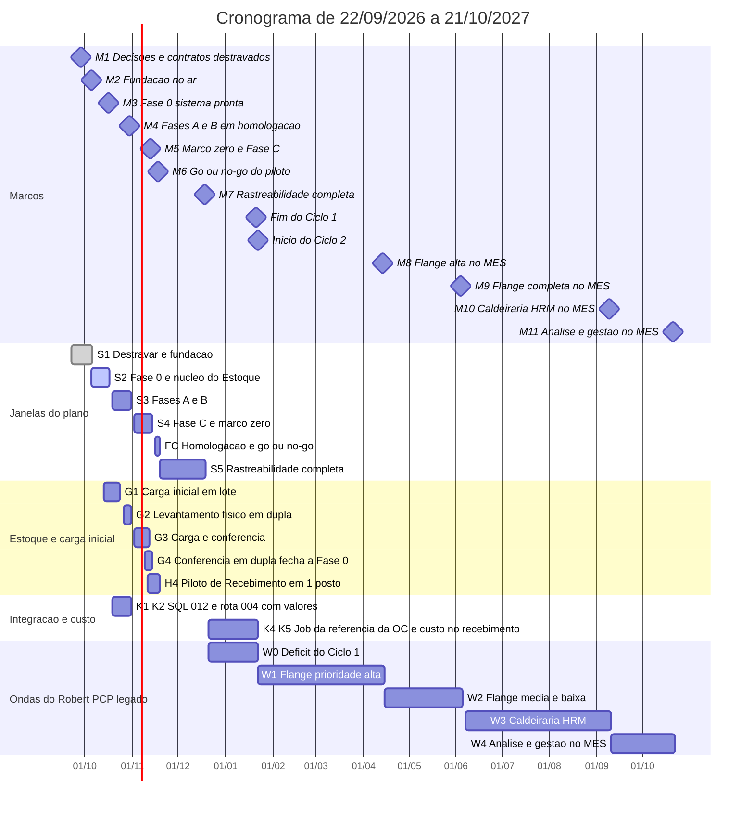

# Cronograma

> As estimativas em pd são do Nathan com apoio do Claude, por complexidade (±30%); o Robert as valida item a item antes de a data valer como compromisso 🟡. As datas de marcos M3 a M7 aguardam o aval do Nathan (#36 do Registro do v1) 🟡.

## Regras de datas (únicas)

- A execução do plano vai de **22/09/2026 a 18/12/2026**. S1 a FC terminam em **18/11/2026**; S5 e M7 terminam em **18/12/2026** 📝.
- **Marco zero do saldo: 13/11/2026** (M5): carga inicial conferida em dupla; nenhum consumo por PCP ou Comercial antes disso 📝.
- **Ciclo 1 fecha em 21/01/2027** (o Robert zera o déficit da Onda 0 nessa data). **Ciclo 2 começa em 22/01/2027** 📝 (item 27 do Registro do v1, aceito pelo Nathan em 09/10).
- Feriados considerados: 12/10 e 02/11 de 2026; 25/12, 01/01, Carnaval (08 e 09/02), 26/03, 21/04, 27/05, 07/09, 12/10, 02/11 e 15/11 de 2027.
- O plano de 2 meses (e a duração de 60 dias) não vale mais; esta nota é a única fonte de datas.

## Marcos

| Marco | Data | O que precisa estar pronto | Situação em 14/10 |
|---|---|---|---|
| **M1** Decisões e contratos destravados | 28/09 | DEC-1 a DEC-12 decididas; contratos 001, 002, 004 e 005 fechados | ✅ cumprido |
| **M2** Fundação no ar | 05/10 | Homologação do MES no ar; `PUT` do contrato 34 funcionando; login duplo | ✅ cumprido |
| **M3** Fase 0 (sistema) pronta | 16/10 | Cadastros, RBAC por setor, Triagem e caixa de requisições prontos | 🟡 em curso: `develop` do MES e do av-hub entregaram Compras · CCP e esperados em 14/10 (PRs #55 a #57 do `api-pcp`, #42 e #43 do `app-pcp`) |
| **M4** Fases A + B em homologação | 30/10 | Requisição, OC, referência no MES, recebimento com pesagem, quarentena, inspeção e RNC; levantamento físico (26 a 30/10) | 🟡 recebimento e inspeção no código; referência da OC no MES 🔴 (job do contrato 004 não existe) |
| **M5** Fase 0 fechada + Fase C | 13/11 | Marco zero carregado e conferido em dupla; saldo, movimento e reserva em homologação; status por item no HUB | 🟡 saldo e reserva no código ✅; carga em lote (G1) 🔴 Robert até 23/10 |
| **M6** Go/no-go do piloto de recebimento | 18/11 | Piloto de 11/11 a 18/11 em 1 posto, em paralelo ao processo manual | 🟡 |
| **M7** Rastreabilidade completa | 18/12 | Log de eventos e Torre de Fluxo (mapa, trilha, tempo por etapa) em homologação | 🔴 o MES não publica `/fluxo/eventos` (LOG-46) |
| **Fim do Ciclo 1** | 21/01/2027 | Déficit do Robert (Onda 0) zerado | 🟡 |
| **M8** Flange alta no MES | 14/04/2027 | Itens 1, 2, 4, 5, 6, 7 e 11 do levantamento do PCP legado | 🟡 |
| **M9** Flange completa no MES | 04/06/2027 | Itens 3, 8, 9, 10, 12, 13 e 14; só depois dele se desliga a linha Flange do PCP legado | 🟡 |
| **M10** Caldeiraria HRM no MES | 09/09/2027 | Itens 15 a 22, a Caldeiraria como mais uma fábrica `FABRICACAO` | 🟡 depende de decisões abertas (itens 18 a 20) |
| **M11** Análise e gestão no MES | 21/10/2027 | Itens 23 a 27; os itens 28 e 29 ficam no av-hub, sem dono nem data | 🟡 |

## Janelas

| Janela | Período | Foco |
|---|---|---|
| S1 | 22/09 a 05/10 | Destravar decisões, contratos, homologação |
| S2 | 05/10 a 16/10 | Fase 0 (sistema), núcleo do Estoque, cadastros |
| S3 | 19/10 a 30/10 | Fases A e B (compra até a doca), contagem física |
| S4 | 02/11 a 13/11 | Fase C (saldo, reserva), marco zero, integração |
| FC | 16/11 a 18/11 | Homologação e go/no-go |
| S5 | 19/11 a 18/12 | Rastreabilidade completa e genealogia |
| Ondas W0 a W4 | 21/12/2026 a 21/10/2027 | PCP legado no MES (Robert) |

## Trilhas do Robert depois de 18/12 (W0 a W4)

Equipe igual à atual: só o Robert no MES, 75% de foco (0,75 pd por dia útil). Entra primeiro o déficit.

| Onda | Entra | pd | Acumulado | Fim |
|---|---|---|---|---|
| W0 | Déficit do Ciclo 1 (inclui custo do lote K3 a K6) | 16,1 | 16,1 | 21/01/2027 |
| W1 | Flange, prioridade alta (itens 1, 2, 4, 5, 6, 7, 11) | 42 | 58,1 | 14/04/2027 (M8) |
| W2 | Flange, média e baixa (itens 3, 8, 9, 10, 12, 13, 14) | 26 | 84,1 | 04/06/2027 (M9) |
| W3 | Caldeiraria HRM (itens 15 a 22) | 51 | 135,1 | 09/09/2027 (M10) |
| W4 | Análise e gestão (itens 23 a 27) | 22 | 157,1 | 21/10/2027 (M11) |
| av-hub | Itens 28 e 29 (12 pd) | 12 | fora da conta | sem dono, sem data 🔴 |

Com 100% de foco as ondas terminam em 14/01 (W0), 17/03, 26/04, 07/07 e 06/08/2027. O trabalho que não entra na conta: Ciclo 2 (sobras e perdas de matéria-prima, remessa de produtos, Fase D, transferência etapas 2 a 4, `GET /itens/custo`), baixa no despacho do Estoque (documento de retirada) e fabricado virando lote, ainda sem pd dimensionado 🔴. Levantamento completo em [[Backlog-por-Frente]].

## Capacidade

| Pessoa | Foco | Capacidade S1–FC | Observação |
|---|---|---|---|
| Nathan | 40% | 16,8 pd | S5: 11 pd contra 9,2 pd; propõe-se levar a tela de ranking de gargalos (T.6) ao Ciclo 2 🟡 |
| Gustavo | 60% | 25,2 pd | folga de 11,9 pd na S1–FC e 9,8 pd na S5; pode receber parte do backend do MES 🟡 |
| Robert | 75% | 31,5 pd | S1–FC + S5: capacidade 48,75 pd contra 64,85 planejados, **déficit de 16,1 pd** 🔴 |
| Pablo | 75% | fora da conta | Comercial & Suprimentos |

Custo do lote (09/10) somou ao Robert K3 1,0 + K4 3,0 + K5 1,5 + K6 0,5 pd; ao Gustavo K1, K2 e K7 (1,5 pd); K8 (`GET /itens/custo`) e K9 a K11 vão ao Ciclo 2 🟡. Detalhe em [[Modelo-Estoque-e-Custo-do-Lote]] e [[API-008-Custo-do-Lote-no-MES]]. Equipe em [[Equipe-e-Divisao]].

## Comercial & Suprimentos (Pablo, fora do plano original)

| ID | Entrega | Estado |
|---|---|---|
| CS1 | `api-comercial` e Propostas (CRUD, fechar, perder, reabrir, versões, PDF) | ✅ na `develop` |
| CS2 | Suprimentos: catálogo, fornecedores, ofertas, mapa de cotação, solicitações de custo | ✅ na `develop` |
| CS3 | Painel do Comprador, histórico de compras, produtos pendentes | ✅ na `develop` |
| CS4 | E2E Playwright e CI | ✅ na `develop` |
| CS5 | Publicar o `api-comercial`, cadastrar telas em `auth.telas`, claim `perfis` no token | 🔴 Pablo, sem data. Ver [[Comercial-Suprimentos]] |

## Gantt

Barras concluídas marcam o que está no código, não o que está em produção. As datas finais são inclusivas.

## Entregas já no código (14/10)

| Frente | Entrega | Evidência |
|---|---|---|
| MES | Compras · CCP só leitura, esperados no Recebimento, chegada só com NF, marcos por etapa | `api-pcp` PRs #55, #56, #57 (`d7e5cf2`, `f5ce799`, `e104236`); `app-pcp` PRs #42, #43 |
| MES | Envio da requisição (contrato 34) e leitura dos eventos (contrato 35) | `integracao-avhub/envio-avhub.service.ts`, `eventos-avhub.service.ts` |
| av-hub | `itens_pedido_custo` por produto (047b), feed da Torre (046b), autor e comprador nos eventos (035b) | `api-acos-vital` `f322dcd`, `7c3f57a`, `2aee636` |
| HUB | Acompanhamento de clientes v2 | `b55ac55` (PR #194) |
| Pipeline | Envio da OC fixo, sem flags `SYNC_ENVIO_OC` e `ENVIO_OC_DRY_RUN` | `omie-elt-pipeline` `0f739f0` (PR #3) |

## Ordem de corte (para manter a data fixa) 🟡

Se algo estourar, o escopo cede, a data não. Cortar nesta ordem: (1) stretch B9 e B10 (histórico de OC, frete e parcelas); (2) C8, fila "Novo norte" do PCP; (3) status por item só para Fabricação e Recebimento; (4) D11 em Code128 em vez de leitor 2D; (5) reserva de estoque na Fase C. **Nunca cortar:** quarentena, inspeção e RNC; dupla conferência da carga; RBAC por setor. A ordem de corte alivia no máximo ~4,0 pd do Robert; os 12 pd restantes do déficit pedem decisão do Nathan (estender a janela, levar a J5 ao Ciclo 2 ou devolver parte do backend ao Gustavo) 🔴 Nathan. Riscos e gatilhos em [[Riscos]].

## Pendências

- 🔴 Robert valida as estimativas de pd das ondas W0 a W4 e de K3 a K6.
- 🔴 Nathan decide como cobrir os 16,1 pd de déficit e confirma M3 a M7.
- 🔴 Robert informa a data do merge `develop` → `main` do MES antes do piloto (a `main` do `api-pcp` está em 08/10, 11 commits atrás da `develop`).
- ❓ Dono do pipeline e dos itens 28 e 29 do levantamento do PCP legado. Ver [[Pontas-Soltas]].
