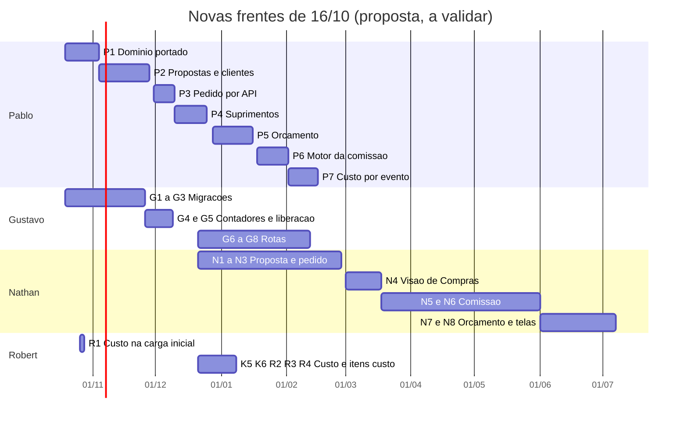
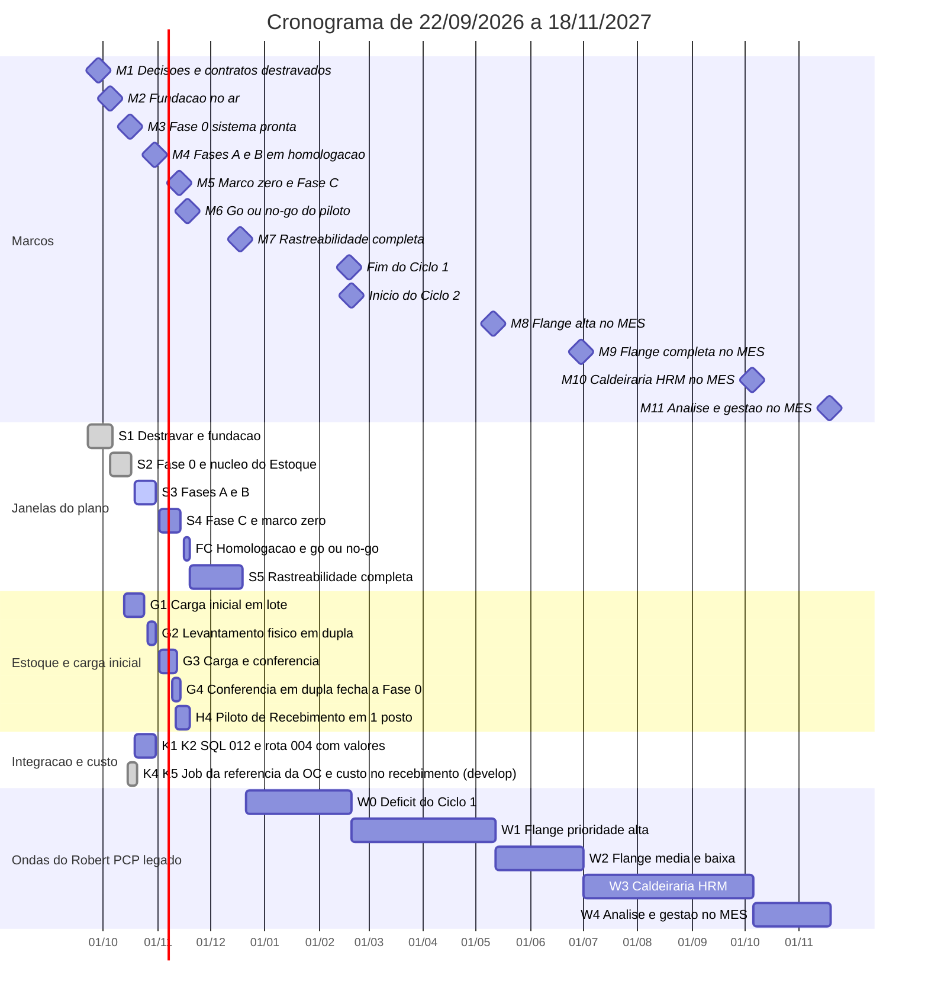

# Cronograma

**Em uma frase:** o plano entrega primeiro o recebimento e o estoque (até 18/11/2026), depois a rastreabilidade (18/12/2026) e fecha o Ciclo 1 em 18/02/2027; o PCP antigo migra para o MES até 18/11/2027.

**Quando consultar esta nota:** quando você precisar saber o que está previsto para cada data, quem tem carga demais e o que pode ser cortado.

> As estimativas em pd (pessoa-dia) são do Nathan, com apoio do Claude, por complexidade (±30%). O Robert as valida item a item antes de a data valer como compromisso 🟡. As datas dos marcos M3 a M7 estão confirmadas pelo Nathan (14/10/2026) 📝. Há um **protótipo para entregar por volta de 15/11/2026**, logo depois do M5 (13/11) 📝.

## O que entrega quando

| Quando | O que fica pronto | Como está |
|---|---|---|
| Até 05/10/2026 | Decisões e contratos fechados (M1, 28/09) e fundação no ar (M2, 05/10) | ✅ Cumprido |
| 16/10/2026 | Sistema da Fase 0: cadastros, permissões por setor, Triagem e caixa de requisições (M3) | 🟡 Em curso |
| 30/10/2026 | Compra, recebimento com pesagem, quarentena, inspeção e RNC em homologação (M4) | 🟡 O recebimento e a inspeção estão no código; o MES já lê a OC do hub (K4, 15/10) e grava o custo da OC no lote (19/10), ambos só na `develop` ✅; falta usar a OC na Triagem e no Estoque (BL-049, BL-050) 🔴 |
| 13/11/2026 | **Marco zero do saldo**: carga inicial conferida em dupla; saldo, movimento e reserva em homologação (M5) | 🟡 Saldo e reserva no código ✅; existe `POST /estoque/lotes/carga-inicial` (um lote por chamada); a carga em lote (G1) não foi encontrada na `develop` de 29/10 🔴 |
| 15/11/2026 | Protótipo | 📝 |
| 18/11/2026 | Decisão de seguir ou não com o piloto de recebimento (M6) | 🟡 |
| 18/12/2026 | Rastreabilidade completa: Torre de Fluxo e log de eventos (M7) | 🔴 O MES ainda não envia os eventos |
| 18/02/2027 | **Fim do Ciclo 1**: o déficit do Robert zerado. Começa o Ciclo 2 em 19/02/2027 | 🟡 Deslocado de 21/01 pelo N14-30 |
| 11/05/2027 a 18/11/2027 | PCP antigo migrado para o MES, em quatro marcos: Flange alta (M8), Flange completa (M9), Caldeiraria (M10) e Análise e gestão (M11) | 🟡 |

As novas frentes de 16/10 (proposta, Orçamento, custo real e comissão nova) ainda não mexem nesses marcos. Elas estão em "Novas frentes" no Detalhe técnico e só valem depois que cada pessoa validar seus pd 🟡. **Os donos mudaram em 28/10** (o Robert conduz o módulo comercial na API do Hub, N16-117 a N16-119) e os contratos dessa parte foram removidos em 29/10 para o Robert recriar; a distribuição por pessoa abaixo é só o histórico da proposta de 16/10 e precisa ser refeita.

## Gargalos

- **Robert:** o plano pede mais do que ele entrega. O déficit é de **29,6 pd** no Ciclo 1 (era 16,1 pd; 32,6 antes do crédito do K4) 🔴. A cobertura decidida é dobrar o esforço e fazer horas extras, se preciso 📝 (Nathan, 14/10). Desde então o Robert também entregou, na `develop`, o custo da OC no lote (K5, 19/10) e o `GET /itens/custo` (27/10) e assumiu o módulo comercial (28/10); o déficit **não foi recalculado** ❓.
- **Nathan:** na proposta de 16/10 as telas dele terminavam só em 06/07/2027, e ele era o gargalo 🟡. Em 28/10 as telas de proposta passaram ao Robert e as de Orçamento ao Pablo com o Robert, o que tira trabalho do Nathan; a conta não foi refeita ❓. As alternativas A, B e C ficam no Detalhe técnico como histórico.
- **Gustavo:** tem folga (11,9 pd na S1–FC e 9,8 pd na S5) e pode receber parte do backend do MES 🟡.

## Ordem de corte (para manter a data fixa) 🟡

Se algo estourar, o escopo cede e a data não. **Exceção decidida em 15/10/2026 (N14-30):** o escopo do N14-29 (+16,5 pd) não foi cortado. O Nathan aceitou deslocar o fim do Ciclo 1 e as ondas W0 a W4 (a W0 foi de 21/01 para 24/02/2027, a 75% de foco).

Para o que ainda não está decidido, corte nesta ordem:

1. Stretch B9 e B10 (histórico de OC, frete e parcelas).
2. C8, a fila "Novo norte" do PCP.
3. Status por item só para Fabricação e Recebimento.
4. D11 em Code128 em vez de leitor 2D.
5. Reserva de estoque na Fase C.

**Nunca cortar:** quarentena, inspeção e RNC; dupla conferência da carga; permissões por setor.

A ordem de corte alivia no máximo ~4,0 pd do Robert. O déficit restante será coberto com **dobra de esforço e horas extras, se preciso** 📝 (decisão do Nathan, 14/10). A opção de passar parte do backend ao Gustavo continua como reserva. Riscos e gatilhos em [[Riscos]].

## Pendências

- 🔴 O Robert valida as estimativas de pd das ondas W0 a W4 e de K3 a K6.
- 🔴 Pablo, Gustavo, Robert e Nathan validam as estimativas das novas frentes de 16/10 (P1 a P7, G1 a G8, N1 a N8, R1 a R5). O Nathan escolhe a alternativa para o gargalo dele (A, B ou C). Só depois os marcos e a W0 mudam.
- 🔴 OQ-11 e OQ-12 (imposto real e encargo de cada evento de custo) até 04/12/2026, para o custo real não sair sem imposto ([[Perguntas-Proposta-Pedido-Comissao]]).
- 📝 Déficit de 16,1 pd: coberto com esforço dobrado e horas extras (Nathan, 14/10). M3 a M7 confirmados. Protótipo por volta de 15/11.
- 📝 Merge `develop` → `main`: o Nathan diz que pode ser feito a qualquer momento, porque tudo o que está na `develop` foi testado e funciona. Em 14/10 a `develop` estava à frente da `main` em 13 commits no `api-pcp`, 10 no `app-pcp`, 11 no `api-acos-vital` e 284 no HUB. **Em 29/10** (`git fetch`): a `api-acos-vital` já está com a `main` igual à `develop` (PR #305) ✅; o HUB tem 29 commits à frente; o `api-pcp` 53 e o `app-pcp` 51, com a `main` do MES parada em 08/10 🔴 (BL-035). Falta o merge do MES (Robert) e do HUB (Nathan).
- 📝 Dono do pipeline: Nathan.
- 🔴 Itens 28 (valores por mês e por vendedor) e 29 (faturamento mensal) do levantamento do PCP legado: são relatórios que hoje rodam em planilha fora do controle da TI e vão para o av-hub (6 pd cada). Seguem sem dono e sem data.
- 🔴 Itens 18 (rastreabilidade por material: número no padrão óleo e gás e Data Book) e 20 (ciclo do Book com o cliente: preparação, inspeção pelo cliente, postagem no portal, aprovação): o Robert não conhece a regra de negócio. O Nathan descreve os campos 🔴 Nathan. O Robert responde as demais perguntas da Caldeiraria em 15/10. Ver [[Pontas-Soltas]].

Equipe em [[Equipe-e-Divisao]]. Itens do levantamento em [[Backlog-por-Frente]].

## Detalhe técnico

### Regras de datas (únicas)

- A execução do plano vai de **22/09/2026 a 18/12/2026**. S1 a FC terminam em **18/11/2026**; S5 e M7 terminam em **18/12/2026** 📝.
- **Marco zero do saldo: 13/11/2026** (M5): carga inicial conferida em dupla; nenhum consumo por PCP ou Comercial antes disso 📝.
- **Ciclo 1 fecha em 18/02/2027** (o Robert zera o déficit da Onda 0 nessa data; era 21/01, deslocado pelo N14-30 e abatido pelo K4, N14-32). **Ciclo 2 começa em 19/02/2027** 📝 (item 27 do Registro do v1, aceito pelo Nathan em 09/10).
- Feriados considerados: 12/10 e 02/11 de 2026; 25/12, 01/01, Carnaval (08 e 09/02), 26/03, 21/04, 27/05, 07/09, 12/10, 02/11 e 15/11 de 2027.
- O plano de 2 meses (e a duração de 60 dias) não vale mais; esta nota é a única fonte de datas.

### Marcos

| Marco | Data | O que precisa estar pronto | Situação (14/10; M4, M5 e Ciclo 1 conferidos em 29/10) |
|---|---|---|---|
| **M1** Decisões e contratos destravados | 28/09 | DEC-1 a DEC-12 decididas; contratos 001, 002, 004 e 005 fechados | ✅ cumprido |
| **M2** Fundação no ar | 05/10 | Homologação do MES no ar; `PUT` do contrato 34 funcionando; login duplo | ✅ cumprido |
| **M3** Fase 0 (sistema) pronta | 16/10 | Cadastros, RBAC por setor, Triagem e caixa de requisições prontos | 🟡 em curso: `develop` do MES e do av-hub entregaram Compras · CCP e esperados em 14/10 (PRs #55 a #57 do `api-pcp`, #42 e #43 do `app-pcp`) |
| **M4** Fases A + B em homologação | 30/10 | Requisição, OC, referência no MES, recebimento com pesagem, quarentena, inspeção e RNC; levantamento físico (26 a 30/10) | 🟡 recebimento e inspeção no código; referência da OC no MES ✅ (job K4 na `develop` desde 15/10, `114ba89`; fornecedor da OC desde 26/10); recebimento por item da OC e custo da OC no lote na `develop` (BL-051, BL-005) |
| **M5** Fase 0 fechada + Fase C | 13/11 | Marco zero carregado e conferido em dupla; saldo, movimento e reserva em homologação; status por item no HUB | 🟡 saldo e reserva no código ✅; carga em lote (G1) 🔴 Robert (prazo era 23/10; só há a carga de um lote por chamada) |
| **M6** Go/no-go do piloto de recebimento | 18/11 | Piloto de 11/11 a 18/11 em 1 posto, em paralelo ao processo manual | 🟡 |
| **M7** Rastreabilidade completa | 18/12 | Log de eventos e Torre de Fluxo (mapa, trilha, tempo por etapa) em homologação | 🔴 o MES não publica `/fluxo/eventos` (LOG-46) |
| **Fim do Ciclo 1** | 18/02/2027 (era 21/01/2027; 24/02 antes do crédito do K4) | Déficit do Robert (Onda 0, agora 29,6 pd) zerado | 🟡 deslocado pelo N14-30, abatido em 3,0 pd pelo K4 na `develop` (N14-32); K5 e `GET /itens/custo` também já na `develop`, conta não refeita ❓ Em 30/10 o Nathan incluiu BL-007, BL-049 e BL-050 no Ciclo 1 (N16-145): a conta do vault dá 03/03/2027 a 75% de foco, e o Robert valida 🟡 |
| **M8** Flange alta no MES | 11/05/2027 (era 14/04) | Itens 1, 2, 4, 5, 6, 7 e 11 do levantamento do PCP legado | 🟡 |
| **M9** Flange completa no MES | 30/06/2027 (era 04/06) | Itens 3, 8, 9, 10, 12, 13 e 14; só depois dele se desliga a linha Flange do PCP legado | 🟡 |
| **M10** Caldeiraria HRM no MES | 05/10/2027 (era 09/09) | Itens 15 a 22, a Caldeiraria como mais uma fábrica `FABRICACAO` | 🟡 depende de decisões abertas (itens 18 a 20) |
| **M11** Análise e gestão no MES | 18/11/2027 (era 21/10) | Itens 23 a 27; os itens 28 e 29 ficam no av-hub, sem dono nem data | 🟡 |

### Janelas

| Janela | Período | Foco |
|---|---|---|
| S1 | 22/09 a 05/10 | Destravar decisões, contratos, homologação |
| S2 | 05/10 a 16/10 | Fase 0 (sistema), núcleo do Estoque, cadastros |
| S3 | 19/10 a 30/10 | Fases A e B (compra até a doca), contagem física |
| S4 | 02/11 a 13/11 | Fase C (saldo, reserva), marco zero, integração |
| FC | 16/11 a 18/11 | Homologação e go/no-go |
| S5 | 19/11 a 18/12 | Rastreabilidade completa e genealogia |
| Ondas W0 a W4 | 21/12/2026 a 18/11/2027 (era 21/10/2027) | PCP legado no MES (Robert) |

### Trilhas do Robert depois de 18/12 (W0 a W4)

Equipe igual à atual: só o Robert no MES, 75% de foco (0,75 pd por dia útil). Entra primeiro o déficit.

| Onda | Entra | pd | Acumulado | Fim |
|---|---|---|---|---|
| W0 | Déficit do Ciclo 1 (inclui custo do lote K5 e K6 e o escopo do N14-29: 16,1 + 16,5 − 3,0 do K4, já na `develop`, N14-32) | 29,6 | 29,6 | 18/02/2027 |
| W1 | Flange, prioridade alta (itens 1, 2, 4, 5, 6, 7, 11) | 42 | 71,6 | 11/05/2027 (M8) |
| W2 | Flange, média e baixa (itens 3, 8, 9, 10, 12, 13, 14) | 26 | 97,6 | 30/06/2027 (M9) |
| W3 | Caldeiraria HRM (itens 15 a 22) | 51 | 148,6 | 05/10/2027 (M10) |
| W4 | Análise e gestão (itens 23 a 27) | 22 | 170,6 | 18/11/2027 (M11) |
| av-hub | Itens 28 e 29 (12 pd) | 12 | fora da conta | sem dono, sem data 🔴 |

Com 100% de foco as ondas terminam em 02/02 (W0), 06/04, 13/05, 26/07 e 25/08/2027 (conta refeita em 15/10 com os feriados da nota). O trabalho que não entra na conta: Ciclo 2 (sobras e perdas de matéria-prima, remessa de produtos, Fase D, transferência etapas 2 a 4, `GET /itens/custo`), baixa no despacho do Estoque (documento de retirada) e fabricado virando lote, ainda sem pd dimensionado 🔴. Levantamento completo em [[Backlog-por-Frente]].

### Capacidade

| Pessoa | Foco | Capacidade S1–FC | Observação |
|---|---|---|---|
| Nathan | 40% | 16,8 pd | S5: 11 pd contra 9,2 pd. A tela de ranking de gargalos (T.5b, uma das 4 telas da Torre de Fluxo) é a candidata a ir ao Ciclo 2 se faltar capacidade; o Nathan ainda não decidiu 🟡 |
| Gustavo | 60% | 25,2 pd | folga de 11,9 pd na S1–FC e 9,8 pd na S5; pode receber parte do backend do MES 🟡 |
| Robert | 75% | 31,5 pd | S1–FC + S5: capacidade 48,75 pd contra 78,35 planejados (64,85 + 16,5 do N14-29 − 3,0 do K4), **déficit de 29,6 pd** 🔴 (era 16,1 pd; 32,6 antes do crédito do K4) |
| Pablo | 75% | fora da conta | Comercial & Suprimentos |

Custo do lote (09/10) somou ao Robert K3 1,0 + K4 3,0 + K5 1,5 + K6 0,5 pd; ao Gustavo K1, K2 e K7 (1,5 pd); K8 (`GET /itens/custo`) e K9 a K11 iam ao Ciclo 2; com a N16-09 (custo obrigatório e custo real por evento) a proposta de 16/10 os traz de volta como R3 e R5 (seção "Novas frentes de 16/10") 🟡. Detalhe em [[Modelo-Estoque-e-Custo-do-Lote]] e [[API-008-Custo-do-Lote-no-MES]].

### Comercial & Suprimentos (Pablo criou; Robert conduz desde 28/10; fora do plano original)

| ID | Entrega | Estado |
|---|---|---|
| CS1 | `api-comercial` e Propostas (CRUD, fechar, perder, reabrir, versões, PDF) | ✅ feito no legado (hoje só leitura, N16-117); fechar parcial, perder e reabrir saíram do desenho |
| CS2 | Suprimentos: catálogo, fornecedores, ofertas, mapa de cotação, solicitações de custo | ✅ feito no legado; telas de catálogo, fornecedores, painel do comprador e parâmetros de custo seguem em `orcamento/` |
| CS3 | Painel do Comprador, histórico de compras, produtos pendentes | ✅ feito no legado; a tela Histórico de compras saiu (N16-108) |
| CS4 | E2E Playwright e CI | ✅ feito no legado; o Playwright saiu do HUB em 29/10 |
| CS5 | **Migrar o módulo para a `api-acos-vital`** (no lugar de publicar o `api-comercial`; LOG-52 fases 1 a 5; o `api-comercial` virou legado de leitura, N16-117), cadastrar telas em `auth.telas`, claim `perfis` no token | 🟡 **Robert conduz desde 28/10** (Pablo acompanha). Na `api-acos-vital`, `develop` de 29/10: cadastros, `POST /clientes`, `/parceiros` e `/propostas` (criar, listar, resumo, eventos, `PUT`, aprovar, cancelar, copiar, transformar); `/suprimentos` sem rota. Pd e datas dos blocos P1 a P7 estão superados ❓. Ver [[Comercial-Suprimentos]] e [[LOG-52-Migracao-do-Modulo-Comercial-para-a-API-do-Hub]] |

### Novas frentes de 16/10: proposta, Orçamento, custo real e comissão nova (🟡 a validar; histórico)

> **Superado em parte (29/10/2026):** os blocos do Pablo (P1 a P4, P6, P7) e as telas da proposta do Nathan (N1, N2) mudaram de dono em 28/10: o Robert faz as rotas e as telas da proposta (N16-117 a N16-119). Os 15 contratos de proposta, orçamento, custo real e comissão nova foram removidos em 29/10; o Robert os recria. A tabela fica como registro da estimativa de 16/10; os pd por pessoa precisam ser refeitos.

Estimativas da proposta de cronograma de 16/10/2026 (`Proposta-Orcamento-Comissao/07-Cronograma/Proposta-de-Cronograma.md`, pasta de histórico fora do vault), com o mesmo método desta nota (pd por complexidade, ±30%, dias úteis = pd ÷ foco, mesmos feriados, crédito só do que está na `develop`). **Nada aqui vale como compromisso:** cada pessoa confirma os seus pd e o seu foco livre. **Os marcos M1 a M11, o fim do Ciclo 1 e as trilhas W0 a W4 não mudam** até essa validação. Os itens estão no [[Backlog-por-Frente]] (BL-066 a BL-078) e as regras em [[11-Proposta-e-Pedido-de-Venda]], [[12-Orcamento-Base-de-Preco]] e [[13-Custo-Real-e-Comissao-no-Fluxo]].

| Pessoa | Blocos | pd (faixa) | Foco | Início | Fim proposto |
|---|---|---|---|---|---|
| Pablo | P1 domínio portado e testes (8,0) · P2 clientes e propostas com as regras novas (13,0) · P3 pedido por API (6,0) · P4 suprimentos e pedido de custo (8,0) · P5 Orçamento: matriz, consulta do vendedor, valor da OC no histórico (10,0) · P6 motor da comissão na API (8,0) · P7 custo por evento (6,0) | 59,0 (41,3 a 76,7) | 75% | 19/10/2026 | 15/02/2027 |
| Gustavo | G1 migração do `core_comercial` (6,0) · G2 Orçamento no `core_comercial` (4,0) · G3 `core_comissao` (6,0) · G4 contadores, telas e `auth.rotas_telas` (2,5) · G5 liberação do pedido da proposta (2,0) · G6 rotas da proposta, do pedido e do Orçamento (8,0) · G7 rotas da comissão (5,0) · G8 rotas do custo por evento e job do `GET /itens/custo` (7,0) | 40,5 (28,4 a 52,7) | 60% | 19/10/2026 | G1 a G5 em 08/12/2026, dentro da folga (20,5 de 21,7 pd ❓ o Gustavo confirma); G6 a G8 em 11/02/2027 |
| Nathan | N1 tela da proposta (10,0) · N2 aprovar, transformar, cancelar (3,0) · N3 pipeline do pedido (5,0) · N4 visão de Compras (5,0) · N5 Controladoria (10,0) · N6 visão geral, minhas comissões, parâmetros (10,0) · N7 Orçamento: consulta e matriz (9,0) · N8 cadastro de telas (1,0) | 53,0 (37,1 a 68,9) | 40% | 21/12/2026 (depois da S5) | 06/07/2027: **é o gargalo** |
| Robert | R1 custo obrigatório na carga inicial (1,5) · R2 custo obrigatório no Recebimento (1,5) · R3 `GET /itens/custo`, o antigo K8 (3,0) · R4 origem e documento em cada linha de custo (2,0) · R5 custo do fabricado = matéria-prima, os antigos K9 a K11 (4,0) | 12,0 (8,4 a 15,6) | 75% | R1 já; o resto em 21/12/2026 | R1 leva a G1 do MES de 23/10 a 27/10; K5, K6, R2 a R4 em 07/01/2027; o resto entra na W0 (cenários na proposta) |

Desde 16/10 o desenho andou: em 26/10 as migrações já estavam escritas e testadas em Postgres 18, e o Gustavo passa a revisar e aplicar, não a criar do zero (G1 a G3 devem encolher). O pedido do Omie no mesmo fluxo (N16-106), as datas, os sequenciais e o calendário do marketing entraram depois da estimativa e não têm pd ❓. R5 depende de BL-008 e BL-010, sem pd ❓. O imposto real por evento (BL-053, OQ-11 e OQ-12) não está em nenhum bloco.

Alternativas para o gargalo do Nathan 🟡 (decisão do Nathan):

| Alternativa | Efeito |
|---|---|
| (A) O Pablo faz as telas de Orçamento (N7, 9 pd) | Nathan termina em 03/06/2027; o Pablo vai a 68 pd e termina em 01/03/2027 |
| (B) Foco do Nathan sobe de 40% para 60% a partir de 21/12 | Os 53 pd terminam em 30/04/2027 (faixa 22/03 a 08/06/2027) |
| (C) Primeiro corte só com proposta e pedido (N1 a N3, 18 pd) | Fim em 26/02/2027; comissão, Compras e Orçamento vão ao Ciclo 2 |

### Gantt

Barras concluídas marcam o que está no código, não o que está em produção. As datas finais são inclusivas.

### Entregas já no código (14/10 e 15 a 29/10)

| Frente | Entrega | Evidência |
|---|---|---|
| MES | Compras · CCP só leitura, esperados no Recebimento, chegada só com NF, marcos por etapa | `api-pcp` PRs #55, #56, #57 (`d7e5cf2`, `f5ce799`, `e104236`); `app-pcp` PRs #42, #43 |
| MES | Envio da requisição (contrato 34) e leitura dos eventos (contrato 35) | `integracao-avhub/envio-avhub.service.ts`, `eventos-avhub.service.ts` |
| av-hub | `itens_pedido_custo` por produto (047b), feed da Torre (046b), autor e comprador nos eventos (035b) | `api-acos-vital` `f322dcd`, `7c3f57a`, `2aee636` |
| HUB | Acompanhamento de clientes v2 | `b55ac55` (PR #194) |
| Pipeline | Envio da OC fixo, sem flags `SYNC_ENVIO_OC` e `ENVIO_OC_DRY_RUN` | `omie-elt-pipeline` `0f739f0` (PR #3) |
| MES (`develop`, fora da `main`) | K4 projeção da OC do hub (15/10); custo da OC no lote, K5 (19/10); compra em andamento e vínculo da parcial à OC (API-011 R1 e R2, 20/10); referência das requisições do Compras (API-009, 23/10); `GET /itens/custo` e custo do lote à mão (27/10); OP e lote do fabricado (27/10) | `api-pcp` `114ba89`, `97b9adc`, `c269aa7`, `9e75df5`, `6c11147`, `ab3318d` |
| av-hub (API) | Chaves de serviço presas a rotas (15/10); referência da OC com fornecedor (26/10); setor do cliente (22 e 23/10); módulo `/comercial/*` (28 e 29/10) | `api-acos-vital` `b02d6c5`, `a7fda49`, `fd69145`, `43dbec3`, `260e835`, `f2fa237` |
| HUB | Telas da Torre de Fluxo sobre dados de teste (15/10); menu enxuto de Vendas, Orçamento e Compras (27/10); BFF do comercial só na API do Hub (27/10); propostas sem fechamento parcial (28/10) | `av-hub` `3cd55de`, `a1493a8`, `3bccfce`, `2008344` |
