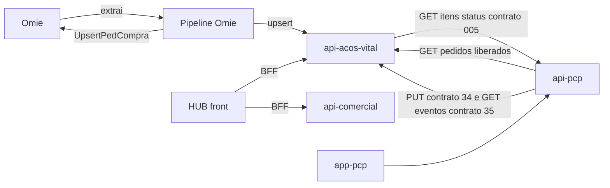

# Sistemas e responsabilidades

## Repositórios, branches e commits de 14/10/2026

Branch de trabalho: `develop` (no pipeline, `master`). Os três repositórios com `develop` foram atualizados com `git fetch` e `git pull --ff-only` em 14/10/2026 ✅; o HUB e o pipeline já estavam em dia.

| Sistema | Repositório (GitHub `Acosvital/…`) | Pasta local | `develop` em 14/10 | `main` | Dono |
|---|---|---|---|---|---|
| MES back (`api-pcp`) | `api-pcp` | `Gerenciamento de Integrações\api-pcp` | `de68086` (PR #58, débitos técnicos) | `8e2bf56` (08/10), `develop` 13 commits à frente | Robert |
| MES front (`app-pcp`) | `app-pcp` | `Gerenciamento de Integrações\app-pcp` | `df4a258` (PR #45, débitos técnicos) | `3b0f463` (08/10), `develop` 10 à frente | Robert |
| API do av-hub (`api-acos-vital`) | `api-acos-vital` | `Gerenciamento de Integrações\api-acos-vital` | `276dab8` (acompanhamento de clientes) | `49596ca` (09/10), `develop` 11 à frente | Gustavo (DBA) |
| HUB (front do av-hub) | `av-hub` | `TI\NATHAN\00 - HUB` | `b55ac55` (PR #194, acompanhamento de clientes) | `cfed113` (06/10), `develop` 284 commits à frente | Nathan |
| `api-comercial` | `av-hub` (pasta `api-comercial/` dentro do HUB) | `00 - HUB\api-comercial` | junto com o HUB | **não existe em `main`** | Pablo. É uma API de teste; o Pablo migra tudo para a `api-acos-vital` 📝 |
| Pipeline Omie | `omie-elt-pipeline` | `Gerenciamento de Integrações\omie-elt-pipeline` | `master` `0f739f0` (PR #3, envio da OC fixo, 08/10) | — | Nathan 📝 |

Evidência: `git log -1`, `git branch --show-current` e `git rev-list --count origin/main..origin/develop` em cada repositório, 14/10/2026 ✅.

Divergência com o v1: o v1 dizia que a `main` do MES "parou em 28/08". Hoje a `main` do `api-pcp` e do `app-pcp` está em 08/10 ✅. O Nathan afirma que tudo o que está na `develop` foi testado e funciona, e que o merge para a `main` pode ser feito a qualquer momento 📝. Falta só executá-lo 🔴 (Robert no MES, Gustavo na API, Nathan no HUB). O banco de produção do MES, pelo dump de 07/10, não tem as migrations da `develop` ❓ ([[Banco-MES]]).

### Autores nos commits recentes (desde 15/09)

| Repositório | Autores (commits) | Leitura |
|---|---|---|
| `api-pcp` | Robert Wilson 28, arquitetoVital 17 (merges de PR), Pablo Cruz 9 | MES é do Robert; os 9 do Pablo são anteriores à reatribuição de 07/10 |
| `app-pcp` | Robert Wilson 37, arquitetoVital 20, Pablo Cruz 17 | idem |
| `api-acos-vital` | HauntedCrusader 87, Gustavo M. de Farias 15, arquitetoVital 5 | `HauntedCrusader` é o Gustavo 📝 |
| HUB | Pablo Cruz 258, oluccaa 137, Nathan Lucca 80, arquitetoVital 16, Robert Wilson 16 | Pablo concentra o Comercial & Suprimentos; `oluccaa` e `Nathan Lucca` são o Nathan 📝 |
| `omie-elt-pipeline` | oluccaa 15, Nathan Lucca 3, Claude 1 | O dono do pipeline é o Nathan 📝 (a atribuição "Gustavo" do v1 estava errada) |

## Quem faz o quê

| Pessoa | Frente | Repositórios | Detalhe |
|---|---|---|---|
| **Gustavo M. de Farias** (DBA) | Banco e API do av-hub | `api-acos-vital`, migrations, `auth.*`, `core_*` | Aplicar migrations no banco (a API não tem `.sql`); L3 de `auth.rotas_telas`; chave própria do MES (L6); permissões `torre-fluxo` e `custo-itens`; 047b; versionar SQL do contrato 34; exposição de rede da `api-pcp` |
| **Nathan** | Front do av-hub (telas e BFF) e coordenação | HUB | Telas de Compras, Torre de Fluxo, custo por item, indicador de origem da requisição; perfil CCP; decisões e contratos; este vault |
| **Robert Wilson** | MES inteiro | `api-pcp`, `app-pcp` | Documento de retirada e baixa na retirada, fabricado vira lote, `GET /itens/custo`, `/fluxo/eventos`, job do contrato 004, G1 (carga em lote), D11, I1/J2/J5 |
| **Pablo Cruz** | Comercial & Suprimentos | `api-comercial` e as telas `comercial/*` e `suprimentos/*` do HUB | Publicar o `api-comercial`, cadastrar telas em `auth.telas`, claim `perfis` no token, carga de `PerfilComercial` |

Atribuições decididas em 07/10/2026 (itens 32 e 33 do Registro do v1, reafirmadas em 14/10): MES com o Robert, Comercial & Suprimentos com o Pablo 📝. Nota completa em [[Equipe-e-Divisao]]; backlog por dono em [[Backlog-por-Frente]].

## Stack e ambientes

| Sistema | Stack | Container |
|---|---|---|
| HUB | Next.js (BFF com dois backends: `API_URL` e `COMERCIAL_API_URL`) | `Dockerfile` Node 20 alpine, porta 3000 |
| `api-acos-vital` | Express 4 + Sequelize, `src/schemas/**` | `Dockerfile` Node 20 alpine, porta 3000 |
| `api-comercial` | Express 5 + Prisma, schema `core_comercial` | `Dockerfile` Node 22 slim, porta 3001; API de teste, não será publicada: o Pablo a migra para a `api-acos-vital` 📝 |
| `api-pcp` | NestJS + Prisma | `Dockerfile` Node 22 slim, porta 3000 |
| `app-pcp` | Next.js | `Dockerfile` Node 22 slim, porta 3000 |
| Pipeline | Node (BullMQ, node-cron, Playwright) + Redis | `docker-compose.yml`, 6 processos no PM2 (`ecosystem.config.cjs`) |

Evidência: Dockerfiles em cada repositório e `ecosystem.config.cjs` do pipeline ✅.

| Ambiente | Estado |
|---|---|
| Produção do av-hub (HUB e API) | no ar; contêineres saudáveis 📝 (Nathan, 14/10). A versão em produção é a `main` ❓ |
| `api-test` (API do av-hub de teste) | ambiente em que os contratos foram validados (`develop`) 📝 |
| `mes-test.acosvital.com.br` | homologação do MES com a `develop`; o `PUT` do contrato 34 funcionou no teste 📝 (v1 Registro #1 e #2) |
| Produção do MES | banco vazio em 07/10 (dump), sem as migrations da `develop` ❓ |
| `api-pcp` | no ar 📝 (Nathan, 14/10) |
| `api-comercial` | API de teste do Pablo, só `develop`; será migrada para a `api-acos-vital`, não terá ambiente próprio 📝 |

Topologia de servidores em [[Infraestrutura]]; chaves e autenticação entre os sistemas em [[Chaves-e-Autenticacao]]; contratos entre eles em [[Integracao-AvHub-MES]] e [[Painel-de-Contratos]].

## Fronteira entre os sistemas

Versão completa por contrato em [[Componentes-e-Implantacao|Diagrama-Componentes-e-Implantacao]].
