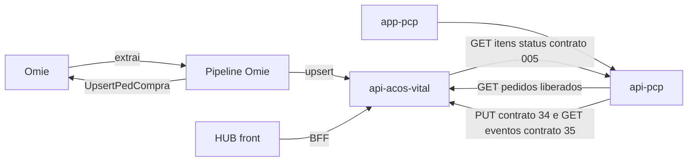

# Sistemas e responsabilidades

**Em uma frase:** o projeto tem cinco peças de software em uso (HUB, API do Hub, MES com dois repositórios e pipeline do Omie), mais a `api-comercial`, que ficou só como legado de leitura, e cada uma tem um dono.

**Quando consultar esta nota:** quando você quiser saber qual sistema faz o quê, de quem ele é e em que estado está.

## Quem cuida de quê

| Sistema | O que é | Dono |
|---|---|---|
| HUB (`av-hub`) | As telas do portal comercial e de compras | Nathan |
| `api-acos-vital` | A API do Hub, que fala com o banco do av-hub. Desde 28/10 o módulo comercial (`/comercial/*`) nasce aqui, conduzido pelo Robert | Gustavo (DBA); módulo comercial: Robert |
| `api-comercial` | API de teste do Pablo, mantida no repositório do HUB **só para leitura** (legado). Não roda, não está em produção e o front não a chama 📝 N16-117 | Ninguém altera; o Robert lê para portar |
| MES: `api-pcp` (back) e `app-pcp` (front) | Chão de fábrica, Estoque, Recebimento e Qualidade | Robert |
| `omie-elt-pipeline` | Copia o Omie para o banco do av-hub e envia a OC ao Omie | Nathan 📝 |

## Quem faz o quê

| Pessoa | Frente | Onde trabalha | Entregas principais |
|---|---|---|---|
| **Gustavo M. de Farias** (DBA) | Banco e API do av-hub | `api-acos-vital`, migrations, `auth.*`, `core_*` | Aplicar migrations no banco; L3 de `auth.rotas_telas`; cadastrar as listas de rotas das chaves do MES e da pipeline (L6; o recurso já está no código); permissões `torre-fluxo` e `custo-itens`; versionar o SQL do contrato 34; exposição de rede da `api-pcp` |
| **Nathan** | Telas do av-hub (front e BFF) e coordenação | HUB | Telas de Compras, Torre de Fluxo, custo por item, indicador de origem da requisição; perfil CCP; decisões e contratos; este vault. As telas de proposta são do Robert e as de Orçamento, do Pablo com o Robert |
| **Robert Wilson** | MES inteiro e, desde 28/10, o módulo comercial na API do Hub | `api-pcp`, `app-pcp`, rotas `/comercial/*` da `api-acos-vital` e telas de proposta do HUB | Documento de retirada e baixa na retirada, fabricado virar lote (feito na `develop`), `/fluxo/eventos`, G1 (carga em lote), D11, I1/J2/J5; rotas e telas da proposta. Já feitos na `develop`: `GET /itens/custo` (27/10) e o job da OC do contrato 004 (K4, 15/10) |
| **Pablo Cruz** | Acompanha o módulo comercial e cuida do Orçamento (com supervisão do Robert) | Telas de `orcamento/*` do HUB; `api-comercial` só como legado | Regras do legado a portar ([[Mapa-do-Modulo-do-Pablo]]); telas e perfis do Orçamento |

As atribuições foram decididas em 07/10/2026 (itens 32 e 33 do Registro do v1) e reafirmadas em 14/10: MES com o Robert, Comercial & Suprimentos com o Pablo 📝. Em 28/10 o Robert passou a conduzir o módulo comercial, com o Pablo acompanhando (N16-117) 📝. Nota completa em [[Equipe-e-Divisao]]. Backlog por dono em [[Backlog-por-Frente]].

## Como os sistemas se ligam

Versão completa por contrato em [[Componentes-e-Implantacao|Diagrama-Componentes-e-Implantacao]]. Chaves e autenticação entre os sistemas em [[Chaves-e-Autenticacao]]. Contratos em [[Integracao-AvHub-MES]] e [[Painel-de-Contratos]].

## Em que ambiente cada um está

| Ambiente | Estado |
|---|---|
| Produção do av-hub (HUB e API) | No ar, com contêineres saudáveis 📝 (Nathan, 14/10). A versão em produção é a `main` ❓ |
| `api-test` (API do av-hub de teste) | Ambiente em que os contratos foram validados (`develop`) 📝 |
| `mes-test.acosvital.com.br` | Homologação do MES com a `develop`. O `PUT` do contrato 34 funcionou no teste 📝 (v1 Registro #1 e #2) |
| Produção do MES | Banco vazio em 07/10 (dump) e sem as migrations da `develop` ❓ |
| `api-pcp` | No ar 📝 (Nathan, 14/10) |
| `api-comercial` | Legado de leitura no repositório do HUB. Não tem ambiente, não roda e não será publicada 📝 N16-117 |

Topologia dos servidores em [[Infraestrutura]].

## Pendência: levar a `develop` para a `main`

O Nathan afirma que tudo o que está na `develop` foi testado e funciona, e que o merge para a `main` pode ser feito a qualquer momento 📝. Situação em 29/10/2026: a `api-acos-vital` já tem a `main` igual à `develop` (PR #305, 29/10) ✅; o HUB tem a `develop` 29 commits à frente da `main`; o MES segue com a `main` parada em 08/10 e a `develop` 53 (`api-pcp`) e 51 (`app-pcp`) commits à frente 🔴 (Robert, BL-035). O banco de produção do MES, pelo dump de 07/10, não tem as migrations da `develop` ❓ ([[Banco-MES]]).

## Detalhe técnico

### Repositórios, branches e commits de 14/10/2026 e de 29/10/2026

O branch de trabalho é `develop` (no pipeline, `master`). Os repositórios foram atualizados com `git fetch` e `git pull --ff-only` em 14/10/2026 ✅ e conferidos de novo em 29/10/2026. A coluna da `develop` e a da `main` abaixo mostram as duas datas.

| Sistema | Repositório (GitHub `Acosvital/…`) | Pasta local | `develop` em 14/10 | `main` | Dono |
|---|---|---|---|---|---|
| MES back (`api-pcp`) | `api-pcp` | `Gerenciamento de Integrações\api-pcp` | 14/10: `de68086` (PR #58). **29/10: `befd973`** (PR #78, OP e lote do fabricado, 27/10) | 14/10: `8e2bf56` (08/10), `develop` 13 à frente. **29/10: igual, `develop` 53 à frente** | Robert |
| MES front (`app-pcp`) | `app-pcp` | `Gerenciamento de Integrações\app-pcp` | 14/10: `df4a258` (PR #45). **29/10: `93f96de`** (PR #63, 27/10) | 14/10: `3b0f463` (08/10), `develop` 10 à frente. **29/10: igual, `develop` 51 à frente** | Robert |
| API do av-hub (`api-acos-vital`) | `api-acos-vital` | `Gerenciamento de Integrações\api-acos-vital` | 14/10: `276dab8`. **29/10: `f2fa237`** (rotas de parceiros; o clone local tem mais 1 commit, `0384e89`, ainda não enviado) | 14/10: `49596ca` (09/10), `develop` 11 à frente. **29/10: `4151467` (PR #305), `develop` 0 à frente** | Gustavo (DBA); módulo comercial: Robert |
| HUB (front do av-hub) | `av-hub` | `TI\NATHAN\00 - HUB` (14/10); `Gerenciamento de Integrações\av-hub` (29/10) | 14/10: `b55ac55` (PR #194). **29/10: `758d5f0`** (PR #251, abas da proposta) | 14/10: `cfed113` (06/10), `develop` 284 à frente. **29/10: `b977529` (23/10), `develop` 29 à frente** | Nathan |
| `api-comercial` | `av-hub` (pasta `api-comercial/` dentro do HUB) | `av-hub\api-comercial` | junto com o HUB; legado de leitura desde `a90d306` (28/10) | **não existe em `main`** | Ninguém altera (N16-117); o Robert lê para portar |
| Pipeline Omie | `omie-elt-pipeline` | `Gerenciamento de Integrações\omie-elt-pipeline` | `master` `0f739f0` (PR #3, envio da OC fixo, 08/10) | — | Nathan 📝 |

Evidência: `git log -1`, `git branch --show-current` e `git rev-list --count origin/main..origin/develop` em cada repositório, 14/10/2026 ✅.

Divergência com o v1: o v1 dizia que a `main` do MES "parou em 28/08". Hoje a `main` do `api-pcp` e do `app-pcp` está em 08/10 ✅.

### Autores nos commits recentes (desde 15/09)

| Repositório | Autores (commits) | Leitura |
|---|---|---|
| `api-pcp` | Robert Wilson 28, arquitetoVital 17 (merges de PR), Pablo Cruz 9 | MES é do Robert; os 9 do Pablo são anteriores à reatribuição de 07/10 |
| `app-pcp` | Robert Wilson 37, arquitetoVital 20, Pablo Cruz 17 | idem |
| `api-acos-vital` | HauntedCrusader 87, Gustavo M. de Farias 15, arquitetoVital 5 | `HauntedCrusader` é o Gustavo 📝 |
| HUB | Pablo Cruz 258, oluccaa 137, Nathan Lucca 80, arquitetoVital 16, Robert Wilson 16 | Pablo concentra o Comercial & Suprimentos; `oluccaa` e `Nathan Lucca` são o Nathan 📝 |
| `omie-elt-pipeline` | oluccaa 15, Nathan Lucca 3, Claude 1 | O dono do pipeline é o Nathan 📝 (a atribuição "Gustavo" do v1 estava errada) |

### Stack e contêineres

| Sistema | Stack | Container |
|---|---|---|
| HUB | Next.js (BFF só com a API do Hub, `API_URL`; o `COMERCIAL_API_URL` saiu do código, `3bccfce`) | `Dockerfile` Node 20 alpine, porta 3000 |
| `api-acos-vital` | Express 4 + Sequelize, `src/schemas/**` | `Dockerfile` Node 20 alpine, porta 3000 |
| `api-comercial` | Express 5 + Prisma, schema `core_comercial` | `Dockerfile` Node 22 slim, porta 3001; legado de leitura: não roda e não será publicada 📝 N16-117 |
| `api-pcp` | NestJS + Prisma | `Dockerfile` Node 22 slim, porta 3000 |
| `app-pcp` | Next.js | `Dockerfile` Node 22 slim, porta 3000 |
| Pipeline | Node (BullMQ, node-cron, Playwright) + Redis | `docker-compose.yml`, 6 processos no PM2 (`ecosystem.config.cjs`) |

Evidência: Dockerfiles em cada repositório e `ecosystem.config.cjs` do pipeline ✅.
