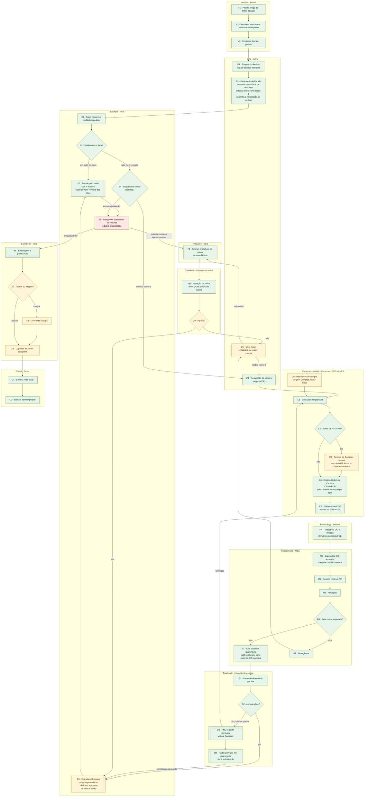

# Fluxo mestre de Atividades (0b)

O diagrama que acompanha um **pedido de venda de 0 a 100%**, do Omie à nota fiscal. Cada nó tem um ID (`V1`, `P2`, `E6`…). Todas as notas de raia desta pasta e todos os diagramas do vault usam esses IDs. O mesmo fluxo está no artifact "0b — Atividades".

Selos: ✅ no código · 📝 decidido · 🟡 proposta · 🔴 aberto ou sem código · ❓ não conferido em produção. Veja [[Regras-do-Vault]].

## O que mudou em relação ao 0b de 09/10

| Nó | Antes | Agora |
|---|---|---|
| C3 | "Aprovação da diretoria" | **Gerente de Compras aprova sempre; acima de R$ 30 mil a Diretoria aprova também** 📝 |
| P3 | Uma origem (PCP) | **Duas origens:** PCP no MES (material do pedido) e Compras no av-hub (necessidade própria) 📝 |
| E4 | "solicitar compra, sempre na Revenda" | "solicitar compra" (matéria-prima também é comprada) ✅ |
| R1 | "Confere a NF contra a OC ou o pedido de venda" | **Chegada com NF na doca, conferência contra a NF** (chave de 44 dígitos) ✅ |
| E6 | "Despacho do Estoque: baixa do saldo" | **Documento de retirada; a baixa é na retirada, no Estoque** 📝 (código ainda baixa na Embalagem 🔴) |
| Q8 / F1 | Fabricado aprovado vai direto à Expedição | **Tudo que é fabricado ou comprado vira lote e saldo no Estoque** 📝 (fabricado ainda não vira lote 🔴) |
| C5 | CCP follow-up | **Compras · CCP no MES é só leitura**, espelha os marcos do contrato 35; a OC aprovada entra nos **esperados do Recebimento** ✅ |

## Diagrama

> O verde é o que está no código, o amarelo é parcial e o vermelho é sem código. A coluna "Código" da tabela a seguir é a fonte; a cor é um resumo. Q4 e Q3 estão no código, mas a substituição aprovada depende do circuito de compra completo (🟡).

## Tabela nó → raia, tela, endpoint, contrato, código

| Nó | Raia | O que acontece | Tela (nome atual · antigo · rota) | Endpoint / contrato | Código |
|---|---|---|---|---|---|
| V1 | Vendas | Pedido criado no Omie chega ao av-hub, travado | — | pipeline `ListarPedidos` → `pedidos_vendas` | ✅ |
| V2 | Vendas | Vendedor marca "Qualidade acompanha desde o início?" | Liberar Pedidos · `/liberar-pedidos` (HUB) | `PUT /pedidos_liberacao/:empresa/:numero` · LOG-26 | ✅ |
| V3 | Vendas | Vendedor libera (marcação e liberação numa ação só) | idem | idem; histórico em `pedidos_vendas_liberacao_historico` | ✅ |
| P1 | PCP | Lista os pedidos liberados | Triagem dos Pedidos · "Carteira" · `/carteira` (app-pcp) | `GET /pedidos/carteira` → `GET /pedidos_liberados` · LOG-26 | ✅ nomes técnicos antigos 🔴 |
| P2 | PCP | Define destino (FABRICACAO ou REVENDA) e quantidade ≤ restante por item e rodada; insere Estoque como etapa 1; confirma importação | Destinação do Pedido · "Nova Ordem de Produção" · `/ordens-producao/novo` | `POST /pedidos/completo/lote`; `POST /pedidos_liberados/:n/importado` · LOG-26 | ✅ |
| P3 | PCP | Requisição de compra do material do pedido (origem PCP) | Requisições de compras · `/compras/requisicoes` | `POST /compras/requisicoes`; envio `PUT /compras/requisicoes/origem/:id_origem` · LOG-34 | ✅ |
| C0 | Compras | Requisição de necessidade própria do Compras (origem av-hub), sem pedido de venda | Nova requisição · `/compras/requisicoes` (HUB) | `POST /compras/requisicoes` (av-hub) | ✅ no av-hub; **não chega ao MES** 🔴 |
| E1 | Estoque | Saldo disponível = lotes LIBERADO − reservas ATIVA na filial do pedido | Atendimento · `/estoque-operacao/atendimento` | `GET /estoque/saldo/disponivel-parcial/:idItemParcial` | ✅ |
| E2 | Estoque | Decide se o saldo cobre (saldo zero exige clique, #31b) | idem | — | ✅ |
| E3 | Estoque | Atende pelo saldo: split + reserva; custo do item = média dos lotes | idem | `PATCH /itens-parciais/:id/atender-estoque` | ✅ custo do item 🔴 (sem `GET /itens/custo`) |
| E4 | Estoque | Para o restante: solicitar compra ou enviar à produção | idem | `PATCH /itens-parciais/:id/atender-estoque` (`destinoRestante`) | ✅ compra; 🔴 enviar à produção sem baixa de matéria-prima |
| C1 | Compras | Cotação e negociação (fora do sistema) | Requisições · Ordens · `/compras/*` (HUB) | marcos `requisicao_recebida`, `em_cotacao` · LOG-35 | ✅ |
| C2/C3 | Compras | Aprovação: Gerente sempre; Diretoria acima de R$ 30 mil | Aprovações · `/compras/aprovacoes` (HUB) | parametros_compras; `oc_enviada_aprovacao`, `oc_aprovada` | 🟡 a trigger `fn_ordens_compra_recalcular` auto-aprova OC até `parametros_compras.limite_aprovacao` (R$ 30 mil); acima disso basta um usuário com `pode_aprovar` (Gerência). **Não há degrau da Diretoria nem "Gerente sempre" 🔴** (`ordens_compra.route.js:1235`, `FecharCompra.tsx:605`) |
| C4 | Compras | Emite a OC (CIF/FOB; valor, desconto, moeda, cotação PTAX por item; flag acabado/não-acabado) | Ordens · `/compras/ordens` (HUB) | `POST /compras/ordens`; envio ao Omie `GET /compras/ordens/fila-omie` (pipeline) · LOG-23, LOG-36 | ✅ |
| C5 | Compras · CCP | Follow-up (confirmação, previsão, despacho, ocorrência) | Follow-up · `/compras/followup` (HUB); Compras · CCP · `/compras/pedidos-compra` (MES, só leitura) | `GET /compras/requisicoes/eventos` · LOG-35, LOG-32 | ✅ perfil CCP 🔴 |
| FN1 | Fornecedor | Recebe a OC; entrega (CIF direto ou coleta FOB) | — (fora do sistema) | — | — |
| R0 | Recebimento | OC aprovada entra nos **esperados**; a doca registra a chegada com a NF | Recebimento · `/logistica/logistica-entrada` | `GET /compras/requisicoes/esperados`; `POST /compras/requisicoes/:id/chegada`; `POST …/liberar-recebimento` (rede de segurança) | ✅ |
| R1 | Recebimento | Confere contra a NF (chave de 44 dígitos) | idem | `POST /compras/recebimentos` | ✅ |
| R2 | Recebimento | Pesagem; peso real obrigatório se há peso teórico; tolerância 5% | idem | idem | ✅ |
| R3 | Recebimento | Bate com o esperado? | idem | `POST /compras/recebimentos/:id/recontar`, `/decidir` | ✅ |
| R4 | Recebimento | Cria o lote PENDENTE (quarentena) com ENTRADA no saldo; split se chegou parte; custo da OC opcional | idem | idem | ✅ lote; **custo da OC não é gravado** 🔴 |
| R6 | Recebimento | Divergência (QUANTIDADE, DESCRICAO, PESO, AVARIA) | Divergências de Recebimento · `/decisoes-pcp` | `POST /compras/recebimentos/:id/decidir` | ✅ reabertura de divergência de produção 🔴 |
| P6 | PCP | Novo norte: retrabalho ou reabre compra | — (decidido, sem tela) | — | 🔴 RoteiroItem C8, EC-03 |
| Q1 | Qualidade | Inspeção de entrada por lote (laudo obrigatório) | Inspeção de entrada · `/qualidade/inspecao-entrada` | `POST /qualidade/lotes/:id/aprovar`, `/reprovar` | ✅ |
| Q2 | Qualidade | Aprova o lote? | idem | idem | ✅ |
| Q3 | Qualidade | RNC; a parte reprovada volta a Compras (devolução e substituição) | idem | RNC; `nota_devolucao_pendente` | ✅ recompra por RNC sem contrato 🔴 |
| Q4 | Qualidade | Parte aprovada fica em QUARENTENA até a substituição (EC-07) | idem | cisão do lote (`idLotePai`) | ✅ |
| E5 | Estoque | **Entrada no Estoque**: lote comprado aprovado ou fabricado aprovado vira lote e saldo | Atendimento · Saldo | compra: `devolverAoEstoqueParciaisProntas` | ✅ comprado; 🔴 fabricado não vira lote (`OrigemLote` só tem RECEBIMENTO e CARGA_INICIAL) |
| F1 | Produção | Setores produtivos do roteiro de cada fábrica | Filas de Produção · `/movimentacoes` | `/itens-parciais/:id/*` | ✅ consumo de matéria-prima (J2/J3) 🔴 |
| Q7 | Qualidade | Inspeção de saída (setor QUALIDADE obrigatório em roteiro de fabricação) | Inspeção de saída · `/qualidade/inspecao-saida` | `PATCH /itens-parciais/:id/reprovar` | ✅ ❓ ninguém conferiu |
| Q8 | Qualidade | Aprova? Sim → Estoque (E5); não → PCP (P6) | idem | idem | 🟡 não existe ação "aprovar": o inspetor usa `mover` e a parcial cai na próxima etapa do roteiro, que é a Expedição, não o Estoque (`itens-parciais.service.ts:426-435`) |
| E6 | Estoque | Despacho: **documento de retirada**; baixa do saldo na retirada, no Estoque | — (não existe) | hoje: `consumirReservasDaParcial` em `receber()` (`itens-parciais.service.ts:278-285`) e de novo em `EntregasService.create` (`entregas.service.ts:87-94`) | 🔴 |
| X1 | Expedição | Embalagem e paletização | Expedição · `/logistica/expedicao` | `/entregas` | ✅ (10.1 paletes) |
| X2 | Expedição | Parcial ou integral? | idem | — | 🟡 integral travado por item que não chega: T-06 |
| X3 | Expedição | Consolida a carga (10.2) | — | — | 🔴 |
| X4 | Expedição | Logística de saída: transporte (10.3), comprovante (10.4) | idem | `POST /entregas` | 🟡 transporte 🔴, comprovante ✅ |
| O1 | Fiscal | Omie emite a nota (o sistema nunca emite) | — | pipeline `ListarNF` | ✅ lado Omie; **sinalização do MES ao Omie (11.1) 🔴** |
| O2 | Fiscal | Baixa o item no pedido | — | pipeline | ✅ lado Omie |

## Fluxos transversais que acompanham o 0b

- **Status por item** (contratos [[API-005-Status-Item-Integracao-MES]] e [[API-006-Status-por-Item-Leitura-no-Hub]]): `GET /itens/status` no MES → job de 90 s no av-hub → cartão "Etapa dos itens" no HUB. 11 etapas em [[Estados-e-Status]].
- **Torre de Fluxo** (LOG-46): feed de eventos do MES para o av-hub. O MES ainda não publica `/fluxo/eventos` 🔴.
- **Custo** (API-008, LOG-47): `lote_custo` no MES, `GET /itens/custo` do MES para o av-hub 🔴.
- **Integração MES ↔ av-hub:** ida da requisição (LOG-34), volta dos marcos (LOG-35), liberação do pedido (LOG-26), referência da OC (API-004, MES não consome 🔴).

## Mapa para as notas de raia

| Raia | Nós | Nota |
|---|---|---|
| Vendas | V1–V3 | [[01-Vendas-Liberacao]] |
| PCP | P1, P2, P6 | [[02-PCP-Triagem-e-Destinacao]] |
| Estoque | E1–E6 | [[03-Estoque-Atendimento-e-Despacho]] |
| Compras e fornecedor | P3, C0–C5, FN1 | [[04-Circuito-de-Compra]] |
| Recebimento | R0–R6 | [[05-Recebimento]] |
| Qualidade de entrada | Q1–Q4 | [[06-Qualidade-Entrada]] |
| Produção | F1 | [[07-Producao-e-Roteiro]] |
| Qualidade de saída | Q7, Q8 | [[08-Qualidade-Saida]] |
| Expedição | X1–X4 | [[09-Expedicao]] |
| Fiscal | O1, O2 | [[10-Fiscal-Omie]] |
