# Fluxo mestre de Atividades (0b)

O diagrama que acompanha um **pedido de venda de 0 a 100%**, da proposta (ou do pedido digitado direto no Omie) à nota fiscal e à comissão. Cada nó tem um ID (`V1`, `P2`, `E6`…). Todas as notas de raia desta pasta e todos os diagramas do vault usam esses IDs. O mesmo fluxo está no artifact "0b — Atividades"; a parte da proposta ao pedido, aprovada em 26/10/2026, está desenhada em `09-Diagramas/artifact-proposta-pedido.html` e contada em [[11-Proposta-e-Pedido-de-Venda]].

Selos: ✅ no código · 📝 decidido · 🟡 proposta · 🔴 aberto ou sem código · ❓ não conferido em produção. Veja [[Regras-do-Vault]].

## O que mudou em relação ao 0b de 09/10

| Nó | Antes | Agora |
|---|---|---|
| C3 | "Aprovação da diretoria" | **OC acima de R$ 30 mil: o Gerente de Compras aprova. OC até R$ 30 mil: os compradores ficam livres, sem aprovação.** A Diretoria não aprova. É o que o código faz ✅ (N14-21); a regra deve ficar mais rígida depois de conversar com Compras 🟡 |
| C0 | "Requisição de compra, origem Compras, não chega ao MES" | **O MES lê as OCs do hub.** Se a OC está vinculada a um pedido de venda, o PCP vê no MES que já há OC para o pedido; se é de estoque, o Estoque do MES mostra o **saldo futuro** (saldo atual mais OCs em andamento) 📝 (N14-20); o MES ainda não lê 🔴 |
| P3 | Uma origem (PCP) | **Duas origens:** PCP no MES (material do pedido) e Compras no av-hub (necessidade própria) 📝 |
| E4 | "solicitar compra, sempre na Revenda" | "solicitar compra" (matéria-prima também é comprada) ✅ |
| R1 | "Confere a NF contra a OC ou o pedido de venda" | **Chegada com NF na doca, conferência contra a NF** (chave de 44 dígitos) ✅ |
| E6 | "Despacho do Estoque: baixa do saldo" | **Documento de retirada; a baixa é na retirada, no Estoque** 📝 (código ainda baixa na Embalagem 🔴) |
| Q8 / F1 | Fabricado aprovado vai direto à Expedição | **Tudo que é fabricado ou comprado vira lote e saldo no Estoque** 📝 (fabricado ainda não vira lote 🔴) |
| C5 | CCP follow-up | **Compras · CCP no MES é só leitura**, espelha os marcos do contrato 35; a OC aprovada entra nos **esperados do Recebimento** ✅. O CCP registra a nova data do fornecedor e vincula a NF de entrada à OC 📝 (N16-86, N16-88) |
| V0 | — (o pedido nascia no Omie) | **Proposta no Hub** (`V0.1` a `V0.7`, `V0C`): o vendedor monta, busca o custo, a comissão estimada nasce, a Gerência aprova fisicamente, o vendedor marca aprovada e transforma em pedido, que vai ao Omie por API 📝 (N16-01 a N16-05, N16-89, N16-90); 🔴 sem código na `api-acos-vital` |
| V1 a V3 | Pedido do Omie, travado até liberar | **Duas origens, mesmo fluxo e mesma tela:** o da proposta nasce liberado; o digitado no Omie chega travado, com a parte de vendas pronta (só se altera no Omie), e o vendedor responde Qualidade e faturamento em partes (`V2`/`V3`) e preenche a parte de compras no pedido, sem travar o fluxo 📝 (N16-05, N16-91, N16-106) |
| B1 a B4 | — | **Orçamento:** base de preço com histórico, página do produto, pedido de custo e cotação do setor de Orçamento 📝 (N16-06, N16-07, N16-52 a N16-59, N16-104) |
| C6 a C8 | — | **Compras confere a parte de compras** do vendedor, usa o valor correto e, se comprar acima do custo do vendedor, ele aprova ou reprova em Meus Pedidos; reprovado, Compras leva à Gerência fisicamente 📝 (N16-08, N16-60 a N16-67, N16-76) |
| O1 | Uma nota por pedido | **Inteira ou em partes:** o Fiscal separa o pedido em sequenciais por item e quantidade, e cada um vira uma nota 📝 (N16-92 a N16-94, N16-100) |
| K1 a K6 | — (comissão fora do fluxo) | **Comissão nova:** estimada na proposta (ou na parte de compras do pedido do Omie), recalcula com o custo real, fecha por nota, a Controladoria decide e as notas devolvidas abatem 📝 (N16-10, N16-42 a N16-51, N16-103 a N16-105) |

## Diagrama

```mermaid
flowchart TD
    subgraph SEC_PROP["Vendas · proposta · av-hub"]
        V01["V0.1 · Vendedor cria a proposta<br/>unidade emissora, cliente, itens, impostos, condição da conta Omie"]
        V02["V0.2 · Vendedor preenche o custo<br/>ou pede ao Orçamento, sem ficar bloqueado"]
        V03["V0.3 · Comissão estimada nasce<br/>incompleta não pode ser aprovada"]
        V04["V0.4 · Gerência aprova desconto e margem<br/>fisicamente, neste ciclo"]
        V05{"V0.5 · Proposta aprovada?<br/>vendedor marca, revisão travada"}
        V0C["V0C · Proposta cancelada<br/>não reabre, comissão estimada vira histórico"]
        V06["V0.6 · Transformar em pedido<br/>previsão, Qualidade e faturamento em partes"]
        V07["V0.7 · Cria o pedido no Omie por API<br/>fila e pipeline, nosso número"]
        V01 --> V02 --> V03 --> V04 --> V05
        V05 -->|não| V0C
        V05 -->|sim| V06 --> V07
    end

    subgraph SEC_ORC["Orçamento · av-hub"]
        B1["B1 · Base de preço com histórico<br/>OCs efetivadas e orçamentista"]
        B2["B2 · Página do produto<br/>histórico, fornecedores, volatilidade, média"]
        B3["B3 · Pedido de custo<br/>sem prazo fixo, tempo cronometrado"]
        B4["B4 · Orçamentista cota<br/>grava a oferta e responde"]
        B1 --> B2
        B3 --> B4 --> B1
    end

    subgraph SEC_VENDAS["Vendas · pedido · av-hub"]
        V1["V1 · Pedido de venda no av-hub<br/>da proposta: nasce liberado<br/>digitado no Omie: chega travado, vendas pronta"]
        V2["V2 · Pedido do Omie: vendedor marca a Qualidade<br/>e o faturamento em partes, na tela do pedido"]
        V3["V3 · Pedido do Omie: vendedor libera<br/>e preenche a parte de compras"]
        V1 -->|"digitado no Omie"| V2 --> V3
    end

    subgraph SEC_PCP["PCP · MES"]
        P1["P1 · Triagem do Pedido<br/>lista os pedidos liberados"]
        P2["P2 · Destinação do Pedido<br/>destino e quantidade de cada item<br/>Estoque entra como etapa 1<br/>confirma a importação ao av-hub"]
        P3["P3 · Requisição de compra<br/>(origem PCP)"]
        P6["P6 · Novo norte<br/>retrabalho ou reabre compra"]
        P1 --> P2
    end

    subgraph SEC_EST["Estoque · MES"]
        E1["E1 · Saldo disponível<br/>na filial do pedido"]
        E2{"E2 · Saldo cobre o item?"}
        E3["E3 · Atende pelo saldo<br/>split e reserva<br/>custo do item = média dos lotes"]
        E4{"E4 · O que fazer com o restante?"}
        E5["E5 · Entrada no Estoque<br/>compra aprovada ou fabricado aprovado<br/>vira lote e saldo"]
        E6["E6 · Despacho: documento de retirada<br/>a baixa é na retirada"]
        E1 --> E2
        E2 -->|"sim, tudo ou parte"| E3
        E2 -->|"não, ou o restante"| E4
        E5 --> E3
        E3 --> E6
    end

    subgraph SEC_COMP["Compras · av-hub + Compras · CCP no MES"]
        C0["C0 · Requisição de compra<br/>(origem Compras, no av-hub)<br/>o MES lê a OC, não a requisição<br/>pode ser excluída enquanto sem OC"]
        C6["C6 · Compras confere a parte de compras<br/>puxa fornecedor, impostos e frete do vendedor"]
        C1["C1 · Cotação e negociação"]
        C7["C7 · Segue o fornecedor do vendedor<br/>ou usa o valor correto; a proposta não muda"]
        C8{"C8 · Acima do custo do vendedor?<br/>aviso em Meus Pedidos: ele aprova ou reprova"}
        C2{"C2 · Acima de R$ 30 mil?"}
        C3["C3 · Gerente de Compras aprova<br/>OC acima de R$ 30 mil"]
        C4["C4 · Emite a Ordem de Compra<br/>CIF ou FOB<br/>valor, moeda e cotação por item"]
        C5["C5 · Follow-up do CCP<br/>marcos do contrato 35<br/>nova data do fornecedor, NF de entrada"]
        C6 --> C1 --> C7 --> C8
        C8 -->|"não, mais barato, ou aprovado"| C2
        C8 -->|"reprovado: Gerência fisicamente, Compras resolve"| C1
        C2 -->|sim| C3 --> C4
        C2 -->|"não: compradores livres"| C4
        C4 --> C5
    end

    subgraph SEC_FORN["Fornecedor · externo"]
        FN1["FN1 · Recebe a OC e entrega<br/>CIF direto ou coleta FOB"]
    end

    subgraph SEC_REC["Recebimento · MES"]
        R0["R0 · Esperados: OC aprovada<br/>chegada com NF na doca"]
        R1["R1 · Confere contra a NF"]
        R2["R2 · Pesagem"]
        R3{"R3 · Bate com o esperado?"}
        R4["R4 · Cria o lote em quarentena<br/>split se chegou parte<br/>custo da OC, opcional"]
        R6["R6 · Divergência"]
        R0 --> R1 --> R2 --> R3
        R3 -->|não| R6
        R3 -->|sim| R4
    end

    subgraph SEC_QE["Qualidade · inspeção de entrada"]
        Q1["Q1 · Inspeção de entrada por lote"]
        Q2{"Q2 · Aprova o lote?"}
        Q3["Q3 · RNC: a parte reprovada<br/>volta a Compras"]
        Q4["Q4 · Parte aprovada em quarentena<br/>até a substituição"]
        Q1 --> Q2
        Q2 -->|"não, total ou parcial"| Q3 --> Q4
    end

    subgraph SEC_PROD["Produção · MES"]
        F1["F1 · Setores produtivos do roteiro<br/>de cada fábrica"]
    end

    subgraph SEC_QS["Qualidade · inspeção de saída"]
        Q7["Q7 · Inspeção de saída<br/>setor QUALIDADE no roteiro"]
        Q8{"Q8 · Aprova?"}
        Q7 --> Q8
    end

    subgraph SEC_EXP["Expedição · MES"]
        X1["X1 · Embalagem e paletização"]
        X2{"X2 · Parcial ou integral?"}
        X3["X3 · Consolida a carga"]
        X4["X4 · Logística de saída: transporte"]
        X1 --> X2
        X2 -->|integral| X3 --> X4
        X2 -->|parcial| X4
    end

    subgraph SEC_FIS["Fiscal · Omie"]
        O1["O1 · Emite a nota fiscal<br/>inteira ou por sequencial<br/>o Fiscal separa por item e quantidade"]
        O2["O2 · Baixa o item no pedido"]
        O1 --> O2
    end

    subgraph SEC_COMIS["Comissão · av-hub"]
        K1["K1 · Comissão estimada<br/>da proposta, ou da parte de compras do pedido do Omie"]
        K2["K2 · Recalcula com o custo real<br/>por evento: OC, NF de entrada, lote, matéria-prima"]
        K3["K3 · Fecha por nota fiscal<br/>só as peças com custo real, pelo menor percentual"]
        K4{"K4 · Controladoria, Gerência ou Coordenação decidem"}
        K5["K5 · Vendedor vê a comissão real<br/>com a justificativa"]
        K6["K6 · NF cancelada, devolvida ou recusada<br/>abate na mesma proporção"]
        K1 --> K2 --> K3 --> K4 --> K5
    end

    V02 -.->|"sem o dado"| B3
    B4 -.->|"custo respondido"| V02
    B2 -.->|"consulta"| V02
    V03 -.-> K1
    V07 --> V1
    V1 -->|"da proposta: já liberado"| P1
    V3 --> P1
    V3 -.-> K1
    P2 --> E1
    E4 -->|solicitar compra| P3
    E4 -->|enviar à produção| E6
    P3 --> C6
    C0 --> C1
    C5 --> FN1
    FN1 --> R0
    R6 --> P6
    R4 --> Q1
    Q2 -->|sim| E5
    Q4 -->|substituição aprovada| E5
    Q3 -->|recompra| C1
    E6 -->|"produto pronto"| X1
    E6 -->|"matéria-prima ou beneficiamento"| F1
    F1 --> Q7
    Q8 -->|sim| E5
    Q8 -->|não| P6
    P6 -->|retrabalho| F1
    P6 -->|reabre compra| P3
    X4 --> O1
    C4 -.->|"evento de custo"| K2
    E3 -.->|"lote"| K2
    F1 -.->|"matéria-prima"| K2
    O1 --> K3
    O1 -.->|"nota cancelada ou devolvida"| K6

    classDef ok fill:#e6f4ea,stroke:#1e7e34,color:#0b2e13
    classDef parcial fill:#fff4d6,stroke:#a8860f,color:#3b2f00
    classDef falta fill:#fde8e8,stroke:#b3261e,color:#410002
    class V2,V3,P1,P2,P3,E1,E2,E3,E4,C1,C2,C3,C4,C5,FN1,R0,R1,R2,R3,R4,R6,Q1,Q2,Q3,Q4,F1,Q7,X1,O2 ok
    class V1,E5,X2,X3,X4,P6,Q8,C0,O1 parcial
    class E6,V01,V02,V03,V04,V05,V0C,V06,V07,B1,B2,B3,B4,C6,C7,C8,K1,K2,K3,K4,K5,K6 falta
```

> O verde é o que está no código, o amarelo é parcial e o vermelho é sem código. Os nós da proposta, do Orçamento, de `C6` a `C8` e da comissão nova são proposta aprovada em 26/10 e ainda não têm código na `api-acos-vital` (os do Orçamento e da proposta existem só no `api-comercial` de teste). Nos diagramas, os IDs com ponto aparecem sem o ponto (`V01` = `V0.1`). A coluna "Código" da tabela a seguir é a fonte; a cor é um resumo. Q4 e Q3 estão no código, mas a substituição aprovada depende do circuito de compra completo (🟡).

## Tabela nó → raia, tela, endpoint, contrato, código

| Nó | Raia | O que acontece | Tela (nome atual · antigo · rota) | Endpoint / contrato | Código |
|---|---|---|---|---|---|
| V0.1 | Vendas | Vendedor cria a proposta: unidade emissora (logo, cores, CRC no PDF), cliente com cadastro no Omie da conta, itens com CFOP, cenário e impostos digitados, condição de pagamento da lista da conta | Proposta (nova) · `/comercial/propostas` | API-019, SQL-016, SQL-019 · [[11-Proposta-e-Pedido-de-Venda]] | 🔴 (`api-comercial` de teste ✅) |
| V0.2 | Vendas | Vendedor preenche o custo com o que conseguiu, consultando a página do produto, ou pede ao Orçamento (`B3`) e segue | idem | API-019, API-020 | 🔴 |
| V0.3 | Vendas | Comissão estimada nasce (motor atual); proposta com item sem custo ou sem fornecedor é incompleta e não aprova | idem | API-022, SQL-018 | 🔴 |
| V0.4 | Gerência | Aprova desconto e margem fisicamente (neste ciclo) | — (fora do sistema) | N16-75 | — |
| V0.5 | Vendas | Vendedor marca a proposta aprovada (quem, quando, revisão); depois disso ela trava | idem | `trg_propostas_travar` · SQL-016 | 🔴 |
| V0C | Vendas | Proposta cancelada: não reabre (o vendedor duplica); a comissão estimada vira histórico | idem | SQL-016, SQL-018 | 🔴 |
| V0.6 | Vendas | Transformar em pedido: previsão de faturamento, Qualidade e faturamento em partes obrigatórios; produto pendente bloqueia | idem | `fn_propostas_transformar_em_pedido` · SQL-016, LOG-58 | 🔴 |
| V0.7 | Vendas | Cria o pedido no Omie por API (fila e pipeline, como a OC), com o nosso número; recusa mostra o motivo e "Tentar novamente" | idem | `IncluirPedido` · API-019, LOG-56, [[Mapa-IncluirPedido-Omie]] | 🔴 |
| B1 | Orçamento | Base de preço de compra com histórico: OCs do Hub e do Omie viram ofertas; estatística por produto | — | `fn_ofertas_gerar_de_ocs` · SQL-017, API-020 · [[12-Orcamento-Base-de-Preco]] | 🔴 |
| B2 | Orçamento | Página do produto: histórico, top fornecedores com score, volatilidade, média | Página do produto (nova) | API-020, LOG-60 | 🔴 |
| B3 | Orçamento | Pedido de custo do vendedor, sem prazo fixo, com o tempo cronometrado | Orçamento · Pedidos de custo | API-020 | 🔴 (`api-comercial` de teste ✅ com prazo) |
| B4 | Orçamento | O setor de Orçamento (o Moisés é uma das pessoas) cota, grava a oferta e responde | idem | API-020 | 🔴 |
| V1 | Vendas | Pedido de venda no av-hub, com duas origens no mesmo fluxo: o da proposta nasce liberado; o digitado no Omie chega travado e o job o traz para `core_comercial.pedidos` com a parte de vendas pronta (só se altera no Omie) | Meus Pedidos | pipeline `ListarPedidos` → `pedidos_vendas`; `fn_pedidos_omie_sincronizar` · SQL-016 | ✅ pipeline; 🔴 pedido no Hub |
| V2 | Vendas | Pedido do Omie: vendedor marca "Qualidade acompanha desde o início?" e se fatura em partes; a resposta passa para a tela do pedido (N16-106) | Liberar Pedidos · `/liberar-pedidos` (HUB); depois Meus Pedidos 🟡 | `PUT /pedidos_liberacao/:empresa/:numero` · LOG-26, LOG-58 | ✅ Qualidade; 🔴 faturamento em partes |
| V3 | Vendas | Vendedor libera (marcação e liberação numa ação só) e preenche a parte de compras do pedido do Omie (a simulação da comissão), sem travar o fluxo | idem | idem; histórico em `pedidos_vendas_liberacao_historico` | ✅ liberação; 🔴 parte de compras |
| P1 | PCP | Lista os pedidos liberados | Triagem dos Pedidos · "Carteira" · `/carteira` (app-pcp) | `GET /pedidos/carteira` → `GET /pedidos_liberados` · LOG-26 | ✅ nomes técnicos antigos 🔴 |
| P2 | PCP | Define destino (FABRICACAO ou REVENDA) e quantidade ≤ restante por item e rodada; insere Estoque como etapa 1; confirma importação | Destinação do Pedido · "Nova Ordem de Produção" · `/ordens-producao/novo` | `POST /pedidos/completo/lote`; `POST /pedidos_liberados/:n/importado` · LOG-26 | ✅ |
| P3 | PCP | Requisição de compra do material do pedido (origem PCP) | Requisições de compras · `/compras/requisicoes` | `POST /compras/requisicoes`; envio `PUT /compras/requisicoes/origem/:id_origem` · LOG-34 | ✅ |
| C0 | Compras | Requisição de necessidade própria do Compras (origem av-hub), sem pedido de venda | Nova requisição · `/compras/requisicoes` (HUB) | `POST /compras/requisicoes` (av-hub); `DELETE /compras/requisicoes/:id` 🔴 (exclusão lógica da requisição criada no Hub e sem OC; a do MES se cancela com motivo; [[LOG-55-Compras-Excluir-Requisicao]]) | ✅ no av-hub; a requisição não chega ao MES, mas a **OC** dela deve chegar (o MES lê `GET /ordens-compra/referencia`): PCP vê a OC do pedido e o Estoque vê o saldo futuro 📝 (N14-20), 🔴 MES não lê |
| E1 | Estoque | Saldo disponível = lotes LIBERADO − reservas ATIVA na filial do pedido | Atendimento · `/estoque-operacao/atendimento` | `GET /estoque/saldo/disponivel-parcial/:idItemParcial` | ✅ |
| E2 | Estoque | Decide se o saldo cobre (saldo zero exige clique, #31b) | idem | — | ✅ |
| E3 | Estoque | Atende pelo saldo: split + reserva; custo do item = média dos lotes | idem | `PATCH /itens-parciais/:id/atender-estoque` | ✅ custo do item 🔴 (sem `GET /itens/custo`) |
| E4 | Estoque | Para o restante: solicitar compra ou enviar à produção | idem | `PATCH /itens-parciais/:id/atender-estoque` (`destinoRestante`) | ✅ compra; 🔴 enviar à produção sem baixa de matéria-prima |
| C1 | Compras | Cotação e negociação (fora do sistema) | Requisições · Ordens · `/compras/*` (HUB) | marcos `requisicao_recebida`, `em_cotacao` · LOG-35 | ✅ |
| C2/C3 | Compras | Aprovação: OC acima de R$ 30 mil, o Gerente de Compras aprova; até R$ 30 mil, compradores livres (sem aprovação) | Aprovações · `/compras/aprovacoes` (HUB) | parametros_compras; `oc_enviada_aprovacao`, `oc_aprovada` | ✅ 📝 N14-21: a trigger `fn_ordens_compra_recalcular` aprova sozinha a OC até `parametros_compras.limite_aprovacao` (padrão R$ 30 mil, por unidade); acima disso a OC fica `aguardando_aprovacao` e só quem tem `pode_aprovar` na tela `compras` (Gerência) aprova (`ordens_compra.route.js:1230-1240`, `FecharCompra.tsx:604-605`). Regra mais rígida depois, com Compras 🟡 |
| C4 | Compras | Emite a OC (CIF/FOB; valor, desconto, moeda, cotação PTAX por item; flag acabado/não-acabado) | Ordens · `/compras/ordens` (HUB) | `POST /compras/ordens`; envio ao Omie `GET /compras/ordens/fila-omie` (pipeline) · LOG-23, LOG-36 | ✅ |
| C5 | Compras · CCP | Follow-up (confirmação, previsão, despacho, ocorrência) | Follow-up · `/compras/followup` (HUB); Compras · CCP · `/compras/pedidos-compra` (MES, só leitura) | `GET /compras/requisicoes/eventos` · LOG-35, LOG-32 | ✅ perfil CCP 🔴 |
| C6 | Compras | Confere a parte de compras que o vendedor preencheu (fornecedor, impostos, frete), puxada para a OC; pode alterar os impostos da OC | Emitir OC · `/compras/ordens` | API-021, LOG-56 · [[04-Circuito-de-Compra]] | 🔴 |
| C7 | Compras | Segue o fornecedor do vendedor ou usa o valor correto; a proposta não muda | idem | LOG-56 | 🔴 |
| C8 | Compras e Vendas | Compra acima do custo do vendedor (por produto, sem tolerância): aviso em Meus Pedidos, o vendedor aprova ou reprova; reprovado, Compras leva à Gerência fisicamente, registra a solução e o vendedor é avisado. Vale para os dois tipos de pedido | Meus Pedidos; Compras · Reprovados | `divergencias_compra` · SQL-016, API-019 | 🔴 |
| FN1 | Fornecedor | Recebe a OC; entrega (CIF direto ou coleta FOB) | — (fora do sistema) | — | — |
| R0 | Recebimento | OC aprovada entra nos **esperados**; a doca registra a chegada com a NF | Recebimento · `/logistica/logistica-entrada` | `GET /compras/requisicoes/esperados`; `POST /compras/requisicoes/:id/chegada`; `POST …/liberar-recebimento` (rede de segurança) | ✅ |
| R1 | Recebimento | Confere contra a NF (chave de 44 dígitos) | idem | `POST /compras/recebimentos` | ✅ |
| R2 | Recebimento | Pesagem; peso real obrigatório se há peso teórico; tolerância 5% | idem | idem | ✅ |
| R3 | Recebimento | Bate com o esperado? | idem | `POST /compras/recebimentos/:id/recontar`, `/decidir` | ✅ |
| R4 | Recebimento | Cria o lote PENDENTE (quarentena) com ENTRADA no saldo; split se chegou parte; custo da OC opcional | idem | idem | ✅ lote; **custo da OC não é gravado** 🔴 |
| R6 | Recebimento | Divergência (QUANTIDADE, DESCRICAO, PESO, AVARIA) | Divergências de Recebimento · `/decisoes-pcp` | `POST /compras/recebimentos/:id/decidir` | ✅ reabertura de divergência de produção 🔴 |
| P6 | PCP | Novo norte: retrabalho ou reabre compra | — (decidido, sem tela) | — | 🔴 RoteiroItem C8, EC-03 |
| Q1 | Qualidade | Inspeção de entrada por lote (laudo obrigatório) | Inspeção de entrada · `/qualidade/inspecao-entrada` | `POST /qualidade/lotes/:id/aprovar`, `/reprovar` | ✅ |
| Q2 | Qualidade | Aprova o lote? | idem | idem | ✅ |
| Q3 | Qualidade | RNC; a parte reprovada volta a Compras (devolução e substituição) | idem | RNC; `nota_devolucao_pendente` | ✅ recompra por RNC sem contrato 🔴 |
| Q4 | Qualidade | Parte aprovada fica em QUARENTENA até a substituição (EC-07) | idem | cisão do lote (`idLotePai`) | ✅ |
| E5 | Estoque | **Entrada no Estoque**: lote comprado aprovado ou fabricado aprovado vira lote e saldo | Atendimento · Saldo | compra: `devolverAoEstoqueParciaisProntas` | ✅ comprado; 🔴 fabricado não vira lote (`OrigemLote` só tem RECEBIMENTO e CARGA_INICIAL) |
| F1 | Produção | Setores produtivos do roteiro de cada fábrica | Filas de Produção · `/movimentacoes` | `/itens-parciais/:id/*` | ✅ consumo de matéria-prima (J2/J3) 🔴 |
| Q7 | Qualidade | Inspeção de saída (setor QUALIDADE obrigatório em roteiro de fabricação) | Inspeção de saída · `/qualidade/inspecao-saida` | `PATCH /itens-parciais/:id/reprovar` | ✅ ❓ ninguém conferiu |
| Q8 | Qualidade | Aprova? Sim → Estoque (E5); não → PCP (P6) | idem | idem | 🟡 não existe ação "aprovar": o inspetor usa `mover` e a parcial cai na próxima etapa do roteiro, que é a Expedição, não o Estoque (`itens-parciais.service.ts:426-435`) |
| E6 | Estoque | Despacho: **documento de retirada**; baixa do saldo na retirada, no Estoque | — (não existe) | hoje: `consumirReservasDaParcial` em `receber()` (`itens-parciais.service.ts:278-285`) e de novo em `EntregasService.create` (`entregas.service.ts:87-94`) | 🔴 |
| X1 | Expedição | Embalagem e paletização | Expedição · `/logistica/expedicao` | `/entregas` | ✅ (10.1 paletes) |
| X2 | Expedição | Parcial ou integral? | idem | — | 🟡 integral travado por item que não chega: T-06 |
| X3 | Expedição | Consolida a carga (10.2) | — | — | 🔴 |
| X4 | Expedição | Logística de saída: transporte (10.3), comprovante (10.4) | idem | `POST /entregas` | 🟡 transporte 🔴, comprovante ✅ |
| O1 | Fiscal | Omie emite a nota (o sistema nunca emite), inteira ou por sequencial: o Fiscal separa o pedido por item e quantidade (sequencial não é outro pedido nem parcela) | — | pipeline `ListarNF`; `pedidos_vendas_sequenciais_itens` · SQL-016 | ✅ lado Omie; **sinalização do MES ao Omie (11.1) 🔴**; criar sequencial pelo Hub 🔴 (teste no Omie) |
| O2 | Fiscal | Baixa o item no pedido | — | pipeline | ✅ lado Omie |
| K1 | Comissão | Comissão estimada: na proposta (`V0.3`) ou na parte de compras do pedido do Omie; o vendedor só vê esta | Comissões (novas) · estimada | API-022, SQL-018 · [[13-Custo-Real-e-Comissao-no-Fluxo]] | 🔴 |
| K2 | Comissão | Recalcula com o custo real, por evento (OC com o valor da NF de entrada, lote do Estoque, matéria-prima), cada um com as suas condições | — (automático) | `custos_eventos` · SQL-016, API-021 | 🔴 |
| K3 | Comissão | Fecha por nota fiscal, só as peças com custo real e pelo menor percentual; a nota do pedido do Omie sem simulação espera, e a Controladoria já vê a margem real | Fila da Controladoria | `fn_comissao_nf_fechar` · SQL-018 | 🔴 |
| K4 | Controladoria | Controladoria, Gerência ou Coordenação decidem, com justificativa; ninguém decide a própria comissão | idem | `fn_comissao_decidir` · SQL-018, LOG-59 | 🔴 |
| K5 | Vendas | O vendedor vê a comissão real só depois da decisão, com a justificativa | Minhas Comissões | `vw_comissao_nf_vendedor` · SQL-018 | 🔴 |
| K6 | Comissão | Nota cancelada, devolvida ou recusada abate na mesma proporção; a devolução parcial é informada pelo Fiscal ou pela Controladoria | Fila do Fiscal | `fn_comissao_nf_abater` · SQL-018 | 🔴 |

## Fluxos transversais que acompanham o 0b

- **Status por item** (contratos [[API-005-Status-Item-Integracao-MES]] e [[API-006-Status-por-Item-Leitura-no-Hub]]): `GET /itens/status` no MES → job de 90 s no av-hub → cartão "Etapa dos itens" no HUB. 11 etapas em [[Estados-e-Status]].
- **Torre de Fluxo** (LOG-46): feed de eventos do MES para o av-hub. O MES ainda não publica `/fluxo/eventos` 🔴.
- **Custo** (API-008, LOG-47): `lote_custo` no MES, `GET /itens/custo` do MES para o av-hub 🔴.
- **Datas do pedido** ([[11-Proposta-e-Pedido-de-Venda]], SQL-016): a previsão inicial é a do vendedor (ou a do Omie); Compras registra a entrega do fornecedor e o CCP a nova data com o motivo; a vigente é a maior entre a inicial e a última de cada item, + 1 dia útil pelo calendário da unidade (feriados do estado e exceções que o marketing cadastra); a mudança do CCP só avisa o vendedor; o vendedor e o PCP veem todas as datas; a vigente não volta ao Omie 📝 (N16-88, N16-91, N16-96, N16-97, N16-104) 🔴.
- **Faturamento em partes** (SQL-016): o Fiscal separa o pedido em sequenciais por item e quantidade; a OC e o custo ficam no item do pedido; a linha do sequencial (código novo no Omie) volta à do original numa tabela própria; cancelar devolve o valor ao original 📝 (N16-92 a N16-94, N16-100) 🔴.
- **Cancelamento do pedido** ([[LOG-56-Fluxo-da-Proposta-ao-Pedido]]): o vendedor cancela (fica registrado) ou exclui o pedido da proposta, e o Hub chama o Omie; requisição e OC não emitida se cancelam com tarja; o comprado vai ao Estoque. O pedido digitado no Omie se cancela no Omie 📝 (N16-68 a N16-71, N16-84, N16-91, N16-106) 🔴.
- **Integração MES ↔ av-hub:** ida da requisição (LOG-34), volta dos marcos (LOG-35), liberação do pedido (LOG-26), referência da OC (API-004, MES não consome 🔴).

## Mapa para as notas de raia

| Raia | Nós | Nota |
|---|---|---|
| Vendas: proposta | V0.1–V0.7, V0C | [[11-Proposta-e-Pedido-de-Venda]] |
| Vendas: pedido | V1–V3 | [[01-Vendas-Liberacao]] e [[11-Proposta-e-Pedido-de-Venda]] |
| Orçamento | B1–B4 | [[12-Orcamento-Base-de-Preco]] |
| PCP | P1, P2, P6 | [[02-PCP-Triagem-e-Destinacao]] |
| Estoque | E1–E6 | [[03-Estoque-Atendimento-e-Despacho]] |
| Compras e fornecedor | P3, C0–C8, FN1 | [[04-Circuito-de-Compra]] e [[11-Proposta-e-Pedido-de-Venda]] |
| Recebimento | R0–R6 | [[05-Recebimento]] |
| Qualidade de entrada | Q1–Q4 | [[06-Qualidade-Entrada]] |
| Produção | F1 | [[07-Producao-e-Roteiro]] |
| Qualidade de saída | Q7, Q8 | [[08-Qualidade-Saida]] |
| Expedição | X1–X4 | [[09-Expedicao]] |
| Fiscal | O1, O2 | [[10-Fiscal-Omie]] |
| Comissão | K1–K6 | [[13-Custo-Real-e-Comissao-no-Fluxo]] |
| Telas de Vendas, Orçamento e Compras | todos | [[14-Telas-e-Experiencia-do-Usuario]] |
