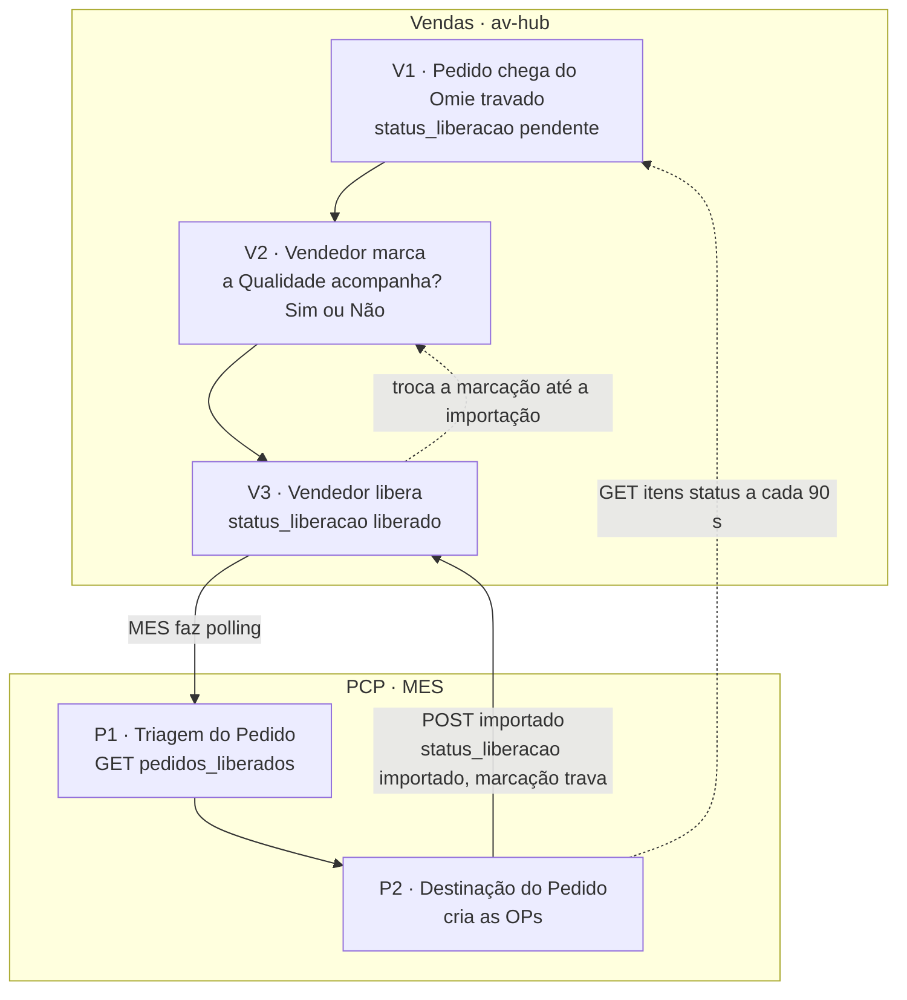

# Raia Vendas: liberação do pedido (V1 a V3)

**Em uma frase:** o pedido de venda só segue para a produção depois que o vendedor o libera. É o portão do fluxo: sem liberação, o PCP (planejamento e controle da produção) não enxerga o pedido.

> [!info] Proposta ao pedido (decisões de 16 a 26/10/2026)
> Esta nota descreve a liberação que **existe hoje** ✅. O desenho aprovado põe a proposta antes do `V1`. O pedido que nasce da proposta já vem liberado. O pedido digitado no Omie continua chegando travado. Esse desenho ainda não está pronto 📝 🔴. Detalhe em [[11-Proposta-e-Pedido-de-Venda]].

## Como funciona, passo a passo

1. O pedido nasce no Omie (o sistema de gestão) e chega ao av-hub **travado**. `V1`
2. O vendedor, ou o auxiliar dele, abre a tela Liberar Pedidos, na aba "Aguardando você".
3. Ele responde: a Qualidade acompanha esse pedido desde o início? Sim ou Não. `V2`
4. Ele libera **na mesma ação** da resposta. `V3`
5. Até o PCP importar o pedido, o vendedor ainda pode corrigir a resposta.
6. O MES (sistema de chão de fábrica) consulta a lista de liberados. Ninguém empurra o pedido para ele. `P1`
7. Quando o PCP grava as ordens, o MES avisa o av-hub. O pedido vira "No PCP" e a resposta trava, com um cadeado. `P2`
8. Depois disso, o vendedor só acompanha. O cartão "Etapa dos itens" mostra em que etapa está cada item.

## Exemplo

O Cliente Exemplo S.A. pede 100 flanges, e o pedido é digitado no Omie. Ele chega ao av-hub travado, na aba "Aguardando você". O vendedor marca "Sim" (a Qualidade acompanha) e libera. O PCP abre a Triagem e vê os 100 flanges. Quando o PCP grava as ordens, o pedido passa para "No PCP" e a marcação trava.

## Quem atua

| Quem | O que faz |
|---|---|
| Vendedor | Marca Sim ou Não e libera os pedidos dele |
| Auxiliar do titular | Libera pelos titulares que ele auxilia |
| Gerente | Só vê todos os pedidos da liberação; descobre quem está segurando pedido |
| PCP | Usa os pedidos liberados; não marca nada |
| Gustavo (DBA), Nathan, Robert | Banco e API, telas do av-hub, e lado MES |

## Regras que valem

- Só pedido liberado vai ao MES. Sem liberação, o PCP não vê o pedido.
- A resposta e a liberação são uma ação só.
- A regra vale por pedido. As parciais criadas depois herdam a resposta.
- Só pedido incluído a partir da data de corte precisa de liberação. A carteira anterior não trava.
- O vendedor corrige a resposta até o MES importar. Depois, ela trava.
- O MES busca a lista. Ninguém empurra pedido para ele.
- O gerente só visualiza. Vendedor e auxiliar liberam.
- O vendedor vê só os pedidos dele. A API aplica isso pelo token de login.
- O pedido do Omie entra na liberação com os mesmos filtros da Carteira antiga.
- A resposta sobre Qualidade é guardada agora e usada depois, na fila de inspeção de processo. Essa fila ainda não existe.

## O que já existe e o que falta

- ✅ Telas Liberar Pedidos e Liberação da Equipe, e as rotas da API.
- ✅ O MES lê os liberados, recusa pedido não liberado e confirma a importação, com reenvio automático.
- ✅ Cartão "Etapa dos itens" no detalhe do pedido.
- 🟡 Os 8 estados macro do vendedor não existem no código. Hoje ele vê a situação da liberação e 11 etapas por item.
- 🔴 Chave própria do MES, mapa de rotas por tela e teste do escopo do vendedor.
- 🔴 Renovar o token expirado, reabrir marcação depois da importação e alertar pedido parado.
- 🔴 Fila de inspeção de processo da Qualidade e refinos do cartão Etapa dos itens.
- 🔴 Pedido manual: o desenho só prevê pedido que chega do Omie.
- ❓ Valor da data de corte em produção e migration `api005`.

Raia seguinte: [[02-PCP-Triagem-e-Destinacao]].

## Detalhe técnico

Tudo abaixo é o conteúdo completo da nota anterior: regras numeradas, estados, telas, rotas, código, tabelas, pendências e o diagrama.

Nós do [[00-Fluxo-Mestre-0b]]: `V1` pedido chega do Omie travado, `V2` vendedor marca se a Qualidade acompanha, `V3` vendedor libera. Selos e convenções em [[Regras-do-Vault]].

> [!info] Proposta ao pedido (decisões de 16 a 26/10/2026, fluxo aprovado em 26/10)
> Esta nota descreve a liberação que **existe hoje** ✅. O desenho aprovado põe a **proposta** antes do `V1` e dá ao `V1` **duas origens no mesmo fluxo**: o pedido da proposta nasce liberado (a Qualidade é respondida no "Transformar em pedido"); o pedido digitado no Omie continua chegando travado, mas o vendedor responde a Qualidade e o faturamento em partes **na tela do pedido** e preenche ali a parte de compras, sem travar o fluxo 📝 (N16-05, N16-91, N16-106) 🔴. A liberação gravada é a mesma desta nota, que o MES lê. Detalhe em [[11-Proposta-e-Pedido-de-Venda]] e.

### Objetivo

O pedido de venda nasce no Omie e chega ao av-hub **travado**. O vendedor decide se a Qualidade acompanha o pedido desde o início e **libera numa ação só**. Só o pedido liberado atravessa para o MES: sem liberação, a Triagem do PCP não o enxerga. É o portão do fluxo inteiro e a única entrada de pedido de venda no MES.

Depois da liberação, esta raia continua como leitura: o vendedor acompanha o item pelo cartão **Etapa dos itens** (status por item que o MES informa, [[API-005-Status-Item-Integracao-MES]] e [[API-006-Status-por-Item-Leitura-no-Hub]]).

### Quem atua

| Quem | Papel | Onde |
|---|---|---|
| Vendedor | Marca Sim ou Não e libera os pedidos dele | Portal do Vendedor, `/liberar-pedidos` |
| Auxiliar do titular | Libera pelos titulares que auxilia (mesmo escopo de Meus Pedidos) | idem |
| Gerente (perfis que já veem Pedidos da Equipe) | Vê todos os pedidos da liberação, só leitura; descobre quem está segurando pedido | Portal do Gerente, `/liberacao-equipe` |
| Admin (Dev) | Vê e libera | as duas telas |
| PCP | Consome os liberados (não marca nada) | MES, ver [[02-PCP-Triagem-e-Destinacao]] |
| Gustavo (DBA) | Banco e API desta raia | `api-acos-vital` |
| Nathan | Front do av-hub (telas e BFF) | HUB |
| Robert | Lado MES do contrato (`importado`, polling) | `api-pcp` |

Pedidos manuais (anexo) e comissões ficam fora desta raia (decisão do Nathan: Atividades é a espinha).

### Regras decididas

Origem: [[LOG-26-Vendas-Liberacao-Pedido]] §2, decisões do Nathan de 28/09/2026, salvo onde indicado.

| # | Regra | Selo |
|---|---|---|
| 1 | O pedido chega do Omie travado; o vendedor marca "a Qualidade acompanha desde o início?" (Sim ou Não) e libera **na mesma ação** (marcação e liberação não se separam). | 📝 |
| 2 | **Só pedido liberado vai ao MES.** Sem linha em `pedidos_vendas_liberacao`, o MES não enxerga o pedido (`/pedidos_liberados` não o lista; os itens respondem 409 `PEDIDO_NAO_LIBERADO`). | 📝 |
| 3 | Grão **por pedido** (`codigo_empresa` + `numero_pedido`). As parciais que o pipeline cria depois herdam a marcação. | 📝 |
| 4 | **Data de corte:** só pedido incluído a partir de `parametros_vendas.data_inicio_liberacao` precisa de liberação. A carteira anterior não trava. | 📝 |
| 5 | O vendedor pode **corrigir a marcação até o MES importar**. Depois da importação a marcação trava (409 `PEDIDO_IMPORTADO_MES`; no banco, erro `23514` do trigger). | 📝 |
| 6 | **Ninguém empurra ao MES: o MES faz GET (polling).** É o Fluxo 4 da integração (os Fluxos 1 a 3 são requisição, referência da OC e status por item). | 📝 |
| 7 | Quem libera: o vendedor e o auxiliar dos titulares que ele auxilia. | 📝 |
| 8 | O gerente tem tela própria, **só visualização**, com todos os vendedores. | 📝 |
| 9 | O escopo do vendedor é aplicado **pela API a partir do token** (contrato [[LOG-40-Escopo-de-Vendedores-e-Permissoes-pelo-Token-no-Backend]]): sem a chave `vendedor`, a API preenche com os vendedores do usuário. O BFF não filtra mais. | 📝 |
| 10 | Pedido do Omie entra na liberação com os mesmos filtros que a Carteira antiga usava: `sequencial = 0`, sem track record, grupo líquido (sem dedução ou blacklist), `etapa <> 0`, incluído a partir da data de corte e `situacao = 'Pendente'` (ou já liberado). | 📝 |
| 11 | A marcação "Qualidade acompanha" é **capturada agora e consumida depois** pela fila de inspeção de processo da Qualidade (não existe, ver "O que falta"). | 📝 |

### Estados

#### Estado da liberação (`status_liberacao`, valor da view `vw_pedidos_liberacao`)

| Valor | Significado | Quem vê |
|---|---|---|
| `pendente` | O vendedor ainda não liberou; o PCP não vê. Aba "Aguardando você" (vendedor) ou "Aguardando vendedor" (gerente) | vendedor, gerente |
| `liberado` | Liberado; o MES ainda não confirmou a importação. Dá para trocar a marcação. Aba "Liberados" | vendedor, gerente, MES |
| `importado` | O MES confirmou (`importado_mes_em` preenchido). A marcação está travada. Aba "No PCP" | vendedor, gerente, MES |

Campo `acompanhamento_qualidade`: `true` (a Qualidade acompanha desde o início), `false` (só inspeção no fim), `null` (sem linha: não liberado). Histórico em `pedidos_vendas_liberacao_historico.acao`: `liberado`, `alterado` (guarda `valor_anterior`), `importado_mes`.

#### Etapa de cada item, depois da liberação

`GET /itens_pedido_status` devolve, por parcial, `etapa` com 11 valores (lista e rótulos em [[Estados-e-Status]]): `compras.requisicao`, `compras.fechamento`, `recebimento.conferencia`, `qualidade.quarentena`, `qualidade.inspecao`, `qualidade.reprovado`, `estoque.atendimento`, `fabrica.espera`, `fabrica.execucao`, `expedicao.embalagem`, `expedicao.concluido`. Vocabulário provisório: a tela traduz o que conhece e mostra o código cru do resto (`lib/domain/etapas-item.ts:30-41` no HUB).

#### Estados do vendedor (visão macro do pedido)

O desenho do v1 (estados do item visto pelo vendedor) tem 8 valores: `AGUARDANDO_LIBERACAO`, `PENDENTE_PCP`, `EM_ESTOQUE`, `EM_COMPRA`, `EM_PRODUCAO`, `EM_RECEBIMENTO`, `EM_INSPECAO`, `PRONTO_EXPEDICAO`, `FATURADO` (nove nomes, oito transições de negócio). 🟡 **Não existe no código**: nenhuma ocorrência desses nomes em HUB, `api-acos-vital` ou `api-pcp` (busca em 14/10). Hoje o vendedor vê dois níveis: `status_liberacao` (acima) e as 11 etapas por item. O mapeamento etapa para estado macro existe como coluna `estado_macro` em `core_fluxo.item_estado_projetado` (Dump Avhub, linha 2176), preenchida pelo feed do MES, que o MES ainda não publica (ver [[Rastreabilidade-e-Torre-de-Fluxo]]). Decidir se o vendedor ganha esses 8 estados ou fica com as 11 etapas é pendência do Nathan.

### Telas

| Nome atual | Nome antigo | Rota | App | Quem |
|---|---|---|---|---|
| Liberar Pedidos | Caixa de entrada do vendedor (tela 1.1) | `/liberar-pedidos` | HUB (Portal do Vendedor) | Vendedor e Admin (Dev): `pode_visualizar` e `pode_editar` |
| Liberação da Equipe | visão do gerente da 1.1 | `/liberacao-equipe` | HUB (Portal do Gerente) | perfis com `pedidos-equipe`: só `pode_visualizar` |
| Meus Pedidos (detalhe, cartão Etapa dos itens) | Meus Pedidos por etapa (tela 1.2) | `/meus-pedidos/pedido/:empresa/:numero` | HUB | Vendedor |
| Pedidos da Equipe (detalhe, mesmo cartão) | idem | `/pedidos-equipe/pedido/:empresa/:numero` | HUB | Gerência |
| Pedidos do PCP | Portal PCP | `/pcp-pedidos`, `/pcp-pedidos/pedido/...` | HUB | acompanhamento comercial, **não** é o `app-pcp` |
| Triagem dos Pedidos | Carteira de Pedidos | `/carteira` | app-pcp | PCP (ver [[02-PCP-Triagem-e-Destinacao]]) |

Lista completa por raia em [[Telas-por-Raia]]. O "Portal PCP" do av-hub é acompanhamento comercial por diligenciador; não confundir com o setor PCP do MES.

#### O que a tela de liberação mostra e faz

Abas com contagem vinda do backend (`contagem.pendente`, `liberado`, `importado`) e "Todos"; busca por número, cliente e vendedor; ordenação por `data_inclusao`, `data_previsao`, `total_pedido_venda`, `cliente`, `numero_pedido`, `liberado_em`; Sim/Não por linha; aviso da última marcação; cadeado quando o PCP já importou. A tela da equipe acrescenta o nome do vendedor, filtro por unidade e mostra a marcação como texto ("Sim", "Não", "Não marcado"). Configuração das duas fontes em `components/LiberarPedidos/fontes.ts`.

### Endpoints e contratos

| Método e rota | Direção | Uso | Contrato |
|---|---|---|---|
| `GET /pedidos_liberacao?vendedor=&codigo_empresa=&status=&busca=&sort=&order=&page=&limit=` | HUB lê da API | caixa do vendedor e tela do gerente (sem `vendedor` = todos) | [[LOG-26-Vendas-Liberacao-Pedido]] §4.1 |
| `PUT /pedidos_liberacao/:codigo_empresa/:numero_pedido` `{ acompanhamento_qualidade, updated_by }` | HUB escreve | libera (1ª vez) ou troca a marcação; 404 `PEDIDO_FORA_DA_LIBERACAO`, 409 `PEDIDO_IMPORTADO_MES`, 403 `PEDIDO_FORA_DO_ESCOPO` e `SEM_VENDEDOR_VINCULADO` | idem |
| `GET /pedidos_liberados?codigo_empresa=&alterado_desde=&mes=&ano=&importado=&page=&limit=` | MES lê (polling) | só liberados; com `alterado_desde` ordena por `liberacao_alterada_em` crescente | idem §4.2 |
| `GET /pedidos_liberados/:numero/itens?codigo_empresa=` | MES lê | itens do pedido mais o objeto `liberacao`; 409 `PEDIDO_NAO_LIBERADO` | idem |
| `POST /pedidos_liberados/:numero/importado?codigo_empresa=` `{ referencia }` | MES escreve | confirma a importação (idempotente); trava a marcação | idem |
| `GET /api/liberar-pedidos` e `PUT /api/liberar-pedidos/:empresa/:numero` | BFF do HUB | repassa à API; `?fonte=equipe` exige a tela `liberacao-equipe` | idem §5 |
| `GET /itens/status` (MES) e `GET /itens_pedido_status?codigo_empresa=&pedido_venda=&historico=` (hub) | MES para hub (job de 90 s) e HUB lê | cartão Etapa dos itens | [[API-005-Status-Item-Integracao-MES]], [[API-006-Status-por-Item-Leitura-no-Hub]], [[SQL-010-Itens-Pedido-Status]] |
| `GET /api/pedidos-venda/:fonte/:empresa/:pedido/etapas` | BFF do HUB | repassa `/itens_pedido_status`; responde `disponivel: false` quando o hub ainda não tem a rota | API-006 |

Banco e telas (DDL e `auth.telas`): apêndices A e B do contrato 26. Diagnóstico das chaves (a do MES só vale para o PUT do contrato 34; as leituras e o `POST importado` usam outra): [[Chaves-e-Autenticacao]].

### Como está no código

#### Banco e API (`api-acos-vital` f322dcd)

- ✅ Rotas montadas em `src/schemas/core_vendas_faturamento/index.js:179-180` (`/pedidos_liberacao`, `/pedidos_liberados`) e job de status em `:181-186`.
- ✅ `GET /pedidos_liberacao` em `aggregates/pedidos_liberacao/pedidos_liberacao.route.js:88` (lê uma vez a view e deriva página, total e contagem por status); `PUT` em `:164`, com `PEDIDO_FORA_DA_LIBERACAO` (`:187`) e `PEDIDO_IMPORTADO_MES` (`:194`, `:222`).
- ✅ `GET /pedidos_liberados` em `aggregates/pedidos_liberados/pedidos_liberados.route.js:57` (filtra `status_liberacao IN ('liberado','importado')`), `/:numero/itens` em `:115` (409 `PEDIDO_NAO_LIBERADO` definido em `:50`), `POST /:numero/importado` em `:143`.
- ✅ Escopo do vendedor **fixo no código**: `src/utils/acessoConfig.js:73-74` (`escopoVendedoresExigir = () => true`; a chave `ESCOPO_VENDEDORES_EXIGIR` não é mais lida). Regra da rota em `src/middlewares/escopoVendedor.js:79` (`pedidos_liberacao`: formato `par`, detalhe `pedido_venda`).
- ✅ Regras no banco (Dump Avhub 14/10): trigger `fn_pedidos_vendas_liberacao_regras` (linha 7783: `liberado_por` e `liberado_em` não mudam; depois de `importado_mes_em`, trocar a marcação dá `23514`), `fn_pedidos_vendas_liberacao_historico` (linha 7743), tabela `parametros_vendas` (linha 18031), `pedidos_vendas_liberacao` (linha 18285), view `vw_pedidos_liberacao` (linha 20870).
- ✅ Job que alimenta o cartão: `tables/itens_pedido_status/itens_pedido_status.job.js` (intervalo `MES_STATUS_INTERVALO_SEG`, padrão 90, linha 217) e rota `itens_pedido_status.route.js:54`. O escopo do vendedor cobre `/itens_pedido_status` (dono por pedido; pedido sem dono conhecido em `pedidos_vendas` dá 403, fail-closed).

#### HUB (b55ac55)

- ✅ BFF `app/api/liberar-pedidos/route.ts` (GET): para a fonte `vendedor` exige token de usuário (sem ele, 401 "Sessão sem identidade no backend") e **não manda `vendedor`**; 403 `SEM_VENDEDOR_VINCULADO` vira "sem vínculo". `[codigoEmpresa]/[numeroPedido]/route.ts` (PUT): exige token, põe o autor pela sessão, e o dono do pedido é conferido pela API.
- ✅ `components/LiberarPedidos/` (lista, tabela, hook e `fontes.ts`) e páginas `app/(protected)/liberar-pedidos/page.tsx` e `liberacao-equipe/page.tsx`.
- ✅ Cartão `components/Pedidos/EtapaDosItens.tsx`, embutido em `PedidoDetalhe.tsx:812` (ao lado de `ComprasDoPedido`, `:814`), alimentado por `app/api/pedidos-venda/[fonte]/[codigoEmpresa]/[pedidoVenda]/etapas/route.ts`. Tradução das etapas em `lib/domain/etapas-item.ts:30-41`; aviso de dado velho acima de 10 minutos (`ETAPA_ATRASO_MINUTOS`).

#### MES (`api-pcp` 579a625, `app-pcp` 1fca8d3)

- ✅ A Triagem lê `GET /pedidos_liberados` (`api-pcp/src/pedidos/omie-integracao.ts:338`); os itens vêm de `/pedidos_liberados/:numero/itens` (`:141`).
- ✅ A criação da destinação recusa pedido não liberado (`pedidos.service.ts:244-249`, `ConflictException`) e guarda `Pedidos.acompanhamentoQualidade` (`:283`, coluna em `producao.prisma:118`). A Triagem mostra a coluna Qualidade ("Acompanha" ou "Não", `app-pcp/app/(protected)/carteira/page.tsx:286-290`).
- ✅ Confirmação de importação (`POST .../importado`, `omie-integracao.ts:393-405`) feita depois da criação das OPs (`pedidos.service.ts:402-406`), com **reenvio automático** a cada `AVHUB_REENVIO_IMPORTADO_MIN` (padrão 10 min) para pedidos dos últimos 7 dias (`pedidos.service.ts:63-122`). Isto cumpre a promessa de retentativa feita no contrato 26.
- ✅ O status por item sai de `GET /itens/status` (`integracao-avhub.controller.ts:26`; `integracao-avhub.service.ts:114-156`; `etapaDoItem` em `:167-192`), protegido por `AvhubApiKeyGuard` com `MES_API_KEY` (fail-closed).

### Dados

| Tabela ou view | Schema | Colunas que importam |
|---|---|---|
| `parametros_vendas` | `core_vendas_faturamento` | linha única (`id = 1`); `data_inicio_liberacao date` (compara com `data_inclusao >=`); sem linha, a view fica vazia |
| `pedidos_vendas_liberacao` | `core_vendas_faturamento` | PK (`codigo_empresa`, `numero_pedido`); `acompanhamento_qualidade boolean`; `liberado_por`, `liberado_em`; `updated_by`, `updated_at` (cursor do polling); `importado_mes_em`, `importado_mes_referencia`. Sem FK para `pedidos_vendas` (o pipeline recria linhas) |
| `pedidos_vendas_liberacao_historico` | `core_vendas_faturamento` | `acao` (`liberado`, `alterado`, `importado_mes`), `valor_anterior`, `usuario`, `referencia` |
| `vw_pedidos_liberacao` | `core_vendas_faturamento` | um pedido por linha; `status_liberacao`; sobre `vw_vendas_planilha` |
| `itens_pedido_status` (+ cursor) | `core_vendas_faturamento` | uma linha por parcial e etapa; alimentada pelo job de 90 s ([[SQL-010-Itens-Pedido-Status]]) |
| `Pedidos.acompanhamento_qualidade`, `Pedidos.importado_avhub_em`, `Pedidos.codigo_pedido_omie` | `public` (MES) | cópia da marcação, selo de importação confirmada, id do pedido no Omie |

Modelo do banco do av-hub em [[Banco-AvHub]]; do MES em [[Banco-MES]].

#### Data de corte

- Regra: `data_inclusao >= parametros_vendas.data_inicio_liberacao`. Pedido anterior não trava, **e também não aparece na Triagem**: os itens dele respondem 404 e o MES mostra "não encontrado" (observação do Robert, 30/09). Os pedidos anteriores à data de corte só chegam ao MES se a regra mudar ou se forem liberados explicitamente.
- Valor vigente: ❓. O contrato registra `2026-07-28` na `api-test` (conferido em 01/10) e `2026-09-01` no banco local. O vault anterior dizia 01/09/2026 em produção. O Dump Avhub é de esqueleto e não traz o dado. Conferir com `SELECT data_inicio_liberacao FROM core_vendas_faturamento.parametros_vendas` (Gustavo).

### Quem vê o quê

| Dado | Vendedor | Auxiliar | Gerente | PCP (MES) |
|---|---|---|---|---|
| Pedido `pendente` | só os dele | os dos titulares que auxilia | todos, em Liberação da Equipe | **não vê** |
| Pedido `liberado` ou `importado` | os dele | idem | todos | vê (Triagem) |
| Marcar e liberar | sim | sim | **não** (só leitura) | não |
| Etapa por item (cartão) | dos pedidos no escopo dele | idem | dos pedidos da equipe | não usa o cartão; vê o roteiro no MES |

Escopo (contrato 40, ✅ fixo na API): vale quando o usuário entrou por tela com escopo de vendedor e o perfil não tem escopo `todos`. No dump de 07/10 só o perfil "Gerencia PCP" tinha `todos`; os outros 20 perfis estavam `vinculados` (❓ conferir em produção). Detalhes de perfis e telas em [[RBAC-e-Permissoes]].

### O que falta desenvolver

| # | O quê | Dono | Nó | Selo |
|---|---|---|---|---|
| 1 | **L6: chave própria do MES**, de escrita, restrita a `/pedidos_liberados/*` e às rotas que ele usa. Hoje o MES usa a chave admin ou de banco; a única chave própria (`MES_INTEGRACAO_KEYS`) só abre o PUT do contrato 34. Decidir: chave restrita ou seguir com a admin | Gustavo (decide), Robert (troca a variável `API_KEY`) | V3, P2 | 🔴 |
| 2 | **L3: mapear `auth.rotas_telas`** para `GET /pedidos_liberacao` (`liberar-pedidos` ou `liberacao-equipe`, `pode_visualizar`) e `PUT` (`liberar-pedidos.pode_editar`); confirmar que `/pedidos_liberados/*` fica como rota de serviço | Gustavo | V2 | 🔴 |
| 3 | **Testar o escopo do vendedor com usuário vendedor** (roteiro da seção 5 do contrato 40): nenhum teste rodou; sessão sem token responde 401 no BFF | Nathan e Gustavo | V2 | 🔴 |
| 4 | **Token expirado vira furo de acesso** quando o BFF para de filtrar: sem `req.usuario` a API não aplica escopo (`escopoVendedor.js`). Renovar o token antes de qualquer remoção de filtro | Gustavo | V2 | 🔴 |
| 5 | **Reabrir marcação depois da importação.** Hoje ninguém destrava. Decidir se a Gerência ou o PCP pode reabrir (rota nova, permissão `pode_aprovar`) | Nathan decide, Gustavo implementa | V3 | 🔴 |
| 6 | **Pedido parado.** Pedido que o vendedor nunca libera é invisível ao PCP. A tela do gerente mostra quem segura; falta alerta depois de N horas e definir quem recebe (decisão T-07 do v1) | Nathan | V3 | 🔴 |
| 7 | **Fila de inspeção de processo** que consome `Pedidos.acompanhamentoQualidade`: o dado chega e é gravado, mas nenhuma tela do MES o usa além da coluna da Triagem | Robert | V2 e raia de [[08-Qualidade-Saida]] | 🔴 |
| 8 | **Estados macro do vendedor** (os 8 do desenho): decidir se entram ou se o vendedor fica com `status_liberacao` mais 11 etapas; se entrarem, depende do feed do MES (`estado_macro`) | Nathan decide, Robert (feed) | V1 a O2 | 🔴 |
| 9 | **Cartão Etapa dos itens:** teste ponta a ponta com a migration `api005` aplicada; `quantidade_na_etapa` tipado como número e a API pode mandar `null`; sem linha do tempo, SLA nem filtro por etapa; `compras.fechamento` ainda aparece como "Em compra" (sem cotação, aprovação ou trânsito) | Nathan (front), Gustavo (migration), Robert (etapa de compra mais fina) | V1 | 🔴 |
| 10 | **Migration `api005`** (função, tabela e mapa de rotas do status por item) não verificada no banco; DDL não versionado | Gustavo | V1 | ❓ |
| 11 | ✅ Marcas `GAMBIARRA(` de escopo removidas do front (`lib/api/pedidosVenda.ts`, `lib/api/portalPcp.ts`; `484dea6`, 15/10): contrato [[LOG-50-Tirar-as-Marcas-de-Escopo-de-Vendedores-do-Front]] | Nathan | V2 | ✅ |
| 12 | **Valor da data de corte em produção** e documentar | Nathan e Gustavo | V1 | ❓ |
| 13 | Pedido manual: o desenho só prevê pedido que chega do Omie; o risco do `exclusionSync` apagar pedido manual está em [[Riscos]] | Gustavo | V1 | 🔴 |

### Pendências

| # | Pergunta | Dono |
|---|---|---|
| 1 | Auxiliar pode liberar pelo titular? Está implementado que sim; confirmar a regra de negócio | Nathan |
| 2 | Pedidos anteriores à data de corte somem da Triagem: aceitar, ou liberar em massa o que ainda está aberto no PCP? | Nathan |
| 3 | O vendedor confirma pedido a pedido ou existe liberação automática depois de um prazo? (T-07) | Nathan e Comercial |
| 4 | Quem avisa o vendedor quando o pedido já está importado e ele tenta trocar a marcação (hoje aparece o cadeado)? | Nathan |
| 5 | Perfil com escopo `todos`: só a Gerência PCP? Os demais perfis passam a ver só os vendedores vinculados, o que muda o dia a dia de comprador e diligenciador | Nathan e Gustavo |

### Diagrama do subfluxo

Raia seguinte: [[02-PCP-Triagem-e-Destinacao]].
