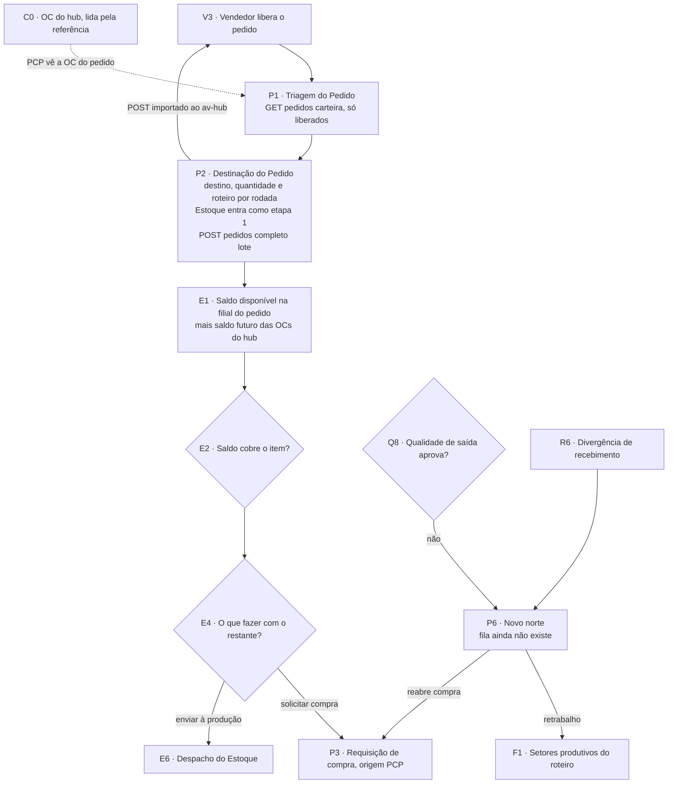

# Raia PCP: Triagem e Destinação do Pedido (P1, P2, P6)

Nós do [[00-Fluxo-Mestre-0b]]: `P1` Triagem do Pedido, `P2` Destinação do Pedido, `P6` Novo norte. O nó `P3` (requisição de compra de origem PCP) fica em [[04-Circuito-de-Compra]]. Entrada: [[01-Vendas-Liberacao]]. Saída: [[03-Estoque-Atendimento-e-Despacho]]. Selos em [[Regras-do-Vault]].

## Objetivo

O PCP enxerga os pedidos que o vendedor liberou (`P1`) e, por **rodada**, decide para cada item **qual destino** recebe (fábrica de fabricação ou a fábrica Revenda), **quanto** manda agora (até o restante) e **qual roteiro** o destino segue (`P2`). Cada rodada gera **uma ordem por destino**. O backend insere o setor **Estoque** como etapa 1 de todo roteiro: a pergunta "há saldo?" não é do PCP, é do Estoque ([[03-Estoque-Atendimento-e-Despacho]]). Ao gravar, o MES confirma a importação ao av-hub e a marcação do vendedor trava.

## Quem atua

| Quem | Papel | Onde |
|---|---|---|
| PCP | Escolhe destino, quantidade, prioridade e roteiro; decide "novo norte" | MES, Triagem (`/carteira`) e Destinação (`/ordens-producao/novo`) |
| Vendedor | Só libera (raia anterior) | HUB |
| Almoxarife | Recebe a parcial no Estoque (raia seguinte) | MES |
| Robert | Dono do código do MES | `api-pcp`, `app-pcp` |

## Regras decididas

| # | Regra | Selo |
|---|---|---|
| 1 | A natureza do item (fabricação ou revenda) **não é do produto**: é o `Fabrica.tipo` do destino escolhido na rodada. Emergência: poucas unidades de um produto fabricado podem ir à Revenda, o resto à fabricação, em ordens diferentes (24/09) | 📝 ✅ `fabricas.prisma:1-8` |
| 2 | Só pedido **liberado** vira ordem: a Destinação consulta `GET /pedidos_liberados/:numero/itens` e recusa com 409 se o vendedor não liberou | 📝 ✅ `pedidos.service.ts:240-249` |
| 3 | O setor Estoque (código `estoque`) é **sempre a etapa 0/1** do roteiro, inserido pelo backend; o PCP monta só o restante e **não** pode incluí-lo | 📝 ✅ `pedidos.service.ts:226-232`, `:459-463` |
| 4 | Circuito de compra (`REQUISICAO`, `COMPRAS`, `LOGISTICA_ENTRADA`) e o Estoque ficam **fora** do roteiro; tentar pô-los no roteiro dá 409 | 📝 ✅ `pedidos.service.ts:500-506` |
| 5 | Roteiro de **fabricação** exige um setor tipo `QUALIDADE` (inspeção de saída, EC-06) antes da primeira etapa `EXPEDICAO` | 📝 ✅ `pedidos.service.ts:512-525` |
| 6 | Quantidade da rodada: até o **restante** do produto no pedido de venda; a soma de todas as ordens do produto não passa do total (409 se ultrapassa) | ✅ `pedidos.service.ts:315-334` |
| 7 | Grão do item no MES = **produto**: linhas repetidas do mesmo produto somam num item só (09/10) | 📝 ✅ `pedidos.service.ts:41-61` |
| 8 | A rodada é **atômica**: todas as ordens (uma por destino) gravam numa transação só; erro em qualquer uma desfaz tudo | ✅ `pedidos.service.ts:262-421` |
| 9 | Numeração: ordem = `pedidoVenda/N` (N = contagem de ordens do pedido + 1); colisão (P2002) refaz a transação até 3 vezes | ✅ `pedidos.service.ts:30`, `:272-278`, `:408-420` |
| 10 | Toda parcial nasce `CRIADO` no setor Estoque com 100% da quantidade | ✅ `pedidos.service.ts:361-373` |
| 11 | **Saldo zero exige clique**: nenhuma parcial passa sozinha pelo Estoque (#31b, 08/10) | 📝 ✅ `itens-parciais.service.ts:588-590` |
| 12 | Confirmação de importação ao av-hub depois de gravar; falhou, o MES reenvia a cada 10 min por 7 dias (20 por rodada) | ✅ `pedidos.service.ts:63-122`, `:399-406` |
| 13 | O PCP **decide o novo norte** (retrabalho ou reabrir compra) quando a Qualidade de saída reprova ou o Recebimento reabre | 📝 🔴 sem tela de fila |
| 14 | **Ordem de Produção (OP)** é uma **entidade** do sistema e também um **documento para impressão** (formalidade), emitido **só para o que será fabricado** (revenda e o que o Estoque atende não geram OP). Não confundir com a "ordem" que hoje o código grava por destino (`Pedidos`, `pedidoVenda/N`), nem com o campo `ordemProducao`, que hoje é só o texto do pedido | 📝 N14-22, #74 🔴 a entidade e o documento não existem (`producao.prisma:97`) |
| 15 | **Se o Compras já emitiu OC vinculada ao pedido de venda, o PCP vê, no MES, que existe ordem de compra para aquele pedido** (número da OC, situação, quantidade, previsão), na Triagem, na Destinação e no Atendimento do Estoque. Fonte: a referência da OC do hub, item com `destino` do tipo `pedido_venda` | 📝 N14-20 🔴 o MES não lê a referência (BL-049) |

### Matriz de destinação (eixo 1 × eixo 2)

O diagrama antigo tratava Estoque, Revenda e Fabricação como três ramos. O modelo vigente tem **três eixos independentes**: (1) natureza, escolhida pela fábrica da rodada; (2) disponibilidade física, resolvida **no setor Estoque**; (3) destinação da reserva (a tabela `Reserva`, ver [[03-Estoque-Atendimento-e-Despacho]]). A matriz abaixo diz o que acontece com cada célula.

| | **Pronto em estoque** (lote `LIBERADO` livre na filial do pedido) | **Matéria-prima em estoque** | **Sem estoque** |
|---|---|---|---|
| **Revenda** (`Fabrica.tipo = REVENDA`) | Estoque atende: split + reserva; a parte atendida vai à primeira etapa `EXPEDICAO` do roteiro ✅ | Beneficiamento é setor `PRODUTIVO` opcional do roteiro da Revenda; **consumo de matéria-prima não existe** 🔴 | O restante **sempre** vai para compra ("Solicitar compra": setor `REQUISICAO`) ✅ `itens-parciais.service.ts:721-730`. Volta pelo circuito: Recebimento, Qualidade, **de volta ao mesmo Estoque** ✅ |
| **Fabricação** (`Fabrica.tipo = FABRICACAO`) | Estoque atende a parte pronta; igual à Revenda ✅ | `destinoRestante = ROTEIRO`: o restante segue o roteiro produtivo; sem baixa de matéria-prima 🔴 | Escolha na tela: "Restante segue o roteiro" ou "Solicitar compra" (matéria-prima) ✅ `AtenderEstoqueModal.tsx:332-345` |

Regra de bolso: **o PCP escolhe o destino; o Estoque decide quanto sai do saldo e para onde vai o restante.** Pedido pode misturar as três situações ao mesmo tempo, item a item.

## Estados

| Estado | Valores | Onde |
|---|---|---|
| `StatusPedido` da ordem | `AGUARDANDO` (nasce assim), `EM_PRODUCAO`, `BLOQUEADO`, `ENTREGUE` | `producao.prisma:11-16`; `EM_PRODUCAO` nunca é gravado, a produção é derivada das parciais (`pedidos-carteira.service.ts:231-236`) |
| Envio do pedido (Triagem) | `NAO_ENVIADO`, `PARCIAL` (X de Y itens), `TOTAL`, `INDISPONIVEL` (itens do Omie não lidos) | `pedidos-carteira.service.ts:25`, `:190-229` |
| Produção do pedido (Triagem) | `AGUARDANDO`, `EM_PRODUCAO`, `CONCLUIDA` | `pedidos-carteira.service.ts:26`, `:237-253` |
| `Prioridade` | `BAIXA`, `NORMAL`, `ALTA`, `URGENTE` (padrão `NORMAL` na tela) | `producao.prisma:3-8`; `ordens-producao/novo/page.tsx:231` |
| `SistemaOrigem` | `OMIE`, `MANUAL` | `producao.prisma:23-26` |
| `TipoFabrica` | `FABRICACAO`, `REVENDA` | `fabricas.prisma:5-8` |
| `TipoSetor` | `PRODUTIVO`, `ESTOQUE`, `COMPRAS`, `EXPEDICAO`, `REQUISICAO`, `LOGISTICA_ENTRADA`, `QUALIDADE` | `fabricas.prisma:17-32` |
| Parcial | `CRIADO`, `RECEBIDO`, `EM_ANDAMENTO`, `EM_TRANSITO`, `PAUSADO`, `REPROVADO`, `CONCLUIDO`, `CANCELADO` (completo em [[Estados-e-Status]]) | `producao.prisma:29+` |

## Telas

| Nome atual | Nome antigo | Rota | App | Slug de permissão |
|---|---|---|---|---|
| Triagem do Pedido | Carteira de Pedidos | `/carteira` | app-pcp | `carteira` (visualizar) ✅ `pedidos.controller.ts:101` |
| Destinação do Pedido | Nova Ordem de Produção | `/ordens-producao/novo` | app-pcp | `ordens-producao` (criar) ✅ `ordens-producao/novo/page.tsx:517` |
| Acompanhamento dos Pedidos | Ordens de Produção | `/ordens-producao`, `/ordens-producao/[id]` | app-pcp | `ordens-producao` (visualizar) |
| Divergências de Recebimento | Decisões do PCP | `/decisoes-pcp` | app-pcp | `decisoes-pcp` (ver [[05-Recebimento]]) |
| Filas de Produção | Movimentações | `/movimentacoes` | app-pcp | `movimentacoes` |

A Triagem lista por mês, ano e **filial** (`codigoEmpresa`), mostra a coluna Qualidade ("Acompanha" ou "Não", `carteira/page.tsx:284-291`), o chip de envio e o de produção, e abre a Destinação com `router.push('/ordens-producao/novo?...')` (`carteira/page.tsx:155`). A Destinação distribui os itens entre destinos, com quantidade a enviar por item (começa cheia), prioridade, observação e montador de roteiro por destino (Estoque fixo travado no topo). Item sem destino **não vai na rodada** e continua na Triagem para a próxima (`ordens-producao/novo/page.tsx:359-366`, `:494-504`).

## Endpoints e contratos

| Método e rota | Permissão | Uso | Código |
|---|---|---|---|
| `GET /pedidos/carteira?mes&ano&codigoEmpresa&page&pageSize` | `carteira:visualizar` | Triagem: lista os liberados do av-hub e cruza com o MES | `pedidos.controller.ts:101-105`, `pedidos-carteira.service.ts:62-87` ✅ |
| `GET /pedidos/consulta-omie/:numeroPedido?codigoEmpresa` | `ordens-producao:criar` | Itens do pedido (via `GET /pedidos_liberados/:numero/itens`) | `pedidos.controller.ts:69-76` ✅ |
| `GET /pedidos/itens-existentes/:pedidoVenda` | `ordens-producao:criar` | Quanto já foi enviado do produto | `pedidos.controller.ts:111-118` ✅ |
| `GET /pedidos/unidades` | `ordens-producao:criar` | Filiais (do av-hub) | `pedidos.controller.ts:83-86` ✅ |
| `GET /pedidos/setor-estoque-fixo` | `ordens-producao:criar` | Mostra a etapa 1 travada | `pedidos.controller.ts:91-95` ✅ |
| `POST /pedidos/completo/lote` | `ordens-producao:criar` | Cria todas as ordens da rodada de uma vez | `pedidos.controller.ts:57-64` ✅ |
| `GET /pedidos`, `GET /pedidos/:id`, `PATCH /pedidos/:id`, `DELETE /pedidos/:id` | `ordens-producao` | Acompanhamento; excluir exige motivo e grava `PedidoExcluido` | `pedidos.controller.ts:120-169` ✅ |
| `GET /pedidos_liberados`, `GET /pedidos_liberados/:numero/itens`, `POST /pedidos_liberados/:numero/importado` | chave `API_KEY` do MES | Lado av-hub do contrato | [[LOG-26-Vendas-Liberacao-Pedido]] ✅ ver [[Integracao-AvHub-MES]] INT-01 |

O `POST /pedidos/completo` singular foi apagado (PR #50); só o `/lote` existe.

## Como está no código

- ✅ **Triagem.** `PedidosCarteiraService.listar` lê a página do av-hub (`listarCarteiraIntegracao`), busca os itens de cada pedido com concorrência 8 (`pedidos-carteira.service.ts:48`, `:94-116`) e cruza com as ordens do MES **na mesma filial** (`:132-148`). Falha de um pedido vira `INDISPONIVEL`, não derruba a página.
- ✅ **Criação.** Valida todos os destinos (fábrica, roteiro, liberação no av-hub, `pedidos.service.ts:207-260`) e depois grava numa transação com timeout de 30 s (`:396`): `Pedidos` com `acompanhamentoQualidade` e `codigoPedidoOmie` copiados do av-hub (`:250-253`, `:282-285`), `ItensPedido`, `Roteiros` (Estoque ordem 0) e uma `ItemParcial` por item.
- ✅ **Excluir ordem** devolve reservas ATIVAS (`liberarReservas`), enfileira o cancelamento das requisições no av-hub (`enfileirarCancelamentosDoPedido`, 409 se já tem OC) e apaga com snapshot (`pedidos.service.ts:622-712`).
- ✅ **Reenvio do `importado`** com `AVHUB_REENVIO_IMPORTADO_MIN` (padrão 10; 0 desliga) (`pedidos.service.ts:80-85`).
- 🟡 **Nomes técnicos antigos:** a rota é `/carteira`, o campo é `ordemProducao`, os códigos são `OP-`. Os rótulos novos já estão na tela (09/10, `9bb47e4`).
- 🔴 **Ordem de Produção como entidade e documento (N14-22).** Não existe no código: `ordemProducao` é só o texto do pedido (`producao.prisma:97`). Falta criar a entidade (emitida só para o que será fabricado), o documento imprimível e a numeração; a contagem de esforço é do Robert (BL-052).
- 🔴 **OC do pedido na Triagem e na Destinação (N14-20).** O PCP não vê hoje se o Compras já emitiu OC para o pedido. O MES precisa ler a referência da OC do hub (`GET /ordens-compra/referencia`, item com `destino` do tipo `pedido_venda`) e mostrar a OC ao lado do pedido e do item (BL-049); do lado do hub já existem o vínculo `ordens_compra_itens_vinculos`, a view `vw_pedido_venda_itens_compra` e `GET /compras/pedidos-venda/:numero/compras` ✅ ([[04-Circuito-de-Compra]]).
- 🔴 **P6 Novo norte:** a Qualidade de saída pode reprovar e abrir retrabalho (`PATCH /itens-parciais/:id/reprovar`, `/resolver`, `/retrabalho`, `itens-parciais.controller.ts:205-239`), mas **não existe a fila "Novo norte"** nem o `RoteiroItem` (C8, EC-03). A única fila de decisão do PCP existente é a de divergência de recebimento.

## O que falta desenvolver

| # | O quê | Dono | Nó | Selo |
|---|---|---|---|---|
| 1 | Fila "Novo norte" (P6): decidir retrabalho ou reabrir compra depois de reprovação de saída ou recompra | Robert | P6 | 🔴 |
| 2 | `RoteiroItem` (roteiro por item, C8, EC-03) | Robert | P2, P6 | 🔴 |
| 3 | Renomear rota, campo e prefixo (`/carteira`, `ordemProducao`, `OP-`) para os nomes novos (BL-036) | Robert | P1, P2 | 🔴 |
| 7 | **Ordem de Produção: entidade e documento imprimível**, só para o que será fabricado (BL-052; esforço a estimar pelo Robert) | Robert | P2 | 🔴 📝 N14-22 |
| 8 | **Mostrar a OC do pedido** (Triagem, Destinação, Atendimento) lendo a referência da OC do hub (BL-049, depende de BL-001) | Robert | P1, P2, E1 | 🔴 📝 N14-20 |
| 4 | Consumo de matéria-prima ao enviar à produção (J2, J3): hoje o restante segue o roteiro sem baixa | Robert | P2, E4 | 🔴 |
| 5 | Pedido manual (`SistemaOrigem.MANUAL`) fora da espinha; ver anexo [[Pedido-Manual]] | Nathan | P2 | 🟡 |
| 6 | Pedido liberado anterior à data de corte não aparece na Triagem (404 nos itens) | Nathan | P1 | 🔴 pergunta aberta (ver [[01-Vendas-Liberacao]]) |

## Pendências

- Nathan: o saldo zero continua exigindo clique mesmo depois do marco zero do Estoque (13/11)? Hoje vale o clique sempre (#31b).
- Nathan e Robert: a Triagem deve mostrar o saldo do Estoque por item (hoje não mostra; a decisão de saldo é só no Estoque). Com N14-20, ela também mostraria o saldo futuro e a OC do pedido.
- Robert: a OP é uma entidade por destino de fabricação, por item ou por rodada? Como se relaciona com a "ordem" que o código grava hoje (`pedidoVenda/N`)?
- Robert: se `ensureEtapasPorTipo` deve aceitar roteiro de Revenda **sem nenhuma** etapa além do Estoque (o front exige roteiro não vazio, `ordens-producao/novo/page.tsx:376-379`).

## Subfluxo

Próxima raia: [[03-Estoque-Atendimento-e-Despacho]].
