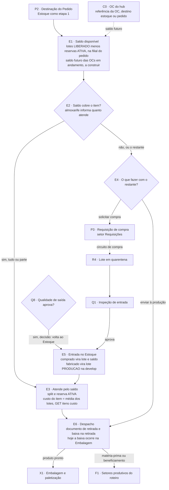

# Raia Estoque: atendimento e despacho (E1 a E6)

**Em uma frase:** toda parcial de item passa primeiro pelo Estoque. O almoxarife atende o que o saldo cobre e decide o que fazer com o resto: comprar ou mandar para a produção.

> [!info] Decisões de 29/10/2026 (N16-120 a N16-143)
> - O documento de retirada é pedido ao Estoque por quem precisa da mercadoria, Expedição ou Produção. Só o Estoque confirma (N16-120). O que o documento imprime segue aberto. Contrato: [[LOG-54-Documento-de-Retirada-e-Baixa-na-Retirada]].
> - A reserva é consumida junto com a baixa. A saída grava lote, pedido e o custo do lote naquele momento (N16-121).
> - A Embalagem só recebe a parcial depois da retirada confirmada (N16-122).
> - A matéria-prima da produção sai por documento de retirada, pela quantidade pedida (N16-140).
> - Fabricado: [[LOG-53-Ordem-de-Producao-e-Lote-do-Fabricado]] ✅ está na `develop` do MES desde 27/10/2026 (`api-pcp` `ab3318d`): um lote de origem `PRODUCAO` por ordem de produção e produto, criado quando o Estoque recebe o fabricado aprovado e informa a localização.
> - Matéria-prima: a baixa decidida é na retirada (N16-140), mas a `develop` já baixa na hora em que o almoxarife usa "Atender pelo estoque" num item de fabricação (`ConsumoMateriaPrima`, 19/10, `8d07917`). A baixa na retirada ainda falta 🔴.
> - Código: tudo o que é MES nesta nota está na `develop` do `api-pcp` e do `app-pcp`; a `main` parou em 08/10 e só recebe com o merge BL-035.

## Como funciona, passo a passo

1. A parcial chega ao Estoque, vinda do PCP, com a quantidade toda.
2. O almoxarife vê o saldo livre na filial do pedido: lotes liberados menos reservas. `E1`
3. Ele informa quanto atende, de zero até a quantidade da parcial, e de quais lotes. Atender zero é um clique. `E2`
4. O sistema reserva o lote e separa a parte atendida, que segue para a Expedição. `E3`
5. Para o restante, o almoxarife escolhe: solicitar compra ou enviar à produção. `E4`
6. O item comprado volta ao mesmo Estoque depois que a Qualidade libera o lote. O almoxarife faz a reserva. `E5`
7. Na saída física, quem precisa da mercadoria pede um documento de retirada, e a baixa acontece na retirada. Hoje a baixa acontece quando a Embalagem recebe a parcial. `E6`

## Exemplo

O pedido tem 100 flanges. O almoxarife encontra 40 em lotes liberados e informa 40. Elas viram uma parcial própria, com reserva, a caminho da Expedição. As 60 restantes seguem na parcial original. Se o destino for a Revenda, as 60 vão para a compra. Se for fabricação, ele escolhe entre comprar matéria-prima e seguir o roteiro. Quando a Expedição pede a retirada, o almoxarife confirma e o saldo baixa com o custo daquele lote.

## Quem atua

| Quem | O que faz |
|---|---|
| Almoxarife | Atende pelo saldo, solicita compra, dá entrada, ajusta e transfere saldo |
| Gestor de Estoque | Supervisiona o painel e o saldo |
| Expedição (Embalagem) | Hoje dispara a baixa ao receber a parcial. No desenho final, pede a retirada |
| Produção | Receberia matéria-prima por documento de retirada, que ainda não existe |
| Compras e CCP (acompanhamento de compras) | Recebem o "Solicitar compra" pelo setor Requisições |
| Robert | Dono do código do MES (sistema de chão de fábrica) |

## Regras que valem

- O saldo livre é por filial: lotes liberados menos reservas ativas, na filial do pedido.
- Saldo zero exige clique. A parcial nunca passa sozinha.
- O saldo é lido e a reserva criada no mesmo passo, para evitar corrida entre pedidos.
- A reserva não expira. Termina por liberação explícita ou quando a ordem é excluída.
- Na Revenda, o restante sempre vai para compra.
- Na fabricação, o restante pode comprar matéria-prima ou seguir o roteiro.
- O item comprado só volta ao Estoque depois que a Qualidade libera o lote.
- Ajuste de saldo não usa o que está reservado e exige motivo.
- O custo do lote é opcional e nunca bloqueia nada.
- Tudo que é fabricado ou comprado passa pelo Estoque (decisão de 14/10). O fabricado aprovado já volta ao Estoque como lote na `develop` (27/10).

## O que já existe e o que falta

- ✅ Telas Atendimento, Saldo, Reservas, Movimentação e Lote com etiqueta.
- ✅ Reserva, divisão da parcial, solicitar compra, entrada do item comprado e baixa na Embalagem.
- 🟡 Painel do Estoque e Mapa do Depósito ainda são protótipos.
- ✅ Na `develop` do MES: fabricado aprovado vira lote `PRODUCAO` e saldo (27/10); rota `GET /itens/custo` com o custo do item (27/10, `6c11147`); custo da OC no lote do Recebimento (19/10); baixa de matéria-prima no "Atender pelo estoque" (19/10).
- 🔴 Documento de retirada e baixa na retirada.
- 🔴 Baixa de matéria-prima na retirada (hoje é na hora do atendimento).
- 🔴 Saldo futuro, com as OCs (ordens de compra) em andamento (BL-050).
- 🔴 Custo obrigatório em todo lote (BL-066) e custo do fabricado (BL-067).
- 🔴 Contagem cíclica, transferência entre filiais e separação física.

Entrada: [[02-PCP-Triagem-e-Destinacao]]. Próxima raia: [[04-Circuito-de-Compra]].

## Detalhe técnico

Nós do [[00-Fluxo-Mestre-0b]]: `E1` saldo disponível, `E2` saldo cobre?, `E3` atende pelo saldo (split e reserva, custo do item), `E4` o que fazer com o restante, `E5` entrada no Estoque, `E6` despacho. Entrada: [[02-PCP-Triagem-e-Destinacao]]. Vizinhos: [[04-Circuito-de-Compra]], [[05-Recebimento]], [[06-Qualidade-Entrada]], [[08-Qualidade-Saida]], [[09-Expedicao]]. Selos em [[Regras-do-Vault]].

### Quem atua (onde)

| Quem | Papel | Onde |
|---|---|---|
| Almoxarife | Atende pelo saldo, solicita compra, dá entrada, ajusta e transfere saldo | MES, `/estoque-operacao/atendimento` e demais telas de Estoque |
| Gestor de Estoque | Supervisiona; não aparece nas conversas operacionais | MES, painel e saldo |
| Expedição (Embalagem) | Hoje dispara a baixa ao receber a parcial; no desenho final pede a retirada | MES, [[09-Expedicao]] |
| Produção | Receberia matéria-prima por documento de retirada (não existe) | MES, [[07-Producao-e-Roteiro]] |
| Compras · CCP | Recebe o "Solicitar compra" via setor Requisições | [[04-Circuito-de-Compra]] |
| Robert | Dono do código | `api-pcp`, `app-pcp` |

Permissão: agir no setor exige `PerfilSetor.podeAtuar` (`ensurePodeAtuar`, `itens-parciais.service.ts:617`); movimentação e carga inicial exigem `PerfilDeposito.podeAtuar` no depósito (`estoque.prisma:86-106`, `estoque-operacao.service.ts:399-401`).

### Regras decididas

| # | Regra | Selo |
|---|---|---|
| 1 | O Estoque (setor `estoque`) é a **etapa 1** de todo roteiro e o **único** Estoque do circuito (a compra volta a ele) | 📝 ✅ `pedidos.service.ts:226-232`, `circuito-compra.ts:19-25` |
| 2 | Saldo disponível = soma dos lotes `LIBERADO` − reservas `ATIVA`, na **filial do pedido** (DEC-1) | 📝 ✅ `estoque-operacao.helpers.ts:150-170` (valida `LIBERADO`, mesmo produto e filial, disponível) |
| 3 | A leitura do saldo e a criação da reserva acontecem **no mesmo passo** (evita corrida entre pedidos) | 📝 ✅ `itens-parciais.service.ts:595-600`, `:744-852` |
| 4 | **Saldo zero exige clique**: a parcial nunca passa sozinha; atender 0 é uma ação explícita | 📝 ✅ `itens-parciais.service.ts:588-590`, `:657-659` (#31b) |
| 5 | Reserva nasce `ATIVA`, **sem expiração**; libera por ação explícita (`LIBERADA`) ou quando a ordem é excluída | 📝 ✅ `estoque.prisma:45-52`, `pedidos.service.ts:695-699` |
| 6 | Na **Revenda** o restante **sempre** vai para compra (não há o que produzir) | 📝 ✅ `itens-parciais.service.ts:721-727` |
| 7 | Na **Fabricação** o restante pode seguir o roteiro (`ROTEIRO`) ou ir à compra (`COMPRA`, matéria-prima) | 📝 ✅ `:607-613`, `AtenderEstoqueModal.tsx:332-345` |
| 8 | A parte atendida vai para a **primeira etapa `EXPEDICAO`** depois do Estoque; sem ela no roteiro, 409 | ✅ `itens-parciais.service.ts:701-714` |
| 9 | Parcial de item **comprado** só entra de volta no Estoque depois que a Qualidade liberou o lote (409 se há lote `PENDENTE`) | 📝 ✅ `itens-parciais.service.ts:862-874` |
| 10 | **Despacho é no Estoque**: quem precisa da mercadoria gera o **documento de retirada**; a **baixa do saldo ocorre na retirada** | 📝 🔴 não existe; contrato [[LOG-54-Documento-de-Retirada-e-Baixa-na-Retirada]], decisões N16-120 a N16-122 |
| 11 | **Tudo que é fabricado ou comprado vai para o Estoque**: o fabricado aprovado vira lote e saldo e só então é despachado | 📝 ✅ na `develop` (27/10, `ab3318d`): `aprovar-saida` e `receber-fabricado`; 🔴 a Expedição ainda não sai do Estoque pela retirada |
| 12 | **Custo do item = média ponderada dos lotes** das reservas (Regra A: faturamento parcial usa o custo médio do item no pedido) | 📝 ✅ `GET /itens/custo` na `develop` (27/10, `6c11147`, `integracao-avhub.controller.ts`, regra em `itens-custo.ts`); fabricado fora até o custo da matéria-prima ([[API-008-Custo-do-Lote-no-MES]]) |
| 13 | O custo do lote é **opcional hoje** e não bloqueia carga inicial, recebimento, reserva nem despacho. A N16-09 decide que **todo lote tem custo** (obrigatório, inclusive na carga inicial) | ✅ opcional no código (`estoque-operacao.service.ts:404-409`, `estoque.prisma:385-393`); 📝 N16-09, 🔴 obrigatório (BL-066) |
| 14 | Lote filho de cisão herda o custo do pai; transferência entre depósitos não muda o custo | 📝 ✅ `estoque-operacao.helpers.ts:431-452` |
| 15 | Ajuste de saldo não pode comer o que já está reservado; motivo obrigatório | ✅ `estoque-operacao.service.ts:657-673` |
| 16 | Carga inicial (marco zero) nasce `LIBERADO` sem inspeção; é o primeiro estoque | 📝 ✅ `estoque-operacao.service.ts:429-437` |
| 17 | **Saldo futuro:** para OC de itens de **estoque** (sem pedido de venda), o Estoque do MES mostra as **OCs em andamento** e a parte delas que preenche o estoque: **saldo atual + saldo futuro** ([[Glossario]]). A fonte é a referência da OC do hub (`GET /ordens-compra/referencia`, item com `destino` do tipo `estoque`) | 📝 N14-20; ✅ o MES já lê a referência da OC (K4, `develop`, 15/10); 🔴 o cálculo e a coluna (BL-050) |
| 18 | Se a OC está **vinculada a um pedido de venda** (`destino` do tipo `pedido_venda`), o Estoque e o PCP veem que já existe OC para aquele pedido; essa quantidade **não** entra no saldo futuro livre | 📝 N14-20 🔴 (BL-049: o PCP ainda não vê a OC do pedido na Triagem e na Destinação) |

### Estados

#### Lote (`StatusQualidadeLote`, `OrigemLote`)

| `StatusQualidadeLote` | Conta no disponível? | Quem muda |
|---|---|---|
| `PENDENTE` | Não | Recebimento cria ([[05-Recebimento]]) |
| `LIBERADO` | **Sim** | Qualidade aprova ou carga inicial |
| `REPROVADO` | Não | Qualidade ([[06-Qualidade-Entrada]]) |
| `QUARENTENA` | Não | Reprovação parcial |

`OrigemLote` = `RECEBIMENTO`, `CARGA_INICIAL` e, na `develop`, `PRODUCAO` (fabricado aprovado, um lote por OP e produto, `estoque.prisma`) ✅. `TipoMovimentoEstoque` = `ENTRADA`, `SAIDA`, `TRANSFERENCIA`, `AJUSTE` (`estoque.prisma:38-43`). `OrigemCusto` = `CARGA_INICIAL`, `OC`, `MANUAL` (`estoque.prisma:378-382`).

#### Reserva (`StatusReserva`)

| Valor | Quando |
|---|---|
| `ATIVA` | Nasce em "Atender pelo estoque" (`reservarParaParcial`) |
| `CONSUMIDA` | A parcial é recebida na Embalagem (`consumirReservasDaParcial`, saída do lote) |
| `LIBERADA` | Ordem excluída, parcial cancelada ou liberação manual com motivo |

`quantidadeConsumida` acompanha parcial; estorno (`estornarConsumosDaParcial`) devolve o saldo à mesma localização quando a Embalagem desfaz o recebimento ou devolve ao Estoque (`itens-parciais.service.ts:1450`, `:1587`; `estoque-operacao.helpers.ts:287`).

#### Parcial no Estoque

Aceita agir em `CRIADO`, `EM_TRANSITO`, `RECEBIDO`, `EM_ANDAMENTO` (`itens-parciais.service.ts:629-639`). A parte atendida segue `EM_TRANSITO` com `atendidoPeloEstoque = true`; o restante segue `EM_TRANSITO` ao setor `REQUISICAO` (compra) ou à próxima etapa do roteiro.

### Telas

| Nome atual | Nome antigo | Rota | Slug | Estado |
|---|---|---|---|---|
| Atendimento | Atendimento / Baixa | `/estoque-operacao/atendimento` | `atendimento` | ✅ fila do setor `ESTOQUE` com modal "Atender pelo estoque" (`atendimento/page.tsx:1-16`, `AtenderEstoqueModal.tsx:232`) |
| Saldo | Consulta de Saldo | `/estoque-operacao/saldo` | `saldo` | ✅ |
| Reservas | — | `/estoque-operacao/reservas` | `reservas` | ✅ consulta e liberação |
| Movimentação | — | `/estoque-operacao/movimentacao` | `movimentacao` | ✅ entrada, ajuste, transferência |
| Lote (detalhe, etiqueta) | — | `/estoque-operacao/lotes/[id]` | `saldo` | ✅ PDF Code128 `GET /estoque/lotes/:id/etiqueta` |
| Painel do Estoque | Dashboard do Estoque | `/estoque-operacao/painel-estoque` | `painel-estoque` | 🟡 protótipo com dados de exemplo; dois alertas reais |
| Mapa do Depósito | — | `/estoque-operacao/mapa-deposito` | — | 🟡 mock |
| Retirada (documento de despacho) | — | — | — | 🔴 não existe |
| Saldo futuro (coluna e detalhe das OCs em andamento no Atendimento e no Saldo) | — | `/estoque-operacao/atendimento`, `/estoque-operacao/saldo` | `atendimento`, `saldo` | 🔴 não existe (BL-050) |

### Endpoints e contratos

| Método e rota | Permissão | Efeito | Código |
|---|---|---|---|
| `GET /estoque/saldo/disponivel-parcial/:idItemParcial` | `movimentacoes:visualizar` | Lotes `LIBERADO` com disponível, mais `outrasFiliais` | `estoque-operacao.controller.ts:45-49`, `estoque-operacao.service.ts:112-147` ✅ |
| `PATCH /itens-parciais/:id/atender-estoque` | `movimentacoes:editar` | `quantidadeEstoque`, `alocacoes[]` (lote e quantidade), `destinoRestante` `ROTEIRO` ou `COMPRA`, observação | `itens-parciais.controller.ts:163-180`, `itens-parciais.service.ts:607` ✅ |
| `GET /estoque/saldo` | `saldo:visualizar` | Saldo por lote e localização; custo só para quem tem `estoque-custo` | `estoque-operacao.controller.ts:39-43` ✅ |
| `POST /estoque/lotes/carga-inicial` | `movimentacao:criar` | Lote `LIBERADO`, custo opcional (`estoque-custo:editar`) | `estoque-operacao.controller.ts:66-70`, `estoque-operacao.service.ts:398-445` ✅ |
| `GET /estoque/movimentos`, `POST /estoque/movimentos` | `movimentacao` | Transferência e ajuste | `estoque-operacao.controller.ts:78-88` ✅ |
| `GET /estoque/reservas`, `PATCH /estoque/reservas/:id/liberar` | `reservas` | Consulta e liberação com motivo | `estoque-operacao.controller.ts:90-98` ✅ |
| `GET /estoque/alertas/estoque-minimo`, `/rnc-pendentes` | Estoque | Dois alertas do painel | `alertas.controller.ts:19-25` ✅ |
| `GET /itens/custo` (MES → av-hub) | chave do av-hub | Custo do item (uma linha por filial, pedido e produto; cursor `alterado_em`) | [[API-008-Custo-do-Lote-no-MES]], [[LOG-47-Custo-Real-por-Item-no-Hub]] ✅ na `develop` do MES (27/10, `6c11147`); o job do hub ainda não foi testado junto |
| `PATCH /itens-parciais/:id/aprovar-saida`, `PATCH /itens-parciais/:id/receber-fabricado` | `movimentacoes:editar` | O "sim" da inspeção de saída e a entrada do fabricado no Estoque, com a localização | [[LOG-53-Ordem-de-Producao-e-Lote-do-Fabricado]] ✅ `develop` (27/10, `itens-parciais.controller.ts`) |
| `PUT /estoque/lotes/:id/custo` | `estoque-custo:editar` | Informa ou corrige o custo do lote à mão, com motivo e histórico | [[API-008-Custo-do-Lote-no-MES]] ✅ `develop` (27/10) |
| Documento de retirada (criar, listar, confirmar) | a definir | Gera a retirada; baixa o saldo | 🔴 sem contrato, sem rota |

### Como está no código

#### E1 e E2: saldo disponível e decisão

✅ O modal busca `GET /estoque/saldo/disponivel-parcial/:id` e sugere lotes (inclusive os da compra daquele item). `E2` não é um nó automático: o almoxarife informa quanto atende (0 a quantidade da parcial) e de quais lotes (`alocacoes` somando exatamente a quantidade atendida, `itens-parciais.service.ts:650-659`). Só é possível agir em setor tipo `ESTOQUE` (`:623-627`).

🔴 **Saldo futuro (N14-20).** O modal e a tela Saldo só mostram o saldo atual (lotes `LIBERADO` menos reservas). Falta mostrar as OCs em andamento. Do lado do hub já há: `ordens_compra.finalidade` (`estoque` é o padrão, `ordens_compra.route.js:982`), `ordens_compra_itens_vinculos` (item da OC para pedido de venda), a view `vw_pedido_venda_itens_compra` e a referência `GET /ordens-compra/referencia`, cujo item traz `destino[]` (`pedido_venda` ou `estoque`, somando a quantidade) ✅ (`vw_ordens_compra_referencia_mes.swagger.json:61-88`). No MES, o job que lê a referência já existe na `develop` (K4, `6914fe9`, 15/10, `oc-referencia-avhub.service.ts`) ✅ e o aviso de compra em andamento aparece ao requisitar (API-011, 20/10). Falta o cálculo do saldo futuro (OC aprovada, parte `estoque` do `destino`, menos o que já foi recebido) e a coluna no Atendimento e no Saldo (BL-050). A referência só traz OC `aprovado` e as canceladas que já foram aprovadas (`vw_ordens_compra_referencia_mes`, [[Banco-AvHub]]): OC em aprovação não entra, e o Gustavo confere se isso basta (BL-028). Como a mercadoria entra no Estoque: [[05-Recebimento]].

#### E3: atender pelo saldo (split e reserva)

✅ Duas formas, numa transação (`itens-parciais.service.ts:744-856`):
- **Tudo atendido** (`restante = 0`): a própria parcial vai `EM_TRANSITO` para a Expedição com `atendidoPeloEstoque = true` e a reserva nasce sobre ela (`:746-779`).
- **Parte atendida**: a parcial original segue com o restante; nasce uma parcial nova, `atendidoPeloEstoque`, com `idParcialOrigem`, indo à Expedição, e a reserva aponta para ela (`:784-852`). A soma das parciais continua igual ao total do item.

A reserva valida lote `LIBERADO`, mesmo produto (`codigoProdutoOmie`) e mesma filial (`codigoEmpresa`), e disponível suficiente (`estoque-operacao.helpers.ts:150-170`). O snapshot (pedido, ordem, item) sobrevive à exclusão da ordem.

✅ **Custo do item (na `develop`, 27/10).** Cada `Reserva` liga lote e parcial, e `lote_custo.custo_liquido_unitario` guarda o custo. A saída grava o custo do lote no movimento, e `GET /itens/custo` devolve o custo por filial, pedido e produto (`6c11147`, [[API-008-Custo-do-Lote-no-MES]]). O fabricado fica de fora até existir o custo da matéria-prima (BL-067).

#### E4: o restante

✅ `destinoRestante = COMPRA` (ou Revenda, sempre) move a parcial para o setor `REQUISICAO` (`setorDoCircuito`, `itens-parciais.service.ts:727-730`); o PCP abre a requisição lá ([[04-Circuito-de-Compra]], nó `P3`). A observação de histórico diz "Sem saldo no estoque: N vão para compra (Requisições)" (`:808-811`).

✅ **Enviar à produção** (`ROTEIRO`) move a parcial para a próxima etapa do roteiro. Na `develop`, o item de fabricação pode ser atendido com matéria-prima do estoque: lote(s) de qualquer produto, com a quantidade baixada e as unidades do item cobertas (`ConsumoMateriaPrima`, 19/10, `8d07917`; a baixa é imediata e devolver a parcial ao Estoque estorna). 🔴 Diverge da N16-140: a decisão é baixar na retirada, pelo documento, e não na hora do atendimento. A genealogia (J4) segue sem código.

#### E5: entrada no Estoque

✅ **Comprado:** a Qualidade aprova o lote, e `devolverAoEstoqueParciaisProntas` funde as parciais do item e devolve a parcial ao setor Estoque com `idLoteCompra = null` (`circuito-compra.ts:166-250`). O lote já nasceu no Recebimento com `ENTRADA` no saldo e `origem = RECEBIMENTO`. A reserva é criada na **segunda passada** pelo almoxarife: "Atender pelo estoque" com a quantidade toda (`itens-parciais.service.ts:592-593`). Detalhe em [[06-Qualidade-Entrada]].

✅ **Fabricado (na `develop`, 27/10, `ab3318d`):** o "sim" da inspeção de saída é `PATCH /itens-parciais/:id/aprovar-saida` (aprova tudo ou só uma `quantidade`; o resto continua na inspeção). A parcela aprovada volta ao setor Estoque, `EM_TRANSITO`, marcada como fabricado aprovado. O almoxarife informa a localização em `PATCH /itens-parciais/:id/receber-fabricado`, e só então nasce o lote `PRODUCAO` (um por OP e produto, sem custo), com `ENTRADA`, saldo e reserva para a própria parcela. Decisão de 14/10 cumprida. 🔴 O lote nasce sem custo (BL-067).

#### E6: despacho

✅ O que existe: quando a **Embalagem recebe** a parcial atendida (`PATCH /itens-parciais/:id/receber`), o código chama `consumirReservasDaParcial` (`itens-parciais.service.ts:275-285`). Ele tira o saldo das localizações do lote (maior saldo primeiro), grava um `MovimentoEstoque` `SAIDA` por pedaço com `idReserva`, e marca a reserva `CONSUMIDA` (`estoque-operacao.helpers.ts:208-284`). Se o saldo físico não cobre, 409 "registre um ajuste antes de entregar" (`:253-258`). Se a Embalagem desfaz o recebimento ou devolve ao Estoque, o saldo volta (`estornarConsumosDaParcial`).

🔴 O que o desenho decidido exige e não existe:
1. **Documento de retirada** gerado por quem precisa da mercadoria (Expedição ou Produção), com itens, lotes, quantidades e solicitante.
2. **Baixa na retirada**, feita pelo Estoque, e não no recebimento da Embalagem.
3. Reserva passa a significar só "separar sem despachar".
4. A matéria-prima enviada à produção também sai por documento de retirada.

Consequência de hoje: o saldo físico só cai quando a Expedição recebe; o almoxarife não tem registro de quem retirou, e item que sai para produção nunca baixa.

### Dados

| Tabela (todas em `public`, MES) | Papel |
|---|---|
| `depositos`, `localizacoes_estoque`, `perfil_depositos` | Depósito (pertence a uma filial), localização, permissão por perfil |
| `materiais` | Produto do av-hub espelhado; chave `(codigo_empresa, codigo_produto_omie)`; peso teórico e tolerância |
| `lotes` | `status_qualidade`, `origem`, `id_lote_pai`, `id_requisicao_item`, NF, fornecedor |
| `saldos_estoque`, `movimentos_estoque` | Saldo por lote, localização e depósito; movimentos `ENTRADA`, `SAIDA`, `TRANSFERENCIA`, `AJUSTE` |
| `reservas` | Lote, parcial, `quantidade`, `quantidade_consumida`, status, snapshot do pedido |
| `lote_custo` | 1:1 com `lotes`: custo líquido unitário, componentes, `id_item_oc`, `cotacao_a_conferir` (migration `20261009140000_lote_custo`) |

Modelo completo e custo em [[Modelo-Estoque-e-Custo-do-Lote]] e [[Banco-MES]].

#### Custo do lote (resumo)

`custo_liquido_unitario = valor_unitario × (1 − desconto) × cotação − ICMS a recuperar + IPI + ST`; frete fica gravado e fora do líquido; moeda estrangeira usa a PTAX da OC; só revenda no ciclo 1. **O que está gravado na `develop`:** carga inicial (`origem CARGA_INICIAL`), cisão, custo da OC no recebimento (`origem OC`, 19/10, `97b9adc`; unidade diferente da OC ou OC fora da projeção gera lote sem custo e sinalizado) e custo à mão (`MANUAL`, `PUT /estoque/lotes/:id/custo`, com motivo e histórico, 27/10). Falta o custo obrigatório em todo lote (BL-066) e o custo do fabricado (BL-067). Ver [[05-Recebimento]], nó `R4`.

### O que falta desenvolver

| # | O quê | Dono | Nó | Selo |
|---|---|---|---|---|
| 1 | **Documento de retirada** (modelo, rotas, tela de pedido e de confirmação) e **baixa do saldo na retirada**; tirar `consumirReservasDaParcial` do `receber()` da Embalagem | Robert (decisão: Nathan) | E6 | 🔴 |
| 2 | Fabricado vira lote e saldo: feito na `develop` (27/10). Falta a Expedição passar a sair do Estoque com reserva e retirada (junto do item 1) e o custo do fabricado (BL-067) | Robert | E5, Q8 | ✅ lote; 🔴 retirada e custo |
| 3 | `GET /itens/custo`: feito na `develop` (27/10). Falta testar junto com o job do hub ([[LOG-47-Custo-Real-por-Item-no-Hub]]) e o merge do MES para a `main` (BL-035) | Robert, Gustavo | E3 | ✅ rota; 🔴 teste conjunto |
| 4 | `lote_custo` com `origem = OC` no recebimento e rota `MANUAL`: feitos na `develop`. Falta o custo obrigatório em todo lote (BL-066, N16-09) | Robert | R4 | ✅ gravação; 🔴 obrigatório |
| 5 | Baixa de matéria-prima **na retirada** (N16-140), com genealogia (J2, J3, J4). Hoje baixa na hora do "Atender pelo estoque" (`develop`) | Robert | E4, F1 | 🟡 baixa imediata ✅; 🔴 retirada e genealogia |
| 6 | Contagem cíclica e ponto de pedido preventivo (EB2 a EB5): só há os alertas | Robert | — | 🔴 |
| 7 | Transferência entre filiais (etapas 2 a 4): só o saldo por filial (`outrasFiliais`) existe; ver [[Transferencia-entre-Filiais]] | Robert | E1 | 🔴 |
| 8 | Separação física (`ordem_separacao`): sem código | Robert | E3 | 🔴 |
| 9 | Trocar os mocks do `painel-estoque` e `mapa-deposito` por dados reais | Robert | — | 🟡 |
| 10 | Importação de carga inicial em lote (hoje um lote por vez) | Robert | — | 🔴 |
| 11 | **Saldo futuro** no Atendimento e no Saldo (saldo atual + OCs em andamento de estoque), a partir da referência da OC (BL-050; depende de BL-001) | Robert (MES), Gustavo (BL-028) | E1 | 🔴 |

### Pendências

- Nathan: o documento de retirada nasce de quem? Expedição pede ao Estoque, ou o Estoque gera quando a parcial chega à Expedição? O que o documento imprime e quem confirma? **Decidido em 29/10/2026 (N16-120): a Expedição ou a Produção pede ao Estoque, e só o Estoque confirma. O que o documento imprime segue aberto.**
- Nathan: a Reserva continua existindo depois da retirada (para rastrear custo) ou é consumida junto? **Decidido em 29/10/2026 (N16-121): consumida junto com a baixa.**
- Nathan e Robert: como o item **fabricado** entra no Estoque: um lote por ordem de produção, ou por parcial aprovada? Quem informa localização? **Respondido e feito na `develop` (27/10): [[LOG-53-Ordem-de-Producao-e-Lote-do-Fabricado]] define e o código cria um lote por ordem de produção e produto; quem informa a localização é o almoxarife, em `receber-fabricado`.**
- Nathan: custo do item fabricado (rateio por peso ou área) continua fora do ciclo 1 (decisão de 09/10)?
- Robert: o setor Estoque aparece uma vez no roteiro (etapa 0). O v1 falava em duas vezes (início e fim); o código resolveu com a parcial voltando ao mesmo setor. Confirmar que o histórico mostra isso com clareza.

### Subfluxo

