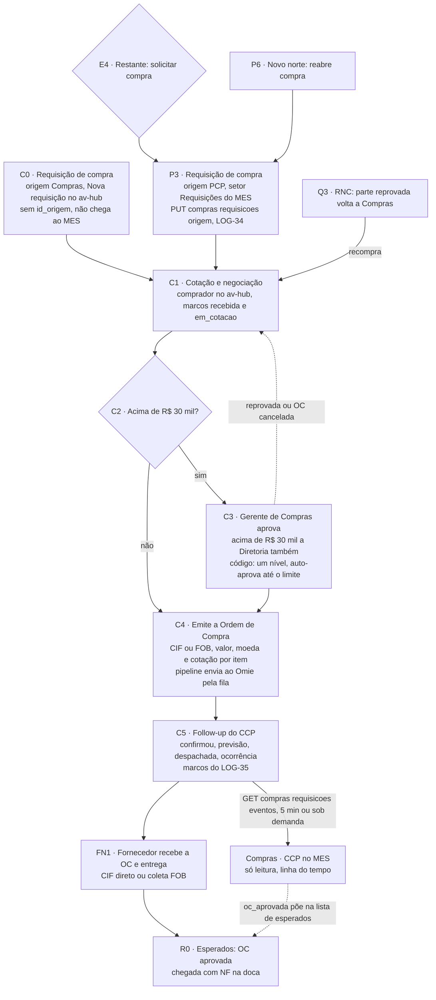

# Circuito de compra (P3, C0 a C5, FN1)

Nós do [[00-Fluxo-Mestre-0b]]: `P3` requisição de compra (origem PCP, MES), `C0` requisição de compra (origem Compras, av-hub), `C1` cotação, `C2` acima de R$ 30 mil?, `C3` aprovação, `C4` emissão da OC, `C5` follow-up do CCP, `FN1` fornecedor. Fecha em `FN1 → R0` ([[05-Recebimento]]). Entrada: `E4` "solicitar compra" ([[03-Estoque-Atendimento-e-Despacho]]) e `Q3` recompra ([[06-Qualidade-Entrada]]). Sequências técnicas completas em [[Integracao-AvHub-MES]]. Selos em [[Regras-do-Vault]].

## Objetivo

Transformar uma **necessidade de material** em uma **Ordem de Compra aprovada**, enviada ao fornecedor e ao Omie, e acompanhar até a chegada física. O circuito cruza dois sistemas: o MES pede e depois só **lê**; o av-hub cota, aprova, emite, envia ao Omie e acompanha. O dado comercial (preço, fornecedor, condição) fica no av-hub; o MES recebe só os **marcos**.

## Quem atua

| Quem | Papel | Onde |
|---|---|---|
| PCP | Abre a requisição do material do pedido (origem PCP) | MES, setor Requisições (`/compras/requisicoes`) |
| Comprador | Cota, negocia, emite a OC | HUB, `/compras/requisicoes`, `/compras/nova` |
| Compras (necessidade própria) | Cria requisição sem pedido de venda ("Nova requisição") | HUB, `compras.pode_criar` |
| Gerente de Compras | Aprova a OC (perfil com `pode_aprovar` na tela `compras`) | HUB, `/compras/aprovacoes` |
| Diretoria | Aprova também as OCs acima de R$ 30 mil | 📝 decidido, 🔴 sem código |
| CCP | Follow-up com o fornecedor: confirmação, previsão, despacho, ocorrência | HUB, `/compras/followup` |
| Pipeline | Envia a OC aprovada ao Omie (fila) | `omie-elt-pipeline`, `envioOrdensCompra.ts` |
| Fornecedor | Recebe a OC e entrega (CIF) ou libera para coleta (FOB); sem acesso ao sistema | externo |
| Compras · CCP no MES | Só leitura: espelha os marcos | MES, `/compras/pedidos-compra` |
| Doca | Registra a chegada com NF e tira a parcial de Compras · CCP | MES ([[05-Recebimento]]) |
| Gustavo, Nathan, Robert | API do av-hub, front do av-hub, MES | ver [[Equipe-e-Divisao]] |

## Regras decididas

| # | Regra | Selo |
|---|---|---|
| 1 | **A requisição tem duas origens.** (1) Compras cria no av-hub ("Nova requisição", `POST /compras/requisicoes`, permissão `compras.pode_criar`); (2) o PCP cria no MES a requisição do material do pedido (Estoque → "Solicitar compra" → setor `REQUISICAO`) | 📝 ✅ HUB `components/Compras/ComprasRequisicoes.tsx:186`, `app/api/compras/requisicoes/route.ts:79-80`; MES `compras.service.ts:135-218` |
| 2 | O circuito do MES é **fixo do sistema, fora do roteiro**: `Estoque → Requisições → Compras · CCP → Recebimento → Qualidade · Entrada → Estoque` | 📝 ✅ `circuito-compra.ts:9-25` |
| 3 | **Ida (LOG-34):** o MES **empurra** cada item da requisição por `PUT /compras/requisicoes/origem/{id_origem}`; fila própria, sem perder se o av-hub cair | 📝 ✅ `envio-avhub.service.ts:21`, `:130` |
| 4 | **Volta (LOG-35):** o MES **lê** os marcos por `GET /compras/requisicoes/eventos` com cursor; polling de 5 min mais leitura sob demanda | 📝 ✅ `eventos-avhub.service.ts:25-31` |
| 5 | **Aprovação:** o **Gerente de Compras aprova sempre**; **acima de R$ 30 mil a Diretoria aprova também** | 📝 🔴 o código difere (ver "Como está no código", C2/C3) |
| 6 | Limite de aprovação é **por unidade**, configurável (`parametros_compras.limite_aprovacao`, padrão 30.000,00), em BRL (OC em moeda estrangeira converte pela cotação) | 📝 ✅ `parametros_compras.model.js:16`; Dump Avhub `fn_ordens_compra_recalcular` (linha 6779) |
| 7 | OC emitida marca a requisição `atendida` por trigger; **nunca** pelo PATCH; OC cancelada devolve **todas** as requisições dela a `aberta` ("nenhum estado é beco sem saída") | 📝 ✅ `requisicoes_compra.route.js:15-17`, `:424-430`; Dump `fn_ordens_compra_requisicao` |
| 8 | Cancelar requisição exige motivo (3 a 500 caracteres) | ✅ `requisicoes_compra.route.js:442-448` |
| 9 | Requisição com OC **não se cancela pelo MES**: 409 `REQUISICAO_COM_OC`; o envio fica `RECUSADO` e não repete | ✅ `requisicoes_compra.route.js:221-265`, `envio-avhub.service.ts:164-169` |
| 10 | **Compras · CCP no MES é só leitura.** A parcial só sai dele quando a doca registra a chegada **com NF** | 📝 ✅ `compras.service.ts:353-399` |
| 11 | OC aprovada entra na lista de **esperados** do Recebimento; OC cancelada tira de lá e devolve ao comprador | 📝 ✅ `compras.service.ts:305-351`, `requisicao-avhub.eventos.ts:275-280` |
| 12 | Rede de segurança: sem OC aprovada vinda do av-hub, quem tem `compras-liberar` libera com motivo | 📝 ✅ `compras.service.ts:404-446` |
| 13 | A OC vai ao **Omie pela pipeline**, por fila (decisão de 24/09): `enviar` = aprovada e pendente; `excluir` = cancelada que já estava no Omie | 📝 ✅ `ordens_compra.route.js:857-889`, `envioOrdensCompra.ts:18-40` |
| 14 | O sistema **não envia a OC ao fornecedor**: e-mail ou PDF fora do sistema; frete CIF (fornecedor entrega) ou FOB (coleta da empresa) | 📝 FN1 fora do sistema |
| 15 | Quem aprova ou cancela OC precisa de `pode_aprovar` na tela `compras`; a identidade vem da sessão do BFF | ✅ `ordens_compra.route.js:1230-1240`; HUB `app/api/compras/ordens/[id]/route.ts:35`, `:53` |
| 16 | Comprador só emite OC na unidade a que pertence; unidade que compra por outra unidade recusa (23514) | ✅ Dump `fn_ordens_compra_nascer`, `fn_ordens_compra_comprador` |

## Estados

### Requisição no av-hub (`requisicoes_compra.status`)

`aberta` → `em_cotacao` → `atendida` (só trigger) · `cancelada`. Transições do PATCH: `aberta→em_cotacao|cancelada`, `em_cotacao→aberta|cancelada`, `cancelada→aberta|em_cotacao`, `atendida→(nenhuma)` (`requisicoes_compra.route.js:13-23`).

### OC no av-hub (`ordens_compra.status`, `status_sincronizacao_omie`)

| Campo | Valores | Fonte |
|---|---|---|
| `status` | `rascunho`, `aguardando_aprovacao`, `aprovado`, `cancelado` | `ordens_compra.route.js:91` |
| `status_sincronizacao_omie` | `pendente`, `sincronizado`, `erro` | `ordens_compra.route.js:95` |
| `finalidade` | `pedidos_venda`, `recompra`, `estoque`, `uso_interno` (só as duas primeiras ligam a PV) | `ordens_compra.route.js:92-94` |

Trigger de recálculo: OC nasce `aguardando_aprovacao`; ao recalcular o total em BRL, **valor ≤ limite vira `aprovado` sozinho**, valor > limite fica `aguardando_aprovacao`; `rascunho` e `cancelado` não mudam; OC já aprovada que sobe acima do limite volta a `aguardando_aprovacao` (Dump `fn_ordens_compra_recalcular`, linhas 6750-6794).

### Marcos que o MES recebe (`requisicoes_compra_eventos.tipo`, 14 valores)

`requisicao_recebida`, `em_cotacao`, `oc_criada`, `oc_removida`, `oc_enviada_aprovacao`, `oc_aprovada`, `oc_no_omie`, `fornecedor_confirmou`, `previsao_alterada`, `despachada`, `ocorrencia`, `oc_cancelada`, `requisicao_cancelada`, `requisicao_reaberta` (Dump Avhub, `requisicoes_compra_eventos_tipo_check`, linha 18692). Só existem para requisição com `id_origem` (a do MES).

### No MES

| Entidade | Valores | Código |
|---|---|---|
| `StatusRequisicaoCompra` | `ABERTA`, `EM_COMPRA`, `RECEBIDA_PARCIAL`, `RECEBIDA`, `CANCELADA` | `compras.prisma:9-15` |
| `etapaCompra` (por material) | `AGUARDANDO_COMPRADOR`, `EM_COTACAO`, `EM_APROVACAO`, `COM_FORNECEDOR`, `EM_TRANSITO`, `CANCELADA` | `compras.prisma:145-149` |
| `TipoItemRequisicao` | `PRODUTO_FINAL` (revenda), `MATERIA_PRIMA` (fabricação) | `compras.prisma:19-22` |
| Envio ao av-hub | `PENDENTE`, `ENVIADO`, `RECUSADO`, `FALHOU` | `integracao.prisma:290-320` |

Efeito de cada marco no MES: tabela em [[Integracao-AvHub-MES]] (INT-03) e `requisicao-avhub.eventos.ts:234-318`.

## Telas

| Nome | Rota | App | Quem | Estado |
|---|---|---|---|---|
| Requisições de compras (fila do setor `REQUISICAO`, "Solicitar compra" e "Requisitar") | `/compras/requisicoes` | app-pcp | PCP | ✅ `compras/requisicoes/page.tsx` (`tipos=['REQUISICAO']`) |
| Compras · CCP (fila do setor `COMPRAS`, só leitura, linha do tempo, "Atualizar") | `/compras/pedidos-compra` | app-pcp | PCP, doca | ✅ `compras/pedidos-compra/page.tsx`, `CompraCcpCard.tsx`, `EventosRequisicaoModal.tsx` |
| Requisições (lista e kanban; botão **Nova requisição** com `pode_criar`) | `/compras/requisicoes`, `/compras/requisicoes/kanban` | HUB | Comprador | ✅ `components/Compras/ComprasRequisicoes.tsx:186-189`, `:426` |
| Emissão da OC | `/compras/nova`, `/compras/nova/[requisicaoId]` | HUB | Comprador | ✅ `components/Compras/FecharCompra.tsx` (limite em `:604-605`, aviso em `:1652`) |
| Ordens de Compra (lista, kanban, detalhe, Omie) | `/compras/ordens`, `/compras/ordem/[id]`, `/compras/pedido-omie/[id]` | HUB | Comprador | ✅ `components/Compras/ComprasOrdens.tsx`, `OrdemDetalhe.tsx`, `PedidoOmieDetalhe.tsx` |
| Aprovações ("acima do limite da unidade") | `/compras/aprovacoes` | HUB | Gerência de Compras | ✅ `components/Compras/ComprasAprovacoes.tsx:78` |
| Follow-up do CCP | `/compras/followup` | HUB | CCP | ✅ `components/Compras/Followup/FollowupLista.tsx`, `FollowupPainel.tsx` |
| Dashboard de Compras, Compradores | `/compras/dashboard-compras`, `/compras/compradores` | HUB | Compras | ✅ fora da espinha |

Nome histórico no MES: o setor `COMPRAS` aparece como "Pedidos de Compra" em rótulos de 09/10 e hoje como **Compras · CCP**; a rota continua `/compras/pedidos-compra`. HUB confirmado em disco (`C:\Users\nathan.silva\Desktop\TI\NATHAN\00 - HUB`, b55ac55).

## Endpoints e contratos

### MES (`api-pcp`, `compras/requisicoes`)

| Rota | Permissão | Efeito | Código |
|---|---|---|---|
| `GET /compras/requisicoes?idItemPedido&status` | `movimentacoes:visualizar` | Lista (até 200) com `marcos` | `compras.controller.ts:30-34` ✅ |
| `GET /compras/requisicoes/esperados` | idem | Parciais em Compras · CCP com OC aprovada ou liberação manual, ordenadas por previsão | `:45-51` ✅ |
| `POST /compras/requisicoes/sincronizar` | idem | Lê agora os marcos (pula se a última leitura boa < 30 s) | `:53-60` ✅ |
| `GET /compras/requisicoes/:id`, `/:id/eventos` | idem | Detalhe e linha do tempo | `:62-73` ✅ |
| `POST /compras/requisicoes` | `movimentacoes:editar` | Cria requisição e move a parcial a Compras · CCP; enfileira o envio | `:75-79` ✅ |
| `POST /compras/requisicoes/:id/cancelar` | idem | Só requisição `ABERTA`; parcial volta a Requisições | `:81-91` ✅ |
| `POST /compras/requisicoes/:id/chegada` | idem + `pode_atuar` no Recebimento | Chegada com NF ([[05-Recebimento]]) | `:93-103` ✅ |
| `POST /compras/requisicoes/:id/liberar-recebimento` | idem + `compras-liberar` | Rede de segurança | `:105-115` ✅ |
| `PATCH /compras/requisicoes/:id/compra` | — | **Removida** (14/10): o registro manual da compra saiu | ✅ ausente em `compras.controller.ts` |

### av-hub (`api-acos-vital`)

| Rota | Quem chama | Efeito | Código |
|---|---|---|---|
| `PUT /compras/requisicoes/origem/:id_origem` | MES (chave `MES_INTEGRACAO_KEYS`) | cria, atualiza, cancela ou ignora (`fn_requisicao_mes_aplicar`) | `requisicoes_compra.route.js:221` ✅ [[LOG-34-Requisicoes-MES-Empurra-para-o-Hub]] |
| `GET /compras/requisicoes/eventos` | MES (`API_KEY`) | marcos com cursor `(registrado_em, id)` | `:289` ✅ [[LOG-35-Compras-Marcos-Requisicao-para-MES]] |
| `GET`, `GET /resumo`, `GET /:id`, `POST`, `PATCH /:id` | HUB (BFF) | caixa do Compras e "Nova requisição"; PATCH só `em_cotacao`, `aberta`, `cancelada` | `:148`, `:199`, `:371`, `:384`, `:413` ✅ |
| `GET /compras/ordens`, `POST /compras/ordens`, `PATCH /:id` (`aprovado` ou `cancelado`) | HUB | lista, emite, aprova ou cancela | `ordens_compra.route.js:607`, `:923`, `:1177` ✅ [[LOG-23-Compras-Pipeline-Consolidado]], [[LOG-36-Compras-Produto-Obrigatorio-e-Comprador-da-OC]] |
| `GET /compras/ordens/fila-omie`, `PATCH /:id/sincronizacao`, `POST /:id/reenviar` | pipeline e HUB | fila e retorno do envio ao Omie | `ordens_compra.route.js:857`, `:1267`, `:1321` ✅ |
| `GET /compras/acompanhamento`, `GET`/`PUT /compras/ordens/:id/acompanhamento`, `POST …/contatos`, `POST …/ocorrencias`, `PATCH /compras/ocorrencias/:id` | HUB (CCP) | follow-up | `ordens_compra_acompanhamento.route.js:298-586` ✅ [[LOG-32-Compras-CCP-Acompanhamento-OC]] |
| `GET /ordens-compra/referencia` | MES (job) | referência e valores da OC | [[API-004-Referencia-OC-Integracao-MES]], [[API-007-Referencia-OC-Valores-no-MES]]; lado hub ✅, **MES não consome** 🔴 |

Montagem em `core_vendas_faturamento/index.js:190-193`. Contratos de banco: [[SQL-008-Requisicoes-Compra]], [[SQL-007-Ordens-Compra-Estruturada]], [[SQL-011-Ordens-Compra-Referencia-MES]], [[SQL-012-Ordens-Compra-Referencia-Valores]].

## Como está no código

### As duas origens da requisição

- ✅ **Origem 1, Compras (C0).** HUB: botão "Nova requisição" só com `can('pode_criar','compras')` (`ComprasRequisicoes.tsx:186`); o BFF exige `requirePermission('compras','pode_criar')` e repassa `POST {API_URL}/compras/requisicoes` com `created_by` da sessão (`app/api/compras/requisicoes/route.ts:79-95`). A API grava sem `id_origem`; o número vem do contador do banco por unidade (`requisicoes_compra.route.js:384-411`).
- ✅ **Origem 2, PCP (P3).** O almoxarife usa "Solicitar compra" em `E4` e a parcial vai ao setor `REQUISICAO` (`itens-parciais.service.ts:727-730`); o PCP abre a requisição com 1+ materiais (`compras.service.ts:135-218`), obrigatório prazo de necessidade, produto buscado no av-hub; a parcial vai `EM_TRANSITO` a Compras · CCP e o envio entra na fila **na mesma transação** (`:212`). Cada material vira uma requisição separada no av-hub (cada requisição do av-hub tem 1 material).
- 🟡 Fallback: em ordens montadas sem o setor Requisições, dá para requisitar já em Compras (`compras.service.ts:138-155`).

### Ida (LOG-34)

✅ `EnvioAvhubService` faz `PUT {API_URL}/compras/requisicoes/origem/{id_origem}`, com `id_origem` = id do `RequisicaoCompraItem`. Dispara após criar ou cancelar e a cada `AVHUB_ENVIO_INTERVALO_SEG` (60 s); espera 1, 2, 5, 10, 30 e 60 min (`envio-avhub.service.ts:21`, `:130`). Chave `AVHUB_MES_INTEGRACAO_KEY`, que só abre esse PUT (`apiKeyAuth.js:94-100`). 200/201 grava `ENVIADO` e espelha id, número e status do av-hub; 409 `REQUISICAO_COM_OC` vira `RECUSADO` (`:164-169`). Precisão: o MES guarda 4 casas e o hub 3.

### No av-hub: caixa do Compras (C1)

✅ `fn_requisicao_mes_aplicar` aplica a ida (Dump Avhub, linha 8680). A caixa lê as **duas origens** sem distinção (`GET /compras/requisicoes`). Trigger grava marcos `requisicao_recebida` (INSERT) e `em_cotacao` (`aberta → em_cotacao`) (Dump, linha 8966). Cotação e negociação com o fornecedor são **fora do sistema** 📝.

### C2 e C3: aprovação (🔴 código difere da decisão)

- ✅ **O que o código faz:** a OC nasce `aguardando_aprovacao`; a trigger de recálculo **aprova automaticamente** a OC cujo total em BRL é **menor ou igual** ao limite da unidade (30.000,00 por padrão) e deixa `aguardando_aprovacao` a que passa do limite (Dump, linhas 6779-6794). O HUB avisa "Acima de {limite}, ela nasce Aguardando aprovação" (`FecharCompra.tsx:1652`). Quem aprova ou cancela uma OC aguardando é **um** usuário com `pode_aprovar` na tela `compras` (Gerência de Compras): `ordens_compra.route.js:1230-1240`, `FecharCompra.tsx:604-605`. **Não existe segundo aprovador nem papel "Diretoria".**
- 📝 **O que foi decidido (14/10):** o Gerente de Compras aprova **sempre**; acima de R$ 30 mil a Diretoria aprova **também**. Gap: (a) OC até R$ 30 mil hoje **dispensa** o Gerente; (b) acima de R$ 30 mil falta o segundo nível. Evento `oc_enviada_aprovacao` só marca a mudança para `aguardando_aprovacao` (Dump, linha 6929).
- 🟡 Segregação comprador ≠ aprovador (DEC-3 do v1): o `aprovado_por` vem do BFF (sessão), mas a API **não** compara com `created_by` (`ordens_compra.route.js:1217-1240`) ❓ conferir se há trava no banco.

### C4: emissão da OC e envio ao Omie

✅ A OC carrega fornecedor, transportadora, previsão de chegada, condição e parcelas, `tipo_frete`, `moeda` com `cotacao_moeda`/`cotacao_data`/`cotacao_origem` (PTAX), `valor_frete`, `valor_seguro`, `finalidade`, e por item: `valor_unitario`, `desconto`, `tipo_material` (acabado ou não), `id_requisicao` e `vinculos` ao pedido de venda (`ordens_compra.route.js:109-132`). Várias requisições do MES cabem numa OC (uma por item). ✅ A pipeline lê `fila-omie` e envia com `UpsertPedCompra` (`cCodIntPed` = número da OC), exclui OC cancelada que já estava no Omie com `ExcluirPedCompra`, e devolve `nCodPed` pelo `PATCH …/sincronizacao`; OC com erro **sai** da fila e só volta por "Reenviar" (`envioOrdensCompra.ts:18-40`). O evento `oc_no_omie` leva `numero_pedido_omie` ao MES.

### C5: follow-up do CCP

✅ HUB `/compras/followup` e tabelas `ordens_compra_acompanhamento`, `_contatos`, `_ocorrencias`. Marcos `fornecedor_confirmou`, `previsao_alterada`, `despachada` (data, NF do fornecedor, transportadora), `ocorrencia` (aberta ou resolvida) chegam ao MES. 🔴 Perfil exclusivo do CCP (só ele edita): hoje vale a permissão da tela, conforme [[LOG-32-Compras-CCP-Acompanhamento-OC]].

### Volta (LOG-35) e Compras · CCP

✅ Dois gatilhos: polling de 5 min e leitura sob demanda (a tela chama `POST /compras/requisicoes/sincronizar` ao abrir e no "Atualizar", `FilaSetor.tsx:370-396`; rodada compartilhada, pulada se a última leitura boa tem menos de 30 s, `eventos-avhub.service.ts:31`, `:80`). Chave `API_KEY` do MES. Cada evento é gravado e aplicado numa transação; se falhar, o cursor não avança; evento que não aplica fica com `ERRO:` em `acao` (`:150-181`). O MES usa **todos os 14 marcos**; por marco: `etapaCompra`, `numeroOc`, `numeroPedidoOmie`, `previsaoChegada`, `despachadaEm`, `nfFornecedor`, `transportadora`, `ocorrenciaAberta` e o resumo da requisição (ABERTA ↔ EM_COMPRA). `requisicao_cancelada` com todos os materiais cancelados devolve a parcial a Requisições; `requisicao_reaberta` devolve a Compras · CCP. Migration 035b: `autor` e `comprador` em cada marco.

### Pontas soltas da requisição

1. 🔴 **Requisição criada só no av-hub (C0) não chega ao MES.** `id_origem` é `NOT NULL` em `requisicoes_compra_eventos` (Dump, linha 18683), então ela não gera marco; e nenhuma rota entrega ao MES o material que ela comprou. Resultado: não há caminho para o MES receber, conferir e dar entrada no material comprado por requisição de necessidade própria. Opções: (a) contrato novo de OC → MES (job do 004/007) que cria "compra avulsa" no Recebimento; (b) a mercadoria da C0 entra por carga manual; (c) o Recebimento também passa a ler OC aprovada sem requisição do MES. Decisão do Nathan.
2. 🔴 `GET /requisicoes-compra` do MES ([[API-003-Requisicao-Compra-Integracao-MES]], `integracao-avhub.controller.ts:20-24`) ficou **sem consumidor** (a ida é por PUT).
3. 🟡 O comentário "JOB DE POLLING do MES" em `requisicoes_compra.route.js:31-34` está velho.
4. 🔴 **Fornecedor da OC só chega ao MES** com o job do contrato 004/007 (K4), sem código: `RequisicaoCompra.fornecedor` fica vazio e a conferência usa o que a doca digita (`compras.prisma:84-91`).
5. 🔴 A aprovação em dois níveis (item C2/C3 acima).
6. ❓ O SQL de `fn_requisicao_mes_aplicar` (migration 034) está em produção mas não versionado (Gustavo).
7. 🟡 Recompra por RNC não tem contrato: a OC antiga segue `atendida` (ver [[06-Qualidade-Entrada]], pendência 2).
8. 🟡 Um item cancelado pelo Compras volta a Requisições com motivo, e o PCP decide: abrir outra requisição ou devolver ao Estoque (`compras.service.ts:222-227`).

## O que falta desenvolver

| # | O quê | Dono | Nó | Selo |
|---|---|---|---|---|
| 1 | **Aprovação em dois níveis:** Gerente de Compras sempre; Diretoria acima do limite. Mudar a trigger (hoje auto-aprova ≤ limite), criar o papel (`pode_aprovar` por nível ou tela `compras-diretoria`), UI de Aprovações com segunda etapa e marco `oc_enviada_aprovacao` por nível | Gustavo (banco e API), Nathan (tela) | C2, C3 | 🔴 |
| 2 | **Requisição só do av-hub chegar ao MES** (ponta solta 1) | Nathan decide; Gustavo (API), Robert (MES) | C0, R0 | 🔴 |
| 3 | **Job do contrato 004/007 no MES:** projeção da OC (fornecedor, valores) e custo do lote | Robert | C4, R4 | 🔴 |
| 4 | **Perfil CCP:** edição só pelo CCP | Gustavo, Nathan | C5 | 🔴 |
| 5 | Remover ou arquivar `GET /requisicoes-compra` (contrato 003) e o comentário velho | Gustavo, Robert | — | 🟡 |
| 6 | **Versionar** `fn_requisicao_mes_aplicar` (migration 034) | Gustavo | P3 | ❓ |
| 7 | Contrato de **recompra por RNC** | Nathan decide | Q3, C1 | 🔴 |
| 8 | Aviso ao PCP e ao vendedor quando a previsão de chegada atrasa o pedido de venda | Nathan | C5 | 🔴 |
| 9 | Dois formulários ou um para origem PCP e origem Compras (T-03): o MES exige pedido e prazo; o HUB aceita sem pedido | Nathan | P3, C0 | 🟡 |
| 10 | Teste ponta a ponta do circuito com `AVHUB_MES_INTEGRACAO_KEY` e `API_KEY` reais | Robert, Gustavo | P3, C5 | ❓ |

## Pendências

- Nathan: o segundo nível é só valor (acima de R$ 30 mil) ou também finalidade (por exemplo, uso interno)? O limite é por unidade ou global? O código tem por unidade.
- Nathan: segregação comprador ≠ aprovador continua valendo se o Gerente também compra?
- Compras: prazo máximo de OC sem confirmação do fornecedor até destacar na fila do CCP.
- Compras: quem avisa quando uma OC é cancelada depois de aprovada e a parcial já estava esperada no Recebimento (o MES tira da lista, mas ninguém avisa a doca).
- Gustavo: `requisicoes_compra_eventos.id_origem NOT NULL` precisa mudar se a decisão da ponta solta 1 for gerar marcos para requisição do Compras.

## Subfluxo

Próxima raia: [[05-Recebimento]].
