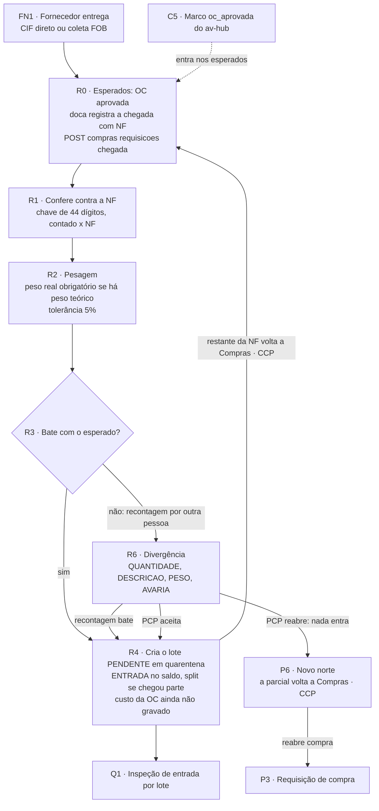

# Raia Recebimento (R0 a R6)

Nós do [[00-Fluxo-Mestre-0b]]: `R0` esperados e chegada com NF, `R1` conferência contra a NF, `R2` pesagem, `R3` bate com o esperado?, `R4` cria o lote em quarentena, `R6` divergência. (`R5` não existe no 0b.) Entrada: `FN1` fornecedor entrega ([[04-Circuito-de-Compra]]). Saída: `Q1` ([[06-Qualidade-Entrada]]) ou `P6` ([[02-PCP-Triagem-e-Destinacao]]). Selos em [[Regras-do-Vault]].

## Objetivo

Receber na doca o material comprado, conferi-lo **contra a nota fiscal** e transformar o que chegou em **lote em quarentena** (`PENDENTE`) com entrada no saldo, para a Qualidade inspecionar. Enquanto há divergência aberta, **nada entra** no estoque. O cruzamento com a **OC** (preço, quantidade comprada, fornecedor) entra quando existir o job do contrato 004/007 🔴; até lá a conferência não compara com a OC.

## Quem atua

| Quem | Papel | Onde |
|---|---|---|
| Doca (conferente) | Registra a chegada com NF, conta, pesa, informa avaria e descrição | MES, `/logistica/logistica-entrada` |
| Segunda pessoa | Reconta quando há divergência (quem conferiu **não** pode recontar) | idem |
| PCP | Decide `ACEITAR` ou `REABRIR` quando a recontagem continua divergindo | MES, `/decisoes-pcp` |
| Compras (`compras-liberar`, em geral só o Administrador) | Libera a requisição para o Recebimento sem OC aprovada | `FilaSetor` / `CompraCcpCard` |
| Qualidade | Recebe o lote | [[06-Qualidade-Entrada]] |

Permissões: `movimentacoes` (visualizar ou editar) para conferir e recontar; `decisoes-pcp` para listar e decidir; `pode_atuar` no setor Recebimento (`PerfilSetor`) para a chegada e a recontagem (`compras.service.ts:381-382`, `recebimento.service.ts:260`); a decisão do PCP **não** exige setor (`recebimento.service.ts:336`, `registrarRecebimento` com `checarPermissaoSetor: false`).

## Regras decididas

| # | Regra | Selo |
|---|---|---|
| 1 | **Esperados:** só aparece na lista da doca a parcial em Compras · CCP cuja requisição tem **OC aprovada** no av-hub (e não cancelada) ou **liberação manual** | 📝 ✅ `compras.service.ts:305-351`, `:448-456` |
| 2 | **Sem NF a parcial não sai de Compras · CCP**, para o tempo do fornecedor não cair no Recebimento. A doca informa número ou **chave de 44 dígitos** | 📝 ✅ `compras.service.ts:356-370`, `compras-ccp.dto.ts:17-20` |
| 3 | **A conferência é contra a NF**, não contra o pendente nem a OC. Receber mais do que a requisição pede é permitido; a sobra fica livre no estoque | 📝 ✅ `recebimento.service.ts:100-102`, `:176-177`; `compras.service.ts:464` |
| 4 | **Peso:** se o material tem peso teórico, o **peso real é obrigatório**; desvio acima da tolerância (padrão 5%, por material) vira divergência `PESO` | 📝 ✅ `recebimento.service.ts:373-400`, `estoque.prisma:167` |
| 5 | Tudo bate: o lote nasce **na hora**, `PENDENTE`, com `ENTRADA` no saldo na localização da conferência; recebimento `CONCLUIDO` | 📝 ✅ `recebimento.service.ts:200-231`, `compras.service.ts:537-568` |
| 6 | Diverge: **nada entra**; `AGUARDANDO_RECONTAGEM`; outra pessoa reconta | 📝 ✅ `recebimento.service.ts:233-244`, `:254-258` |
| 7 | Recontagem bate: `CONCLUIDO`. Continua divergindo: `AGUARDANDO_DECISAO` do PCP | 📝 ✅ `recebimento.service.ts:315-326` |
| 8 | PCP `ACEITAR` (entra a quantidade recontada) ou `REABRIR` (nada entra; a parcial volta a Compras · CCP); **motivo obrigatório** | 📝 ✅ `recebimento.service.ts:331-368`, `conferir-recebimento.dto.ts:140-143` |
| 9 | **Recebimento parcial faz split:** o que chegou segue para a Qualidade, o **restante volta a Compras · CCP** aguardando a próxima NF | 📝 ✅ `compras.service.ts:506-531`, `:590-611` |
| 10 | Avaria exige foto (URL de evidência); descrição e avaria são informadas pelo conferente; quantidade e peso o sistema calcula | ✅ `recebimento.service.ts:411-413`; `compras.prisma:39-47` |
| 11 | Só um recebimento aberto por parcial (409 se há conferência aguardando recontagem ou decisão) | ✅ `recebimento.service.ts:534-546` |
| 12 | Lote **sempre** nasce `PENDENTE` (quarentena), mesmo item "acabado" | 📝 ✅ `compras.service.ts:545-547` |
| 13 | **Custo do lote vem da OC, opcional**, e nunca bloqueia o recebimento | 📝 🔴 não gravado (ver R4) |
| 14 | Recebimento nunca decide compra: a divergência vai ao PCP; o `REABERTO` devolve a Compras | 📝 ✅ `recebimento.service.ts:340-351` |

## Estados

### `StatusRecebimento` (`compras.prisma:31-37`)

| Valor | Significado | Próximo |
|---|---|---|
| `CONCLUIDO` | Bateu (na conferência ou na recontagem); lotes criados | Qualidade |
| `AGUARDANDO_RECONTAGEM` | Divergiu; nada entrou | recontagem por outra pessoa |
| `AGUARDANDO_DECISAO` | A recontagem continua divergindo | PCP |
| `ACEITO` | PCP aceitou; entrou a quantidade recontada | Qualidade |
| `REABERTO` | PCP reabriu; nada entrou | Compras · CCP |

### `TipoDivergenciaRecebimento` (`compras.prisma:42-47`)

`QUANTIDADE` (contado ≠ NF, calculada), `PESO` (fora da tolerância, calculada), `DESCRICAO` (informada), `AVARIA` (informada, com foto). Cada divergência guarda `etapa`: `conferencia` ou `recontagem`.

### Parcial e requisição

Parcial no setor `LOGISTICA_ENTRADA` (nome "Recebimento", código `logistica-entrada`) em estado "aguardando": `CRIADO`, `EM_TRANSITO`, `RECEBIDO` ou `EM_ANDAMENTO` (`STATUS_AGUARDANDO`, `circuito-compra.ts:30-35`). `StatusRequisicaoCompra`: `ABERTA`/`EM_COMPRA` → `RECEBIDA_PARCIAL` → `RECEBIDA` (`compras.service.ts:576-579`); `CANCELADA`. Lote: `PENDENTE` ([[06-Qualidade-Entrada]], [[Estados-e-Status]]).

## Telas

| Nome atual | Nome antigo | Rota | Slug | Ações |
|---|---|---|---|---|
| Recebimento | Logística de entrada | `/logistica/logistica-entrada` | `logistica-entrada` | lista de esperados, **Receber com NF** (`FilaSetor.tsx:594`, `ReceberComNfModal.tsx:56`), **Conferir recebimento** (`FilaSetor.tsx:923`, `ConferirRecebimentoModal.tsx:199`), **Recontar** (`FilaSetor.tsx:936`, `RecontarRecebimentoModal.tsx:91`), **Liberar para o Recebimento sem OC** (`FilaSetor.tsx:911`) |
| Divergências de Recebimento | Decisões do PCP | `/decisoes-pcp` | `decisoes-pcp` | Aceitar ou Reabrir com motivo (`decisoes-pcp/page.tsx`) |
| Compras · CCP | Pedidos de Compra | `/compras/pedidos-compra` | `pedidos-compra` | onde a parcial espera até a NF chegar ([[04-Circuito-de-Compra]]) |

`/logistica/logistica-entrada/page.tsx` é só `ModuloSetores` com `tipos=['LOGISTICA_ENTRADA']`. A NF da chegada vem pré-preenchida na conferência (`ConferirRecebimentoModal.tsx:60`). Não há leitor de código de barras: a chave de 44 dígitos é digitada.

## Endpoints e contratos

| Método e rota | Permissão | Efeito | Código |
|---|---|---|---|
| `GET /compras/requisicoes/esperados` | `movimentacoes:visualizar` | R0: lista de esperados | `compras.controller.ts:45-51` ✅ |
| `POST /compras/requisicoes/:id/chegada` `{idItemParcial, numeroNf?, chaveAcessoNf?}` | `movimentacoes:editar` | R0: grava `nfChegada`, `chaveNfChegada`, `chegadaEm`; parcial vai ao Recebimento | `compras.controller.ts:93-103`, `compras.service.ts:356-399` ✅ |
| `POST /compras/requisicoes/:id/liberar-recebimento` `{motivo}` | `movimentacoes:editar` + `compras-liberar` | Rede de segurança (motivo até 500) | `compras.controller.ts:105-115`, `compras.service.ts:404-446` ✅ |
| `GET /compras/recebimentos`, `GET /:id` | `movimentacoes:visualizar` | Lista (até 200) e detalhe | `recebimento.controller.ts:26-43` ✅ |
| `GET /compras/recebimentos/decisoes` | `decisoes-pcp:visualizar` | Fila `AGUARDANDO_DECISAO` | `:32-37` ✅ |
| `POST /compras/recebimentos` | `movimentacoes:editar` | R1 a R4: conferir (`idRequisicao`, `idItemParcial`, itens com `quantidadeNf`, `quantidadeContada`, `pesoReal`, `idLocalizacao`; cabeçalho `numeroNf`, `chaveAcessoNf`, `fornecedor`, `laudoUrl`; divergências informadas) | `:45-49` ✅ |
| `POST /compras/recebimentos/:id/recontar` | `movimentacoes:editar` | Recontagem por outra pessoa | `:51-59` ✅ |
| `POST /compras/recebimentos/:id/decidir` `{decisao: ACEITAR\|REABRIR, motivo}` | `decisoes-pcp:editar` | Decisão do PCP | `:61-69` ✅ |
| `POST /compras/requisicoes/:id/recebimentos` | — | **Removida**; o registro direto não existe mais | ✅ |
| `GET /estoque/lotes/:id/etiqueta` | Estoque | PDF Code128 do lote | `estoque/etiquetas/etiqueta.controller.ts` ✅ |

Contratos de apoio: [[LOG-35-Compras-Marcos-Requisicao-para-MES]] (marco `oc_aprovada` põe a parcial nos esperados), [[API-004-Referencia-OC-Integracao-MES]] e [[API-007-Referencia-OC-Valores-no-MES]] (referência e valores da OC, **MES não consome**), [[API-008-Custo-do-Lote-no-MES]] (custo no lote).

## Como está no código

### R0: esperados e chegada com NF

✅ O marco `oc_aprovada` grava `ocAprovadaEm` no item da requisição (`requisicao-avhub.eventos.ts:275-280`). `podeReceber` = `liberadaRecebimentoEm` preenchido **ou** algum item com `ocAprovadaEm` e `etapaCompra ≠ CANCELADA` (`compras.service.ts:448-456`). Os esperados saem ordenados por `previsaoEntrega` (`:346-350`). Na chegada, o service exige: requisição não cancelada, `podeReceber`, parcial do mesmo item do pedido, parcial **em Compras · CCP** e aguardando, e `pode_atuar` no setor Recebimento (`:362-382`). A parcial vai `EM_TRANSITO` ao Recebimento com a observação "Chegou a NF … aguardando a conferência" (`:386-398`). `oc_cancelada` tira dos esperados e devolve ao comprador (`requisicao-avhub.eventos.ts:300-307`).

### R1: conferência contra a NF

✅ `RecebimentoService.conferir` valida que cada item pertence à requisição e entra uma vez só, que a localização existe, e que algo foi contado (`recebimento.service.ts:147-162`). Para cada item calcula `pendente = max(quantidade − quantidadeRecebida, 0)` e avalia **contado × NF** (`:164-171`, `:373-381`). Grava `Recebimento` (`RB-AAAAMMDD-NNNN`), `RecebimentoItem` e `RecebimentoDivergencia` (`:452-504`, `:548-552`).

### R2: pesagem

✅ Peso teórico = `Material.pesoTeoricoUnitario × contado`; sem peso teórico o item não é pesado; com ele, o peso real digitado é obrigatório (400 se falta) e o desvio acima de `toleranciaPeso` vira `PESO` (`recebimento.service.ts:382-398`). Balança sem saída digital: o peso é digitado.

### R3: bate com o esperado?

✅ "Bate" = nenhuma divergência calculada nem informada. Não bate: `AGUARDANDO_RECONTAGEM`. A recontagem exige **todos** os itens (`:263-265`), mantém `DESCRICAO` e `AVARIA` já apontadas (`:275-277`) e reavalia quantidade e peso. Se ainda diverge: `AGUARDANDO_DECISAO`.

### R4: cria o lote em quarentena

✅ `ComprasService.registrarRecebimento` (`compras.service.ts:472-616`), numa transação com retry de código (`LT-AAAAMMDD-NNNN`):
1. Lote `PENDENTE`, `origem RECEBIMENTO`, `quarentenaDesde`, com `idRequisicaoItem`, NF, fornecedor (`:541-554`).
2. `SaldoEstoque` (`aplicarDeltaSaldo`) e `MovimentoEstoque` `ENTRADA` na localização (`:557-568`).
3. `quantidadeRecebida` do item incrementa; a requisição vira `RECEBIDA` (todos os itens cobertos) ou `RECEBIDA_PARCIAL` (`:569-579`).
4. A parcela que o recebimento cobre avança: na revenda, o que chegou do **produto final**, `min(parcial, produtoFinal)`; só com matéria-prima, a parcial inteira quando tudo chegou (`:508-526`). Se é a parcial toda, `moverParcial`; se é parte, `splitParaDestino` (nasce parcial nova) para o setor `QUALIDADE` com `idLoteCompra` apontando o lote (`:590-601`).
5. O restante volta a **Compras · CCP** `EM_TRANSITO`, com "falta N" (`:604-611`).

🔴 **Custo da OC não é gravado.** O desenho (API-008, decisão D1 de 14/10) manda criar `lote_custo` com `origem = OC` por produto dentro da OC, com `id_item_oc`. Em `registrarRecebimento` e em `RecebimentoService` **não há** `loteCusto.create` (as únicas gravações são a carga inicial, `estoque-operacao.service.ts:440`, e a cisão, `estoque-operacao.helpers.ts:434`). Faltam: o job do 004/007 que traz os valores da OC ao MES, a regra do lote por produto dentro da OC, a conversão de unidade (D2: sem fator no ciclo 1; lote sem custo e sinalizado) e o aviso `cotacao_a_conferir` quando a cotação é manual.

### R6: divergência e decisão do PCP

✅ `REABRIR`: recebimento `REABERTO`; a parcial volta ao setor Compras com "reaberto pelo PCP: motivo — volta a Compras (devolução ao fornecedor / nova compra)" (`recebimento.service.ts:340-351`). `ACEITAR`: entra a quantidade recontada (ou a contada); se nada foi contado, 400 "use Reabrir compra" (`:354-360`). 🔴 Não existe "reabrir divergência de produção" (o 0b prevê o vazio de P6) e a reabertura não avisa o av-hub: a OC segue `atendida` ([[04-Circuito-de-Compra]], ponta solta 7).

## Dados

| Tabela (`public`, MES) | Campos que importam |
|---|---|
| `requisicoes_compra` | `pedido_compra`, `fornecedor`, `previsao_entrega`, `comprado_em`, `liberada_recebimento_*`, `motivo_liberacao`, `nf_chegada`, `chave_nf_chegada`, `chegada_em` (`compras.prisma:84-104`) |
| `requisicoes_compra_itens` | `quantidade`, `quantidade_recebida`, `etapa_compra`, `numero_oc`, `oc_aprovada_em`, `previsao_chegada`, `despachada_em`, `nf_fornecedor`, `transportadora`, `ocorrencia_aberta` (`:119-164`) |
| `recebimentos` | `codigo`, `status`, `numero_nf`, `chave_acesso_nf`, `fornecedor`, `laudo_url`, `conferido_por_id`, `recontado_por_id`, `decidido_por_id`, `motivo_decisao` (`:168-210`) |
| `recebimentos_itens` | `quantidade_pendente`, `_nf`, `_contada`, `_recontada`, `peso_teorico`, `_real`, `_recontado`, `tolerancia_peso`, `id_localizacao`, `id_lote` (`:212-240`) |
| `recebimentos_divergencias` | `tipo`, `descricao`, `evidencia_url`, `etapa` (`:242-257`) |
| `lotes` | `PENDENTE`, `id_requisicao_item`, `numero_nf`, `fornecedor` ([[03-Estoque-Atendimento-e-Despacho]]) |

Migrations: `20261006140000_recebimento_conferencia`, `20261014120000_compras_ccp`. Modelo geral em [[Banco-MES]].

## O que falta desenvolver

| # | O quê | Dono | Nó | Selo |
|---|---|---|---|---|
| 1 | **Gravar o custo da OC no lote** (`lote_custo`, `origem OC`, `id_item_oc`, `cotacao_a_conferir`) com o job do 004/007; lote por produto dentro da OC; lote sem custo sinalizado quando a unidade difere | Robert (MES), Gustavo (rota) | R4 | 🔴 |
| 2 | **Cruzar a conferência com a OC** (quantidade comprada, fornecedor) quando existir o job 004/007; hoje só NF | Robert | R1, R3 | 🔴 |
| 3 | **Material comprado por requisição só do av-hub (C0)** não tem como ser esperado nem conferido | Nathan decide | R0 | 🔴 (ver [[04-Circuito-de-Compra]]) |
| 4 | Reabertura de divergência de produção e o `P6` novo norte | Robert | R6, P6 | 🔴 |
| 5 | Leitor de código de barras da chave da NF e posto de recebimento (impressora, leitor) | Robert | R1 | 🔴 |
| 6 | Avisar o av-hub quando o PCP **reabre** o recebimento (devolução ao fornecedor, nova compra) | Nathan, Gustavo, Robert | R6 | 🔴 |
| 7 | Aviso à doca quando uma OC esperada é cancelada no av-hub | Robert | R0 | 🟡 |
| 8 | Teste ponta a ponta de "Receber com NF" e da lista de esperados com OC real | Robert | R0 | ❓ |
| 9 | Alerta de OC esperada que passou da previsão sem chegar | Compras, Robert | R0 | 🔴 |

## Pendências

- Nathan: tolerância de peso de 5% vale para toda categoria (decisão provisória do v1), ou por material? O código guarda por material (`toleranciaPeso`, padrão 0,05).
- Nathan: quando existir o cruzamento com a OC, a divergência de quantidade contra a OC bloqueia (como a da NF) ou só avisa?
- Robert: conferência de NF com **várias OCs** ou várias requisições na mesma nota (hoje a conferência é por requisição e parcial).
- Robert: `RecebimentoService.conferir` usa o fornecedor digitado quando o MES não tem `fornecedor` da OC; confirmar que o campo preenchido pela doca não conflita com o futuro vindo do 004.

## Subfluxo

Próxima raia: [[06-Qualidade-Entrada]].
