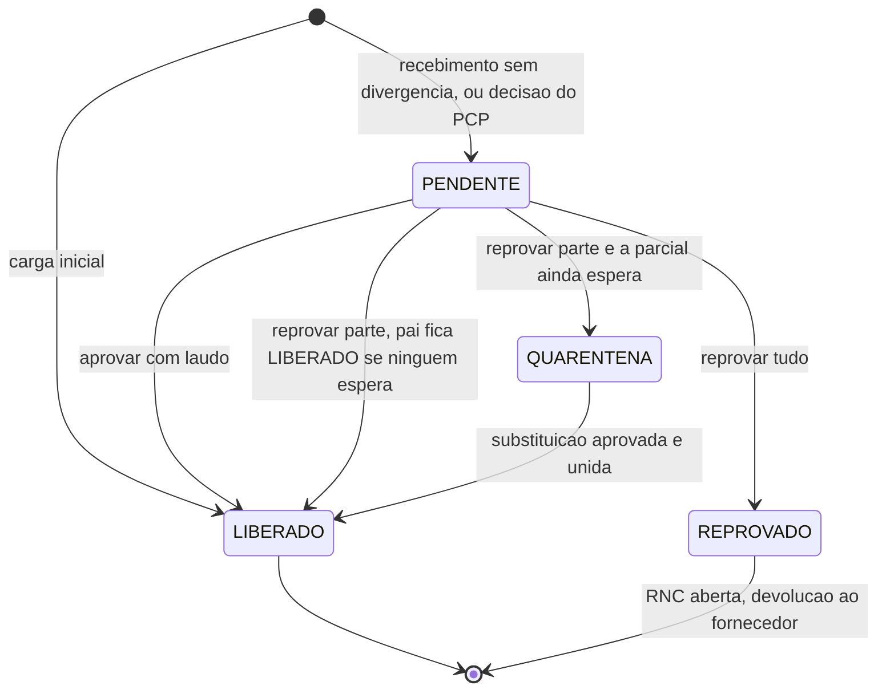
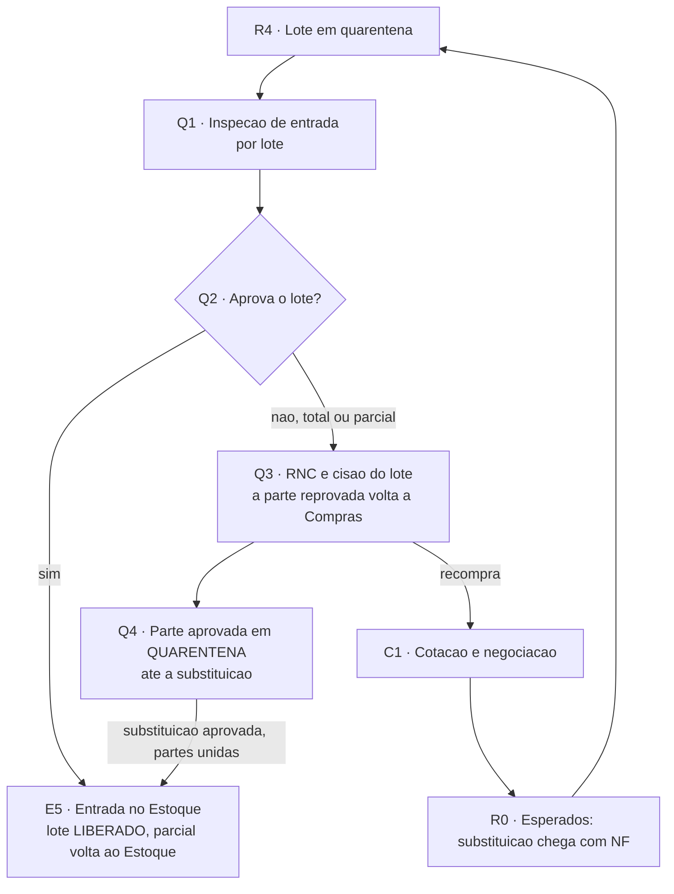

# Qualidade de entrada (Q1 a Q4)

**Em uma frase:** a Qualidade inspeciona o lote que chegou do fornecedor e decide se ele entra no Estoque ou volta para Compras, para que nada comprado vire saldo sem laudo. Nós `Q1` a `Q4` do [[00-Fluxo-Mestre-0b]]. A inspeção de saída da produção é outra raia: [[08-Qualidade-Saida]].

> [!info] Decisões de 29/10/2026 (N16-120 a N16-143)
> - N16-124: só o setor da Qualidade decide o lote. Hoje qualquer usuário com permissão de editar a inspeção decide.
> - N16-125: não existe concessão. O lote é liberado ou reprovado.
> - N16-126: lote 100% reprovado volta ao fornecedor e abre a recompra (RNC).
> - N16-127: o Compras é avisado no av-hub da recompra. Isso exige contrato novo entre MES e hub.

## Como funciona, passo a passo

1. O [[05-Recebimento]] entrega o lote em quarentena (status `PENDENTE`). Ele aparece na fila da Qualidade, do mais antigo ao mais novo, e ainda não conta no saldo. `Q1`
2. O inspetor da Qualidade abre o lote na tela de inspeção e decide: aprova ou reprova. `Q2`
3. Para aprovar, ele anexa o laudo. Para reprovar, anexa laudo, motivo e evidência e informa a quantidade reprovada. `Q2`
4. Aprovado: o lote fica `LIBERADO`. A parcial que esperava junta-se às outras do mesmo item e volta ao Estoque. `E5`
5. Reprovado em parte: a quantidade reprovada vira um lote filho separado e o sistema abre a RNC (registro de não conformidade). `Q3`
6. A parte reprovada volta para Compras, que combina com o fornecedor a devolução e a substituição. `Q3`
7. Se ainda há parcial esperando, a parte aprovada fica em quarentena até a substituição chegar. `Q4`
8. A substituição chega como nova entrega com nota, passa de novo pela inspeção e, aprovada, une-se à parte em quarentena. `Q4` → `E5`

## Exemplo

O lote de aço carbono comprado para as 100 flanges chega e fica em quarentena. O inspetor reprova uma parte. Só essa quantidade vira um lote filho, a RNC abre e Compras negocia a troca com o fornecedor. O aço aprovado espera em quarentena. Quando a reposição chega e passa na inspeção, as duas partes se unem e seguem ao Estoque. O Omie emite a nota de devolução, não o sistema.

## Quem atua

| Quem | O que faz |
|---|---|
| Inspetor da Qualidade | Anexa o laudo, aprova ou reprova o lote |
| Almoxarife / Recebimento | Entrega o lote em quarentena e recebe a parcial de volta no Estoque |
| Compras | Recebe a parte reprovada e alinha devolução e substituição |
| PCP | Só acompanha a parcial; não decide nada aqui |

## Regras que valem

- A inspeção vale para o lote, nunca para a parcial (decisão EC-01).
- Aprovar exige laudo. Reprovar exige laudo, motivo e evidência.
- Na reprovação parcial, a parte aprovada fica em quarentena até a substituição ser aprovada (EC-07).
- Material aprovado vai ao Estoque. Nunca segue direto à Expedição.
- O sistema nunca emite a nota de devolução. Ele só sinaliza e o Omie emite.
- Lote da carga inicial já nasce liberado, porque a dupla conferência faz o papel do laudo.
- Reprovação total também tem saída: a parte volta a Compras. Nenhum estado fica sem dono.
- Devolução a fornecedor (RNC) e devolução de cliente são coisas diferentes. Só a primeira existe aqui.

## O que já existe e o que falta

- ✅ Tela de inspeção, aprovação, reprovação com cisão do lote e devolução da parte reprovada a Compras.
- ✅ Substituição que se une à parte em quarentena e segue ao Estoque.
- 🟡 Painel do Estoque com alerta de RNC pendentes: é protótipo, mas o alerta usa API real.
- 🟡 Travar a decisão ao setor da Qualidade (decidido em N16-124, falta código).
- 🔴 Fechar a RNC: registrar a nota de devolução e dar baixa do lote reprovado. Hoje é manual, fora do MES.
- 🔴 Avisar o Compras no av-hub da recompra por RNC. Sem contrato.
- 🔴 Inspeção de processo (Ciclo 2).
- ❓ Nome do perfil da Qualidade no ambiente real.

## Detalhe técnico

### Quem atua (com telas e perfis)

| Quem | Onde | O que faz |
|---|---|---|
| Inspetor da Qualidade | MES, tela `/qualidade/inspecao-entrada` | Anexa o laudo, aprova ou reprova o lote (informa a quantidade reprovada) |
| Almoxarife / Recebimento | MES | Entrega o lote em quarentena (nó `R4`), depois recebe a parcial de volta no Estoque |
| Compras (comprador, CCP) | av-hub e Compras · CCP no MES | Recebe de volta a parte reprovada, alinha com o fornecedor a devolução e a substituição |
| PCP | MES | Não decide nada aqui; só vê a parcial andando |

CCP = acompanhamento de compras. Os perfis são dados do banco (`perfis`, `permissoes`, `perfil_setores`); o código não fixa nome de perfil "Qualidade" ❓ (confirmar o nome no ambiente). Detalhe de permissões na seção "Perfil e permissões do setor QUALIDADE".

### Objetivo (original)

Impedir que material comprado chegue ao saldo disponível sem laudo. A inspeção é **por lote** (a entidade `Lote`), nunca por parcial. O que sai aprovado vira saldo no Estoque ([[03-Estoque-Atendimento-e-Despacho]], nó `E5`); o que sai reprovado abre uma RNC e volta a Compras. A raia recebe o lote em quarentena que o [[05-Recebimento]] criou e devolve a parte reprovada para o [[04-Circuito-de-Compra]].

### Regras decididas

| Regra | Decisão | Selo |
|---|---|---|
| Inspeção de entrada é por **lote**; a de saída é um setor tipo `QUALIDADE` no roteiro | EC-01 (Nathan, 29/09) | 📝 ✅ |
| Aprovar exige laudo; reprovar exige laudo, motivo e evidência | Regra de Q4 do v1, trava dura no DTO | 📝 ✅ `api-pcp/src/qualidade/dto/aprovar-lote.dto.ts:4-9`, `reprovar-lote.dto.ts:5-27` |
| Reprovação total ou parcial: a parte aprovada fica em **QUARENTENA** até a substituição; a parte reprovada volta a Compras, que alinha devolução e substituição com o fornecedor; a substituição passa de novo pela inspeção e, aprovada, **une-se** à parte em quarentena | EC-07 (Nathan, 29/09) | 📝 ✅ `circuito-compra.ts:166-250`, `qualidade.service.ts:222-246` |
| Aprovado volta ao Estoque (entrada no saldo); nunca vai direto à Expedição | Decisão do Nathan de 24/09, reafirmada em 14/10 (tudo que é comprado vai ao Estoque) | 📝 ✅ `circuito-compra.ts:239-249` |
| O sistema nunca emite a nota de devolução: só sinaliza (`nota_devolucao_pendente`); o Omie emite | Regra de Q10/Q11 do v1; Registro #30 (Omie é o fiscal) | 📝 ✅ sinalização, 🔴 fechamento |
| Lote da carga inicial nasce `LIBERADO`, sem inspeção (dupla conferência faz o papel do laudo) | DEC-4, Registro #25 | 📝 ✅ `estoque-operacao.service.ts:429` |
| Reprovação **total** do lote não fica sem saída: a parcial volta a Compras (nunca estado final sem dono) | Princípio "nenhum estado é beco sem saída" | 📝 ✅ `qualidade.service.ts:226-234` (ver "Como está no código") |
| Devolução a fornecedor (RNC) e devolução de cliente são conceitos distintos; só o primeiro existe aqui | Nota de Q10/Q11 do v1 | 📝 |

### Estados

`StatusQualidadeLote` (enum exato, `estoque.prisma:25-31`): `PENDENTE` · `LIBERADO` · `REPROVADO` · `QUARENTENA`

| Valor | Significado | Entra no saldo disponível? |
|---|---|---|
| `PENDENTE` | Recém-recebido, aguardando inspeção. Quarentena de recebimento. | Não |
| `LIBERADO` | Aprovado (ou carga inicial). Só lote `LIBERADO` conta no disponível e pode ser reservado | Sim (`estoque-operacao.helpers.ts:165`) |
| `REPROVADO` | Lote inteiro reprovado, ou o **lote filho** da cisão com a quantidade reprovada | Não |
| `QUARENTENA` | Parte aprovada de uma reprovação parcial, bloqueada até a substituição ser aprovada | Não |

`OrigemLote` (`estoque.prisma:17-20`) tem só `RECEBIMENTO` e `CARGA_INICIAL`. Não existe origem de produção (ver [[08-Qualidade-Saida]] e [[Estados-e-Status]]).

#### Transições

Em toda reprovação parcial nasce um **lote filho** `REPROVADO` (`idLotePai` apontando o pai) com a quantidade reprovada. O pai fica `LIBERADO` quando nenhuma parcial espera por ele, ou `QUARENTENA` quando ainda há parcial aguardando (`qualidade.service.ts:199-207` e `235-246`).

#### Estado da parcial na raia

A parcial que espera a decisão fica no setor `qualidade-entrada` ("Qualidade · Entrada", tipo `QUALIDADE`), com `idLoteCompra` apontando o lote. Nesse setor a fila **não oferece ação** (`app-pcp/.../movimentacoes/acoes.ts:98-100`): quem decide é a inspeção do lote. Status `StatusItemParcial` completos em [[Estados-e-Status]].

### Telas

| Nome atual | Nome antigo | Rota | App | Slug de permissão | Estado |
|---|---|---|---|---|---|
| Inspeção de entrada | Qualidade (mock) | `/qualidade/inspecao-entrada` | app-pcp | `inspecao-entrada` | ✅ `app-pcp/app/(protected)/qualidade/inspecao-entrada/page.tsx:116-118`; a rota `qualidade/route` ainda cita mock ❓ |
| Qualidade · Entrada (fila do setor, só leitura) | — | `/movimentacoes/[setorId]` | app-pcp | `movimentacoes` (ou slug equivalente de fila) | ✅ `acoes.ts:91-100` |
| Painel do Estoque, alerta "RNC pendentes" | — | `/estoque-operacao/painel-estoque` | app-pcp | `painel-estoque` | 🟡 painel é protótipo com dados de exemplo (`painel-estoque/page.tsx:205`), o alerta usa API real |

A tela de inspeção lista os lotes `PENDENTE` com material, quantidade, fornecedor, NF, requisição e prazo do pedido, e abre o modal de decisão (laudo, motivo, evidência, quantidade reprovada).

### Endpoints e contratos

| Método e rota | Direção | Permissão | Efeito | Código |
|---|---|---|---|---|
| `GET /qualidade/lotes` | app-pcp → api-pcp | `inspecao-entrada:visualizar` | Fila: lotes com `statusQualidade = PENDENTE`, mais antigo primeiro | `qualidade.controller.ts:19-23`, `qualidade.service.ts:39-81` ✅ |
| `POST /qualidade/lotes/:id/aprovar` | idem | `inspecao-entrada:editar` | Lote `LIBERADO`, devolve parciais ao Estoque | `qualidade.controller.ts:25-29`, `qualidade.service.ts:83-100` ✅ |
| `POST /qualidade/lotes/:id/reprovar` | idem | `inspecao-entrada:editar` | RNC, cisão, devolução a Compras | `qualidade.controller.ts:31-35`, `qualidade.service.ts:102-265` ✅ |
| `GET /estoque/alertas/rnc-pendentes` | app-pcp → api-pcp | permissão do Estoque | Lista RNC com `notaDevolucaoPendente = true` | `estoque/alertas/alertas.service.ts:63-64` ✅ |

Não há contrato com o av-hub para a RNC. O Compras só vê o efeito indireto (ver "O que falta desenvolver"). Contratos relacionados: [[LOG-35-Compras-Marcos-Requisicao-para-MES]] (marcos), [[LOG-34-Requisicoes-MES-Empurra-para-o-Hub]] (ida da requisição), [[API-008-Custo-do-Lote-no-MES]] (a cisão herda o custo do pai).

### Como está no código

#### Aprovar (nó `Q2` sim, depois `E5`)

`QualidadeService.aprovar` (`qualidade.service.ts:83-100`), numa transação:

1. Trava o lote (`travarLotes`) e exige `PENDENTE` (`loteParaDecidir`, `:276-283`; outro status dá 409 "já foi decidido").
2. Grava `statusQualidade = LIBERADO`, `laudoUrl`, `liberadoById`, `liberadoEm`.
3. Se o lote veio de uma requisição, chama `devolverAoEstoqueParciaisProntas` (`circuito-compra.ts:166-250`): junta as parciais do mesmo item que esperavam no setor Qualidade · Entrada, **libera os lotes em `QUARENTENA` do mesmo item**, funde as parciais numa só (a mais antiga é o destino; as outras viram `CANCELADO` com "Unida à parcial…") e move a parcial resultante, `EM_TRANSITO`, para o setor Estoque, com `idLoteCompra = null`.
4. Matéria-prima (requisição sem produto final): a parcial só volta quando nenhum lote da requisição está `PENDENTE` (`circuito-compra.ts:181-186`).

#### Reprovar (nós `Q2` não, `Q3`, `Q4`)

`QualidadeService.reprovar` (`qualidade.service.ts:102-265`):

1. Exige `PENDENTE`. `quantidadeReprovada` é opcional; ausente = saldo total do lote. Tem de estar entre 0,0001 e o saldo (`:107-112`).
2. **Total** (`reprovada >= saldo`): o próprio lote vira `REPROVADO` com `motivoReprovacao`, `evidenciaUrl`, `reprovadoPor`, `reprovadoEm` (`:124-128`).
3. **Parcial** (cisão, `:129-208`): nasce o lote filho `LT-AAAAMMDD-NNNN`, `REPROVADO`, com `idLotePai`; o saldo é tirado das localizações do pai (maior saldo primeiro) com um `MovimentoEstoque` `SAIDA` no pai e um `ENTRADA` no filho, motivo "Cisão por reprovação (RNC)". O filho herda o custo do pai (`copiarCustoParaFilho`, `:153`). O pai fica `LIBERADO`.
4. Abre a `Rnc` (`rncs`) do lote reprovado: motivo (300), evidência, quantidade reprovada, `notaDevolucaoPendente = true` por padrão (`:212-220`; modelo em `estoque.prisma:263-276`).
5. EC-07: `devolverAComprasParteReprovada` (`circuito-compra.ts:256-300`) move a parte reprovada das parciais que esperavam o lote para o setor Compras (parcial inteira se a quantidade cobre, senão `splitParaDestino`); o restante continua no setor Qualidade · Entrada. Se ainda há parcial esperando (`STATUS_AGUARDANDO`), o **pai passa a `QUARENTENA`** (`:235-246`).
6. Compras precisa recomprar: `RequisicaoCompraItem.quantidadeRecebida` decrementa a quantidade reprovada e a requisição `RECEBIDA` volta a `RECEBIDA_PARCIAL` (`:248-259`).
7. Fecha chamando `devolverAoEstoqueParciaisProntas` de novo, para o caso da matéria-prima (`:261-262`).

#### Substituição (EC-07)

A substituição chega como **nova chegada com NF** de uma requisição que voltou a Compras · CCP (lista de "esperados" do [[05-Recebimento]]). A conferência cria um lote novo `PENDENTE` e a parcial nova vai para Qualidade · Entrada com o novo `idLoteCompra`. Quando esse lote é aprovado, `devolverAoEstoqueParciaisProntas` encontra as duas parciais no setor (a que está em quarentena e a nova), libera o lote em `QUARENTENA`, funde as parciais e devolve ao Estoque (`circuito-compra.ts:188-249`). ✅

#### Nota de devolução e RNC

A RNC só nasce e é listada (`alertas.service.ts:63`). **Não existe endpoint nem tela para fechar a RNC**, registrar a nota de devolução do Omie, nem dar `SAIDA` no saldo do lote reprovado (o saldo fica no lote filho `REPROVADO`, fora do disponível). Fechamento manual, fora do MES, como o desenho do v1 previa para o ciclo 1. 🔴

#### Retorno ao Estoque

A parcial chega ao setor Estoque `EM_TRANSITO`. O almoxarife usa "Atender pelo estoque" (`PATCH /itens-parciais/:id/atender-estoque`, `itens-parciais.service.ts:607`): reserva sobre lote `LIBERADO` e despacha para a Expedição. O bloqueio inverso existe: enviar para um setor tipo `ESTOQUE` com lote `PENDENTE` do item é recusado (`ensureLotesCompradosLiberados`, `itens-parciais.service.ts:862-879`).

### Perfil e permissões do setor QUALIDADE

| Recurso | Regra | Código |
|---|---|---|
| Fila e decisão de lote | `RequirePermission('inspecao-entrada', 'visualizar'|'editar')`. Não há checagem de `PerfilSetor` no serviço | `qualidade.controller.ts:19-35` ✅ |
| Fila do setor Qualidade · Entrada | Só aparece para quem tem `podeVisualizar` no setor `qualidade-entrada` (tabela `perfil_setores`) | `perfis.service.ts` / `useSetoresPermitidos` ✅ |
| Inspeção de saída | Setor(es) tipo `QUALIDADE` do roteiro, fila `/qualidade/inspecao-saida`; agir exige `podeAtuar` no setor (`ensurePodeAtuar`) | `perfis.service.ts:278-289`, `itens-parciais.service.ts:1011-1020` ✅ |
| Login | Escritório entra por Azure AD; chão de fábrica por usuário e senha | `POST /auth/azure`, `POST /auth/login` ✅ |

Consequência de projeto: qualquer usuário com `inspecao-entrada:editar` decide qualquer lote, mesmo sem vínculo de setor. 🟡 se for desejado travar por setor (Robert). **Decidido em 29/10/2026 (N16-124): a decisão fica travada ao setor da Qualidade.**

### Dados (dump MES, tudo em `public`)

| Tabela | Colunas relevantes |
|---|---|
| `lotes` | `codigo`, `status_qualidade`, `laudo_url`, `id_lote_pai`, `quarentena_desde`, `liberado_by_id`, `liberado_em`, `motivo_reprovacao`, `evidencia_url`, `reprovado_by_id`, `reprovado_em`, `id_requisicao_item`, `numero_nf`, `fornecedor` |
| `rncs` | `id_lote`, `motivo`, `evidencia_url`, `quantidade_reprovada`, `nota_devolucao_pendente`, `aberta_por_id`, `aberta_em` |
| `itens_parciais` | `id_lote_compra` |
| `saldos_estoque`, `movimentos_estoque` | Cisão gera `SAIDA` no pai e `ENTRADA` no filho |
| `requisicoes_compra_itens` | `quantidade_recebida` |
| `lote_custo` | Cisão copia o custo do pai |

### O que falta desenvolver

| # | Item | Dono | Nó | Selo |
|---|---|---|---|---|
| 1 | Fechar a RNC: endpoint e tela para registrar a nota de devolução, dar baixa do lote reprovado e zerar `nota_devolucao_pendente` | Robert (MES) | Q3 | 🔴 |
| 2 | Contrato para a **recompra por RNC**: avisar o Compras no av-hub que a parte reprovada exige devolução e substituição (hoje só o MES sabe; a OC no av-hub segue "atendida") | Nathan decide, Gustavo e Robert implementam | Q3 → `C1` | 🔴 sem contrato |
| 3 | Vincular a inspeção ao setor: checar `PerfilSetor` em `aprovar` e `reprovar` | Robert | Q2 | 🟡 |
| 4 | Concessão de lote fora de especificação (aceite com restrição) e destino do lote 100% reprovado (devolução, descarte ou retrabalho) | Nathan | Q2 | 🔴 pergunta aberta (decidida em 29/10, N16-125 e N16-126) |
| 5 | Inspeção de processo (vendedor marca "Qualidade acompanha desde o início"; inspeção documental). O flag existe em `Pedidos.acompanhamentoQualidade` mas nada o consome | Robert, Ciclo 2 | — | 🔴 |
| 6 | Trocar o mock restante de `qualidade/route` e do painel do Estoque por dados reais | Robert | — | 🟡 |
| 7 | Rótulo de etapa "Em quarentena" do contrato 005 já existe (`qualidade.quarentena`); falta teste ponta a ponta no cartão "Etapa dos itens" | Nathan | — | ❓ |

### Pendências

- Nathan: a trava do laudo vale igual na inspeção de processo (documental)? (T-04 do v1, só afeta o Ciclo 2).
- Nathan: concessão de lote fora de especificação existe? Quem autoriza? Qual o destino de um lote 100% reprovado? **Decidido em 29/10/2026 (N16-125 e N16-126): não existe concessão; lote 100% reprovado volta ao fornecedor e abre a recompra.**
- Qualidade e Robert: nome do perfil da Qualidade no ambiente e quem pode decidir lote (ver item 3). **Decidido em 29/10/2026 (N16-124): a decisão do lote fica travada ao setor da Qualidade. O nome do perfil no ambiente segue ❓.**
- Robert: comportamento esperado quando o fornecedor entrega a substituição **antes** de o lote reprovado ser baixado fisicamente (sem movimento de devolução, o saldo do filho `REPROVADO` convive com o novo lote).

### Diagrama do subfluxo

