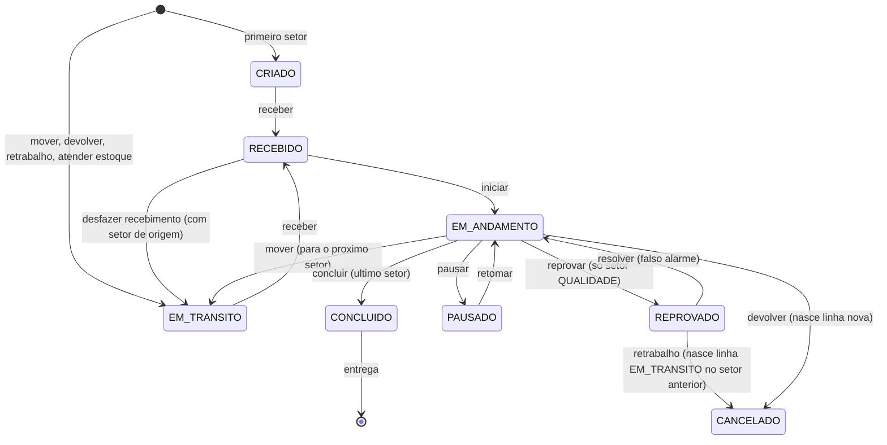
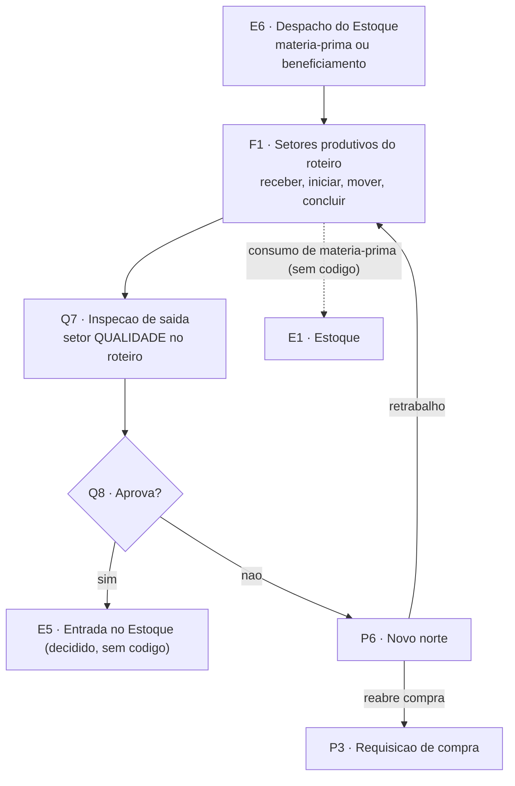

# Produção e roteiro (F1, P6)

**Em uma frase:** a Produção leva cada parte do item (a "parcial") pelos setores do roteiro do pedido, na ordem, até o último setor, e registra tudo no histórico. Nós `F1` (setores produtivos) e `P6` (novo norte: retrabalho ou reabre compra) do [[00-Fluxo-Mestre-0b]]. A entrada vem do despacho do Estoque (`E6`, [[03-Estoque-Atendimento-e-Despacho]]). A saída vai para a inspeção de saída `Q7` ([[08-Qualidade-Saida]]). Selos em [[Regras-do-Vault]].

> [!info] Decisões de 29/10/2026 (N16-120 a N16-143)
> - N16-140: a matéria-prima sai do Estoque na retirada, pela quantidade pedida, no mesmo documento de retirada da Expedição. O operador não lança consumo ao concluir a etapa.
> - N16-141: no retrabalho, o PCP escolhe o setor de volta. A regra 8 (volta ao setor anterior) vale só até isso ter código.
> - Fabricado: [[LOG-53-Ordem-de-Producao-e-Lote-do-Fabricado]] ✅ está na `develop` do MES desde 27/10/2026 (`api-pcp` `ab3318d`): o "sim" da inspeção de saída (`aprovar-saida`) leva a parcela ao Estoque, e o lote de origem `PRODUCAO` nasce em `receber-fabricado`.
> - Roteiro: desde 22/10 (`develop`) a Destinação cria a OP só com o Estoque e o roteiro é montado depois, na tela Montagem do Roteiro; enquanto não for liberado, a parcial só sai do Estoque para compra.
> - Código: o que aparece como ✅ de MES nesta nota além da `main` está na `develop` do `api-pcp` e do `app-pcp`; a `main` parou em 08/10 (merge BL-035).

## Como funciona, passo a passo

1. O PCP destina o pedido na Destinação do Pedido (a OP nasce só com o Estoque como etapa 1) e monta o roteiro na tela Montagem do Roteiro, que libera a OP. `F1`
2. O Estoque despacha à produção só o que não atendeu e que não foi para compra. `E6`
3. O operador do setor recebe a parcial. `F1`
4. Ele inicia a etapa. O cronômetro começa. Em setor que exige, informa máquina e operador. `F1`
5. Durante a etapa, o operador pode pausar e retomar. `F1`
6. Terminada a etapa, ele move a parcial ao próximo setor. Pode mover só parte da quantidade. `F1`
7. No último setor do roteiro, o operador conclui. `F1`
8. Setor de Qualidade no roteiro: a parcial chega à inspeção de saída. `Q7`
9. Se reprovar, abre-se uma divergência e o PCP decide o novo norte: retrabalho ou reabrir a compra. `P6`

## Exemplo

O PCP monta a rota das 100 flanges de aço carbono. O Estoque vem primeiro e a inspeção de saída fica antes da Expedição. O que faltar das flanges depois do Estoque segue ao primeiro setor. O operador recebe, inicia, pausa se a máquina parar e move ao setor seguinte. No último setor, conclui. Se a inspeção reprovar, o PCP decide se há retrabalho.

## Quem atua

| Quem | O que faz |
|---|---|
| PCP (planejamento e controle da produção) | Monta o roteiro e decide o novo norte |
| Operador de setor | Recebe, inicia, move, pausa, retoma e conclui |
| Máquina e operador (cadastros) | Exigidos ao iniciar em certos setores |
| Quem cancela | Cancela pelo detalhe do pedido, com permissão própria |
| Robert | Dono do código do MES (sistema de chão de fábrica) |

## Regras que valem

- O Estoque é sempre a etapa 1. O sistema o insere sozinho.
- Setores de estoque, requisição, compras e logística de entrada ficam fora do roteiro, porque o circuito de compra é fixo.
- Roteiro de fabricação precisa de um setor de Qualidade antes da primeira Expedição.
- Enquanto o roteiro não é liberado, a parcial só sai do Estoque para compra (`develop`, 22/10).
- O roteiro só usa setores da fábrica do pedido, sem repetir setor nem ordem.
- Em todo setor, é preciso receber e iniciar antes de mover ou concluir.
- Só o último setor conclui. Nos outros, move-se.
- Só a Qualidade reprova. Retrabalho nasce de item reprovado.
- Devolver cria uma linha nova. A antiga vira cancelada e nunca é editada.
- Item de pedido inativo bloqueia tudo, menos cancelar.
- Revenda não produz. A fábrica de revenda só envia o restante para compra.
- Tudo que é fabricado volta ao Estoque como lote e saldo (decisão de 14/10; feito na `develop` em 27/10).
- Retrabalho: o PCP escolhe o setor de volta (N16-141). O código ainda volta ao setor anterior.

## O que já existe e o que falta

- ✅ Roteiro, filas por setor, receber, iniciar, mover, pausar, retomar, concluir, reprovar, devolver, cancelar. É o único subfluxo com motor completo desde o início.
- ✅ Telas: Filas de Produção, Destinação do Pedido, Acompanhamento dos Pedidos, Cadastros operacionais; na `develop`, também Montagem do Roteiro e Produtos em Produção.
- ✅ Na `develop` (23/10): ação "finalizar" no setor (status `FINALIZADO`, para o cronômetro e a peça aguarda no setor; `reabrir` volta a `EM_ANDAMENTO`).
- ✅ Na `develop` (27/10): Ordem de Produção impressa (PDF, 2ª via) e fabricado aprovado vira lote e saldo no Estoque (LOG-53).
- ✅ Na `develop`: roteiro individual do item (`RoteiroItem`) lido por `mover`, `concluir`, `atender-estoque`, `reprovar` e `aprovar-saida` (`roteiro-efetivo.ts`).
- 🟡 Matéria-prima: a `develop` já baixa na hora do "Atender pelo estoque" (19/10); a decisão (N16-140) é baixar na retirada, ainda sem código 🔴.
- 🔴 Tela do novo norte, reabrir divergência e reabrir compra a partir da produção.
- 🔴 Painel TV, `PerfilSetor` por filial e feed `/fluxo/eventos`.
- 🟡 Botões de dividir e juntar parciais na fila (a API existe).
- ❓ Nomes e filas reais dos setores produtivos no ambiente.

## Detalhe técnico

### Motor e escrita condicional

O motor é o `ItemParcial` (fração de um item) com histórico imutável em `HistoricoItemParcial`. Toda transição usa escrita condicional (`updateMany` com o status esperado e `count === 0` vira 409), sem leitura seguida de escrita (`itens-parciais.service.ts:245-257`, `:324-337`).

Produção só recebe o que o Estoque não atendeu e que não foi para compra. Revenda não produz: a fábrica `REVENDA` só envia o restante para compra (`itens-parciais.service.ts:722-730`).

### Quem atua (onde)

| Quem | Papel | Onde |
|---|---|---|
| PCP | Monta o roteiro na Destinação do Pedido, decide o novo norte (P6) | MES, `/ordens-producao/novo`, `/ordens-producao/[id]` |
| Operador de setor | Recebe, inicia, move, pausa, retoma, conclui | MES, Filas de Produção `/movimentacoes/[setorId]` |
| Máquina e operador | Cadastros exigidos por setor com `exigeMaquinaOperador` | `/cadastros/operacional/maquinas`, `operadores` |
| Quem cancela | Permissão `ordens-producao:deletar` (não a de setor) | detalhe do pedido |
| Robert | Dono do código MES | `api-pcp`, `app-pcp` |

O acesso a cada fila depende de `PerfilSetor` (`podeVisualizar`, `podeAtuar`), default-deny (`fabricas.prisma:162-185`, `itens-parciais.service.ts:52-54`). A rota exige a tela `movimentacoes` (`itens-parciais.controller.ts:56`, `:99`).

### Regras decididas

| # | Regra | Selo |
|---|---|---|
| 1 | O setor Estoque (`codigo = 'estoque'`) é a **etapa 1 de todo roteiro** e é inserido pelo backend. O payload não pode trazê-lo (`pedidos.service.ts:459-463`). Decisão EN-03. Na `develop` a Destinação cria a OP só com o Estoque e a Montagem do Roteiro (`PUT /pedidos/:id/roteiro`, permissão `montagem-roteiro`) monta e libera o roteiro; `POST /pedidos/:id/devolver-destinacao` devolve a OP à Destinação | ✅ 📝 |
| 2 | Setores de tipo `ESTOQUE`, `REQUISICAO`, `COMPRAS` e `LOGISTICA_ENTRADA` **não entram no roteiro** do PCP: o circuito de compra é fixo (`pedidos.service.ts:500-506`) | ✅ |
| 3 | Roteiro de **fabricação** exige um setor `QUALIDADE` (inspeção de saída) e ele vem antes da primeira `EXPEDICAO` (`pedidos.service.ts:512-525`). Decisão EC-06 | ✅ 📝 |
| 4 | O roteiro só pode usar setores vinculados à fábrica do pedido (`FabricaSetor`), sem repetir setor nem ordem (`pedidos.service.ts:450-474`) | ✅ |
| 5 | `receber` e `iniciar` são obrigatórios em todo setor antes de `mover` ou `concluir`. `iniciar` preenche `startedAt` (cronômetro) e, em setor com `exigeMaquinaOperador`, exige `idMaquina` e `idOperador` (`:299-321`) | ✅ |
| 6 | `concluir` só no **último** setor do roteiro; `mover` só quando existe próximo (`:540-547`, `:426-434`). `mover` aceita `idSetorDestino` livre dentro da fábrica e quantidade parcial (split na passagem) | ✅ |
| 7 | `reprovar` é exclusivo de setor tipo `QUALIDADE` (403 fora dele) e exige `EM_ANDAMENTO` (`:966-989`, `:1011-1021`) | ✅ |
| 8 | `retrabalho` só sai de `REPROVADO`: cancela a linha e cria outra `EM_TRANSITO` no setor anterior com `retrabalho = true` (`:1124-1192`). Não altera a quantidade do `ItensPedido` | ✅; **superada em parte pela N16-141 (29/10): o PCP passa a escolher o setor de volta, ainda sem código** |
| 9 | `devolver` cria linha nova ligada por `idDevolvidoDe`; a antiga vira `CANCELADO` e nunca é editada (`:1387-1488`). Não vale para parcial com requisição de compra viva (`ensureDevolucaoForaDaCompra`, `:1391`) | ✅ |
| 10 | Item de pedido inativo bloqueia toda ação, menos `cancelar` (`:202-208`) | ✅ |
| 11 | **Tudo que é fabricado volta ao Estoque** como lote e saldo, e só sai pelo documento de retirada. Decisão do Nathan de 14/10 | 📝 ✅ lote e saldo na `develop` (27/10, `aprovar-saida` e `receber-fabricado`); 🔴 a saída pelo documento de retirada |
| 12 | **Matéria-prima é consumida do Estoque** na produção (J2/J3 do v1). **Decidido em 29/10 (N16-140): a baixa é na retirada do Estoque, pela quantidade pedida** | 📝 🔴 na retirada; hoje a `develop` baixa na hora do "Atender pelo estoque" (`ConsumoMateriaPrima`, 19/10) |
| 13 | Novo norte (P6): o PCP decide entre retrabalho e reabrir a compra. Roteiro individual do item (`RoteiroItem`, C8) é a ferramenta decidida | 📝 ✅ `RoteiroItem` lido pelo motor na `develop`; 🔴 a tela do novo norte |

### Estados

`StatusItemParcial` (enum exato, `producao.prisma:29-54`; dump MES linha 226): `CRIADO`, `RECEBIDO`, `EM_ANDAMENTO`, `FINALIZADO` (só na `develop`, 23/10), `EM_TRANSITO`, `PAUSADO`, `REPROVADO`, `CONCLUIDO`, `RETRABALHO`, `CANCELADO`. Rótulos da tela em `movimentacoes/labels.ts:7-17`: Aguardando recebimento, Recebido, Em produção, Em trânsito, Pausado, Reprovado, Concluído, Retrabalho, Cancelado. `RETRABALHO` não é mais alcançado por nenhuma ação (só compatibilidade, `producao.prisma:47-52`).

Ações por status na fila (`app-pcp/app/(protected)/movimentacoes/acoes.ts:61-71`):

| Status | Ações |
|---|---|
| `CRIADO`, `EM_TRANSITO` | `receber`, `devolver` |
| `RECEBIDO` | `iniciar`, `desfazer-recebimento` |
| `EM_ANDAMENTO` | `mover`, `concluir`, `pausar`, `reprovar`, `devolver`; na `develop` também `finalizar` e, na inspeção de saída, `aprovar-saida` |
| `FINALIZADO` (`develop`) | `mover`, `reabrir` (volta a `EM_ANDAMENTO`); na inspeção de saída, `aprovar-saida` |
| `PAUSADO`, `RETRABALHO` | `retomar` (volta a `EM_ANDAMENTO`) |
| `REPROVADO` | `retrabalho`, `resolver` |
| `CONCLUIDO` | `confirmar-entrega` |
| `CANCELADO` | nenhuma |

A tela filtra: `concluir` só com `ehUltimaEtapa`, `mover` só sem ela, `devolver` e `retrabalho` só com `idSetorOrigem`, `reprovar` só em setor `QUALIDADE` (`FilaSetor.tsx:685-691`). `cancelar` não aparece na fila: vive no detalhe do pedido (`acoes.ts:55-60`).

`StatusPedido` (`AGUARDANDO`, `EM_PRODUCAO`, `BLOQUEADO`, `ENTREGUE`) e `Prioridade` em [[Estados-e-Status]]. Só `AGUARDANDO` (inicial) e `ENTREGUE` são gravados; `EM_PRODUCAO` e `BLOQUEADO` nunca (`item-parcial-status.constants.ts:44-50`).

### Telas

| Nome atual | Nome antigo | Rota | App | Slug | Estado |
|---|---|---|---|---|---|
| Filas de Produção (escolha de setor) | Movimentações | `/movimentacoes` | app-pcp | `movimentacoes` | ✅ `movimentacoes/page.tsx` (177 linhas) |
| Fila do setor | idem | `/movimentacoes/[setorId]` | app-pcp | `movimentacoes` | ✅ `FilaSetor.tsx` (1272 linhas, 17 ações) |
| Destinação do Pedido | Nova Ordem de Produção | `/ordens-producao/novo` | app-pcp | `ordens-producao` | ✅ distribui os itens entre destinos; o roteiro é montado depois (`develop`, 22/10) |
| Montagem do Roteiro | — | `/montagem-roteiro`, `/montagem-roteiro/[id]` | app-pcp | `montagem-roteiro` | ✅ só na `develop`: OPs destinadas aguardando roteiro, roteiro base e alternativos por item |
| Produtos em Produção | — | `/produtos-em-producao` | app-pcp | `produtos-em-producao` | ✅ só na `develop`: uma linha por split, onde cada produto está no roteiro |
| Acompanhamento dos Pedidos | Ordens de Produção | `/ordens-producao`, `/ordens-producao/[id]` | app-pcp | `ordens-producao` | ✅ mini-roteiro por item, histórico, anexos |
| Dashboard | idem | `/dashboard` | app-pcp | ❓ | ✅ `GET /dashboard`; `GET /dashboard/tv` sem página 🔴 |
| Cadastros operacionais | idem | `/cadastros/operacional/fabricas`, `setores`, `maquinas`, `operadores` | app-pcp | ❓ | ✅ |

Os rótulos de menu moram no banco (tabela `telas`); o código ainda usa os nomes antigos em pastas e rotas. Lista geral em [[Telas-por-Raia]].

### Endpoints e contratos

Todos sob `@UseGuards(JwtAuthGuard, PermissionsGuard)`; setor checado por `perfisService.ensurePodeAtuar` (`itens-parciais.service.ts:227`).

| Método e rota | Efeito | Permissão | Código |
|---|---|---|---|
| `GET /itens-parciais?idSetorAtual=&status=&idItemPedido=` | fila do setor, com `ehUltimaEtapa` | `movimentacoes:visualizar` | `controller:56-60`, `service:43-145` ✅ |
| `GET /itens-parciais/contagem-por-setor` | badge por setor | idem | `controller:66-70` ✅ |
| `GET /itens-parciais/:id`, `/:id/setores-percorridos` | detalhe e destinos válidos de devolução | idem | `controller:93-149` ✅ |
| `PATCH /:id/receber` | `CRIADO` ou `EM_TRANSITO` para `RECEBIDO` | `movimentacoes:editar` | `service:224` ✅ |
| `PATCH /:id/iniciar` | `RECEBIDO` para `EM_ANDAMENTO` (máquina e operador) | idem | `service:299` ✅ |
| `PATCH /:id/mover` | `EM_ANDAMENTO` para `EM_TRANSITO` no próximo setor (ou `idSetorDestino`), com quantidade parcial | idem | `service:366` ✅ |
| `PATCH /:id/concluir` | `CONCLUIDO` no último setor | idem | `service:520` ✅ |
| `PATCH /:id/finalizar`, `PATCH /:id/reabrir` | finaliza o setor (com ou sem enviar) e reabre | idem | `develop` (23/10) ✅ |
| `PATCH /:id/aprovar-saida`, `PATCH /:id/receber-fabricado` | o "sim" da inspeção de saída e a entrada do fabricado no Estoque | idem | `develop` (27/10) ✅ ([[08-Qualidade-Saida]]) |
| `PATCH /:id/pausar`, `/:id/retomar` | pausa e retomada | idem | `service:881`, `:1199` ✅ |
| `PATCH /:id/reprovar`, `/:id/resolver`, `/:id/retrabalho` | reprovação com `Divergencia`, falso alarme, retrabalho | idem | `service:1011`, `:1067`, `:1124` ✅ |
| `POST /:id/split`, `PATCH /:id/consolidar` | divide e junta parciais `RECEBIDO` | idem | `service:1250`, `:1616` ✅ sem botão na tela |
| `POST /:id/devolver`, `PATCH /:id/desfazer-recebimento` | devolução e desfazer | idem | `service:1387`, `:1557` ✅ |
| `PATCH /:id/cancelar` | cancela de qualquer status não terminal; libera reservas | `ordens-producao:deletar` | `controller:274-282`, `service:1506` ✅ |
| `POST /itens-parciais/lote/:acao` | ação em lote (`ACOES_LOTE_ITEM_PARCIAL`) | `movimentacoes:editar` | `controller:78-91` ✅ sem UI |
| `POST /pedidos/completo/lote` | cria pedido, itens, parciais e roteiro (Estoque etapa 1) | `ordens-producao` | `pedidos.controller.ts:58` ✅ |
| `GET /pedidos/setor-estoque-fixo` | etapa 1 fixa para a tela | idem | `pedidos.controller.ts:92` ✅ |
| `/roteiros` CRUD, `/roteiro-item` CRUD | roteiro do pedido e roteiro individual do item | idem | `roteiros.controller.ts:24`, `roteiro-item.controller.ts:25` ✅ CRUD; na `develop`, `RoteiroItem` é lido pelo motor (`roteiro-efetivo.ts`) |
| `GET /pedidos/roteiros`, `GET`/`PUT /pedidos/:id/roteiro`, `POST /pedidos/:id/devolver-destinacao` | Montagem do Roteiro | `montagem-roteiro` | `pedidos.controller.ts` ✅ `develop` (22/10) |
| `/divergencias` (`POST`, `GET`, `PATCH :id`, `PATCH :id/resolver`) | divergência de produção | `movimentacoes` | `divergencias.controller.ts:26-63` ✅ |
| `GET /itens/status` | foto de cada parcial para o av-hub, com `etapa` | chave `MES_API_KEY` | `integracao-avhub.service.ts:114`, `etapaDoItem :167` ✅ ([[API-005-Status-Item-Integracao-MES]]) |

### Como está no código

#### Roteiro

- `Roteiros` (`idPedido`, `idSetor`, `ordem`, único por pedido e ordem) é o roteiro do pedido, lido por `mover`, `concluir`, `atenderEstoque` e `findAll` (`producao.prisma:262-275`).
- `RoteiroItem` (roteiro individual do item, ex.: sub-item de composição) tem CRUD e tabela (`producao.prisma`). Em 14/10 nenhum serviço de movimentação o consultava (registro superado). Na `develop` o motor passa por `roteiroEfetivoDoItem` (`roteiro-efetivo.ts`): o roteiro alternativo do item, quando válido, substitui o base da OP em `mover`, `concluir`, `atender-estoque`, `reprovar` e `aprovar-saida` ✅. Falta a tela do novo norte (P6) 🔴.
- Tipos de setor (`TipoSetor`, `fabricas.prisma:17-32`): `PRODUTIVO`, `ESTOQUE`, `COMPRAS`, `EXPEDICAO`, `REQUISICAO`, `LOGISTICA_ENTRADA`, `QUALIDADE`. Códigos fixos do circuito de compra em `circuito-compra.ts:19-25`: `requisicoes-compra`, `compras`, `logistica-entrada`, `qualidade-entrada`, `estoque`.
- Fábrica: `TipoFabrica` `FABRICACAO` ou `REVENDA`, escolhido por rodada na Destinação (`fabricas.prisma:5-8`).

#### Filas e setores produtivos

Cada setor produtivo (Flange, Caldeiraria HRM, corte etc.) é um registro da tabela `setores` com tipo `PRODUTIVO`, vinculado às fábricas por `fabrica_setores`. Os nomes e as filas reais vêm do banco do ambiente, não do repositório ❓ (o `seed.ts` não cria setores). A fila lista `RECEBIDO`, `EM_ANDAMENTO` etc. do `STATUS_FILA_MOVIMENTACOES` e esconde `CONCLUIDO` já 100% entregue (`service:158-182`).

#### Divergência de produção

`reprovar` grava `HistoricoItemParcial` e abre uma `Divergencia` tipo `QUALIDADE` `ABERTA` na mesma transação (`service:1036-1058`). `resolver` e `retrabalho` fecham a divergência como `RESOLVIDA` (`:1101-1109`, `:1168-1176`). `DivergenciasService.resolver` só aceita `RESOLVIDA` ou `CANCELADA` e recusa divergência já encerrada: **divergência encerrada não reabre** (`divergencias.service.ts:resolver`) 🔴. Não há tela de divergências de produção; `/decisoes-pcp` trata só divergência de recebimento ([[05-Recebimento]]).

#### Consumo de matéria-prima 🟡

Na `develop` (19/10, `8d07917`) existe a baixa de matéria-prima no "Atender pelo estoque" de um item de fabricação: `ConsumoMateriaPrima` (lote de qualquer produto, quantidade baixada, unidades do item cobertas), `SAIDA` imediata com `id_consumo_mp`, estorno ao devolver a parcial ao Estoque. Não existe baixa ao iniciar ou concluir etapa, nem estrutura de produto, nem genealogia. A decisão N16-140 manda baixar na retirada do Estoque; isso ainda não tem código. Registro de 14/10 (superado em parte), mantido:

- `destinoRestante: 'ROTEIRO'` em `atenderEstoque` só move a parcial para a próxima etapa, sem reservar nem consumir material (`service:722-742`).
- `TipoItemRequisicao.MATERIA_PRIMA` existe só para a compra, com o comentário "ação no Estoque·Entrada na próxima rodada" (`compras.prisma:17-22`).
- Consumo de reserva (`consumirReservasDaParcial`, `estoque-operacao.helpers.ts:208`) só trata a parte "atendida pelo estoque", que é a que vai à Expedição.

O que falta: definir quem informa o material consumido (setor ao concluir etapa, ou Estoque ao despachar para a produção pelo documento de retirada), o vínculo produto acabado x matéria-prima, e a geração de `MovimentoEstoque` `SAIDA` com referência à parcial. Dono: Robert, decisão Nathan. **Decidido em 29/10 (N16-140): na retirada do Estoque.**

#### Fabricado vira lote ✅ (só na `develop`)

Desde 27/10/2026 (`ab3318d`) a `develop` do MES tem `OrigemLote.PRODUCAO`: o "sim" da inspeção de saída (`aprovar-saida`) devolve a parcela ao Estoque e `receber-fabricado` cria o lote (um por OP e produto, sem custo), com entrada no saldo e reserva para a própria parcela ([[LOG-53-Ordem-de-Producao-e-Lote-do-Fabricado]]). Registro de 14/10 (superado): `OrigemLote` só tinha `RECEBIMENTO` e `CARGA_INICIAL` e nada criava lote do fabricado.

### O que falta desenvolver

| # | O quê | Dono | Nó | Selo |
|---|---|---|---|---|
| 1 | Baixa de matéria-prima na retirada do Estoque (N16-140) e genealogia; hoje há a baixa imediata no "Atender pelo estoque" (`develop`) | Robert | F1 | 🟡 baixa imediata ✅; 🔴 retirada |
| 2 | Fabricado aprovado vira lote e saldo: feito na `develop` (27/10). Falta a saída pelo documento de retirada | Robert | F1, `E5` | ✅ lote; 🔴 retirada |
| 3 | `RoteiroItem` lido por `mover`, `concluir` e Expedição: lido pelo motor na `develop`; conferir a Expedição | Robert | P6 | ✅ motor; ❓ Expedição |
| 4 | Tela do novo norte para divergência de produção (reprovada na inspeção de saída), com retrabalho e reabrir compra; `/decisoes-pcp` só cobre recebimento | Robert, Nathan decide | P6 | 🔴 |
| 5 | Reabertura de divergência (hoje `RESOLVIDA` e `CANCELADA` são terminais) | Robert | P6 | 🔴 |
| 6 | Reabertura de compra a partir da produção (P6 para P3): sem rota; só a divergência de recebimento reabre (`REABERTO`) | Robert | P6 | 🔴 |
| 7 | Botões de `split` e `consolidar` na fila (API existe) | Robert | F1 | 🟡 |
| 8 | Painel TV (`GET /dashboard/tv` sem página) | Robert | F1 | 🔴 |
| 9 | `PerfilSetor` sem dimensão de filial (T.2/C3) | Robert | F1 | 🔴 |
| 10 | Feed `/fluxo/eventos` com ator, autorizador e tempo por etapa ([[Rastreabilidade-e-Torre-de-Fluxo]]) | Robert | todos | 🔴 |

### Pendências

- Nathan: quem informa o consumo de matéria-prima e em que momento (retirada do Estoque ou conclusão da etapa)? **Decidido em 29/10/2026 (N16-140): na retirada do Estoque, pela quantidade pedida.**
- Nathan e Robert: a fábrica com múltiplos setores `PRODUTIVO` consome por etapa ou só no primeiro?
- Nathan: retrabalho volta sempre ao setor imediatamente anterior? Hoje é `idSetorOrigem`, sem escolha (`:1134-1142`). **Decidido em 29/10/2026 (N16-141): não; o PCP escolhe o setor de volta.**
- Robert: confirmar nomes de setores e filas reais do ambiente de produção (código só traz o seed) ❓.

### Subfluxo

