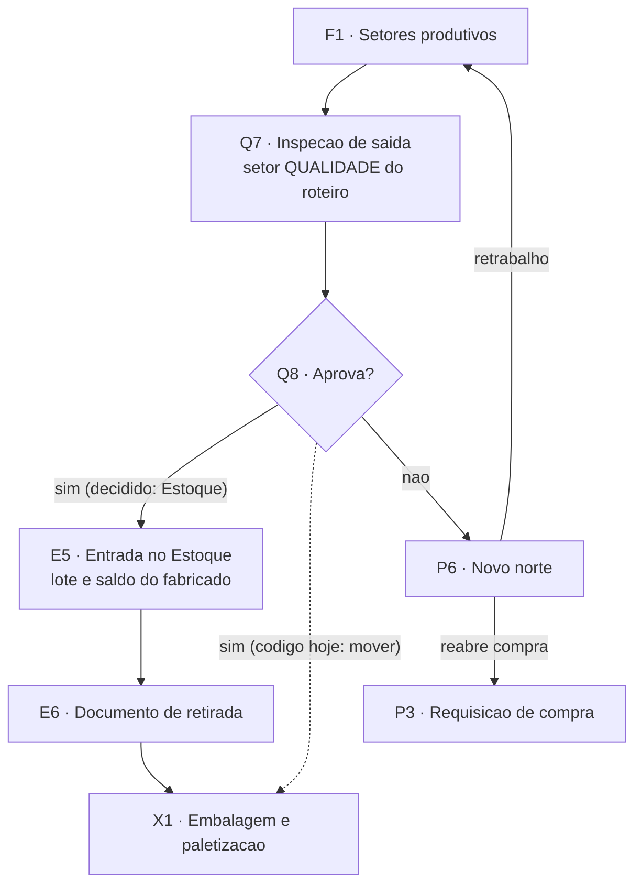

# Qualidade de saída (Q7, Q8)

Nós do [[00-Fluxo-Mestre-0b]]: `Q7` inspeção de saída e `Q8` aprova?. Recebe o item que a produção concluiu em todos os setores anteriores ([[07-Producao-e-Roteiro]]). A inspeção de entrada, por lote, é outra raia ([[06-Qualidade-Entrada]]).

## Objetivo

Garantir que nada fabricado ou beneficiado siga adiante sem inspeção. A inspeção é **um setor do roteiro** (tipo `QUALIDADE`), por parcial, não por lote. Aprovado: o item segue para a próxima etapa. Reprovado: abre divergência e o PCP decide o novo norte ([[07-Producao-e-Roteiro]], P6).

**Divergência entre código e decisão (🔴).** A decisão do Nathan de 14/10 é que o "sim" do Q8 leva o item ao **Estoque** (`E5`: vira lote e saldo, sai pelo documento de retirada). O código leva o "sim" à **Expedição**: não há ação de aprovar; o inspetor usa `mover` e a parcial cai na próxima etapa do roteiro, que é de tipo `EXPEDICAO` (`itens-parciais.service.ts:426-435`, regra de ordem em `pedidos.service.ts:520-525`).

## Quem atua

| Quem | Papel | Onde |
|---|---|---|
| Inspetor da Qualidade | Recebe, inicia, **reprova** ou segue (`mover`) | `/qualidade/inspecao-saida` |
| PCP | Decide retrabalho ou reabertura de compra depois da reprovação | MES (sem tela dedicada) |
| Operador do setor anterior | Recebe o retrabalho | fila do setor |
| Vendedor | Marcou "Qualidade acompanha desde o início" (V2); nada consome o flag ainda | av-hub |

Perfis são dados do banco; o inspetor precisa de `PerfilSetor.podeAtuar` no setor `QUALIDADE` do roteiro (`itens-parciais.service.ts:1014`).

## Regras decididas

| # | Regra | Selo |
|---|---|---|
| 1 | Todo roteiro de **fabricação** tem um setor tipo `QUALIDADE`, antes da primeira `EXPEDICAO` (EC-06). Revenda não exige | 📝 ✅ `pedidos.service.ts:512-525` |
| 2 | `reprovar` só em setor tipo `QUALIDADE` e a partir de `EM_ANDAMENTO` | ✅ `itens-parciais.service.ts:966-989`, `:1017-1021` |
| 3 | Reprovar grava histórico e abre `Divergencia` tipo `QUALIDADE`, `ABERTA`, com motivo | ✅ `:1036-1058` |
| 4 | Reprovado só tem duas saídas: `resolver` (falso alarme, volta a `EM_ANDAMENTO`) ou `retrabalho` (volta ao setor anterior). Mover, concluir, pausar e devolver somem | ✅ `acoes.ts:67` |
| 5 | Aprovado volta ao Estoque: **lote e saldo do fabricado**, retirada depois | 📝 🔴 |
| 6 | Reprovação de inspeção de saída **não** gera RNC nem nota de devolução: RNC é conceito do lote comprado | ✅ `rncs` só em `qualidade.service.ts:212` |
| 7 | Inspeção de saída tem trava de laudo? Pergunta T-04 para a inspeção documental (ciclo 2). Hoje não há laudo na saída | ❓ |

## Estados

A raia usa os estados do item parcial ([[Estados-e-Status]]): `EM_ANDAMENTO` (inspecionando), `REPROVADO`, e a saída por `EM_TRANSITO`. A divergência usa `StatusDivergencia`: `ABERTA`, `EM_ANALISE`, `RESOLVIDA`, `CANCELADA` (`producao.prisma:77-82`), e `TipoDivergencia` (`QUALIDADE`, `QUANTIDADE`, `PRAZO`, `DANO`, `DOCUMENTACAO`, `OUTRO`, `:67-74`). Reprovar usa só `QUALIDADE`.

Etapa vista pelo vendedor: parcial em setor `QUALIDADE` que não é `qualidade-entrada` é `qualidade.inspecao`; `REPROVADO` em qualquer setor é `qualidade.reprovado` (`integracao-avhub.service.ts:172`, `:182-186`).

## Telas

| Nome atual | Nome antigo | Rota | App | Slug | Estado |
|---|---|---|---|---|---|
| Inspeção de saída | — | `/qualidade/inspecao-saida` | app-pcp | `inspecao-saida` | ✅ `qualidade/inspecao-saida/page.tsx:1-18`: `ModuloSetores` com `tipos={['QUALIDADE']}` e `excluirCodigos` do setor `qualidade-entrada` |
| Fila do setor Qualidade | Movimentações | `/movimentacoes/[setorId]` | app-pcp | `movimentacoes` | ✅ mesma `FilaSetor`; botão Reprovar só com `setor.tipo === 'QUALIDADE'` (`FilaSetor.tsx:690`) |
| Qualidade (índice) | — | `/qualidade` | app-pcp | ❓ | ✅ `qualidade/page.tsx` |

Não existe tela de laudo, checklist nem formulário de resultado de inspeção de saída: a decisão é um clique e um motivo.

## Endpoints e contratos

| Método e rota | Uso | Código |
|---|---|---|
| `PATCH /itens-parciais/:id/receber`, `/iniciar` | inspetor assume a parcial | `service:224`, `:299` ✅ |
| `PATCH /itens-parciais/:id/mover` | **"aprova"**: segue ao próximo setor do roteiro | `service:366` ✅ |
| `PATCH /itens-parciais/:id/reprovar` `{ motivo }` | reprova e abre divergência | `controller:205-213`, `service:1011` ✅ |
| `PATCH /itens-parciais/:id/resolver` | falso alarme | `service:1067` ✅ |
| `PATCH /itens-parciais/:id/retrabalho` `{ motivo }` | volta ao setor anterior, `retrabalho = true` | `service:1124` ✅ |
| `GET /divergencias` | consulta divergências | `divergencias.controller.ts:38-43` ✅ |

Contrato com o av-hub: só a etapa do item ([[API-005-Status-Item-Integracao-MES]], [[API-006-Status-por-Item-Leitura-no-Hub]]).

## Como está no código

- O "Aprovar" que aparece na tela (rótulo da ação `resolver`, `FilaSetor.tsx:203`) **não** aprova a inspeção: só desfaz uma reprovação. Aprovar de verdade é `mover`.
- Como a Qualidade é um setor comum no roteiro, `ehUltimaEtapa` é falso nela (a Expedição vem depois), então a tela oferece `mover`, não `concluir` (`FilaSetor.tsx:687-688`).
- Fabricado aprovado nunca passa pelo Estoque: `mover` leva a parcial direto à primeira etapa `EXPEDICAO`. Reserva não existe (`atendidoPeloEstoque = false`), logo `consumirReservasDaParcial` não roda (`service:278`).
- `ensureLotesCompradosLiberados` só barra envio a setor `ESTOQUE` com lote comprado pendente (`service:862-874`); não protege este caso.
- `Pedidos.acompanhamentoQualidade` (V2) é gravado (`producao.prisma:118`) e mostrado na Triagem, mas nenhuma fila consome ([[01-Vendas-Liberacao]], item 7).
- ❓ Ninguém conferiu o uso real da tela em ambiente.

## O que falta desenvolver

| # | O quê | Dono | Nó | Selo |
|---|---|---|---|---|
| 1 | O "sim" do Q8 passa a levar ao Estoque: criar lote e saldo do fabricado (nova `OrigemLote`), setor de retorno ao Estoque (roteiro fixo, como o circuito de compra) e documento de retirada | Robert | Q8, `E5`, `E6` | 🔴 |
| 2 | Ação explícita de aprovar na inspeção (hoje `mover`), com quantidade aprovada e reprovada (cisão da parcial), motivo e evidência | Robert | Q7 | 🔴 |
| 3 | Tela do novo norte para a reprovação (P6): retrabalho, ajustar roteiro, reabrir compra. `/decisoes-pcp` só trata recebimento | Robert, Nathan | P6 | 🔴 |
| 4 | Laudo ou evidência na reprovação de saída (a reprovação de entrada exige motivo e evidência, a de saída só motivo) | Robert, Qualidade | Q7 | 🟡 |
| 5 | Fila de inspeção de processo que usa `acompanhamentoQualidade` (ciclo 2, 22/01/2027) | Robert | V2 | 🔴 |
| 6 | Reabertura de divergência encerrada | Robert | P6 | 🔴 |

## Pendências

- Nathan e Qualidade: reprovação parcial na saída existe (parte aprovada segue, parte reprovada vai a retrabalho)? Hoje a parcial inteira é reprovada.
- Nathan: sucata e refugo da produção: como entram no saldo e no custo?
- Qualidade: a inspeção de saída exige laudo (T-04)?

## Subfluxo

Raias vizinhas: [[07-Producao-e-Roteiro]], [[03-Estoque-Atendimento-e-Despacho]], [[09-Expedicao]].
