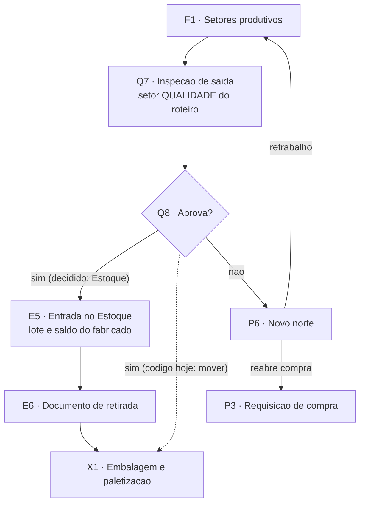

# Qualidade de saída (Q7, Q8)

**Em uma frase:** é a inspeção do que a produção fabricou, para que nada siga adiante sem conferência. Nós `Q7` (inspeção) e `Q8` (aprova?) do [[00-Fluxo-Mestre-0b]].

Recebe a parcial concluída pela produção ([[07-Producao-e-Roteiro]]). A inspeção de entrada, por lote, é outra raia ([[06-Qualidade-Entrada]]).

> [!info] Decisões de 29/10/2026 (N16-120 a N16-143)
> - N16-128: pode reprovar só parte (5 de 100 peças). Hoje reprova tudo.
> - N16-129: sem laudo nem checklist. Um clique e um motivo.
> - N16-141: no retrabalho, o PCP escolhe o setor de volta. Hoje volta ao anterior.
> - Aprovado vai ao Estoque como lote ([[LOG-53-Ordem-de-Producao-e-Lote-do-Fabricado]]); baixa na retirada ([[LOG-54-Documento-de-Retirada-e-Baixa-na-Retirada]]).
> - Código: o "sim" (`aprovar-saida`) e o lote do fabricado estão só na `develop` do `api-pcp` e do `app-pcp` (27/10/2026, `ab3318d`). A `main` do MES parou em 08/10 e só recebe com o merge BL-035.

## Como funciona, passo a passo

1. A produção conclui a parcial e ela cai na fila da Qualidade. `Q7`
2. O inspetor recebe a parcial e inicia a inspeção. `Q7`
3. Ele decide com um clique e um motivo. `Q8`
4. Aprovado: o item volta ao Estoque e vira lote quando o almoxarife informa a localização (na `develop`; na `main` do MES ainda segue à Expedição). `Q8`
5. Reprovado: o sistema abre uma divergência com o motivo. `Q8`
6. O PCP decide: falso alarme, retrabalho ou reabrir a compra. `P6`

## Exemplo

As 100 flanges chegam à inspeção de saída. O inspetor as confere.

- Estando boas, ele as aprova (tudo ou só uma quantidade). Elas voltam ao Estoque e viram lote (`develop`); na `main` do MES vão direto à Expedição.
- Havendo problema, ele reprova com um motivo. Pela decisão, pode ser só 5 das 100. Hoje são as 100.
- O PCP vê a divergência e escolhe entre falso alarme e retrabalho.

## Quem atua

| Quem | O que faz |
|---|---|
| Inspetor da Qualidade | Recebe, inicia, reprova ou segue com a parcial |
| PCP | Decide retrabalho ou reabertura de compra |
| Operador do setor anterior | Recebe o item em retrabalho |

## Regras que valem

- Todo roteiro de fabricação tem um setor de Qualidade antes da Expedição. Revenda não exige.
- Só se reprova em setor de Qualidade, com a inspeção em andamento.
- Reprovado só tem duas saídas: falso alarme ou retrabalho.
- Reprovação de saída não gera RNC nem nota de devolução. RNC é do lote comprado.
- O fabricado aprovado vira lote e saldo no Estoque.

## O que já existe e o que falta

- ✅ Telas de inspeção e fila da Qualidade; reprovar, falso alarme e retrabalho.
- ✅ Na `develop` (27/10): o "sim" leva ao Estoque, com lote e saldo, por uma ação explícita de aprovar (`aprovar-saida`, com quantidade aprovada; o resto continua na inspeção).
- 🔴 Reprovar só uma parte (N16-128): a reprovação continua sendo da parcela inteira.
- 🔴 Tela do novo norte do PCP; fila de inspeção de processo; reabrir divergência.
- 🟡 Laudo ou evidência na reprovação de saída.
- ❓ Uso real da tela em ambiente; regra de sucata e refugo.

## Detalhe técnico

### Como a inspeção entra no roteiro e divergência entre código e decisão

Nada fabricado ou beneficiado segue sem inspeção. A inspeção é **um setor do roteiro** (tipo `QUALIDADE`), por parcial, não por lote. Reprovado: o PCP decide o novo norte (P6).

**Código e decisão (atualizado em 29/10/2026).** A decisão do Nathan de 14/10 é que o "sim" do Q8 leva o item ao **Estoque** (`E5`: vira lote e saldo, sai pelo documento de retirada). Na `develop` do MES isso foi feito em 27/10 (`ab3318d`): `PATCH /itens-parciais/:id/aprovar-saida` leva a parcela ao Estoque e `receber-fabricado` cria o lote. 🔴 A saída pelo documento de retirada ainda não existe. Registro de 14/10 (superado na `develop`, ainda vale na `main`): não havia ação de aprovar; o inspetor usava `mover` e a parcial caía na próxima etapa do roteiro, de tipo `EXPEDICAO` (`itens-parciais.service.ts:426-435`, regra de ordem em `pedidos.service.ts:520-525`).

### Quem atua (onde)

| Quem | Papel | Onde |
|---|---|---|
| Inspetor da Qualidade | Recebe, inicia, **reprova** ou segue (`mover`) | `/qualidade/inspecao-saida` |
| PCP | Decide retrabalho ou reabertura de compra depois da reprovação | MES (sem tela dedicada) |
| Operador do setor anterior | Recebe o retrabalho | fila do setor |
| Vendedor | Marcou "Qualidade acompanha desde o início" (V2); nada consome o flag ainda | av-hub |

Perfis são dados do banco; o inspetor precisa de `PerfilSetor.podeAtuar` no setor `QUALIDADE` do roteiro (`itens-parciais.service.ts:1014`).

### Regras decididas

| # | Regra | Selo |
|---|---|---|
| 1 | Todo roteiro de **fabricação** tem um setor tipo `QUALIDADE`, antes da primeira `EXPEDICAO` (EC-06). Revenda não exige | 📝 ✅ `pedidos.service.ts:512-525` |
| 2 | `reprovar` só em setor tipo `QUALIDADE` e a partir de `EM_ANDAMENTO` | ✅ `itens-parciais.service.ts:966-989`, `:1017-1021` |
| 3 | Reprovar grava histórico e abre `Divergencia` tipo `QUALIDADE`, `ABERTA`, com motivo | ✅ `:1036-1058` |
| 4 | Reprovado só tem duas saídas: `resolver` (falso alarme, volta a `EM_ANDAMENTO`) ou `retrabalho` (volta ao setor anterior; pela N16-141, de 29/10, o PCP passará a escolher o setor). Mover, concluir, pausar e devolver somem | ✅ `acoes.ts:67` |
| 5 | Aprovado volta ao Estoque: **lote e saldo do fabricado**, retirada depois ([[LOG-53-Ordem-de-Producao-e-Lote-do-Fabricado]], [[LOG-54-Documento-de-Retirada-e-Baixa-na-Retirada]]) | 📝 ✅ lote e saldo na `develop` (27/10); 🔴 retirada |
| 6 | Reprovação de inspeção de saída **não** gera RNC nem nota de devolução: RNC é conceito do lote comprado | ✅ `rncs` só em `qualidade.service.ts:212` |
| 7 | Inspeção de saída tem trava de laudo? Pergunta T-04 para a inspeção documental (ciclo 2). Hoje não há laudo na saída. **Decidido em 29/10 (N16-129): sem laudo nem checklist.** | 📝 ✅ |

### Estados

A raia usa os estados do item parcial ([[Estados-e-Status]]): `EM_ANDAMENTO` (inspecionando), `REPROVADO`, e a saída por `EM_TRANSITO`. A divergência usa `StatusDivergencia`: `ABERTA`, `EM_ANALISE`, `RESOLVIDA`, `CANCELADA` (`producao.prisma:77-82`), e `TipoDivergencia` (`QUALIDADE`, `QUANTIDADE`, `PRAZO`, `DANO`, `DOCUMENTACAO`, `OUTRO`, `:67-74`). Reprovar usa só `QUALIDADE`.

Etapa vista pelo vendedor: parcial em setor `QUALIDADE` que não é `qualidade-entrada` é `qualidade.inspecao`; `REPROVADO` em qualquer setor é `qualidade.reprovado` (`integracao-avhub.service.ts:172`, `:182-186`).

### Telas

| Nome atual | Nome antigo | Rota | App | Slug | Estado |
|---|---|---|---|---|---|
| Inspeção de saída | — | `/qualidade/inspecao-saida` | app-pcp | `inspecao-saida` | ✅ `qualidade/inspecao-saida/page.tsx:1-18`: `ModuloSetores` com `tipos={['QUALIDADE']}` e `excluirCodigos` do setor `qualidade-entrada` |
| Fila do setor Qualidade | Movimentações | `/movimentacoes/[setorId]` | app-pcp | `movimentacoes` | ✅ mesma `FilaSetor`; botão Reprovar só com `setor.tipo === 'QUALIDADE'` (`FilaSetor.tsx:690`) |
| Qualidade (índice) | — | `/qualidade` | app-pcp | ❓ | ✅ `qualidade/page.tsx` |

Não existe tela de laudo, checklist nem formulário de resultado de inspeção de saída: a decisão é um clique e um motivo.

### Endpoints e contratos

| Método e rota | Uso | Código |
|---|---|---|
| `PATCH /itens-parciais/:id/receber`, `/iniciar` | inspetor assume a parcial | `service:224`, `:299` ✅ |
| `PATCH /itens-parciais/:id/aprovar-saida` `{ observacao?, quantidade? }` | **"aprova"**: a parcela (ou só a `quantidade`) volta ao Estoque `EM_TRANSITO`, marcada como fabricado aprovado | `develop` (27/10, `itens-parciais.controller.ts`) ✅ |
| `PATCH /itens-parciais/:id/receber-fabricado` `{ idLocalizacao }` | o Estoque recebe o fabricado e cria o lote `PRODUCAO` | `develop` (27/10) ✅ ([[03-Estoque-Atendimento-e-Despacho]]) |
| `PATCH /itens-parciais/:id/mover` | na `main` do MES era o "aprova": segue ao próximo setor do roteiro | `service:366` ✅ |
| `PATCH /itens-parciais/:id/reprovar` `{ motivo }` | reprova e abre divergência | `controller:205-213`, `service:1011` ✅ |
| `PATCH /itens-parciais/:id/resolver` | falso alarme | `service:1067` ✅ |
| `PATCH /itens-parciais/:id/retrabalho` `{ motivo }` | volta ao setor anterior, `retrabalho = true` | `service:1124` ✅ |
| `GET /divergencias` | consulta divergências | `divergencias.controller.ts:38-43` ✅ |

Contrato com o av-hub: só a etapa do item ([[API-005-Status-Item-Integracao-MES]], [[API-006-Status-por-Item-Leitura-no-Hub]]).

### Como está no código

- O "Aprovar" que aparece na tela (rótulo da ação `resolver`, `FilaSetor.tsx:203`, em 14/10) **não** aprovava a inspeção: só desfaz uma reprovação. Na `develop` há a ação explícita `aprovar-saida`; conferir o rótulo na tela do `app-pcp` (❓).
- Como a Qualidade é um setor comum no roteiro, `ehUltimaEtapa` é falso nela (a Expedição vem depois), então a tela oferece `mover`, não `concluir` (`FilaSetor.tsx:687-688`).
- Registro de 14/10 (superado na `develop`): o fabricado aprovado nunca passava pelo Estoque, e `mover` levava a parcial direto à primeira etapa `EXPEDICAO`. Na `develop`, a reserva do lote `PRODUCAO` nasce em `receber-fabricado`.
- `ensureLotesCompradosLiberados` só barra envio a setor `ESTOQUE` com lote comprado pendente (`service:862-874`); não protege este caso.
- `Pedidos.acompanhamentoQualidade` (V2) é gravado (`producao.prisma:118`) e mostrado na Triagem, mas nenhuma fila consome ([[01-Vendas-Liberacao]], item 7).
- ❓ Ninguém conferiu o uso real da tela em ambiente.

### O que falta desenvolver

| # | O quê | Dono | Nó | Selo |
|---|---|---|---|---|
| 1 | O "sim" do Q8 leva ao Estoque, com lote e saldo do fabricado: feito na `develop` (27/10). Falta o documento de retirada | Robert | Q8, `E5`, `E6` | ✅ lote; 🔴 retirada |
| 2 | Ação explícita de aprovar na inspeção, com quantidade aprovada: feita na `develop` (`aprovar-saida`). Falta a quantidade reprovada (reprovação parcial, N16-128), o motivo e a evidência | Robert | Q7 | ✅ aprovar; 🔴 reprovar em parte |
| 3 | Tela do novo norte para a reprovação (P6): retrabalho, ajustar roteiro, reabrir compra. `/decisoes-pcp` só trata recebimento | Robert, Nathan | P6 | 🔴 |
| 4 | Laudo ou evidência na reprovação de saída (a reprovação de entrada exige motivo e evidência, a de saída só motivo) | Robert, Qualidade | Q7 | 🟡 |
| 5 | Fila de inspeção de processo que usa `acompanhamentoQualidade` (ciclo 2, 22/01/2027) | Robert | V2 | 🔴 |
| 6 | Reabertura de divergência encerrada | Robert | P6 | 🔴 |

### Pendências

- Nathan e Qualidade: reprovação parcial na saída existe (parte aprovada segue, parte reprovada vai a retrabalho)? Hoje a parcial inteira é reprovada. (Decidido em 29/10, N16-128: pode reprovar só parte.)
- Nathan: sucata e refugo da produção: como entram no saldo e no custo?
- Qualidade: a inspeção de saída exige laudo (T-04)? (Decidido em 29/10, N16-129: sem laudo.)

### Subfluxo

Raias vizinhas: [[07-Producao-e-Roteiro]], [[03-Estoque-Atendimento-e-Despacho]], [[09-Expedicao]].
