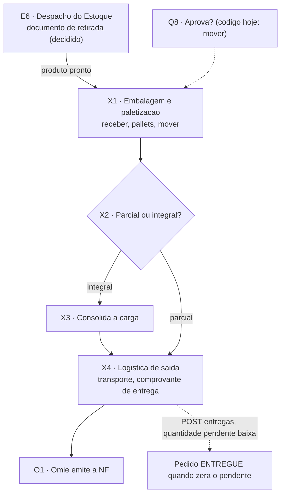

# Expedição e logística de saída (X1 a X4)

Nós do [[00-Fluxo-Mestre-0b]]: `X1` embalagem e paletização, `X2` parcial ou integral?, `X3` consolida a carga, `X4` logística de saída (transporte). Termina na emissão da nota no Omie ([[10-Fiscal-Omie]]). No v1 as telas são 10.1 a 10.4.

## Objetivo

Receber o que está pronto, embalar e paletizar, decidir se o pedido sai por partes ou inteiro, montar a carga, definir o transporte e registrar a entrega. A Expedição tem **duas portas de entrada** hoje: a parcial atendida pelo Estoque (`atendidoPeloEstoque`) e a parcial que a Qualidade moveu (fabricado, [[08-Qualidade-Saida]]). Pela decisão de 14/10 haverá uma só: o **documento de retirada do Estoque**, porque tudo que é fabricado ou comprado passa pelo Estoque ([[03-Estoque-Atendimento-e-Despacho]]).

O sistema **nunca emite nota fiscal**. Ele sinaliza a necessidade e o Omie emite.

## Quem atua

| Quem | Papel | Onde |
|---|---|---|
| Operador da Embalagem | Recebe a parcial, lança pallets (nome, peso, unidades) | `/logistica/expedicao`, setor tipo `EXPEDICAO` |
| Operador da Logística | Confirma entrega, anexa comprovante, canhoto ou NF | idem, último setor |
| PCP | Acompanha pedido, embalagens e entregas no detalhe | `/ordens-producao/[id]` |
| Vendedor | Observa o status final no av-hub | HUB |
| Cliente | Recebe | externo |
| Faturamento (Omie) | Emite a NF | [[10-Fiscal-Omie]] |

## Regras decididas

| # | Regra | Selo |
|---|---|---|
| 1 | Embalagem e Logística de saída são os dois últimos setores de todo pedido, de tipo `EXPEDICAO`; pallets valem em qualquer setor `EXPEDICAO` (29/09) | 📝 ✅ `fabricas.prisma:13-14`, `itens-parciais.service.ts:966-973` |
| 2 | A soma das unidades dos pallets não pode passar da quantidade da parcial; soma menor é válida (embalagem incompleta) | ✅ `itens-parciais.service.ts:946-951` |
| 3 | O peso dos pallets só é editável no setor `EXPEDICAO`; nos seguintes viaja com a peça, só leitura | ✅ `FilaSetor.tsx:810-835` |
| 4 | Entrega é **livre, item a item e por quantidade**: não existe trava de "pedido inteiro pronto". O pedido só vira `ENTREGUE` quando zera o pendente de todos os itens ativos e não resta parcial ativa | ✅ `entregas.service.ts:17-24`, `:104-130` |
| 5 | Só entrega parcial `CONCLUIDO`, com quantidade até o pendente do item e até a quantidade da parcial | ✅ `entregas.service.ts:44-63` |
| 6 | Parcial ou integral é decisão humana. Faturamento integral travado por um item que nunca chega: muda para parcial automaticamente ou exige decisão manual? (T-06) | 🔴 aberta |
| 7 | **Despacho é no Estoque**: quem precisa da mercadoria (Expedição ou Produção) gera um **documento de retirada**; a baixa do saldo acontece na retirada. Hoje a baixa ocorre quando a Embalagem **recebe** a parcial | 📝 🔴 |
| 8 | Nota fiscal de saída é do Omie. O MES guarda só o número digitado na entrega | 📝 ✅ `entregas.service.ts:82` |
| 9 | Remessa de produtos (registro de remessa) vai ao Ciclo 2 (22/01/2027), item 27 do registro de 07/10 | 📝 |

## Estados

Parcial: `RECEBIDO` ao entrar na Embalagem, `EM_ANDAMENTO` ao iniciar, `CONCLUIDO` no último setor, depois entregas. Etapa vista no av-hub (`etapaDoItem`, `integracao-avhub.service.ts:187-188`): `expedicao.embalagem` (qualquer status em setor `EXPEDICAO`) e `expedicao.concluido` (`CONCLUIDO`). Rótulos no HUB: "Embalagem", "Pronto para expedição" (`lib/domain/etapas-item.ts:44-45`).

Pedido: `StatusPedido` `AGUARDANDO`, `EM_PRODUCAO`, `BLOQUEADO`, `ENTREGUE`. Todo pedido nasce `AGUARDANDO`; o único valor gravado depois é `ENTREGUE`, pelo `EntregasService` (`item-parcial-status.constants.ts:44-50`); `EM_PRODUCAO` e `BLOQUEADO` nunca são gravados. `TipoAnexo` do comprovante: `NOTA`, `CANHOTO`, `DESENHO`, `PEDIDO`, `ORDEM_PRODUCAO`, `COMPROVANTE_ENTREGA` (`producao.prisma:57-64`). Enums completos em [[Estados-e-Status]].

## Telas

| Nome atual | Nome antigo | Rota | App | Slug | Estado |
|---|---|---|---|---|---|
| Expedição | — | `/logistica/expedicao` | app-pcp | `expedicao` | ✅ `logistica/expedicao/page.tsx:1-16`: `ModuloSetores` com `tipos={['EXPEDICAO']}` (Embalagem e Logística) |
| Fila do setor | Movimentações | `/movimentacoes/[setorId]` | app-pcp | `movimentacoes` | ✅ paletes e entrega pelo mesmo `FilaSetor` |
| Editar pallets / Ver pallets | — | modal na fila | app-pcp | `movimentacoes` | ✅ `PalletsModal.tsx` (248 linhas) |
| Confirmar entrega | — | modal na fila | app-pcp | `movimentacoes` | ✅ `ConfirmarEntregaModal.tsx` (195 linhas): quantidade, NF opcional, observação, anexo `COMPROVANTE_ENTREGA`, `CANHOTO` ou `NOTA` |
| Acompanhamento dos Pedidos, seção Embalagens | Ordens de Produção | `/ordens-producao/[id]` | app-pcp | `ordens-producao` | ✅ `EmbalagensSection.tsx` |
| Consolidação de carga (10.2) | — | — | — | — | 🔴 não existe |
| Transporte e roteiro (10.3) | — | — | — | — | 🔴 não existe |
| Fila de sinalização de faturamento (11.1) | — | — | — | — | 🔴 [[10-Fiscal-Omie]] |

## Endpoints e contratos

| Método e rota | Uso | Permissão | Código |
|---|---|---|---|
| `PATCH /itens-parciais/:id/receber` | Embalagem recebe; **consome a reserva** se `atendidoPeloEstoque` | `movimentacoes:editar` | `itens-parciais.service.ts:224-289` ✅ |
| `PATCH /itens-parciais/:id/pallets` `{ pesosPallets[], nomesPallets[], unidadesPallets[] }` | arrays paralelos por pallet | idem | `controller:182-190`, `service:927` ✅ |
| `PATCH /itens-parciais/:id/mover`, `/concluir` | passa da Embalagem à Logística e conclui no último setor | idem | `service:366`, `:520` ✅ |
| `POST /entregas` `{ idItemPedido, idItemParcial, quantidade, numeroNf?, observacao? }` | confirma entrega; baixa `quantidadePendente`; pode marcar o pedido `ENTREGUE` | idem | `entregas.controller.ts:34-38`, `entregas.service.ts:25` ✅ |
| `GET /entregas`, `GET /entregas/:id` | consulta | `movimentacoes:visualizar` | `entregas.controller.ts:40-50` ✅ |
| `POST /pedido-anexos` | comprovante, canhoto, NF da entrega (via `criarPedidoAnexo`) | ❓ | `ConfirmarEntregaModal.tsx:94` ✅ |
| `/pedido-embalagens` e `/pedido-embalagem-pallets` (CRUD) | embalagens e pallets por pedido, total em sincronia | `ordens-producao` | `pedido-embalagens.controller.ts:32`, `pedido-embalagem-pallets.controller.ts:28` ✅ |

Não há contrato com o av-hub para a Expedição além da etapa do item ([[API-005-Status-Item-Integracao-MES]]). A baixa do item ("faturado") volta pelo pipeline do Omie, sem contrato.

## Como está no código

### X1 · 10.1 paletes ✅

Dois modelos coexistem:

- **Por parcial** (usado na fila): `ItemParcial.pesosPallets`, `nomesPallets` e `unidadesPallets`, arrays alinhados por índice (`producao.prisma:454-468`). Atualizado por `atualizarPallets`, que exige setor tipo `EXPEDICAO` e o mesmo tamanho dos três arrays (`itens-parciais.service.ts:927-961`).
- **Por pedido** (usado na seção Embalagens do detalhe): `PedidoEmbalagem` (identificação e `totalUnidades`) com `PedidoEmbalagemPallet` (identificação, `peso Decimal(10,3)`, `unidades`). `totalUnidades` é derivado e atualizado por delta a cada pallet (`producao.prisma:294-338`).

### Baixa do saldo hoje 🔴

A baixa do Estoque acontece **quando a Embalagem recebe** a parcial:

- `receber()` chama `consumirReservasDaParcial` se `atendidoPeloEstoque` (`itens-parciais.service.ts:278-285`). A reserva vira `CONSUMIDA` e nasce um `MovimentoEstoque` `SAIDA` (`estoque-operacao.helpers.ts:208-280`).
- `desfazerRecebimento` e `devolver` ao Estoque estornam a baixa (`estornarConsumosDaParcial`, helpers `:287`; service `:1450`, `:1587`).
- `EntregasService.create` consome de novo o que ainda estiver reservado, como garantia (`entregas.service.ts:87-94`).

Não existe **documento de retirada** nem tabela dele: a baixa depende do movimento da parcial, não de uma retirada física registrada no Estoque. Lacuna para o Robert (E6).

### X2 · parcial ou integral 🟡

Não há campo nem tela para a escolha. A entrega parcial é permitida por padrão (regra 4). O "integral" é só a prática da Expedição de esperar. T-06 (item que nunca chega) não tem gatilho: compra e produção têm `CANCELADO` como saída, a consolidação não.

### X3 · consolidação de carga 🔴 e X4 · transporte 🔴

Nenhuma entidade (carga, romaneio, veículo, transportadora de saída) existe em `api-pcp/prisma/models`. O levantamento do PCP legado (romaneios de carga: criar, conferir, fechar, imprimir) está em [[Backlog-por-Frente]]. O comprovante de entrega (10.4) está feito ✅.

### Fechamento do pedido

`EntregasService.create` marca `ENTREGUE` só se `pendentes === 0` e `parciaisAtivas === 0` (status fora de `CONCLUIDO` e `CANCELADO`). A segunda condição existe porque retrabalho pode deixar parcial ativa depois de entrega (`entregas.service.ts:104-130`).

## O que falta desenvolver

| # | O quê | Dono | Nó | Selo |
|---|---|---|---|---|
| 1 | **Documento de retirada** do Estoque (solicitante: Expedição ou Produção; itens, lotes, quantidades) e baixa do saldo na retirada; remover a baixa em `receber()` | Robert, Nathan decide fluxo | `E6`, X1 | 🔴 |
| 2 | Entrada única na Expedição: tudo vem do Estoque pelo documento de retirada (hoje há duas portas) | Robert | X1 | 🔴 |
| 3 | Decisão e campo parcial x integral por pedido, com gatilho de saída para item travado (T-06) | Nathan, Comercial, Expedição | X2 | 🔴 |
| 4 | Consolidação de carga (10.2): visão por pedido, espera dos itens, romaneio | Robert | X3 | 🔴 |
| 5 | Transporte e roteiro (10.3): frota própria ou terceirizada | Robert | X4 | 🔴 |
| 6 | Sinalização do MES ao Omie (11.1) com acompanhamento do retorno da NF | Robert, Gustavo | O1 | 🔴 |
| 7 | NF da entrega só é texto livre (`numeroNf VarChar(30)`); ligar ao número que o Omie devolve | Robert | X4, O1 | 🟡 |
| 8 | Registro de remessa de produtos | Robert | X4 | 🔴 Ciclo 2 |

## Pendências

- Nathan: quem pode gerar o documento de retirada e quem o confirma (almoxarife)? A retirada exige conferência física dupla?
- Nathan e Comercial: pedido integral é opção do vendedor, regra do cliente ou decisão da Expedição? E o prazo máximo de espera?
- Expedição: frota própria e terceirizada usam o mesmo fluxo de carga?
- Robert: `PerfilSetor` por filial (hoje inexistente) afeta quem vê a carga.

## Subfluxo

Raias vizinhas: [[03-Estoque-Atendimento-e-Despacho]], [[08-Qualidade-Saida]], [[10-Fiscal-Omie]].
