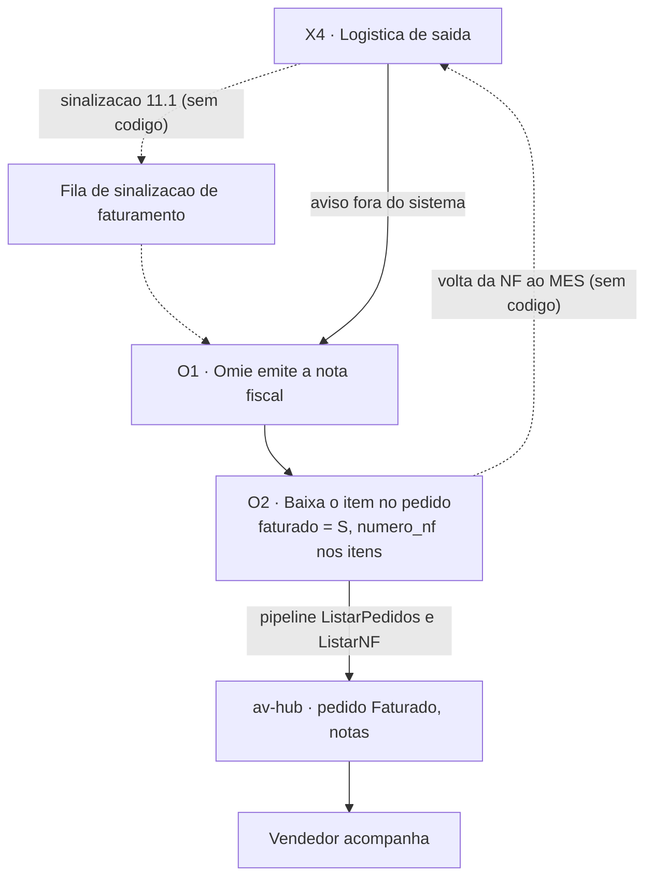

# Fiscal no Omie (O1, O2)

**Em uma frase:** é a etapa em que o Omie emite a nota fiscal e dá baixa nos itens do pedido. O sistema nunca emite nem edita nota; só recebe o que o Omie emitiu.

Nós `O1` (emite a nota) e `O2` (baixa o item) do [[00-Fluxo-Mestre-0b]], depois de `X4` ([[09-Expedicao]]). Contexto: [[Pipeline-Omie]] e [[Omie-Integracao-Estado]].

> [!info] Decisões de 29/10/2026 (N16-120 a N16-143)
> - N16-130: o vendedor decide nota inteira ou em partes, pela marca "pode faturar em partes".
> - N16-132: a Logística avisa que a carga está pronta, ao fechá-la. Sem código ainda.
> - N16-133: pedido faturado antes da entrega no MES só gera aviso.
> - N16-92 a N16-94: o sequencial é um agrupamento, não outro pedido: um pedido, várias notas.

## Como funciona, passo a passo

1. A carga fica pronta e a Logística avisa o faturista, fora do sistema. `X4`
2. O faturista emite a nota no Omie, inteira ou em partes. `O1`
3. A cada 3 minutos, o pipeline lê os pedidos e o banco marca o pedido como Faturado. `O2`
4. O pipeline lê as notas e grava o número da nota em cada item. Assim o item dá baixa. `O2`
5. O vendedor vê o pedido e a nota nas telas de notas. `O2`

O MES ainda não sabe que o pedido foi faturado.

## Exemplo

A Expedição avisa que as 100 flanges do Cliente Exemplo S.A. estão prontas. O faturista emite a nota no Omie. Em poucos minutos o pedido aparece como Faturado no av-hub, as flanges recebem o número da nota e o vendedor a encontra em Minhas Notas.

## Quem atua

| Quem | O que faz |
|---|---|
| Faturamento (Omie) | Emite a nota de saída |
| Expedição ou Logística | Avisa que a carga está pronta |
| Pipeline do Omie | Traz pedidos e notas para o banco do av-hub |
| Vendedor | Acompanha o pedido faturado |
| Gustavo e Robert | Gustavo cuida do banco e do pipeline; Robert, da futura sinalização no MES |

## Regras que valem

- Só o Omie emite ou edita nota fiscal (decisão #30).
- A baixa do item volta pelo pipeline, sem tela e sem escrita do MES.
- O banco calcula a situação do pedido a partir das marcas do Omie.
- As telas de notas só mostram o que o Omie já emitiu.
- A única escrita do pipeline no Omie é o envio da ordem de compra.
- Remessa de produtos fica para o Ciclo 2 (22/01/2027).

## O que já existe e o que falta

- ✅ Omie emite a nota; o pipeline traz pedido e nota; as telas de notas do hub.
- 🔴 Fila de sinalização de carga pronta (tela 11.1) e a volta da nota ao MES.
- 🔴 Remessa de produtos (Ciclo 2).
- 🟡 Pedido faturado antes da entrega: só avisa. Dicionário de etapas do Omie.
- ❓ Itens legados com `codigo_item_omie` nulo.

## Detalhe técnico

### Objetivo

Fechar o ciclo: da carga pronta até a nota emitida e o item "faturado" no pedido de venda. **O sistema nunca emite nem edita nota fiscal.** O Omie é o sistema fiscal e financeiro (decisão #30 do registro de 07/10). O MES só deveria **sinalizar** que a carga está pronta (11.1); o retorno da nota chega pelo pipeline ELT, que já funciona.

### Regras decididas

| # | Regra | Selo |
|---|---|---|
| 1 | Emissão fiscal 100% no Omie; nenhum módulo do ERP emite ou edita NF | 📝 (#30) |
| 2 | A baixa de item no pedido volta pelo **pipeline** (polling), sem tela e sem escrita do MES | 📝 ✅ |
| 3 | Parcial x integral na faturação é decisão da Expedição ([[09-Expedicao]], X2, T-06); pela N16-130, de 29/10, quem decide é o vendedor, pela marca "pode faturar em partes" | 📝 |
| 4 | A sinalização ao Omie é uma fila de cargas prontas (tela 11.1), com acompanhamento do número e da chave da NF pelo pipeline | 🟡 desenho, sem código |
| 5 | Remessa de produtos (registro de remessa) fica para o Ciclo 2 (22/01/2027) | 📝 |
| 6 | Só uma escrita do pipeline no Omie: envio da OC (`UpsertPedCompra`, `ExcluirPedCompra`) | ✅ [[04-Circuito-de-Compra]] |

### Estados

`pedidos_vendas.situacao` não é escrito pelo pipeline: a trigger `trg_sync_situacao_pv` o calcula a cada insert ou update, na ordem de precedência abaixo (`fn_sync_situacao_pv`, Dump Avhub linha 9804; trigger linha 26286):

| Ordem | Condição (flag do Omie) | `situacao` |
|---|---|---|
| 1 | `cancelado` | `Cancelado` |
| 2 | `denegado` | `Denegado` |
| 3 | `devolvido` | `Devolvido` |
| 4 | `devolucao_parcial` | `Dev. Parcial` |
| 5 | `encerrado` | `Encerrado` |
| 6 | `faturado` | `Faturado` |
| 7 | `autorizado` | `Autorizado` |
| 8 | nenhuma | `Pendente` |

Os flags vêm dos campos `S`/`N` do cabeçalho e de `infoCadastro` (`pedidosVendas.ts:134-136`). `pedidos_vendas.etapa` (`numeric(2,0)`) é a etapa do Omie (`cabecalho.etapa`); os nomes por operação estão em `core.etapas_faturamento` (Dump Avhub linha 11084; recurso `etapasFaturamento` habilitado, tabela populada em produção, registro #5). `sequencial` 0 é o pedido guarda-chuva e 1, 2... são parciais. A liberação (`status_liberacao`) usa `situacao = 'Pendente'` ([[01-Vendas-Liberacao]]).

O MES não tem estado fiscal: guarda só `Entrega.numeroNf` (texto de até 30 caracteres) digitado na entrega e `ItensPedido.quantidadePendente` ([[09-Expedicao]]).

### Telas

| Nome atual | Nome antigo | Rota | App | Estado |
|---|---|---|---|---|
| Fila de sinalização de faturamento (11.1) | — | — | MES | 🔴 não existe |
| Minhas Notas | — | `/minhas-notas` | HUB | ✅ `app/(protected)/minhas-notas/page.tsx` (pós-fato, por vendedor) |
| Notas da Equipe | — | `/notas-equipe` | HUB | ✅ `app/(protected)/notas-equipe/page.tsx` |
| Notas do PCP | — | `/pcp-notas` | HUB | ✅ `app/(protected)/pcp-notas/page.tsx` |
| Notas Fiscais de Saída | — | `/vendas/notas-fiscais-saida` | HUB | ✅ `app/(protected)/vendas/notas-fiscais-saida/page.tsx` |
| Etapa dos itens (cartão no pedido) | — | `/meus-pedidos/pedido/...` | HUB | ✅ `components/Pedidos/EtapaDosItens.tsx`; só chega até `expedicao.concluido` |

As telas de notas do HUB são **pós-fato**: mostram a NF que o Omie já emitiu. Notas manuais ficam fora do fluxo (pasta `10-Anexo-Fora-do-Fluxo`).

### Endpoints e contratos

| O quê | Direção | Fonte |
|---|---|---|
| `ListarPedidos` (`/produtos/pedido/`) | pipeline lê do Omie por janela de data de inclusão | `pedidosVendas.ts` ✅ |
| `ListarNF` (`/produtos/nfconsultar/`, `tpNF = 1`, por data de emissão) | pipeline lê do Omie | `notasFiscais.ts:21-46` ✅ |
| `core_vendas_faturamento.notas_fiscais` (chave `codigo_empresa`, `codigo_nf_omie`) | destino da NF | `notasFiscais.ts:57-58` ✅ |
| `afterUpsert` da NF | grava `codigo_nf_omie` e `numero_nf` nos itens de `produto_vendas` do mesmo pedido que ainda não têm NF | `notasFiscais.ts:125-165` ✅ |
| Cron do pipeline | hoje a cada 3 min (`SYNC_HOJE_CRON`); mês a cada 20 min; últimos meses a cada 3 h; full 3h17 | `config` `:89-104` ✅ |
| Sinalização do MES ao Omie (11.1) | MES para Omie, via av-hub | 🔴 sem contrato |

Os endpoints do av-hub que expõem pedidos e notas pertencem ao módulo de vendas ([[AV-Hub-API]]).

### Como está no código

#### O1 e O2 (lado Omie) ✅

1. O faturista emite a NF no Omie.
2. O `ListarPedidos` a cada 3 minutos (janela de hoje) traz o pedido com `faturado = S`; a trigger recalcula `situacao = 'Faturado'`.
3. O `ListarNF` traz a nota e o `afterUpsert` carimba `codigo_nf_omie` e `numero_nf` em cada item de `produto_vendas`. O item "dá baixa" no pedido por esse vínculo.
4. O vendedor vê o pedido em Pedidos e Notas.

Limitação conhecida: o Omie filtra por data de inclusão, então o pipeline revarre janelas fixas em vez de usar watermark (`pedidosVendas.ts`, comentário de abertura). Itens legados com `codigo_item_omie` nulo podem ser pulados no vínculo ([[Riscos]]).

#### Sinalização do MES ao Omie (11.1) 🔴

Não existe no `api-pcp` nem na API do av-hub: nenhuma rota, tabela ou fila que sinalize "carga pronta, emitir NF". Hoje a Expedição avisa o faturista fora do sistema. O MES não sabe se o pedido foi faturado, e o pedido pode ser faturado antes da entrega no MES.

O desenho do v1 (11.1): lista de cargas prontas, botão que sinaliza, acompanhamento do retorno (número e chave) pela sincronização. Como o MES nunca fala com o Omie direto, a sinalização passaria pelo av-hub, que já tem o caminho de escrita ao Omie (envio de OC pelo pipeline).

### O que falta desenvolver

| # | O quê | Dono | Nó | Selo |
|---|---|---|---|---|
| 1 | Contrato e fila de sinalização MES para o av-hub (carga pronta por pedido e itens) e destino no Omie | Nathan desenha, Gustavo (API e pipeline), Robert (MES) | X4, O1 | 🔴 |
| 2 | Tela 11.1 no MES: cargas prontas, sinalizar, ver número e chave da NF | Robert | O1 | 🔴 |
| 3 | Volta da NF ao MES: ligar `Entrega.numeroNf` ao número do Omie (hoje digitado) e mostrar "faturado" na Expedição | Robert, Gustavo | O2 | 🔴 |
| 4 | Pedido em `Faturado` antes de entregue: definir se o MES bloqueia ou só avisa | Nathan | O2 | 🟡 |
| 5 | Remessa de produtos (Ciclo 2) | Robert | O1 | 🔴 |
| 6 | Reconciliar itens legados com `codigo_item_omie` nulo que travam o vínculo da NF | Gustavo | O2 | ❓ |
| 7 | Dicionário de etapas do Omie para o Portal do Vendedor, ligando `core.etapas_faturamento` | Nathan | O2 | 🟡 |

### Pendências

- Nathan e Faturamento: quem sinaliza (Expedição ou Logística) e qual o gatilho (carga fechada ou item `CONCLUIDO`)? **Decidido em 29/10/2026 (N16-132): a Logística, ao fechar a carga.**
- Nathan: sinalização por carga ou por pedido? Faturamento parcial gera um pedido filho (`sequencial`) no Omie? **Respondido: por carga fechada (N16-132); o sequencial não é outro pedido, é um agrupamento (N16-92 a N16-94). Faturado antes da entrega: só aviso (N16-133).**
- Gustavo: o pipeline tem latência de minutos; o MES precisa do retorno em quanto tempo?
- Nathan: devolução de cliente (`Devolvido`, `Dev. Parcial`) afeta saldo do Estoque? Fluxo decidido para o Estoque na Fase D, sem código.

### Subfluxo

Raia anterior: [[09-Expedicao]]. Visão geral: [[00-Fluxo-Mestre-0b]].
