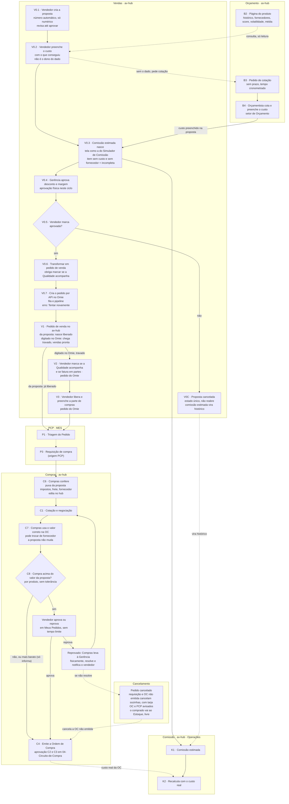

# Raia Vendas: da proposta ao pedido de venda (V0.1 a V0.7, V0C, V1 com duas origens), Compras confere (C6, C7), compra acima do valor (C8) e cancelamento

**Nota de raia (proposta, fluxo aprovado em 26/10/2026).** Nós do [[00-Fluxo-Mestre-0b]]: `V0.1` a `V0.7`, `V0C`, `V1`, e para o pedido digitado no Omie `V2` e `V3` ([[01-Vendas-Liberacao]]); `B1` a `B4` aparecem aqui só como ligação ([[12-Orcamento-Base-de-Preco]]); `C6`, `C7` e `C8` na raia de Compras; `K1` a `K6` em [[13-Custo-Real-e-Comissao-no-Fluxo]]. Selos em [[Regras-do-Vault]]; decisões em [[Registro-de-Decisoes]]; regras completas em [[LOG-56-Fluxo-da-Proposta-ao-Pedido]]; o que o Omie permite em [[Estudo-Omie-API]].

## Objetivo

Construir dentro do av-hub o começo do fluxo, que hoje não tem lugar: o vendedor monta a **proposta**, preenche a parte de venda e a de orçamento e compra com o que conseguiu (telefone, e-mail), mas **não é o dono do dado de custo**: o dono é Compras e o Orçamento (N16-54). A Gerência aprova desconto e margem (fisicamente neste ciclo) e a proposta aprovada vira **pedido de venda** criado por API no Omie. O pedido **nasce liberado**: a escolha "a Qualidade acompanha?" já foi feita na proposta. O pedido digitado direto no Omie segue o **mesmo fluxo e a mesma tela** (N16-106): chega travado, com a parte de vendas pronta (só se altera no Omie), e o vendedor responde `V2`/`V3` e preenche a parte de compras.

Depois do pedido, o PCP abre as requisições (`P3`). Compras recebe, o sistema **puxa os dados da proposta** (impostos, frete, fornecedor), Compras **confere os impostos**, edita no hub e valida se segue ou busca valor ou condição melhor (`C6`, `C7`). A proposta não muda e o preço fechado com o cliente não muda. **Se Compras compra por mais que o valor da proposta, o vendedor é avisado na tela "Meus Pedidos" e aprova ou reprova, por produto** (`C8`, N16-60 a N16-67). Se o pedido é **cancelado**, o sistema avisa a OC e o PCP, cancela a requisição e a OC ainda não emitida, e o que já foi comprado vai ao Estoque (N16-68 a N16-71).

## Quem atua

| Quem | Papel | Onde |
|---|---|---|
| Vendedor | Cria e revisa a proposta, preenche o custo que conseguiu ou pede cotação, marca a aprovação, transforma em pedido, **aprova ou reprova a compra acima do valor**, **cancela ou exclui o pedido** (N16-84) e vê o andamento em Meus Pedidos | Vendas, `/vendas/propostas`, Meus Pedidos |
| Auxiliar do titular | Mesmo escopo do vendedor (vê e edita pelos titulares que auxilia, como em Meus Pedidos) 🟡 | idem |
| Gerência (João Vitor, Sérgio Vital) | Aprova desconto e margem **fisicamente** (`V0.4`). Quando o vendedor reprova uma compra, **Compras leva o caso a ela, fisicamente**; a Gerência **não cancela no sistema** e **não tem tela** para isso (N16-66) | fora do sistema |
| Orçamento (setor orçamentário) | **Setor novo; uma das pessoas é o Moisés** (N16-104). O sistema funciona sem orçamentista (N16-59). Atende o pedido de custo e mantém a base de preço ([[12-Orcamento-Base-de-Preco]]). O perfil "orçamentista" deve existir | Orçamento, `/orcamento/painel-comprador` |
| Gerente de Vendas e perfis que veem a equipe | Leem propostas da equipe (escopo `vinculados`/`todos`) 🟡 | Vendas |
| PCP | Consome o pedido liberado e abre a requisição (`P1` a `P3`); **é avisado do cancelamento** do pedido; **liga a NF de entrada ao item do pedido** (N16-57) | MES |
| Compras (compradores, Gerente de Compras) | `C6`, `C7`, `C8`, OC (`C1` a `C4`); **lista dos casos reprovados pelo vendedor** e registro da solução (N16-73) | HUB, `/compras/*` |
| Fiscal | Cria o produto novo no Omie; separa o pedido em sequenciais para faturar em partes (N16-92); informa a **devolução parcial** (N16-74). **Não cancela o pedido**: quem cancela é o vendedor (N16-84) | Omie |
| Controladoria (Michele) | Decide a comissão ao fim, numa tela igual à da proposta, com o custo real ([[13-Custo-Real-e-Comissao-no-Fluxo]]); também informa a devolução parcial | HUB, Operações |
| Pablo | Módulo comercial na `api-acos-vital` | `api-acos-vital` |
| Gustavo (DBA) | Revisa e cria o banco e as rotas (`core_comercial`) | `api-acos-vital` |
| Nathan | Telas de Vendas, BFF, pipeline do pedido de venda, carga do imposto da OC do Omie | HUB, `omie-elt-pipeline` |

`Admin (Dev)` não é ator ([[Regras-do-Vault]]).

## Regras decididas

Origem: [[Registro-de-Decisoes]].

| # | Regra | Selo |
|---|---|---|
| 1 | A proposta é a primeira etapa do fluxo mestre (`V0`), antes do `V1` | 📝 N16-01 |
| 2 | Uma proposta equivale a **um** pedido. Não há fechamento parcial | 📝 N16-02 |
| 3 | O botão "Transformar em pedido de venda" (`V0.6`) só aparece na proposta **aprovada** | 📝 N16-02 |
| 4 | O pedido é criado **por API no Omie** (`V0.7`), pelo padrão da OC: a API grava numa fila e a pipeline envia | 📝 N16-02 |
| 5 | **Cancelada** é um estado só (`CANCELADA`, com motivo) e **não reabre**: o vendedor duplica. Nunca vira pedido; a comissão estimada vira histórico | 📝 N16-02, N16-24 |
| 6 | A proposta só se ajusta **até ser aprovada**; cada ajuste gera uma revisão. Aprovada, não se ajusta mais | 📝 N16-03 |
| 7 | Proposta **incompleta** é a que tem **qualquer item sem custo e sem fornecedor**; **não pode ser aprovada** | 📝 N16-03, N16-31 |
| 8 | Número automático e próprio, só dígitos, **por unidade e tipo**; proposta e pedido têm sequências próprias; prefixo só na tela e no PDF; o número do Omie segue a chave no MES | 📝 N16-04, N16-26 |
| 9 | "A Qualidade acompanha?" é obrigatório em `V0.6`; sem a marcação, o pedido não é criado. O vendedor pode corrigir a marcação até o MES importar, com histórico | 📝 N16-05, N16-29 |
| 10 | O pedido criado pela proposta **nasce liberado**, sem `V3`. O `V1` tem duas origens, que seguem o mesmo fluxo e a mesma tela; o pedido digitado no Omie chega com a parte de vendas pronta (só se altera no Omie), e o vendedor responde `V2`/`V3` e preenche a parte de compras no Hub, sem travar o fluxo | 📝 N16-05, N16-106 |
| 11 | O vendedor preenche o custo com o que conseguiu, mas **não é o dono do dado** (Compras e Orçamento são). Sem o dado, pede cotação ao orçamentista ou vê o histórico das OC. Ele decide o valor que põe | 📝 N16-06, N16-54 |
| 12 | A aprovação de desconto e margem é **física** neste ciclo (`V0.4`); no sistema, só no próximo. **O vendedor marca "aprovada"** no sistema, que grava quem, quando e qual revisão | 📝 N16-12, N16-25 |
| 13 | A comissão estimada nasce em `V0.3` (`K1`) e só o vendedor a vê, como ele a colocou | 📝 N16-10 |
| 14 | Compras confere a parte de compras da proposta (`C6`): o sistema **puxa os dados da proposta**; Compras confere os impostos, edita no hub, pode usar o fornecedor do vendedor ou outro, e usa o valor correto na OC (`C7`) | 📝 N16-08, N16-38, N16-53 |
| 15 | Compras **não altera** a proposta; o preço fechado com o cliente não muda | 📝 N16-08, N16-17 |
| 16 | **Compra acima do valor da proposta (`C8`):** o vendedor é avisado em **Meus Pedidos** e **aprova ou reprova, por produto, sem tolerância e sem tempo limite**. Aprovada, o processo continua e a margem e a comissão dele caem. **Supera** a regra antiga de que o vendedor não recebe aviso | 📝 N16-60, N16-61, N16-63, N16-64 |
| 17 | O aviso traz PV e OC, **margem atual** (do simulador), **margem considerada** (da compra real), **motivo escrito por Compras** (obrigatório), diferença de custo e fornecedor com prazo e pagamento | 📝 N16-62 |
| 18 | Aviso **favorável** (a margem sobe) é só informativo | 📝 N16-65 |
| 19 | Vendedor reprova: **Compras leva o caso à Gerência (João Vitor ou Sérgio Vital), fisicamente**, e, se preciso, fala com o vendedor. A Gerência **não cancela** no sistema e a aprovação dela **é conversa**, não botão. Compras resolve (busca valor melhor) e notifica o vendedor, que só vê a notificação e resolve fisicamente | 📝 N16-61, N16-65, N16-66, N16-67 |
| 20 | Compras tem uma **lista dos casos reprovados ainda sem solução** e um mecanismo para registrar a solução | 📝 N16-73; 🟡 o desenho |
| 21 | O pedido de custo ao Orçamento **não tem prazo fixo**; o tempo é **cronometrado**. O setor é novo (o Moisés é uma das pessoas) e o sistema funciona sem orçamentista | 📝 N16-58, N16-59, N16-104 |
| 22 | **Pedido cancelado:** a requisição do PCP e a OC ainda não emitida são **canceladas sozinhas, com tarja**; a OC e o PCP são avisados; o que já foi comprado vai ao **Estoque, livre**, como lote com o custo da OC | 📝 N16-68, N16-69, N16-70 |
| 23 | **Pedido já faturado:** o cancelamento não desfaz compra nem produção; fica só o abatimento da comissão e o saldo ainda não faturado, **parte por parte** | 📝 N16-71 |
| 24 | O câmbio vem da PTAX do Hub, **do dia da aprovação**; não há migração do ERP antigo de propostas | 📝 N16-13, N16-27 |
| 25 | Produto pendente (`PEND-xxxx`) **não vira pedido** até o cadastro no Omie | 📝 N16-28 |
| 26 | Se alguém mexer no pedido no Omie depois, o sistema só avisa e traz a mudança | 📝 N16-30 |
| 27 | Erro do Omie ao criar o pedido: **erro de sincronia**, com o motivo e o botão **"Tentar novamente"**; a proposta segue aprovada | 📝 N16-36 |
| 28 | **A tela da proposta é semelhante à do Simulador de Comissão atual**: pedido, condições comerciais (um conjunto por proposta), itens com Compra, Venda e Resultado, e rodapé de totais com margem e letra. Mesmo motor e mesmas regras, em tabelas novas. Seção "A tela da proposta" abaixo | 📝 N16-19, N16-21, 🔴 sem código |
| 29 | O vendedor preenche o custo de compra dos itens na própria tela e vê custo líquido, sugerido, margem, letra e a comissão estimada que ele colocou. **Não vê** a comissão real antes da decisão da Controladoria. Na aprovação de **C8** ele vê o valor da compra daquele produto | 📝 N16-10, N16-19, N16-60 |
| 30 | Compras vê a mesma tela em **leitura** (cotado do vendedor ao lado do valor da OC, em `C6`); o valor correto entra na **OC** (`C7`), não na proposta | 📝 N16-08, N16-19 |
| 31 | A Michele tem a tela igual, com o custo real e afins, lado a lado com o estimado, e as condições de **cada evento de custo** | 📝 N16-19, N16-20 |
| 32 | **Pedidos de Venda e Notas Fiscais de Saída** ficam inativas também em produção | 📝 N16-33 |

## Estados

### Proposta (`status`) 🟡

O enum de hoje, no módulo do Pablo, é `StatusProposta`: `ABERTA`, `PARCIAL`, `FECHADA`, `PERDIDA` (`api-comercial/prisma/models/enums.prisma:69-76`). Valores novos, no `CHECK` da migração ([[SQL-016-Proposta-e-Pedido-de-Venda-em-core_vendas_faturamento]], `ck_propostas_status`):

| Valor 🟡 | De onde vem | Significado | Quem vê |
|---|---|---|---|
| `ABERTA` | `ABERTA` | Em elaboração. Ajusta e revisa. Se algum item está sem custo e sem fornecedor, a tela marca **incompleta** (campo calculado, não é estado) | vendedor, equipe |
| `APROVADA` | `FECHADA` (sem fechamento parcial) | O vendedor marcou a aprovação da Gerência. Travada. Libera o botão `V0.6` | vendedor, equipe |
| `TRANSFORMADA` | novo | O pedido foi criado a partir dela (`V0.6`, `V0.7`); grava `transformada_em`. Travada | vendedor, equipe |
| `CANCELADA` | `PERDIDA` | Estado único, não reabre (duplica). A comissão estimada vira histórico | vendedor, equipe |

`PARCIAL` deixa de existir (N16-02). Eventos da linha do tempo: `TipoEventoProposta` tem `CRIADA`, `REVISADA`, `PERDIDA`, `REABERTA`, `FECHAMENTO_PARCIAL`, `FECHAMENTO_TOTAL`, `DUPLICADA`, `COPIADA`, `PDF_GERADO`, `EMAIL_ENVIADO`, `EXCLUIDA`, `CUSTO_ALTERADO`, `MIGRADA`, `PEDIDO_OMIE_ATUALIZADO` (`enums.prisma:119-136`); na migração saem `PERDIDA`, `REABERTA` e `FECHAMENTO_*` e entram 🟡 `CUSTO_SOLICITADO`, `CUSTO_RESPONDIDO`, `APROVADA`, `CANCELADA`, `TRANSFORMADA_EM_PEDIDO`, `PEDIDO_ENVIADO_OMIE`, `PEDIDO_RECUSADO_OMIE`, `PEDIDO_NUMERO_OMIE` e `REATRIBUIDA` (`ck_propostas_eventos_tipo`).

### Pedido de venda do hub (`status_sincronizacao_omie`) 🟡

Mesmo vocabulário da OC (`pendente`, `sincronizado`, `erro`; Dump Avhub 17315-17320): `pendente` (na fila), `sincronizado` (Omie criou; guarda o número do Omie), `erro` (Omie recusou; texto do erro; botão "Tentar novamente", N16-36).

### Pedido de aprovação do vendedor (`C8`) 🟡

Estados propostos (N16-66, N16-73): `PENDENTE` (na lista do vendedor, sem tempo limite), `APROVADO` (a compra segue), `REPROVADO` (em tratativa: entra na **lista de Compras**) e `RESOLVIDO` (Compras registrou a solução: novo valor, novo fornecedor, mantido ou pedido cancelado; o vendedor foi notificado). O tempo em cada estado é cronometrado.

### Liberação

O pedido da proposta nasce em `status_liberacao = liberado` (valores em [[01-Vendas-Liberacao]]); o histórico `liberado` é gravado **na resposta do `IncluirPedido`**, usando o `codigo_pedido_integracao` como chave ([[LOG-58-Liberacao-do-Pedido-Origem-Proposta]], [[Estudo-Omie-API]]).

## Telas

| Nome atual | Rota | App | Quem | Nó | Estado |
|---|---|---|---|---|---|
| Propostas (lista) | `/vendas/propostas` | HUB | Vendedor, equipe | `V0.1` | ✅ `app/(protected)/vendas/propostas/page.tsx` (movida em 16/10, `200e860`) |
| Nova proposta | `/vendas/propostas/nova` | HUB | Vendedor | `V0.1`, `V0.2` | ✅ `vendas/propostas/nova/page.tsx`, formulário `components/Propostas/PropostaForm/PropostaForm.tsx` |
| Proposta (detalhe, revisões, linha do tempo) | `/vendas/propostas/[id]` | HUB | Vendedor, equipe | `V0.1` a `V0.7` | ✅ `vendas/propostas/[id]/page.tsx`; 🔴 aprovar e transformar em pedido |
| **Página do produto** (histórico, top fornecedores com score, flutuação, volatilidade, média) | a definir 🟡 | HUB | Vendedor | `V0.2`, `B2` | 🔴 ([[12-Orcamento-Base-de-Preco]]) |
| **Meus Pedidos**, com o andamento da venda e **o que está aberto para o vendedor** (aprovar ou reprovar compra acima do valor) | `/meus-pedidos` 🟡 | HUB | Vendedor | `C8` | 🔴 a tela existe e outra frente a evolui (encerramento por saldo zerado, SQL-014); a área de pendências é nova |
| **Lista de casos reprovados pelo vendedor** (sem solução) | `/compras/...` 🟡 | HUB | Comprador | `C8` | 🔴 |
| Clientes | `/vendas/clientes` | HUB | Vendedor | `V0.1` | ✅ |
| Relatório de Cotações, Relatório Gerencial | `/vendas/relatorio-cotacoes`, `/vendas/relatorio-gerencial` | HUB | Gerência | — | ✅ |
| Pedidos de Venda (lista do Omie) | `/vendas/pedidos-de-venda` | HUB | Vendedor | `V1` | ✅ página no código; **inativada também em produção** (N16-33) |
| Notas Fiscais de Saída | `/vendas/notas-fiscais-saida` | HUB | — | — | ✅ página no código; **inativada também em produção** (N16-33) |
| Tela da proposta no formato do Simulador (pedido, condições, itens, totais) | dentro de `/vendas/propostas/[id]` e `/vendas/propostas/nova` | HUB | Vendedor | `V0.2`, `V0.3` | 🔴 hoje o formulário é `components/Propostas/PropostaForm/PropostaForm.tsx` sem comissão |
| Visão de Compras da mesma tela (leitura) | dentro de `/compras/nova/[requisicaoId]` 🟡 | HUB | Comprador | `C6`, `C7` | 🔴 |
| Visão da Controladoria da mesma tela, com custo real | Operações 🟡 | HUB | Controladoria | `K4` | 🔴 ([[13-Custo-Real-e-Comissao-no-Fluxo]]) |
| Botão "Transformar em pedido de venda" e marcação da Qualidade | dentro de `/vendas/propostas/[id]` | HUB | Vendedor | `V0.6` | 🔴 |
| Marcar "aprovada" (registro da aprovação física) | idem | HUB | Vendedor | `V0.4`, `V0.5` | 🔴 |
| **Tarja de pedido cancelado** na requisição e na OC | nas telas da requisição e da OC | HUB, MES | Compras, PCP | cancelamento | 🔴 |
| Liberar Pedidos, Liberação da Equipe | `/liberar-pedidos`, `/liberacao-equipe` | HUB | Vendedor, gerente | `V2`, `V3` | ✅ hoje; a resposta passa para a tela do pedido (N16-106) 🟡 |
| Conferência de Compras (parte de compras da proposta) | dentro de `/compras/nova/[requisicaoId]` 🟡 | HUB | Comprador | `C6`, `C7` | 🔴 |

O menu de Vendas, Orçamento e Compras: [[LOG-57-Menu-Vendas-Orcamento-Compras]].

## Endpoints e contratos

| Método e rota | Uso | Nó | Estado |
|---|---|---|---|
| `GET /propostas`, `/resumo`, `/:id`, `/:id/eventos`, `/:id/versoes`, `/:id/versoes/:revisao` | listar e ler | `V0.1` | ✅ `propostas.routes.ts:17-23`, `:76`, `:118-142` (módulo de teste) |
| `POST /propostas` | criar (idempotente) | `V0.1` | ✅ `:82` |
| `PUT /propostas/:id` | revisar (só `ABERTA`, `If-Match`) | `V0.1`, `V0.2` | ✅ `:87`; trava em `propostas.service.ts:478-481` |
| `POST /propostas/calcular`, `/itens/importar`, `GET /itens/modelo` | pré-visualizar, planilha de itens | `V0.1` | ✅ `:27`, `:55`, `:68` |
| `POST /propostas/:id/duplicar` | nova proposta a partir de outra (também para refazer a cancelada) | `V0.1` | ✅ `:125` |
| `POST /custos/sugerir` | sugestão de custo para o item | `V0.2` | ✅ `custos.routes.ts:30` |
| `GET /produtos/:id/precos` | histórico, média e fornecedores | `B2` | ✅ `suprimentos.routes.ts:823` |
| `POST /solicitacoes_custo` e `responder`, `assumir`, `liberar`, `cancelar` | pedido de custo (o prazo obrigatório de 2 dias úteis **sai**: N16-58) | `B3`, `B4` | ✅ `custos.routes.ts:304-510`; 🔴 ajuste |
| `POST /propostas/:id/aprovar` | marcar aprovada | `V0.4`, `V0.5` | 🔴 proposta |
| `POST /propostas/:id/cancelar` | cancelar com motivo (substitui `perder`) | `V0C` | 🔴 proposta |
| `POST /propostas/:id/pedido_venda` `{ acompanhamento_qualidade }` | transformar em pedido: grava na fila | `V0.6`, `V0.7` | 🔴 proposta |
| `GET /pedidos_venda_hub/fila-omie`, `PATCH /pedidos_venda_hub/:id/sincronizacao`, `POST /:id/reenviar` | fila e retorno da pipeline, espelho de `/compras/ordens/fila-omie` | `V0.7` | 🔴 proposta |
| `POST /pedidos_venda_hub/:id/cancelar` | registrar o cancelamento do pedido no hub; avisa OC e PCP, cancela requisição e OC não emitida, manda o comprado ao Estoque | cancelamento | 🔴 🟡 nome |
| `GET /divergencias_compra`, `POST /:id/aprovar`, `/:id/reprovar`, `/:id/resolver` | aviso ao vendedor, decisão dele e solução de Compras | `C8` | 🔴 🟡 nomes |
| `GET /propostas/:id/pedido_omie`, `PUT` (digitar o número à mão) | **substituídas**: o pedido deixa de ser digitado | `V0.7` | ✅ `propostas.routes.ts:146-164`, saem |

Auditoria das telas e a nova página de proposta: [[14-Telas-e-Experiencia-do-Usuario]]; mapa do pedido no Omie: [[Mapa-IncluirPedido-Omie]].

Contratos: [[LOG-56-Fluxo-da-Proposta-ao-Pedido]] (regras e permissões), [[LOG-58-Liberacao-do-Pedido-Origem-Proposta]] (liberação), [[LOG-57-Menu-Vendas-Orcamento-Compras]] (menu e telas), API-019 a API-022 e SQL-016 a SQL-018. Nomes de rota 🟡: o Gustavo e o Pablo fecham.

## Como está no código (✅ do módulo do Pablo)

Tudo abaixo é do `api-comercial` (pasta `av-hub/api-comercial`), serviço **só de teste** (N14-15). Nada disto existe na `api-acos-vital` 🔴.

- ✅ **Proposta completa:** modelo `Proposta` (`prisma/models/vendas.prisma:45-109`) com cliente, empresa emissora, itens, moeda, incoterm, frete, condição, totais, `valorFechado`, `acompanhamentoQualidade`, `numeroPedidoOmie`; itens com snapshot de custo (`PropostaItem`, `:111-166`: `custo`, `margemPct`, `origemCusto`, `idOferta`, `fornecedor`, `custoLiquidoUnit`, `margemRealPct`).
- ✅ **Revisão:** `atualizar` só roda em `ABERTA` (`propostas.service.ts:478-481`); se o conteúdo comercial muda, `revisao + 1` e uma linha em `propostas_versoes` com o snapshot (`:483-515`); evento `REVISADA`.
- ✅ **Numeração atômica** (`proximoSequencial`, `propostas.service.ts:313-322`), mas com formato `CO-AV2026-0012-R03` (`domain/numeracao/numeroProposta.ts:3-12`), por empresa e ano: **diverge de N16-04 e N16-26** 🔴.
- ✅ **Comandos de status:** `perder` (`:555-575`), `reabrir` (`:578-606`), `fechar` com fechamento parcial por item (`:609-649`) e `calcularFechamento`. **Divergem de N16-02, N16-03 e N16-24** 🔴: reabrir e fechar em parte deixam de existir.
- ✅ **Pedido no Omie à mão:** `pedidoOmie` monta o resumo para o vendedor digitar (`:663-691`), com planilha (`pedidoOmie.ts`), e `registrarPedidoOmie` grava o número e a marcação da Qualidade (`:694-725`); `exigirGanha` aceita `FECHADA` e `PARCIAL` (`:652-656`). Sai com N16-02 🔴.
- ✅ **Duplicar e copiar para outra empresa** (`propostas.service.ts:853-903`).
- ✅ **PDF e e-mail da proposta** (HUB gera o PDF; `emailProposta.ts`; evento `PDF_GERADO`).
- ✅ **Capacidades** derivadas das telas do hub: `propostas`, `propostas-valores`, `custo-item`, `painel-comprador`, `propostas-delegacao` (`domain/permissoes/capacidades.ts:47-56`).
- ✅ **Pedido de custo** com prazo padrão de 2 dias úteis (`custos.routes.ts:378`) e rótulos `ATRASADA`, `VENCE_HOJE`, `NO_PRAZO` (`:338`): **saem** com N16-58 (cronômetro, sem prazo). `GET /produtos/:id/precos` (`suprimentos.routes.ts:823-880`).
- ✅ **Simulador do Hub** lê a proposta ligada ao pedido para pré-preencher o lado da compra (`simulador.routes.ts`, PR #207). Não é a comissão estimada da proposta.

No HUB (branch `feat/menu-orcamento-vendas-compras`, `5aa5311`): as páginas de Vendas já estão em `app/(protected)/vendas/*` ✅ ([[LOG-57-Menu-Vendas-Orcamento-Compras]]).

No av-hub (API do hub), o que serve de padrão: contador por `(unidade, tipo)` (`contadores_documento`, `fn_proximo_numero_documento`, Dump Avhub 8110-8140, 16552-16564); fila da OC para o Omie (`GET /compras/ordens/fila-omie`, `PATCH …/sincronizacao`, `POST …/reenviar`, `ordens_compra.route.js:857`, `:1267`, `:1321`); liberação (`pedidos_vendas_liberacao`, Dump 18285).

## O Omie nesta raia ([[Estudo-Omie-API]])

- ✅ O `IncluirPedido` aceita o **nosso código de integração** do pedido e do item: o hub grava a liberação na **resposta** da inclusão e liga o item da proposta ao `codigo_item_omie`. Etapa inicial `"10"`. A pipeline precisa **gravar** `codigo_pedido_integracao`.
- 🟡 Pode ser possível **mandar o nosso `numero_pedido`**, e o pedido criado por API pode nascer **bloqueado** na tela do Omie: ❓ só teste.
- ✅ **Existe cancelar pedido por API** (`CancelarPedidoVenda`, serviço `/produtos/pedidovendafat/`), e também `ExcluirPedido` e `AlterarPedidoVenda`. **Quem cancela, edita e exclui é o vendedor** (N16-84), não o Fiscal. O `ListarEtapasPedido` (`/produtos/pedidoetapas/`) devolve, por pedido, cancelamento, devolução e faturamento. **O hub guarda o cancelamento por conta própria** (quem, quando, motivo) porque o `exclusionSync` apagaria do hub um pedido excluído no Omie.
- ✅ Devolução de **venda**: a total vem do Omie; a **parcial** só chega marcada, sem valor, item nem quantidade. Fiscal ou Controladoria informam o que voltou (N16-74).

## Dados 🟡

Schema `core_comercial` (proposta, pedido de venda do hub, numeração, custo realizado por item): modelo em SQL-016. Aqui só o que o fluxo exige:

| Dado | Regra |
|---|---|
| `propostas.status`, `revisao`, `aprovada_em`, `aprovada_por`, `aprovada_revisao` | aprovação grava quem, quando e **qual revisão** |
| `propostas.acompanhamento_qualidade` | obrigatório no `V0.6`, copiado ao pedido |
| `pedidos_venda_hub.numero`, `numero_omie`, `codigo_pedido_integracao`, `status_sincronizacao_omie`, `id_proposta`, `cancelado_em`, `cancelado_por`, `motivo_cancelamento` | 1 para 1 com a proposta (único); o cancelamento é guardado **no hub**, mesmo que o Omie exclua o pedido |
| `contadores_documento.tipo` | ganha `proposta` e `pedido_venda` (o `CHECK` hoje só aceita `ordem_compra` e `requisicao_compra`, Dump 16560) |
| Item da proposta ↔ item do pedido ↔ `codigo_item_omie` ↔ item da OC | chave do custo real |
| `divergencias_compra` (pedido, produto, valor da proposta, valor da compra, motivo, estado, quem decidiu e quando, solução, tempos) | uma linha por produto (N16-63); estados `PENDENTE`, `APROVADO`, `REPROVADO`, `RESOLVIDO` 🟡 |

## Quem vê o quê

| Dado | Vendedor | Auxiliar | Gerente de equipe | Orçamento | Compras | PCP | Controladoria |
|---|---|---|---|---|---|---|---|
| Proposta (venda, preço, desconto) | só as dele | dos titulares | todas da equipe | só o pedido de custo, sem preço de venda 🟡 | a parte de compras, quando há requisição do pedido | não | só a tela da comissão (mesma estrutura da proposta), não edita a proposta |
| Custo e margem | os que ele pôs (`propostas-valores`, `custo-item`) | idem | equipe | custo que preenche | custo e valor correto | não | sim (custo real e diferença) |
| **Aviso de compra acima do valor** | **sim, só o dos produtos dele**, com margem atual, margem considerada, motivo e fornecedor | idem 🟡 | 🟡 OQ-21 | não | **sim, a lista dos reprovados** | não | sim |
| Comissão estimada | só a que ele pôs | idem | 🟡 OQ-21 | não | não | não | sim |
| Pedido de venda do hub | os dele | idem | equipe | não | o vinculado à requisição | liberado; **avisado do cancelamento** | não |

Matriz completa por perfil em [[LOG-56-Fluxo-da-Proposta-ao-Pedido]].

## A tela da proposta (N16-19)

A tela de criar e revisar a proposta segue a do **Simulador de Comissão atual** (`09-Diagramas/fontes/tela-simulador-comissao.png`; `av-hub/app/(protected)/comissoes/simulador/page.tsx`). Blocos, na ordem da imagem:

1. **Pedido** → na proposta: unidade, número da proposta (automático, N16-04), cliente, vendedor e quantidade de itens.
2. **Condições comerciais** (um conjunto por proposta, como no Simulador): estado de destino com ICMS, condição de pagamento com encargo ("o encargo financeiro entra no preço sugerido"), chave "Com impostos", frete na compra (rateio pelo percentual de logística), valor ST (venda), imposto retido ou DIFAL e frete na venda ("entra na NF, mas fica fora da margem"). Os parâmetros vigentes ("Parâmetros: Maio/23" na imagem, que continuam valendo, N16-39) são gravados com o cálculo. 🟡 O `SimularImpostos` do Omie pode alimentar a ST e o DIFAL da venda sem digitação ([[Estudo-Omie-API]]).
3. **Itens**: bloco Compra (fabricação, quantidade, unidade, preço, origem, % IPI, ST, frete e fornecedor: o vendedor preenche), bloco Venda (quantidade e preço) e bloco Resultado (custo líquido, sugerido, margem e letra: o sistema calcula).
4. **Rodapé de totais**: custo, venda, total da NF, sugerido, mark-up real, mark-up sobre a compra, margem e letra.

As colunas e as condições **vêm das mesmas entradas do motor atual** (`simulacoes`, `simulacao_itens`, `simulador_parametros` e a view `vw_simulacao_resolvida`, ver [[01-Motor-Atual-Como-Calcula]]); o `core_comercial` (itens da proposta) e o `core_comissao` casam com elas, sem colunas paralelas (SQL-016 e SQL-018). Hoje o Simulador calcula no navegador (`calcularSimulacao`, `simulador/page.tsx:1053`) e a proposta não calcula comissão; o cálculo passa à API ([[03-Modelo-Novo-core_comissao]]).

**Três visões da mesma tela** (detalhe e tabela por bloco em [[13-Custo-Real-e-Comissao-no-Fluxo]]): (a) o vendedor, na proposta, preenche o custo e vê margem, letra e a comissão estimada que ele colocou; (b) Compras vê o cotado do vendedor ao lado do valor da OC e usa o valor correto na OC, sem alterar a proposta; quando o valor é maior, o vendedor aprova em Meus Pedidos; (c) a Controladoria vê estimado e real lado a lado, com o drill-down por evento de custo (cada evento com as suas condições, N16-20), e decide com justificativa.

## O que falta desenvolver

| # | O quê | Dono | Nó | Selo |
|---|---|---|---|---|
| 1 | Migrar o módulo de propostas para a `api-acos-vital` (schema `core_comercial`) e trocar a numeração, o enum e os comandos de status | Pablo, Gustavo | `V0.1` | 🔴 |
| 2 | Estado `APROVADA`, trava de ajuste, "incompleta" e aprovar com a revisão | Pablo | `V0.4`, `V0.5` | 🔴 |
| 3 | Cancelar com motivo e histórico da comissão estimada | Pablo | `V0C` | 🔴 |
| 4 | Botão "Transformar em pedido", marcação da Qualidade obrigatória, fila do pedido e retorno da pipeline | Pablo (API), Nathan (tela e pipeline), Gustavo (banco) | `V0.6`, `V0.7` | 🔴 |
| 5 | Pipeline: `IncluirPedido` por fila, espelho do `envioOrdensCompra.ts`, com `codigo_pedido_integracao` e `codigo_item_integracao`; gravar esses códigos no hub | Nathan | `V0.7` | 🔴 |
| 6 | Liberação gravada na resposta do `IncluirPedido`, com histórico | Gustavo | `V1` | 🔴 ([[LOG-58-Liberacao-do-Pedido-Origem-Proposta]]) |
| 7 | `C6` e `C7` na tela de emissão da OC: mostrar a parte de compras da proposta, puxar fornecedor e impostos, editar, gravar o valor correto sem tocar a proposta | Nathan, Gustavo | `C6`, `C7` | 🔴 |
| 8 | Trocar a AwesomeAPI pela PTAX do hub | Pablo | `V0.1` | 🔴 |
| 9 | Aprovar com perfil da Gerência no sistema | — | `V0.4` | próximo ciclo (N16-12) |
| 10 | Tela da proposta no formato do Simulador, com o motor na API (porta de `lib/simulador/motor.ts`) e a comissão estimada | Nathan (tela), Pablo e Gustavo (API) | `V0.2`, `V0.3`, `K1` | 🔴 |
| 11 | Visão de Compras (leitura) e visão da Controladoria (custo real, drill-down por evento) da mesma tela | Nathan | `C6`, `C7`, `K4` | 🔴 |
| 12 | **`C8`:** aviso e aprovação em Meus Pedidos, tabela `divergencias_compra`, lista de Compras dos reprovados e registro da solução | Nathan, Pablo, Gustavo | `C8` | 🔴 |
| 13 | **Cancelamento:** registro no hub, requisição e OC não emitida canceladas com tarja, aviso à OC e ao PCP, comprado ao Estoque, ajuste do `exclusionSync` | Nathan, Gustavo, Robert (Estoque) | cancelamento | 🔴 |
| 14 | **Pipeline do Omie:** gravar os códigos de integração, ampliar o espelho e o envio da OC com os impostos, recurso novo de recebimento de NF-e, cancelamento e devolução da NF | Nathan, Gustavo | vários | 🔴 ([[Estudo-Omie-API]]) |
| 15 | Página do produto e regras do score | Nathan, Pablo | `V0.2`, `B2` | 🔴 ([[12-Orcamento-Base-de-Preco]]) |

## Pendências

| # | Pergunta | Dono |
|---|---|---|
| 1 | ✅ Alçada de desconto e margem: tudo fisicamente (N16-75; OQ-04 fechada) | Nathan (feito) |
| 2 | Perfis do Orçamento e de quem vê a equipe (OQ-21); o Moisés é uma das pessoas do setor (N16-104) | Nathan, Gustavo |
| 3 | Testes no Omie: campos obrigatórios, `numero_pedido` próprio, pedido bloqueado, `ExcluirPedido` (OQ-16, OQ-48) | Nathan |
| 4 | ✅ Quem cancela: o vendedor, por API (N16-84). Falta testar a diferença entre `CancelarPedidoVenda` e `ExcluirPedido` e quando cada um vale (OQ-17, OQ-48) | Nathan |
| 5 | Quem cadastra produto novo, e em quanto tempo (OQ-36) | Fiscal |
| 6 | O e-mail de Compras ao vendedor deixa de ser necessário? (N16-64) | Nathan, Compras |
| 7 | Quem recebe o aviso quando a Gerência quer falar com Compras sobre um caso (fora do sistema) | — |
| 8 | Estado do item que vai ao Estoque quando o pedido cancela e a reserva do MES | Robert |

Lista completa em [[Perguntas-Proposta-Pedido-Comissao]].

## Diagrama do subfluxo

Próxima raia no desenho: [[04-Circuito-de-Compra]] (para `P3`, `C6`, `C7`, `C8`) e [[12-Orcamento-Base-de-Preco]].
