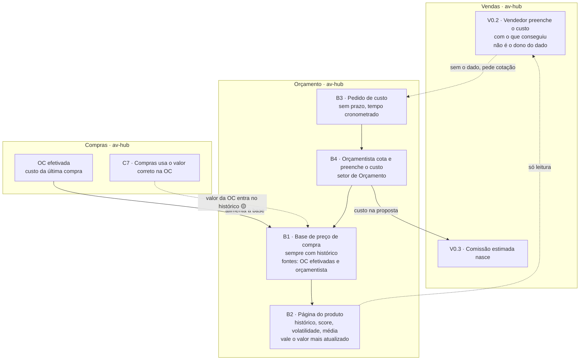

# Orçamento e base de preço de compra

**Em uma frase:** o Orçamento é o setor novo que mantém o preço de compra de cada produto, sempre com histórico, para o vendedor consultar ou pedir cotação quando não tem o custo.

Esta nota substitui o anexo [[Orcamento]], arquivado em 26/10/2026. Os nós são `B1` a `B4` do [[00-Fluxo-Mestre-0b]].

## Como funciona, passo a passo

1. O vendedor monta a proposta e tenta preencher o custo com o que conseguiu. Ele não é dono do dado, mas decide o valor que põe. `V0.2`
2. Se precisa de referência, ele abre a página do produto: histórico de preços, melhores fornecedores com nota, flutuação e valor médio. É só leitura. `B2`
3. Se não tem o dado, ele pede o custo de um item ao Orçamento. Não há prazo fixo: o sistema só cronometra o tempo. O vendedor segue trabalhando. `B3`
4. O orçamentista assume o pedido, cota com fornecedores e responde com uma oferta. O custo aparece na proposta. Se nenhum fornecedor serve, o pedido fecha com justificativa. `B4`
5. A oferta entra na base de preço e não muda mais. Para corrigir, o orçamentista invalida com motivo e lança outra. `B1`
6. Quando Compras emite a ordem de compra (OC), o preço pago vira a última referência do produto. O valor correto usado na OC também deve entrar no histórico. `C7`, `B1`
7. Com o custo na proposta, o sistema calcula margem e comissão estimada para o vendedor. `V0.3`

## Exemplo

O vendedor do Cliente Exemplo S.A. não tem o preço do flange. Ele olha o histórico e vê a média das compras anteriores. A cotação mais recente tem menos de 7 dias? Então ele usa o valor dela.

Se não tem cotação recente, pede ao Orçamento o custo dos 100 flanges e continua montando a proposta. O orçamentista cota com fornecedores e responde. A cotação vira uma oferta vigente. Se estava errada, ele a invalida com motivo e lança a certa.

Depois, Compras emite a OC dos 100 flanges. O preço pago passa a ser a última referência de compra do produto.

## Quem atua

| Quem | O que faz |
|---|---|
| Orçamento (setor novo; o Moisés é uma das pessoas) | Cota com fornecedores, atualiza ofertas e responde pedidos de custo |
| Vendedor | Consulta a página do produto, pede cotação e decide o valor que põe na proposta |
| Compras | Dona do dado de compra. As OC efetivadas alimentam a base |

## Regras que valem

- A base é o preço de compra do produto e guarda sempre o histórico.
- Duas fontes alimentam a base: as OC efetivadas e a atualização do orçamentista. Vale sempre o valor mais atualizado.
- A matriz de preços é por produto, fornecedor, unidade e vigência.
- O vendedor não é dono do dado de custo. Ele responde pelo valor que decide.
- O pedido de custo não tem prazo fixo, e o vendedor nunca fica bloqueado.
- A oferta não se edita. Corrigir é invalidar com motivo e lançar outra.
- A nota do fornecedor pesa preço em 50%, prazo em 30% e histórico em 20%.
- Sem dado de prazo ou histórico, a nota fica neutra e aparece o aviso "poucos dados".
- Vale a última cotação com menos de 7 dias. Mais velha, o vendedor vê a média e pode pedir nova.
- O setor funciona mesmo sem orçamentista disponível. O perfil "orçamentista" deve existir.

## O que já existe e o que falta

- ✅ Painel do Comprador, Pedido de cotação, Ofertas, Fornecedores, Catálogo, Pesquisa de materiais, Parâmetros de custo e Tabela da telha.
- ✅ Oferta imutável com histórico, média por período e pedido de custo, no módulo de teste do Pablo.
- 📝 As regras acima estão decididas.
- 🟡 Valor correto da OC (`C7`) entrando no histórico de compras.
- 🟡 Cadastro das telas em produção.
- 🔴 Página do produto para o vendedor.
- 🔴 Nota do fornecedor, ranking por categoria e volatilidade.
- 🔴 Prazo de entrega em dias.
- 🔴 Matriz de preços, com modelo e tela.
- 🔴 Cronômetro do pedido de custo no lugar do prazo.
- 🔴 Perfil "orçamentista".
- 🔴 Migração do módulo para a `api-acos-vital`.

## Detalhe técnico

Tudo abaixo é o conteúdo completo da nota original, sem cortes.

### Título original e ligações

Raia Orçamento: base de preço de compra, página do produto, pedido de custo (B1 a B4).

**Esta nota substitui o anexo [[Orcamento]]**, arquivado em 26/10/2026. O que foi do antigo está na última seção. Nós do [[00-Fluxo-Mestre-0b]]: `B1` a `B4`. Ligações: `V0.2` (o vendedor preenche o custo, consulta ou pede cotação) e `V0.3` em [[11-Proposta-e-Pedido-de-Venda]]; `C6` a `C8` em [[04-Circuito-de-Compra]]. Selos em [[Regras-do-Vault]].

### Objetivo

O **Orçamento é o setor orçamentário** (N16-07): vai atrás de fornecedores e mantém a **base de precificação**, que é o **preço de compra do produto, sempre com histórico**. O setor é **novo e ainda está em formação**; uma das pessoas é o **Moisés** (N16-104). O sistema funciona mesmo sem orçamentista disponível (N16-59), e o perfil "orçamentista" deve existir.

**O vendedor não é o dono do dado de custo** (N16-54). Na proposta, ele preenche a parte de orçamento e compra com o que conseguiu (telefone, e-mail). Quando não tem o dado, ele **consulta a página do produto** (histórico, média) ou **pede uma cotação** ao orçamentista. A base tem **duas fontes** (N16-41): as **ordens de compra efetivadas** (o custo da última compra, item a item) e o **setor orçamentário**, que também atualiza os valores à mão; **vale sempre o valor mais atualizado** (N16-52).

A **matriz de preços** é por produto × fornecedor × unidade × vigência (N16-32); quantidade, moeda e condição de compra ficam para depois.

O **pedido de custo** não tem prazo fixo: é preciso responder o mais rápido possível, mas o sistema **cronometra o tempo** (N16-58). O vendedor nunca fica bloqueado: segue sozinho.

Os nós (numeração 🟡: o desenho do Nathan fixou só o intervalo `B1` a `B4`; o significado de cada um é proposta):

| Nó | O que acontece |
|---|---|
| `B1` | Base de preço de compra do produto, sempre com histórico, com duas fontes: OC efetivadas e atualização do orçamentista |
| `B2` | Página do produto para o vendedor: histórico, top fornecedores com score, últimos preços, flutuação anual, mensal e de todo o período (como bolsa de valores), volatilidade e valor médio. Só leitura |
| `B3` | Pedido de custo: o vendedor sem o dado pede a cotação de um item. Sem prazo fixo, com o tempo cronometrado |
| `B4` | Cotação: o orçamentista cota com fornecedores, grava a oferta na base (`B1`) e preenche o custo na proposta |

### Quem atua (completo)

| Quem | Papel | Onde |
|---|---|---|
| Orçamento (setor orçamentário, novo; o Moisés é uma das pessoas) | Cota com fornecedores, atualiza ofertas, responde pedidos de custo | Orçamento (`/orcamento/*`) |
| Vendedor | Consulta a página do produto, pede cotação; **decide o valor que põe na proposta** | Vendas e Orçamento (só consulta) |
| Compras | Dona do dado de compra; o valor das OC efetivadas alimenta a base; o valor correto da OC (`C7`) entra no histórico | Compras |
| Pablo | Escreve o módulo na `api-acos-vital` | `api-acos-vital` |
| Gustavo (DBA) | Revisa e aplica a migração do Orçamento no `core_comercial` | `api-acos-vital` |
| Nathan | Telas | HUB |

`Admin (Dev)` não é ator.

### Regras decididas

| # | Regra | Selo |
|---|---|---|
| 1 | Orçamento é o setor orçamentário; mantém a base de precificação; é um setor novo (o Moisés é uma das pessoas) e o sistema funciona sem orçamentista | 📝 N16-07, N16-59, N16-104 |
| 2 | A base é o preço de compra do produto, **sempre com histórico** | 📝 N16-07 |
| 3 | A base tem **duas fontes**: OC efetivadas (custo da última compra) e atualização do orçamentista. **Vale sempre o valor mais atualizado** | 📝 N16-41, N16-52 |
| 4 | A matriz de preços é por produto × fornecedor × unidade × vigência | 📝 N16-32 |
| 5 | O vendedor tem a **página do produto** (histórico, top fornecedores e score, últimos preços, flutuação, volatilidade, média). É só consulta | 📝 N16-07, N16-52 |
| 6 | **O vendedor não é o dono do dado de custo**: preenche com o que conseguiu; sem o dado, pede cotação ou vê o histórico das OC. Ele decide o valor e a responsabilidade é dele | 📝 N16-06, N16-54 |
| 7 | O pedido de custo **não tem prazo fixo**; o tempo é cronometrado; o vendedor nunca fica bloqueado | 📝 N16-58, N16-06 |
| 8 | O valor correto que Compras usa na OC (`C7`) entra no histórico de compras; a proposta não muda | 📝 N16-08 🟡 (liga ao histórico) |
| 9 | O Orçamento volta ao escopo (a decisão "só pro futuro" foi revista) | 📝 N16-16 |

#### Regras da página do produto (N16-55, N16-56, N16-72)

| Item | Regra | Selo |
|---|---|---|
| Score do fornecedor | `(Nota Preço × 0,5) + (Nota Prazo × 0,3) + (Nota Histórico × 0,2)`. Nota Preço = menor preço ÷ preço do fornecedor × 100. Nota Prazo = menor prazo em dias ÷ prazo do fornecedor × 100. Nota Histórico = percentual de entregas no prazo (ou taxa de aprovação de cotações passadas) | 📝 N16-55 |
| Nota Preço | compara o **custo líquido** (com imposto e frete), na **mesma unidade** (preço por KG) e na **mesma moeda** | 📝 N16-56 |
| Nota Prazo | prazo de **entrega em dias, como número** (hoje a `Oferta` guarda texto livre) | 📝 N16-56, 🔴 campo novo |
| Nota Histórico | usa a **data real do recebimento** (`dRec` na NF de entrada do Omie, [[Estudo-Omie-API]]) contra a prevista | 📝 N16-56 |
| Falta de prazo ou histórico | **nota neutra** naquilo que falta e o aviso **"poucos dados"** | 📝 N16-72 |
| Top fornecedores | score associado à **frequência de vitória** (= Compras efetivamente comprou do fornecedor, aparece numa OC), ranqueado por **categoria** de material | 📝 N16-55, N16-72 |
| Volatilidade | coeficiente de variação (desvio padrão ÷ média) dos preços dos últimos 30 a 90 dias; alerta "Alta Volatilidade" acima de 15% ou 20%; **só calcula com um mínimo de pontos** | 📝 N16-55, N16-56 |
| Dado recente | a **última cotação válida** por produto, com menos de **7 dias** (parâmetro por categoria). Mais velha: o vendedor vê a média histórica e o botão de pedir cotação | 📝 N16-55, N16-72 |
| Parâmetros | pesos, limites e dias são **parâmetro configurável, com vigência**, não fixos no código | 📝 N16-56 |

### Estados

Valores reais do módulo do Pablo (`api-comercial/prisma/models/enums.prisma`):

| Campo | Valores | Fonte |
|---|---|---|
| `StatusSolicitacao` (pedido de custo) | `ABERTA`, `RESPONDIDA`, `SEM_FORNECEDOR`, `CANCELADA` | `enums.prisma:188-195` ✅ |
| SLA da solicitação (calculado) | `ATRASADA`, `VENCE_HOJE`, `NO_PRAZO` | `custos.routes.ts:338` ✅; **sai** com N16-58 (sem prazo; o tempo é cronometrado) 🔴 |
| `StatusOferta` | `VIGENTE`, `VENCIDA`, `INVALIDADA`, `HISTORICA` | `enums.prisma:179-186` ✅ |
| `FonteOferta` | `MANUAL`, `MAPA_COTACAO`, `PEDIDO_OMIE`, `MIGRACAO` | `enums.prisma:170-177` ✅ |
| `OrigemCusto` (item da proposta) | `VIGENTE`, `HISTORICO`, `MANUAL`, `SEM_CUSTO` | `enums.prisma:110-117` ✅ |

A oferta é **imutável** (RN-130): corrigir é invalidar com motivo e lançar outra, o que garante o histórico (`suprimentos.prisma:138-183`). O pedido de custo passa a guardar **abertura e resposta** para o cronômetro, no lugar do prazo obrigatório 🔴.

### Telas

Menu **Orçamento** desde 16/10/2026. Telas movidas de `suprimentos/*` para `orcamento/*` (`200e860`):

| Nome atual | Rota | Slug (`auth.telas`) | Nó | Estado |
|---|---|---|---|---|
| Painel do Comprador | `/orcamento/painel-comprador` | `painel-comprador` | `B3`, `B4` | ✅ fila de solicitações de custo; responde com oferta (PR #201) |
| Pedido de cotação | `/orcamento/pedido-cotacao` | `pedido-cotacao` | `B4` | ✅ envia pedido de cotação a fornecedores |
| Ofertas de fornecedor | `/orcamento/ofertas-fornecedor` | `ofertas-fornecedor` | `B1`, `B4` | ✅ |
| Fornecedores (e ficha) | `/orcamento/fornecedores`, `/[id]` | `fornecedores` | `B1` | ✅ |
| Catálogo (e produto) | `/orcamento/catalogo-produtos`, `/[id]` | `catalogo-produtos` | `B2` | ✅ o detalhe do produto mostra os preços (`components/Suprimentos/ProdutoDetalhe.tsx`); é a base da página do produto |
| Pesquisa de materiais | `/orcamento/pesquisa-materiais` | `pesquisa-materiais` | `B2` | ✅ |
| Parâmetros de custo | `/orcamento/parametros-custo` | `parametros-custo` | `B1` | ✅ ICMS a recuperar, densidades, validade; 🟡 recebe também os pesos do score e os limites |
| Tabela da telha | `/orcamento/tabela-telha` | `tabela-telha` | `B1` | ✅ |
| Custo do item (oculta) | — | `custo-item` | `B2` | ✅ libera ver custo, margem e sugestão |
| Solicitações de custo (oculta, em Vendas) | — | `solicitacoes-custo` | `B3` | ✅ o vendedor pede custo pela proposta |
| Histórico de compras | `/compras/historico-compras` | `historico-compras` | `B1` | ✅ está em **Compras** |
| **Página do produto para o vendedor**: histórico, top fornecedores com score, flutuação anual, mensal e total, volatilidade, média | 🟡 | 🟡 | `B2` | 🔴 hoje só quem tem `custo-item` ou `painel-comprador` vê custo (`capacidades.ts:77`) |
| Matriz de preços | 🟡 | 🟡 (o BFF já cita o slug `matriz-precos`, `app/api/comercial/[...rota]/route.ts:89,104`) | `B1`, `B2` | 🔴 tela ainda não construída |

### Endpoints e contratos

Rotas do `api-comercial` (módulo de teste) que serão migradas ([[LOG-52-Migracao-do-Modulo-Comercial-para-a-API-do-Hub]]):

| Método e rota | Uso | Nó | Código |
|---|---|---|---|
| `GET /produtos`, `/produtos/:id`, `POST /produtos` | catálogo | `B2` | ✅ `suprimentos.routes.ts:29`, `:72`, `:106` |
| `GET /produtos/:id/precos?dias=` | mínimo, máximo, último, média e por fornecedor com variação sobre a média | `B2` | ✅ `suprimentos.routes.ts:823-880` (exige `veCusto`) |
| `GET /produtos/:id/score_fornecedores`, `/volatilidade` | score, ranking por categoria, coeficiente de variação, dado recente | `B2` | 🔴 🟡 nomes |
| `GET /ofertas`, `POST /ofertas`, `POST /ofertas/:id/invalidar`, `GET /ofertas/importacoes`, `/exportar` | base com histórico | `B1`, `B4` | ✅ `:645`, `:687`, `:791`, `:561`, `:597` |
| `GET /solicitacoes_custo`, `POST /solicitacoes_custo` | fila e criação do pedido de custo | `B3` | ✅ `custos.routes.ts:304`, `:367` |
| `POST /solicitacoes_custo/:id/assumir`, `liberar`, `responder`, `cancelar` | comprador pega, devolve, responde, cancela | `B4` | ✅ `custos.routes.ts:494`, `:500`, `:406`, `:508` |
| `POST /custos/sugerir` | sugestão de custo | `B2` | ✅ `custos.routes.ts:30` |
| Matriz de preços | 🟡 | `B1`, `B2` | 🔴 |

Contratos: os do Orçamento foram removidos em 29/10/2026 e o Robert cria os novos. Dependências: [[LOG-52-Migracao-do-Modulo-Comercial-para-a-API-do-Hub]] (fases 4 e 5).

### Como está no código (✅)

- ✅ **Oferta imutável com histórico:** `Oferta` (`prisma/models/suprimentos.prisma:138-183`): preço, unidade, IPI, ST, origem do ICMS, frete, `prazo` (**texto**), mínimo, `dataCotacao`, `validaAte`, `custoLiquidoUnit`, `status`, invalidação com motivo e quem. Chave única `(fonte, idDocumentoFonte, idProduto, idFornecedor)` para importar sem duplicar. Já há `validaAte` e `custoLiquidoUnit`, que apoiam o "dado recente" e a Nota Preço.
- ✅ **Média "bolsa de valores":** `mediasDoProduto` e `GET /produtos/:id/precos` com janela de 7 a 730 dias, média ponderada pela quantidade comprada, mínimo, máximo, último preço e `delta_media_pct` por fornecedor (`suprimentos.routes.ts:823-880`; `domain/custo/medias.ts`).
- ✅ **Pedido de custo:** `SolicitacaoCusto` (`suprimentos.prisma:216-245`) com `prazoResposta` obrigatório (**sai**), comprador que assumiu, oferta que respondeu, justificativa quando não há fornecedor; prazo padrão de 2 dias úteis (`custos.routes.ts:378`, **sai**); número `SC-AAAA-NNNN` (`custos.routes.ts:384-386`, com letras).
- ✅ **Resposta com oferta no Painel do Comprador:** PR #201 (`33f21d3`).
- ✅ **Mapa de cotação importado:** `importarMapa.ts`, `mapaCotacao.ts` (oferta com fonte `MAPA_COTACAO`).
- ✅ **Ofertas do Omie:** `PEDIDO_OMIE` nasce de pedidos de compra lidos direto do Omie; no desenho do LOG-52 isso vira derivado de `pedidos_compras_itens` da pipeline (LOG-52 seção 3.4, Q1 ❓). É a fonte "OC efetivada" da base (N16-41).
- 🔴 **Não existe:** score, ranking por categoria e volatilidade; prazo de entrega em dias; frequência de vitória; matriz de preços; página do produto sem acesso a custo; vínculo do valor correto da OC (`C7`) com o histórico; cronômetro do pedido de custo; migração para a `api-acos-vital` (BL-062).

### Dados 🟡

Tudo no `core_comercial`. O banco real já tem as ofertas (imutáveis, com histórico), as solicitações de custo, os fornecedores, os produtos e os parâmetros de custo; a migração acrescenta só o que falta: ofertas geradas das OCs, base e estatística de preço e o pedido de custo sem prazo. O schema separado `core_orcamento`, do desenho de 16 a 21/10, foi abandonado em 26/10 (o mesmo que o [[LOG-52-Migracao-do-Modulo-Comercial-para-a-API-do-Hub]] já fazia).

Campos novos pelas decisões 🟡: `oferta.prazo_entrega_dias` (número); `solicitacao_custo.aberta_em` e `respondida_em` (cronômetro); parâmetros do score (pesos, limite de volatilidade, dias de "dado recente", mínimo de pontos) em tabela de parâmetros **com vigência**, por categoria.

### Quem vê o quê

| Dado | Vendedor | Orçamento | Compras | Gerência |
|---|---|---|---|---|
| Página do produto e preços de compra (B2) | sim, só leitura | sim | sim | sim |
| Score, top fornecedores e volatilidade | sim, só leitura 🟡 | sim | sim | sim |
| Ofertas e fornecedores (editar) | não | sim | leitura | leitura |
| Pedido de custo | cria e acompanha os dele | responde todos | não | vê |
| Matriz de preços | leitura 🟡 | edita | leitura | leitura |

Hoje a regra do código é mais restrita: `veCusto` vem de `custo-item` ou de ser comprador (`capacidades.ts:77`). Dar a página do produto ao vendedor exige tela ou permissão nova (OQ-21).

### O que falta desenvolver

| # | O quê | Dono | Nó | Selo |
|---|---|---|---|---|
| 1 | Migrar suprimentos e custos para a `api-acos-vital` (LOG-52 fases 4 e 5) | Pablo, Gustavo | `B1` a `B4` | 🔴 |
| 2 | Página do produto para o vendedor, sem dar acesso ao que o Orçamento edita | Nathan, Pablo | `B2` | 🔴 |
| 3 | Score, ranking por categoria, volatilidade e dado recente, com parâmetros e vigência | Pablo, Gustavo | `B2` | 🔴 |
| 4 | Prazo de entrega em dias na oferta e na OC; data real de recebimento (recurso novo da pipeline) | Gustavo, Nathan | `B1`, `B2` | 🔴 ([[Estudo-Omie-API]]) |
| 5 | Base com a fonte "OC efetivada" (última compra por item) e a atualização do orçamentista; regra do valor mais atualizado | Pablo, Gustavo | `B1` | 🔴 |
| 6 | Matriz de preços: modelo e tela (produto × fornecedor × unidade × vigência) | Pablo, Gustavo, Nathan | `B1`, `B2` | 🔴 |
| 7 | Cronômetro do pedido de custo no lugar do prazo | Pablo | `B3` | 🔴 |
| 8 | Perfil "orçamentista" (setor novo) | Gustavo | — | 🔴 |
| 9 | O valor correto da OC (`C7`) vira oferta ou linha do histórico de compras | Pablo, Gustavo | `B1` | 🟡 |
| 10 | Cadastro das telas em produção (SQL do 16/10) | Gustavo | — | 🟡 |

### Pendências

OQ-21 (perfis), PS-031 e PS-032 de [[Pontas-Soltas]] (quem escreve o módulo; `vinculados`). Quem opera o Orçamento: setor novo; o Moisés é uma das pessoas (N16-104). Produtos duplicados dividem o histórico de preço de um mesmo produto: ligar com a frente de **Prováveis Duplicatas**.

### Diagrama do subfluxo

### O que foi do antigo anexo `Orcamento.md`

O anexo `10-Anexo-Fora-do-Fluxo/Orcamento.md` (14/10) dizia que o orçamento era "por fora" ([[Comercial-Suprimentos]]) e descrevia a tela antiga. O que aconteceu com cada item:

| Item do anexo antigo | O que acontece |
|---|---|
| 5 telas `orcamento/categorias`, `fornecedores`, `historico-produtos`, `sem-cadastro`, `vinculos` | **Removidas do av-hub em 16/10** (`ededeea`): páginas, estilos, tipos, services (`categoriasOrcamento`, `fornecedores`, `historicoPrecos`, `vinculosOrcamento`) e rotas BFF `app/api/orcamento/{categorias,fornecedores,historico-precos,vinculos}`; no banco o SQL de produção desativa os slugs antigos (`deleted_at`) |
| Rotas BFF órfãs `app/api/historicoProdutos/*` | Removidas (`5aa5311`, 16/10) |
| JSON `lib/orcamento/data/*.json` (6 arquivos, 4,4 MB de fornecedores com CNPJ, e-mail e telefone) | **Saíram 3:** `categorias.json`, `historicoPrecos.json`, `vinculos.json` (`ededeea`). **Ficam 3:** `familias.json`, `fornecedores.json`, `produtos.json`, lidos por `lib/orcamento/dados.ts` para o cadastro de produtos e o simulador de comissão (`app/api/orcamento/{familias,produtos,todos-fornecedores}`). `fornecedores.json` (CNPJ, e-mail, telefone) continua versionado no git 🔴 |
| Marcas `GAMBIARRA` O1 e O2 (`lib/orcamento/dados.ts`) | **Saíram:** o arquivo não tem mais a marca; as funções O1 e O2 foram removidas junto das telas |
| Tabelas `orc_*` e views `orc_vw_*` no schema `core_compras` (13.896 linhas carregadas em 02/10, dump de 07/10) | **Seguem no banco** e as rotas `/orcamento/*` da `api-acos-vital` seguem montadas (`orcamento.route.js`), **sem consumidor**. Aposentadoria: fase 7 do LOG-52 ("só depois do Nathan confirmar o corte do orçamento", agora confirmado por N16-14 e N16-16), a cargo do Gustavo 🔴 |
| Decisão "migrar a tela para a API ou removê-la" | Resolvida: removida (N16-14); o módulo novo é o do Pablo (N16-07, N16-15) |
| Contratos [[LOG-42-Coordenadores-e-Orcamento-sair-do-JSON-do-Repositorio]] e `LOG-07a` | LOG-42 encerrado (N16-14); a metade de coordenadores segue pendente e ganha item no backlog ([[Backlog-por-Frente]]) |
