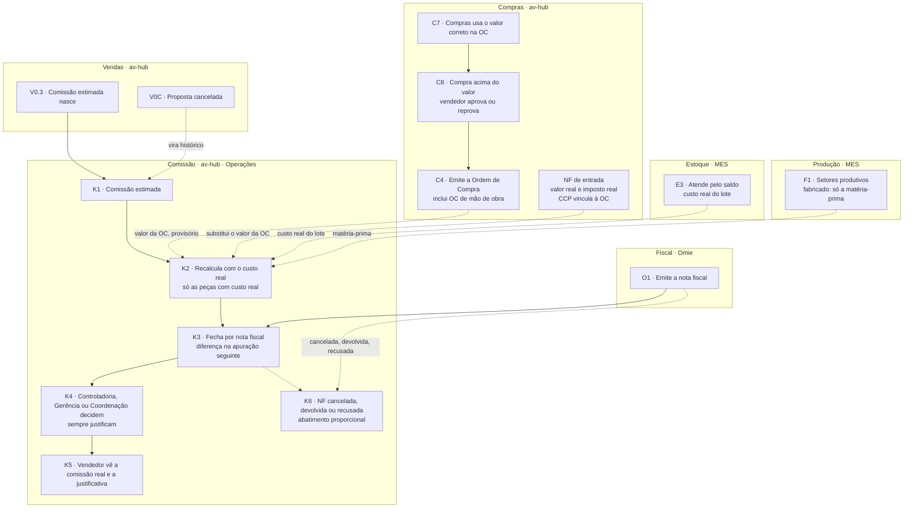

# Custo real e comissão no fluxo (K1 a K6)

**Em uma frase:** o vendedor estima a comissão na proposta, o custo real vai chegando conforme compras, estoque e produção acontecem, e a Controladoria decide a comissão final quando a nota sai.

Tudo aqui ainda é proposta: não há API nem tela. Esta nota mostra só o fluxo. Os modelos de dados estão em [[03-Modelo-Novo-core_comissao]]. Decisões: [[Registro-de-Decisoes]]. Selos: [[Regras-do-Vault]].

> [!info] Decisões de 29/10/2026 (N16-120 a N16-143)
> - N16-143: a comissão nova fica em `core_comissao`, schema próprio, já modelado e testado.
> - Proposta, pedido e custo realizado vão para `core_vendas_faturamento`. O `core_comercial` não existe (N16-116).
> - A pendência de devolução parcial já está no banco.

## Como funciona, passo a passo

1. O vendedor monta a proposta e o sistema estima a comissão pelo motor atual. Ele só vê a estimativa que ele mesmo colocou. `K1`
2. Cada compra, lote do Estoque ou matéria-prima da produção gera uma linha de custo real, com as condições do próprio evento. `K2`
3. Enquanto o custo do item não cobre a quantidade, o custo é parcial. Só as peças com custo real entram na comissão. `K2`
4. No recebimento, o valor da nota de entrada substitui o valor da ordem de compra (OC). `K2`
5. Se a compra sai mais cara que a proposta, o vendedor aprova ou reprova a compra do produto dele. O preço de venda não muda. `C8`
6. Quando o Omie emite a nota, a comissão fecha com o percentual vigente naquele momento e chega à Controladoria já calculada. `K3`
7. Controladoria, Gerência ou Coordenação decidem: aprovar, desaprovar, bloquear, desbloquear, cortar ou alterar. Sempre com justificativa. `K4`
8. Só depois da decisão o vendedor vê a comissão real e o motivo. Desaprovada aparece com R$ 0. `K5`
9. Se a nota for cancelada, devolvida ou recusada, a comissão é abatida na mesma proporção. `K6`

Se o custo completar depois da decisão, a diferença vai para a apuração seguinte, para nova decisão.

## Exemplo

Um pedido com 50 flanges (item A). Na proposta, o vendedor cotou R$ 100 por flange. A compra fechou a R$ 150 por flange, em várias OCs. Os R$ 100 e os R$ 150 vêm do exemplo do Nathan.

- No início, a Controladoria vê custo parcial e a diferença contra o cotado.
- O vendedor aprova ou reprova a compra mais cara. Se aprova, a margem e a comissão caem.
- A nota sai e a comissão chega à Controladoria. Ela aprova ou corta, com justificativa.
- O vendedor do Cliente Exemplo S.A. passa a ver o valor real e o porquê.
- Se o cliente devolver parte das flanges, o Fiscal ou a Controladoria informam quantas voltaram. A comissão cai na proporção.

## Quem atua

| Quem | O que faz |
|---|---|
| Vendedor | Estima a comissão; aprova ou reprova compra acima do valor; vê a real depois da decisão |
| Controladoria | Acompanha o custo real, decide a comissão e informa o que voltou nas devoluções parciais |
| Gerência e Coordenação | Mesmas permissões de decisão da Controladoria |
| Compras | Fornece o custo real pela OC e pela nota de entrada |
| Fiscal | Informa, com a Controladoria, o que voltou numa devolução parcial |

## Regras que valem

- Controladoria, Gerência e Coordenação decidem sem teto. Ninguém decide a própria comissão.
- Toda decisão tem justificativa, autor, data e valores anterior e novo.
- O vendedor vê a comissão real só depois da decisão.
- Com custo parcial, só as peças com custo real entram na comissão.
- Cada nota fecha com o percentual vigente. Nunca se paga duas vezes a mesma peça.
- A nota de entrada manda: ela substitui o valor da OC.
- O encargo da condição de pagamento entra no preço sugerido, não no custo.
- Cancelamento, devolução ou recusa abatem a comissão. Se já foi paga, o desconto entra na próxima apuração.
- Devolução total vem do Omie. Na parcial, o Fiscal ou a Controladoria informam o que voltou.

## O que já existe e o que falta

- ✅ Motor atual de comissão, só leitura aqui.
- ✅ Simulador de Comissão, usado como referência da tela nova.
- 🟡 Tela "Custo real por item" existe, sem imposto e com dados de teste.
- 🟡 Módulo novo em `core_comissao`: modelado e testado no banco, sem API nem tela.
- 🔴 Comissão estimada na proposta (`K1`).
- 🔴 Custo real por evento, com a nota de entrada como verdade (`K2`).
- 🔴 Tela da Controladoria, relatórios e visão geral (`K4`).
- 🔴 Aprovação do vendedor na compra acima do valor.
- 🔴 Pendência de devolução parcial e apuração do vendedor.
- ❓ Sobra aproveitável de chapa (OQ-32) e devolução de compra ao fornecedor (OQ-42).

## Detalhe técnico

**Só o fluxo.** Esta nota mostra por onde o custo real e a comissão atravessam o fluxo mestre. Os **modelos de dados** estão nos contratos: o custo realizado por item em `core_vendas_faturamento` e a comissão nova em `core_comissao` (testado em Postgres 18 com as respostas da Controladoria). O modelo está explicado em [[03-Modelo-Novo-core_comissao]].

### Os nós K1 a K6

Os `K` seguem o desenho do Nathan (artifact); o detalhe vem de N16-10, N16-42 a N16-51 e N16-74.

| Nó | O que acontece | Quando |
|---|---|---|
| `K1` | **Comissão estimada** nasce na proposta (`V0.3`), pelo motor atual (percentual final = menor entre o do vendedor e o de compras), numa tela semelhante à do Simulador de Comissão (N16-19). O vendedor só vê a comissão que ele colocou. Parâmetros: os de **"Maio/23"** continuam, com vigência (N16-39); o **encargo** entra no **preço sugerido**, não no custo | ao criar e a cada revisão da proposta |
| `K2` | **Recalcula com o custo real**, por evento: OC (com o valor da NF de entrada no recebimento), lote do Estoque, matéria-prima da produção. **Cada evento carrega as suas condições** (N16-20). Enquanto o custo do item não cobre a quantidade, o custo é **parcial**, e a comissão só vale para as **peças com custo real** (N16-48) | a cada evento de custo |
| `K3` | **Fecha por nota fiscal** (`O1`). **Cada nota fecha com o percentual vigente naquele momento**, com o custo real que já entrou. Chega à Controladoria **já calculada**. O mesmo item pode sair em várias notas, **sem pagar duas vezes a mesma quantidade** (N16-49). Quando o custo completa depois da decisão, a diferença (complemento ou desconto) vai para a **apuração seguinte, para nova decisão** | quando o Omie emite a nota |
| `K4` | **Decidem a Controladoria, a Gerência ou a Coordenação**, com as mesmas permissões: aprovar, desaprovar, bloquear (e **desbloquear**), cortar ou alterar, por **valor ou percentual, sem teto**, **sempre com justificativa** e rastro (quem, quando, valor anterior e novo). **Ninguém decide sobre a própria comissão** (N16-44, N16-45). A Controladoria também tem a visão geral e os relatórios (N16-50) | depois de `K3` |
| `K5` | **O vendedor vê a comissão real**, com a **justificativa**, **só depois da decisão** (N16-46). Desaprovada aparece com **R$ 0 e o motivo** | depois de `K4` |
| `K6` | **NF cancelada, devolvida ou recusada**: a comissão é **abatida na mesma proporção**. Se ainda não foi paga, reduz o valor a pagar; **se já foi paga, o desconto entra na próxima apuração** do vendedor (N16-47). A devolução **total** vem do Omie; a **parcial** só chega marcada, e o Fiscal ou a Controladoria **informam o que voltou** (N16-74) | depois da nota |

Regras de visibilidade: o vendedor só vê a estimada que ele colocou e a **comissão real depois da decisão** (N16-10). Na aprovação de **compra acima do valor** (`C8`), ele vê o valor da compra do produto dele e **aprova ou reprova** (N16-60); isso **supera** a regra antiga de que não havia aviso (N16-18). A Controladoria vê o custo real e a diferença.

### Como o custo real atravessa o fluxo

Regra (N16-09, N16-40): o custo real de um item do pedido é a **soma das linhas** (OC, NF de entrada ou lote); o unitário médio é o total dividido pela quantidade; o custo do pedido é a soma dos itens. Cada linha guarda data, material, origem, quantidade e valor. Linhas podem ser parciais (5.01, 5.02… do item parcial do MES).

**A linha da OC nasce na aprovação da OC, com o valor da OC (provisório), e vale só até o recebimento: no recebimento, o valor da NF de entrada a substitui** (N16-23, N16-40), porque a maioria dos materiais é comprada por KG pelo peso teórico e a NF pode divergir da balança. OC cancelada antes de receber estorna a linha. O **lote** é de uma OC específica: identifica a OC e **não soma o custo de novo** (N16-37).

| Nó | O que entra no custo real | Origem da linha | Selo |
|---|---|---|---|
| `C4` | O valor da OC, por item, vinculado ao pedido de venda (`ordens_compra_itens_vinculos`); inclui a **OC de mão de obra** (categoria "Despesas com Industrialização", ou "Serviços Tomados" com o Nº do Pedido do Fornecedor apontando um PV) | `OC` | 🔴 linha por evento; vínculo ✅ ([[LOG-14b-Compras-Vinculo-Pedido-Venda]]) |
| `C7` | Compras usa o valor correto; a proposta **não muda**; se for maior que o da proposta, o vendedor aprova ou reprova (`C8`) | `OC` | 📝 N16-08, N16-17, N16-60 |
| NF de entrada | No recebimento, o valor da NF substitui o da OC. **O CCP vincula a NF de entrada à OC**, na tela de Follow-up, e o item do pedido vem do vínculo da OC (a ligação automática do Omie não existe na prática; N16-57, N16-86), inclusive com várias NFs por OC e KG contra PC. A NF traz **imposto real** e a **data real de recebimento** | `NF_ENTRADA` | 🔴 recurso novo na pipeline ([[Estudo-Omie-API]]) |
| `R4` | O lote nasce com custo, **obrigatório**: valor total e valor por item; no fim, o valor unitário | `OC` (ou `CARGA_INICIAL`, `MANUAL`) | 🔴 hoje o lote do Recebimento nasce sem custo (`compras.service.ts:545`); custo obrigatório N16-09. ❓ o dado de estoque hoje não é confiável (aviso de Compras) |
| `E3` | Item atendido pelo Estoque usa o **custo real do lote** (o da OC que o originou) | lote | 🔴 `GET /itens/custo` ainda não existe (BL-004) |
| `E5` | O fabricado aprovado vira lote; o custo do lote fabricado é **só a matéria-prima** | `PRODUCAO` 🟡 | 🔴 ([[LOG-53-Ordem-de-Producao-e-Lote-do-Fabricado]]) |
| `F1` | A matéria-prima enviada à produção para o item fabricado (J2, J3) | lote da matéria-prima | 🔴 BL-010 |
| `O1` | Fecha a comissão sobre a NF | NF | ✅ lado Omie; `K3` 🔴 |

Hoje o código tem a base: `lote_custo` (`api-pcp/prisma/models/estoque.prisma:394-423`, opcional), `OrigemCusto` `CARGA_INICIAL`, `OC`, `MANUAL` (`:378-382`), a tabela `itens_pedido_custo` no hub com o job que lê `GET /itens/custo` do MES (`itens_pedido_custo.job.js:78`) ([[API-008-Custo-do-Lote-no-MES]], [[LOG-47-Custo-Real-por-Item-no-Hub]]). O que as decisões acrescentam: custo **obrigatório**, linhas **por evento**, a **NF de entrada como verdade** do valor, e a soma por item do pedido.

#### Sobras de chapa ❓

Quando o item é fabricado com chapa, quem calcula o aproveitamento é o **PCP ou a Engenharia**; Compras só registra nas observações da OC. Se **não há sobra aproveitável**, o custo todo da chapa vai para o pedido. Se há, a sobra **vai ao Estoque** (e quem a controla é o Recebimento e o PCP). **Falta definir como a sobra aproveitável ganha custo** e como esse custo entra no pedido que a usa (OQ-32).

### O exemplo do Nathan

Pedido com 5 itens: A. 50 Flanges; B. 1 Mão de obra; C. 50 Tubos; D. Flange sobre desenho; E. 50 Flanges cegas. Na proposta, o vendedor pôs as 50 flanges (A) a **R$ 100** o unitário. A compra, dividida em dias, fecha em **R$ 150** o unitário. **Só os R$ 100 e R$ 150 são do Nathan; os demais valores abaixo são ilustrativos 🟡 (Claude), para mostrar o cálculo.**

| Dia | Evento (PCP e Compras) | Item | Origem | Linha de custo | Custo acumulado do item |
|---|---|---|---|---|---|
| 01 | Requisição de 50 tubos | C | OC | 50 × R$ 80 = R$ 4.000 | C: 50 de 50, R$ 4.000, unitário R$ 80 (completo) |
| 01 | Requisição de 10 flanges | A | OC | 10 × R$ 140 = R$ 1.400 | A: 10 de 50, R$ 1.400 (**parcial**) |
| 02 | 20 flanges | A | OC | 20 × R$ 150 = R$ 3.000 | A: 30 de 50, R$ 4.400 (parcial) |
| 03 | 1 mão de obra | B | OC de serviço | 1 × R$ 1.200 = R$ 1.200 | B: 1 de 1, R$ 1.200 (completo) |
| 03 | O restante das flanges normais | A | OC | 20 × R$ 155 = R$ 3.100 | A: 50 de 50, R$ 7.500, **unitário R$ 150** (completo) |
| 04 | As 50 flanges cegas já estão no estoque | E | lote | 50 × R$ 90 = R$ 4.500 (custo real do lote, o da OC que o originou) | E: 50 de 50, R$ 4.500, unitário R$ 90 |
| 05 | O PCP manda a matéria-prima para a flange sobre desenho | D | lote da matéria-prima | custo só da matéria-prima, por exemplo R$ 600 | D: custo da matéria-prima; completo quando a quantidade do item está coberta |

Custo do pedido (itens completos, valores ilustrativos): R$ 4.000 + R$ 7.500 + R$ 1.200 + R$ 4.500 + R$ 600 = R$ 17.800. No recebimento de cada compra, o valor da NF de entrada substitui o da OC naquela linha.

O item A mostra a regra: o vendedor cotou R$ 100 o unitário (R$ 5.000 as 50); o custo real fecha em R$ 150 (R$ 7.500). O **preço de venda não muda** (N16-17). Como a compra ficou **mais cara que a proposta, o vendedor aprova ou reprova** a compra de cada produto (`C8`); se aprova, a margem e a comissão caem.

#### O que acontece com a comissão no exemplo

| Momento | `K` | O que o sistema faz | Quem vê |
|---|---|---|---|
| Proposta criada | `K1` | Estima a comissão com o custo cotado (A a R$ 100) | o vendedor vê a estimada que ele pôs |
| Dia 01 a 03 | `K2` | A cada linha de custo recalcula. Enquanto A está **parcial**, **só as peças com custo real entram na comissão**; o restante espera (N16-48) | a Controladoria vê o custo real e a diferença |
| Dia 01 a 03, compra acima do valor | `C8` | O vendedor é avisado em Meus Pedidos e aprova ou reprova a compra de A | o vendedor vê o valor da compra de A |
| Dia 03, A completo | `K2` | A fecha a R$ 150; a margem do item cai; a comissão cai. A diferença das peças que entraram depois vai para a **apuração seguinte**, para nova decisão | só a Controladoria |
| Depois do faturamento (`O1`) | `K3` | Fecha sobre a NF, já calculada, com o percentual vigente naquele momento | Controladoria |
| Decisão | `K4` | Controladoria, Gerência ou Coordenação aprovam, desaprovam, bloqueiam, cortam ou alteram, com justificativa | **agora** o vendedor vê a comissão real e a justificativa (`K5`) |
| Devolução da nota | `K6` | Total: abatimento de 100% sozinho. Parcial: pendência para Fiscal ou Controladoria informarem o que voltou; depois, abatimento proporcional | Controladoria; o vendedor vê o desconto com o motivo |

#### Várias notas, mesmo item (N16-49)

Exemplo da Michele: venda de R$ 1.000 a 2%, com notas de 500, 100, 100, 100, 100 e 100: a comissão é paga a 2% sobre cada nota. Se o custo real muda entre uma nota e outra, **cada nota fecha com o percentual vigente naquele momento**; quando o custo completa, o sistema recalcula o percentual final e **lança a diferença na apuração seguinte**. O banco guarda a **quantidade já comissionada** por item e nunca paga duas vezes a mesma peça (testado em 19/10).

### As condições de cada evento de custo (N16-20)

Um item de 50 unidades pode ter 50 OCs diferentes: cada uma com a sua condição de pagamento, encargo, impostos, frete e fornecedor. Por isso o custo real **não** usa um conjunto de condições por pedido. A regra:

| Lado | Condições | De onde vêm |
|---|---|---|
| **Venda** | **Um conjunto por pedido**, como no Simulador: estado de destino e ICMS, condição de pagamento e encargo, "com impostos", valor ST, imposto retido ou DIFAL, frete na venda | a proposta (`V0.2`, `V0.3`); na tela da Controladoria, as mesmas |
| **Custo real** | **Um conjunto por evento**: fornecedor, condição de pagamento, IPI, ICMS, ST, DIFAL, frete, origem do fornecedor (por exemplo, optante pelo Simples) | a OC (`C4`, `C7`) ou a **NF de entrada** (imposto real), o lote (`R4`, `E3`) ou a matéria-prima (`F1`) |

- O **custo líquido de cada evento** é calculado com as condições do próprio evento, pela **mesma fórmula do motor** (compra, IPI e crédito de ICMS em `lib/simulador/motor.ts:277-283`; frete e custo líquido em `:307-312`, ver [[01-Motor-Atual-Como-Calcula]]). Depois **soma**: o custo líquido do item é a soma dos eventos e o unitário médio é o total dividido pela quantidade coberta. O custo do pedido é a soma dos itens. **O encargo da condição de pagamento NÃO entra no custo**: entra no **preço sugerido**, como no motor atual (N16-22).
- **Imposto da compra.** O vendedor registra os impostos na proposta; ao chegar a requisição, o sistema os **puxa para a OC**, Compras os confere e edita **no hub**, e o que edita **volta ao Omie pela mesma sincronização da OC** (N16-38, N16-53). O hub **não** guarda hoje IPI, ICMS, ST nem DIFAL por item; **o Omie guarda** ICMS, ST, IPI, PIS e COFINS por item do pedido de compra, **em valor e sem DIFAL**, e a **NF de entrada** traz base, alíquota e valor ([[Estudo-Omie-API]]). **O Nathan traz esses dados do Omie para o hub.** O **DIFAL da compra** fica fora do custo líquido (provisório, Compras valida).
- Até os campos existirem, o evento calcula **sem imposto** (como o Ciclo 1) e a linha mostra "sem imposto" 🟡; a Controladoria vê que o custo está sem o imposto real. O impacto no cronograma está na proposta de cronograma (`Proposta-Orcamento-Comissao/07-Cronograma/Proposta-de-Cronograma.md`, fora do vault, a validar).
- No exemplo do Nathan (item A), cada requisição vira uma OC com o seu fornecedor, a sua condição e o seu imposto. O custo líquido de A é a soma das três, cada uma com as suas condições. Impostos e encargos de cada uma são "a definir": **não há valor inventado aqui** 🟡.

#### Drill-down por evento (visão da Controladoria)

Na tela da Controladoria, cada item abre a **lista dos seus eventos de custo**. Colunas propostas 🟡:

| Coluna | Observação |
|---|---|
| Data e origem | `OC`, `NF_ENTRADA`, `LOTE`, `MATERIA_PRIMA`, `CARGA_INICIAL`, `MANUAL` (origens do MES em `estoque.prisma:378-382`, mais a NF de entrada e a matéria-prima do fabricado) |
| Documento | número da OC, NF de entrada, lote, parcial do MES (5.01, 5.02…) |
| Fornecedor e condição de pagamento | com o encargo do evento só para auditoria (N16-22) |
| Quantidade e preço | preço de compra do evento |
| IPI, ICMS, ST, DIFAL, frete | do evento; "sem imposto" enquanto não houver o imposto real |
| Custo líquido do evento e unitário | pelo motor |
| Cotado × real | o que o vendedor pôs para a mesma quantidade e a diferença (só a Controladoria vê) |
| Estado da linha | normal, estornada (OC cancelada), "unidade diferente", "sem imposto" |

Fonte de cada linha: eventos de custo realizado por item no `core_vendas_faturamento` e cálculos da comissão. O vendedor **não** vê esta lista.

### A tela da comissão: três visões da mesma tela (N16-19)

A tela da proposta é **semelhante à do Simulador de Comissão** que o Nathan mandou em 16/10 (`09-Diagramas/fontes/tela-simulador-comissao.png`; código em `av-hub/app/(protected)/comissoes/simulador/page.tsx`). Mesmo motor e mesmas regras, em **tabelas novas** (N16-21). A Controladoria tem a mesma tela com a verdade na tabela: o custo real e afins.

#### Blocos da tela e o que cada visão mostra

| Bloco do Simulador (imagem) | (a) Vendedor, na proposta (`V0.2`, `V0.3`) | (b) Compras (`C6`, `C7`, `C8`) | (c) Controladoria (`K4`) |
|---|---|---|---|
| **Pedido:** Unidade, Número do pedido (busca pelo número exato), Cliente, Vendedor, Itens | Unidade, **número da proposta** (automático, só dígitos, sem busca), cliente, vendedor, itens | Pedido, proposta ligada, requisição do PCP | NF, pedido, proposta, vendedor, cliente |
| **Condições comerciais**, com "Parâmetros: Maio/23": estado de destino e ICMS, condição de pagamento e encargo, "Com impostos", frete na compra, valor ST, imposto retido ou DIFAL, frete na venda | Preenche. Os parâmetros vigentes são gravados com o cálculo (`id_parametros`, [[03-Modelo-Novo-core_comissao]]) | Lê as da proposta (só leitura) | As da venda (um conjunto por pedido) e, no drill-down, **as de cada evento de custo** (N16-20) |
| **Itens:** "Compra: você preenche", "Resultado: o sistema calcula"; colunas COMPRA, VENDA, RESULTADO | Preenche a compra (custo cotado) e a venda; vê custo líquido, sugerido, margem e letra | Vê o **cotado do vendedor** ao lado do **valor da OC** e do fornecedor; edita os campos de imposto da OC; **não altera a proposta** (N16-08) | **Estimado × real, lado a lado**: custo líquido real, margem real, letra real, comissão real, por item e por evento |
| **Chip** "Comissão: após a aprovação de Compras" | Não aparece. O vendedor vê a comissão estimada que ele colocou; a real só depois da decisão | **O passo de Compras aprovar o percentual fica desligado** (provisório; o valor estimado por Compras vem do Omie, sem digitação; N16-51) | Substituído pela decisão |
| **Rodapé:** custo, venda, total da NF, sugerido, mark-up real, mark-up s/ compra, margem e letra | Estimados | Estimados e reais | Estimados e reais, com a queda por custo |
| **Botões:** Recomeçar, Salvar rascunho, Enviar | Salvar a proposta; "Enviar" vira marcar aprovada e transformar em pedido (`V0.4` a `V0.6`) | Registrar a OC e tratar a lista dos casos reprovados | **Aprovar, desaprovar, bloquear, desbloquear, cortar ou alterar**, sempre com justificativa |

#### O passo "aprovação de Compras" do motor atual

Hoje (✅ `simulacoes.route.js:30-36`, `:233-259`; `simulador/page.tsx:1192-1234`): o vendedor envia o simulador; Compras abre e, se o custo está errado, cria uma segunda versão (origem `COMPRAS`) com o custo correto; o percentual final do item é o menor entre o do vendedor e o de Compras ([[01-Motor-Atual-Como-Calcula]], R5 e R10).

No fluxo novo (N16-51, OQ-28 em parte): o **percentual de Compras** deixa de ser uma digitação e passa a ser o cálculo `REAL`, gerado a cada evento de custo (`K2`); o passo "Compras aprova o percentual" **sai do fluxo e fica pronto no sistema, desligado**, até Compras validar. O percentual final continua sendo o **menor** entre os dois.

#### Telas e menu que a imagem mostra

| Item do menu na imagem | O que é hoje | Alinhamento 🟡 |
|---|---|---|
| Comissões › Simulador, Análise de Simuladores, Minhas Comissões, Visão Geral, Parâmetros, Bloqueio de Comissões | Módulo atual (`app/(protected)/comissoes/*`), **não muda** (N16-11) | O módulo novo fica em Operações |
| Operações › "Custo real por item" | `app/(protected)/custo-itens/page.tsx` (`CustoItens`): custo real por pedido, KPIs, lotes e simulador de margem **sem imposto**, sobre dados de teste (BL-023, `544ee0b`; [[LOG-47-Custo-Real-por-Item-no-Hub]]) | Pode ser a entrada do drill-down por evento da Controladoria; precisa ligar ao custo por evento e ao imposto |
| Dashboards › "Matriz de preços" | O BFF cita o slug `matriz-precos`; a tela ainda não existe | É a matriz de preços do Orçamento ([[12-Orcamento-Base-de-Preco]]) |

Os contratos com o detalhe das telas e das regras foram removidos em 29/10/2026; o Robert cria os novos.

#### Relatórios da Controladoria (N16-50)

A lista por mês, vendedor, unidade e status (com exportação para Excel), mais: (1) **markup real** (Venda ÷ Custo − 1) de todos os pedidos, por vendedor, com consolidado; (2) **Faturamento × Compras por pedido**, com markup real, percentual de comissão e valor a pagar. Nos dois, separar **Revenda, Industrializado e Projeto** e sinalizar **recompra no mesmo pedido**. O **valor retido** das comissões bloqueadas aparece no resumo mensal, separado do valor a pagar. ❓ Projeto e recompra aguardam a OQ-44.

### Casos de borda do custo real

| Caso | O que acontece |
|---|---|
| OC cancelada antes de receber | A linha de custo dela é estornada; o item volta a parcial |
| NF de entrada diferente da OC (peso da balança) | O valor da NF substitui o da OC (N16-40) |
| Item sem nenhuma linha quando a NF de saída sai | `K3` fecha só as peças com custo real; o resto espera (N16-48); a Controladoria vê "custo parcial" |
| Unidade de medida diferente entre proposta, OC e lote (KG × PC) | **Sem conversão no sistema** (Compras); o PCP liga a NF ao item do pedido (N16-57); linha marcada "unidade diferente" |
| Pedido digitado no Omie | O `K1` nasce quando o vendedor preenche a parte de compras do pedido (a simulação, N16-104, N16-106); a nota que sair antes **espera**, e a Controladoria já vê a margem real (N16-105); com as duas, fecha pelo menor |
| Proposta ou pedido **cancelado** | A estimada vira histórico. O que já foi comprado vai ao **Estoque, livre**, como lote com o custo da OC, e **deixa de ser custo** do pedido cancelado (N16-68, N16-69) |
| Pedido **faturado** e depois cancelado | O cancelamento não desfaz compra nem produção; fica o abatimento da comissão (`K6`) e o saldo não faturado, parte por parte (N16-71) |
| Devolução de **venda** | Total vem do Omie; parcial só chega marcada e o Fiscal ou a Controladoria informam item, quantidade e valor (N16-74) |
| Devolução de **compra** (NF de entrada devolvida ao fornecedor) | ❓ Como aparece no Omie e o efeito na linha de custo: adiado (OQ-42) |
| Pedido manual (`MAN-`) | Nunca entra no custo (D6 do 008, [[LOG-45-Pedido-de-Venda-Manual]]) |

### Estados da comissão

Os estados são os do banco (testado), resumidos em [[04-Regras-e-Estados-da-Comissao-Nova]]. Por nó do fluxo:

| Nó | Dossiê da proposta ou do pedido (`comissoes`) | Comissão da nota (`comissoes_nf`) e lançamentos |
|---|---|---|
| `K1` | `ESTIMADA` (salva e revisada); `CONGELADA` quando a proposta é aprovada | — |
| `K2` | `EM_ACOMPANHAMENTO` (o pedido existe e o custo real chega) | — |
| `K3` | `EM_ACOMPANHAMENTO` | `AGUARDANDO_DECISAO` (a nota fechou, já calculada); lançamento `COMPLEMENTO` ou `DESCONTO` quando o custo completa depois |
| `K4` | — | `APROVADA`, `DESAPROVADA` (R$ 0, visível), `CORTADA`, `ALTERADA` ou `BLOQUEADA` (desbloquear devolve à fila, com justificativa) |
| `K6` | — | `NF_CANCELADA` (nota cancelada inteira antes da decisão); lançamento `ABATIMENTO`; devolução parcial em `comissao_devolucao_pendencia` (`ABERTA` → `INFORMADA` ou `DISPENSADA`) |
| `V0C` | `CANCELADA` (vira histórico, com motivo; só sem nota faturada) | — |
| fim | `ENCERRADA` (tudo faturado e decidido) | — |

A decisão tem seis ações (`aprovar`, `desaprovar`, `bloquear`, `desbloquear`, `cortar`, `alterar`), sempre com justificativa.

### Quem vê o quê

| Dado | Vendedor | Gerência e Coordenação | Compras | Controladoria |
|---|---|---|---|---|
| Comissão estimada | a que ele pôs | 🟡 OQ-21 | não | sim |
| Custo real e diferença cotado × real | **não** | 🟡 | custo da OC | sim |
| Valor da compra de um produto dele, em aprovação (`C8`) | **sim** | não | sim | sim |
| Comissão real e justificativa | só depois da decisão | decidem | não | sim |
| Complementos, descontos e abatimentos | os dele, com o motivo, depois de decididos | decidem | não | sim |
| Visão geral e relatórios | não | 🟡 | não | sim |
| Pendência de devolução parcial | não | não | não | sim (com o Fiscal) |

### Estado no código e o que falta

| Item | Estado | Selo |
|---|---|---|
| Motor atual (menor entre o percentual do vendedor e o de compras, regras fixas, bloqueios, blacklists) | existe em `core_comissionamento`, só leitura aqui ([[Comissoes]]) | ✅ |
| Módulo novo em `core_comissao`, em Operações | rascunhado e **testado num Postgres 18 em 19/10**; sem API nem tela | 🔴 Gustavo (banco), Nathan (telas) |
| Comissão estimada na proposta (`K1`) | não existe; o simulador do Hub só pré-preenche o lado da compra | 🔴 |
| Custo real por evento, com a NF de entrada como verdade (`K2`) | não existe | 🔴 Pablo, Gustavo, Robert |
| Recurso novo da pipeline: recebimento de NF-e (imposto real, data de recebimento) | não existe | 🔴 Nathan ([[Estudo-Omie-API]]) |
| Custo obrigatório em todo lote e `GET /itens/custo` | não existe | 🔴 Robert (OQ-07) |
| Tela da Controladoria igual à do Simulador, com custo real, e visão geral (`K4`, N16-19) | não existe; o Simulador atual é a referência | 🔴 Nathan |
| Aprovação do vendedor na compra acima do valor, lista de Compras e cancelamento | não existe; o modelo atual **ainda não conhece** | 🔴 |
| Abatimento por devolução, pendência de devolução parcial e apuração do vendedor | o abatimento está no modelo; a pendência de devolução parcial e a apuração (OQ-42) **não** | 🔴 |
| Tela da proposta no formato do Simulador | não existe; o Simulador atual calcula no navegador | 🔴 Nathan (tela), Pablo (proposta) |

### Diagrama do subfluxo

