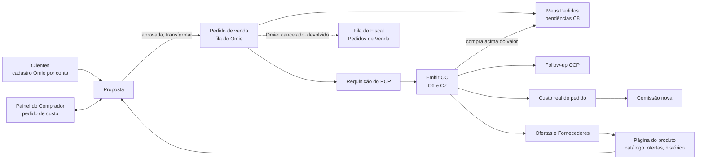

# Telas de Vendas, Orçamento e Compras no modelo novo

## Em uma frase

Esta nota mostra o que cada tela de Vendas, Orçamento e Compras faz hoje, como elas se ligam, onde se repetem e como deve ficar a nova página de proposta.

## Como usar esta nota

- Ache o setor no **Mapa rápido** e vá à seção 1. Desconectado: seção 2. Repetido: seção 3. Faltam: seção 4. Proposta: seção 5. Menu: seção 6.
- Colunas, filtros e o texto completo estão em "Detalhe técnico".

Substitui a versão de 23/10: **todas as páginas foram lidas**. Marcado ❓ o que não foi lido por dentro: botões no servidor, Cadastros, PCP e Meus Pedidos.

Selos: ✅ existe e foi lido · 🔴 não existe · 🟡 proposta · ❓ não conferido.

## Mapa rápido por setor

| Setor | Telas | Situação |
|---|---|---|
| Vendas | Propostas, Clientes, Relatórios, Pedidos de Venda do Omie: criar e acompanhar propostas | ✅ 🔴 |
| Orçamento | Painel do Comprador, Ofertas, Fornecedores, Catálogo, Parâmetros: manter o preço de compra | ✅ 🔴 |
| Compras | Requisições, Emitir OC, Ordens, Aprovações, Follow-up: da requisição à OC | ✅ 🔴 |
| Painéis | PCP, Dashboard de Vendas, Meus Pedidos: carteira do vendedor | ❓ |
| Faltam | Aprovar, transformar em pedido, pendências, fila do Fiscal, comissões (seção 4) | 🔴 |
| Proposta nova | Cinco blocos e um botão por estado (seção 5) | 🟡 |

## 1. O que cada tela faz hoje

### 1.1 Vendas

| Tela | Para que serve | Quem usa | Situação |
|---|---|---|---|
| Propostas, lista | Resumo e filtros; abre a nova proposta | Vendedor, gerente | ✅ Muda: estados e rótulos (seção 4) |
| Proposta, formulário | Emissão, cliente, itens, condições, margem | Vendedor | 🔴 Será reescrita (seção 5) |
| Proposta, "Pedido no Omie" | Dados para digitar no Omie à mão | Vendedor | 🔴 **Sai**: o pedido vai por API |
| Clientes, lista | Cards, propostas de 90 dias, contatos atrasados | Vendedor | ✅ Mantém |
| Cliente, ficha | Dados, compradores, estatísticas | Vendedor | ✅ Mantém; "Total fechado" e "Conversão" contam **propostas aprovadas** |
| Relatório de Cotações | Totais e conversão, com Excel | Gerência | ✅ Mantém, com os novos estados |
| Relatório Gerencial | Resumo por responsável, empresa, unidade | Gerência | ✅ Mantém; "Perdidas" vira **Canceladas** |
| Pedidos de Venda (inativa no menu, N16-33) | Pedidos sincronizados do Omie | Vendedor; Fiscal (futuro) | ✅ Continua inativa, mas **valiosa**: base da fila do Fiscal (seção 4) |
| Notas Fiscais de Saída (inativa) | Notas de saída | — | ✅ Continua inativa |

### 1.2 Orçamento

| Tela | Para que serve | Quem usa | Situação |
|---|---|---|---|
| Painel do Comprador | Fila de pedidos de custo | Comprador | ✅ Mantém; **tira "Vencem hoje" e "Atrasadas"** (N16-58), fica o tempo cronometrado |
| Responder solicitação | Escolhe a oferta vigente que vira o custo | Comprador | ✅ Mantém |
| Pedido de cotação | E-mail por fornecedor da categoria | Comprador | ✅ Mantém |
| Ofertas de fornecedor | Lança, importa, invalida e exporta ofertas | Orçamento | ✅ Mantém; ofertas das OCs entram sozinhas |
| Fornecedores, lista e ficha | Perfil de compras e ofertas | Orçamento | ✅ Mantém |
| Catálogo de produtos, lista e ficha | Produtos, preços, média de 90 dias | Orçamento | ✅ Vira a **página do produto** (`B2`) |
| Pesquisa de materiais | Menor custo e fornecedor vencedor | Orçamento | ✅ Mantém; **repete** parte do catálogo (seção 3) |
| Parâmetros de custo | ICMS, validade, janela do histórico | Orçamento | ✅ Mantém |
| Tabela da telha | Custo por classe e espessura | Orçamento | ✅ Mantém |
| Custo por item (`custo-itens`) | Itens, lotes e custo médio do pedido | Orçamento | ✅ Vira "Custo real do pedido"; o aviso de exemplo sai com dado real |
| Simulador de Orçamento | Custo, preço e margem sem pedido; **não grava** | Vendedor | ✅ Existe; **repete** a análise da proposta (seção 3) |
| Sincronização Omie | Só roda pelo botão | TI | ✅ Existe na `develop`; ferramenta de TI ❓ |
| Guia do fluxo do custo | Páginas "Para que serve" | Todos | 🔴 Descrevem o fluxo **antigo**; reescrever |

### 1.3 Compras

| Tela | Para que serve | Quem usa | Situação |
|---|---|---|---|
| Dashboard de compras | Fila, valor comprado, atrasos | Compras | ✅ Mantém |
| Requisições (lista e kanban) | Requisições do PCP ou manuais | Comprador | ✅ Mantém e **ganha a tarja de pedido cancelado** |
| Nova requisição | "Pedido de compra interno" | Comprador | ✅ Mantém; o pedido de venda vem do hub |
| Emitir OC | Monta a OC | Comprador | 🔴 **Sem imposto por item e sem a proposta**: precisa de `C6` e `C7` |
| Pedidos de venda da OC | "Para que é esta compra" | Comprador | ✅ Mantém. 🟡 Com a proposta, a ligação PV ↔ item deixa de ser digitada |
| Ordens (lista, kanban, detalhe) | OCs por status e origem | Comprador | ✅ Mantém; o detalhe ganha "compra acima do valor" (`C8`) |
| Aprovações | OCs acima do limite da unidade | Aprovador | ✅ Mantém. ⚠️ **Nome igual a outra coisa**: não é a aprovação do vendedor (`C8`) |
| Follow-up (CCP) | Acompanha as OCs aprovadas | CCP (PCP) | ✅ Mantém. 📝 **CCP é parte do PCP** (N14-24) |
| Pedido Omie (detalhe) | Pedido feito direto no Omie, só leitura | Comprador | ✅ Mantém |
| Histórico de compras | Compras por conta, período, produto | Comprador | ✅ Mantém; vira aba da página do produto |
| Compradores | Liga comprador do Omie ao funcionário | Administrador | ✅ Mantém (Cadastros/Acessos) |

### 1.4 Painéis que a proposta deve respeitar

O **Painel PCP**, o **Dashboard de Vendas**, **Meus Pedidos** e **Pedidos da Equipe** mostram a carteira e o "Em avanço"; a proposta deve respeitá-los. ❓ Lidos só pelo nome dos componentes (texto completo em "Detalhe técnico").

## 2. Como as telas se conectam

**Ainda falta ligar** 🔴 (o que já está ligado fica em "Detalhe técnico"):

| Ligação | O que acontece hoje |
|---|---|
| Proposta → Pedido por API | O vendedor digita no Omie e volta para anotar o número. |
| Proposta → Emitir OC (`C6`) | Compras refaz o que o vendedor informou. A OC **não conhece a proposta**. |
| OC → imposto por item | O hub não guarda IPI, ICMS nem ST. |
| OC → custo real → comissão | Não existe. |
| Compra acima do valor → Meus Pedidos (`C8`) | O vendedor não sabe que a margem caiu. |
| Pedido cancelado → requisição, OC, PCP (tarja) | Cada setor descobre sozinho. |
| Pedido do Omie (`devolvido parcial`) → fila do Fiscal | A informação existe na tela inativa e ninguém é avisado. |
| Cliente → cadastro por conta Omie | O erro só aparece ao transformar em pedido. |
| Proposta ↔ Página do produto | O vendedor sai da proposta para consultar preço. |

## 3. Repetições e confusões, com a decisão proposta

| # | Onde | Decisão proposta 🟡 |
|---|---|---|
| 1 | Margem em três lugares | Um só cálculo, na API; a proposta é a casa |
| 2 | Preço do produto em quatro telas | Uma **página do produto** com abas |
| 3 | Duas condições de pagamento | **Um só campo**, com a lista da conta Omie ([[Mapa-IncluirPedido-Omie]] §5.1) |
| 4 | Estado de destino × UF do cliente | O destino vem do cliente ou da entrega; editar exige motivo |
| 5 | ICMS, IPI e ST digitados × Omie | ✅ **Decidido (N16-95):** o vendedor digita e o valor segue para o pedido |
| 6 | Revenda × Fabricação interna | Mantém, com texto de ajuda sobre a comissão **estimada** (N16-78) |
| 7 | **Dois "Aprovações"** em Compras | **"Aprovar OC"** (Compras) e **"Pendências"** (Meus Pedidos, `C8`) |
| 8 | "Custo" com três sentidos | **Custo cotado**, **Custo da oferta** e **Custo real** |
| 9 | Painel do Comprador com SLA | Tira "Vencem hoje" e "Atrasadas" (N16-58) |
| 10 | Relatórios com "Fechadas/Perdidas" | **Aprovadas/Canceladas** |
| 11, 12 | Guias do fluxo do custo; Sincronização Omie no menu | Reescrever os guias depois do fluxo novo; Sincronização só para TI ❓ |
| 13 | Unidades Mogi, Uberaba e Arujá | ✅ **Resolvido (N16-79):** três contas Omie, um só sistema |

## 4. Telas que faltam, com dono do dado

| Tela | Onde fica | Quem usa | Nó |
|---|---|---|---|
| Aprovar proposta | Dentro da proposta | Vendedor | `V0.5` |
| Transformar em pedido | Dentro da proposta | Vendedor | `V0.6` |
| Estado do pedido no Omie | Proposta e Meus Pedidos | Vendedor | `V0.7` |
| Página do produto | Orçamento e proposta | Vendedor, Orçamento, Compras | `B2` |
| Emitir OC com dados da proposta e imposto por item | Compras | Comprador | `C6`, `C7` |
| Pendências (compra acima do valor) | Meus Pedidos | Vendedor | `C8` |
| Reprovados sem solução | Compras | Comprador | `C8` |
| Tarja de pedido cancelado | Requisição, OC, PCP | Todos | `V0C` |
| **Fila do Fiscal** | Cadastros ou Fiscal | Fiscal, Controladoria | `K6` |
| Comissões novas | Comissões (novas) | Vendedor, Controladoria, Gerência, Fiscal | `K1` a `K6` |
| Configuração por conta Omie | Administração | TI | `V0.7` |
| **Calendário** (N16-104) | Cadastros | Marketing | datas |
| **Histórico de datas do pedido** (N16-104) | Meus Pedidos e Carteira do PCP | Vendedor, PCP | datas |
| **Pedido do Omie na tela do pedido** (N16-106) | Meus Pedidos | Vendedor | `V1`, `K1` |

## 5. A página de proposta

A tela de hoje é pesada (ordem confusa, item com cerca de 25 campos, botões do modelo antigo). O desenho novo 🟡 tem **uma ação principal por estado**, cinco blocos (quem e para quem, o que se vende, condições, custo de compra, resultado) e um resumo fixo com pendências clicáveis e o botão do estado: `Salvar`, `Marcar como aprovada`, `Transformar em pedido` (pede previsão de faturamento, Qualidade e faturar em partes; N16-88, N16-89). Pedido em partes ganha o bloco **Sequenciais**. Texto completo (5.1 a 5.4) em "Detalhe técnico".

## 6. Organização do menu 🟡

Menus de Vendas e Orçamento revistos em 27/10/2026 (N16-107, N16-108); o texto está em "Detalhe técnico".

| Menu | Entradas | Observação |
|---|---|---|
| **Vendas** | Propostas · Clientes · **Meus Pedidos** · Relatórios | Meus Pedidos: o vendedor responde `C8` |
| **Orçamento** | **Pedidos de custo** · **Produtos** · Fornecedores · **Parâmetros** | De 9 entradas para 4 |
| **Compras** | Requisições · Ordens · **Aprovar OC** · Follow-up (CCP) · **Reprovados** · Dashboard | "Aprovações" vira "Aprovar OC"; **sem Histórico** |
| **Comissões** | Módulo atual (não muda) + Comissões da proposta (novas) | Nada do atual é tocado |
| **Cadastros ou Fiscal** | Compradores · **Fila do Fiscal** · Sincronização Omie (TI) | |
| **Ocultas** | `propostas-delegacao`, `propostas-valores`, `custo-item`, `solicitacoes-custo` | Liberam capacidade, sem menu |

## 7. Ordem de construção

1. **Proposta nova** (seção 5): a tela de uso diário. Depende da condição de pagamento virar lista da conta; o imposto continua digitado (N16-95).
2. **Meus Pedidos com pendência `C8`**, junto com a frente "encerrar pedido zerado".
3. **Página do produto** (reaproveita Catálogo e Histórico).
4. **Emitir OC** com dados da proposta e imposto por item.
5. **Fila do Fiscal** (reaproveita Pedidos de Venda).
6. Comissões novas.

## Ver também

[[11-Proposta-e-Pedido-de-Venda]] · [[12-Orcamento-Base-de-Preco]] · [[13-Custo-Real-e-Comissao-no-Fluxo]] · [[Mapa-IncluirPedido-Omie]]

## Detalhe técnico

Para quem mexe no código. Tudo o que saiu do texto principal está aqui.

### Como a auditoria foi feita

Foram lidos os 47 arquivos `page.tsx` de `app/(protected)/vendas`, `orcamento` e `compras` e os componentes que cada um abre: títulos, colunas, filtros, ações e serviços chamados. Os arquivos de PCP e Meus Pedidos foram vistos só pelo nome dos componentes (`CarteiraPrevisao`, `PainelPcp`, `PainelVendas`) ❓.

### Texto completo e detalhe lido no código: Vendas

| Tela | O que faz (texto completo) | No modelo novo (texto completo) | Detalhe lido no código |
|---|---|---|---|
| **Propostas, lista** | Mostra o resumo das propostas, com filtros por empresa, status, período, unidade e responsável. Daqui o vendedor abre uma nova proposta. | ✅ Muda: estados e rótulos (seção 4) | Resumo: Total cotado, Em aberto, Fechadas, Perdidas, Conversão. Filtros: Empresa, Status, Período, Unidade (**Mogi, Uberaba, Arujá**), Responsável. Busca por nº e cliente. Botão "Nova proposta". |
| **Proposta, formulário** | Reúne emissão, cliente, itens, condições e análise de margem. Na lateral ficam os totais e as ações. | 🔴 Será reescrita (seção 5) | Blocos Emissão, Cliente, Itens, Condições de fornecimento, Análise de margem. Lateral com Totais e ações: Salvar, Fechar itens, Reabrir, Perder, "Pedido no Omie", Duplicar, Revisões, Linha do tempo, PDF, E-mail. |
| **Proposta, "Pedido no Omie"** | Monta os dados para o vendedor **digitar no Omie à mão** e pede de volta o número do pedido. | 🔴 **Sai.** O pedido vai por API, com fila e pipeline | `PedidoOmieModal`: monta o cabeçalho e os itens para **copiar e digitar no Omie à mão**, escolhe a conta (Mogi ou Uberaba) e pede de volta o nº do pedido digitado. |
| **Clientes, lista** | Mostra cards de clientes, propostas dos últimos 90 dias e contatos atrasados. Permite exportar contatos. | ✅ Mantém | Cards Clientes, Com proposta em 90 dias, Próximo contato vencido. Filtros Status, Segmento, Próximo contato. Exportar contatos. |
| **Cliente, ficha** | Mostra dados, compradores, relacionamento e estatísticas de propostas. | ✅ Mantém. "Total fechado" e "Conversão" passam a contar **propostas aprovadas** | Dados, compradores, relacionamento (segmento, potencial, próximo contato). Estatísticas: Propostas, Última proposta, Total cotado, **Total fechado**, **Conversão**, Ticket médio. |
| **Relatório de Cotações** | Mostra totais de propostas, valor acumulado, fechadas e conversão, com Excel. | ✅ Mantém, com os novos estados | Totais: Propostas, Valor acumulado, **Fechadas**, Valor fechado, Conversão. Tabela Cliente, Responsável, Valor. Excel. |
| **Relatório Gerencial** | Mostra o resumo, a divisão por responsável, empresa e unidade, os motivos de perda e a carteira. | ✅ Mantém. "Perdidas" vira **Canceladas**. Os motivos de perda viram **motivos de cancelamento** | Resumo (Total cotado, Em aberto, Fechadas, **Perdidas**, Conversão). Por responsável, empresa e unidade (**Mogi, Uberaba, Arujá**). **Motivos de perda**. Status da carteira. Excel. |
| **Pedidos de Venda** (inativa no menu, N16-33) | Lista os pedidos **sincronizados do Omie**. O detalhe mostra a situação e as datas de cada pedido. | ✅ Continua inativa, mas **é valiosa**: já mostra os **sinalizadores do Omie** que a comissão precisa (cancelado, devolvido, devolvido parcial). É a base da fila do Fiscal (seção 4) | Pedidos **sincronizados do Omie**: nº, sequencial, inclusão, etapa, cliente, vendedor, valor, situação. Detalhe com **Autorizado, Denegado, Faturado, Cancelado, Devolvido, Devolução Parcial, Encerrado**. Datas de inclusão, previsão, faturamento, cancelamento e encerramento. Motivo e usuário do encerramento. |
| **Notas Fiscais de Saída** (inativa) | Lista as notas de saída com valores e se foi averbada. | ✅ Continua inativa | Data, nº NF, cliente, vendedor, filial, categoria, IPI, mercadorias, total, "Averbada?". |

### Texto completo e detalhe lido no código: Orçamento

| Tela | O que faz (texto completo) | No modelo novo (texto completo) | Detalhe lido no código |
|---|---|---|---|
| **Painel do Comprador** | Organiza a fila de pedidos de custo. O comprador assume, libera, responde, diz "sem fornecedor" ou cancela. | ✅ Mantém, mas **tira "Vencem hoje" e "Atrasadas"**, porque não há prazo (N16-58). Fica o tempo cronometrado | Cards Fila de hoje, Solicitações abertas, **Vencem hoje, Atrasadas**, Ofertas vencendo em 7 dias. Atribuição: Comigo, Livres na fila. Ações: Assumir, Liberar, Responder, "Sem fornecedor", Cancelar. Avisos de "Sem disputas suficientes" e de certificados vencendo. |
| **Responder solicitação** | O comprador escolhe a **oferta vigente** que vira o custo do item. O vendedor é avisado. | ✅ Mantém | O Comprador escolhe a **oferta vigente** que vira o custo do item; "o vendedor é avisado"; lança nova oferta ou responde "Sem fornecedor". |
| **Pedido de cotação** | Envia um e-mail por fornecedor da categoria, com os itens e a data de resposta. | ✅ Mantém | Um e-mail por fornecedor da categoria, com itens e "Resposta até". Busca no catálogo. Modal de análise do item: última compra, média e mínimo, cotações válidas. |
| **Ofertas de fornecedor** | Lista as ofertas e deixa lançar, importar o mapa de Compras, invalidar e exportar. | ✅ Mantém. As ofertas das OCs (ordens de compra) entram sozinhas | Lista: produto, fornecedor, preço, custo líquido, cotação, validade. Ações: Lançar oferta, **Importar mapa** (xlsx de Compras, com produtos pendentes), Importações, Invalidar, Exportar. |
| **Fornecedores, lista e ficha** | Mostra o perfil de compras, as categorias, os certificados e as ofertas de cada fornecedor. | ✅ Mantém | Busca por nome ou CNPJ, categoria. Ficha com perfil de compras (e-mail de cotação, origem do ICMS padrão, entrega certificado), categorias, certificados, ofertas. |
| **Catálogo de produtos, lista e ficha** | Lista os produtos e mostra preços e a média geral de 90 dias. Permite ligar produtos pendentes ao Omie. | ✅ Vira a **página do produto** (`B2`) | Busca por código ou trechos. **Produtos pendentes** (modal para ligar ao Omie). Ficha com preços, **média geral de 90 dias**, "pendente no Omie". |
| **Pesquisa de materiais** | Mostra o menor custo e o fornecedor vencedor de cada material. Gera o PDF "Cotação de Materiais". | ✅ Mantém. **Repete** parte do catálogo (seção 3) | Menor custo e fornecedor vencedor por material, prazo e frete, quantos cotaram. Comparativo por quantidade. PDF "Cotação de Materiais". |
| **Parâmetros de custo** | Guarda ICMS a recuperar, validade da oferta e janela do histórico. Salvar abre uma nova vigência. | ✅ Mantém | ICMS a recuperar por origem, validade padrão da oferta, janela do histórico; "salvar abre uma nova vigência". |
| **Tabela da telha** | Guarda o custo por classe e espessura, com vigência. Telhas já orçadas mantêm o custo da época. | ✅ Mantém | Custo por classe × espessura, núcleos, pinturas, com vigência; telhas já orçadas mantêm o custo da época. |
| **Custo por item** (`custo-itens`) | Mostra itens, lotes e custo médio de um pedido. | ✅ Vira "Custo real do pedido". O aviso de exemplo precisa sair quando houver dado real | Resumo do pedido, itens, **lotes**, custo médio, origem, "Cotação a conferir", "Custo completo/incompleto". Avisos **"Dados de exemplo"** e **"Custo sem impostos"**. |
| **Simulador de Orçamento** | Calcula custo, preço sugerido, margem e letra sem pedido. **Não grava.** | ✅ Existe. **Repete** a análise da proposta (seção 3) | Digita compra e venda sem pedido e vê custo líquido, preço sugerido, margem, letra e status com o motor do Simulador de Comissão. **Não grava.** |
| **Sincronização Omie** | Mostra a sincronização rodando. A automática está desligada: só roda pelo botão. | ✅ Existe na `develop`. É ferramenta de TI, **não** de usuário final ❓ | "Sincronizando agora" e "Automática desligada: só pelo botão". |
| **Guia do fluxo do custo** | Páginas explicativas "Para que serve". | 🔴 Descrevem o fluxo **antigo**. Precisam ser reescritas | `FluxoDoCusto` e `GuiaSuprimentos`: páginas "Para que serve". |

### Texto completo e detalhe lido no código: Compras

| Tela | O que faz (texto completo) | No modelo novo (texto completo) | Detalhe lido no código |
|---|---|---|---|
| **Dashboard de compras** | Mostra a fila de compras, o valor comprado em 12 meses, os atrasos e o que há a receber. | ✅ Mantém | `PainelCompras`, `ComprasDashboard`. Fila de compras: requisições abertas, em cotação, aguardando aprovação, a receber, entregas atrasadas. Valor comprado em 12 meses, por comprador, atraso por tempo, a receber por etapa. |
| **Requisições** (lista e kanban) | Lista as requisições do PCP ou manuais. Permite fechar a compra, ver a OC e cancelar com motivo. | ✅ Mantém e **ganha a tarja de pedido cancelado** | Requisições vindas do PCP ou manuais. Fechar compra, Ver OC. Filtro Unidade, Status, Ação. Arrastar no kanban. Cancelar com motivo. |
| **Nova requisição** | É o "pedido de compra interno": unidade, número do pedido de venda, produto, quantidade, prazo e finalidade. | ✅ Mantém. Com a proposta, o pedido de venda vem do hub, não do Omie | Unidade, **nº do pedido de venda**, produto, quantidade, prazo, tipo sugerido (acabado ou não), finalidade. |
| **Emitir OC** | Monta a ordem de compra com fornecedor, pagamento, itens, frete e observações. O Omie só aceita item com produto cadastrado na unidade. | 🔴 **Não tem imposto por item e não conhece a proposta.** Precisa de `C6` e `C7` (puxar da proposta, conferir e editar impostos) | `FecharCompra`, **1.869 linhas**. Campos: unidade, fornecedor, contato, previsão, condição de pagamento e parcelas, moeda, contrato, nº do pedido no fornecedor, itens (produto, qtd, valor, desconto, tipo de material, local de estoque), frete (modalidade, placa), categoria, conta corrente, projeto, observações, resumo. "O Omie só aceita item com produto cadastrado na unidade." |
| **Pedidos de venda da OC** | Responde "Para que é esta compra". O comprador **digita um pedido de venda de cada vez** e marca o que falta comprar. | ✅ Mantém. 🟡 Com a proposta, a ligação PV ↔ item de compra deixa de ser digitada | `PedidosVendaOC`: "Para que é esta compra". O comprador **digita um pedido de venda de cada vez**, vê o que falta comprar por item e marca. |
| **Ordens** (lista, kanban, detalhe) | Mostra as OCs por status e origem, com Aprovar, Reprovar e Cancelar OC. | ✅ Mantém. O detalhe ganha "compra acima do valor" (`C8`) | OC por status e origem ("Pedido feito direto no Omie: só leitura"). Detalhe com itens, parcelas, observações, histórico, comprador, PDF, Aprovar, Reprovar, Cancelar OC. |
| **Aprovações** | Mostra as OCs **acima do limite da unidade** que esperam o aprovador. | ✅ Mantém. ⚠️ **Nome igual a outra coisa**: não é a aprovação do vendedor (`C8`) | OCs **acima do limite da unidade** aguardando o aprovador: Aprovar, Reprovar com motivo. |
| **Follow-up (CCP)** | Acompanha as OCs aprovadas: confirmação do fornecedor, despacho, contatos e ocorrências. | ✅ Mantém. 📝 **CCP é parte do PCP e cuida do follow-up das compras** (N14-24) | OCs aprovadas: confirmação do fornecedor, despacho (data, NF, transportadora), contatos, ocorrências. Cards Sem confirmação, Atrasadas, Chegam em 7 dias, Com ocorrência. |
| **Pedido Omie (detalhe)** | Mostra, só para leitura, o pedido de compra **feito direto no Omie**. | ✅ Mantém | Pedido de compra **feito direto no Omie**, só leitura, com itens, "Recebido", parcelas. |
| **Histórico de compras** | Mostra as compras por conta, período, produto e fornecedor, com gráfico por mês. | ✅ Mantém. Vira aba da página do produto | Filtro Conta (Mogi, Uberaba), período, produto, fornecedor. Resumo. Gráfico por mês. |
| **Compradores** | Liga os compradores do Omie por unidade ao funcionário que emite a OC por eles. | ✅ Mantém (Cadastros/Acessos) | Compradores do Omie por unidade e o funcionário que emite a OC por eles. |

### Painéis que a proposta deve respeitar: texto completo

O **Painel PCP** e o **Dashboard de Vendas** mostram a carteira, o desvio de previsão e o **"Em avanço"**. "Em avanço" é o pedido que o diligenciador marcou como faturamento em etapas. **Meus Pedidos** e **Pedidos da Equipe** são a casa do pedido do vendedor. ❓ Foram lidos só pelo nome dos componentes.

### Menu: tabela completa

| Menu | Entradas | Observação |
|---|---|---|
| **Vendas** | Propostas · Clientes · **Meus Pedidos** · Relatórios (Gerencial, com a aba Cotações) | Meus Pedidos entra no grupo: é onde o vendedor responde `C8`. |
| **Orçamento** | **Pedidos de custo** (Painel do Comprador + Pedido de cotação) · **Produtos** (Catálogo + Pesquisa de materiais + Ofertas, com a página do produto) · Fornecedores · **Parâmetros** (custo e telha) | De 9 entradas para 4. |
| **Compras** | Requisições · Ordens · **Aprovar OC** · Follow-up (CCP) · **Reprovados** · Dashboard | "Aprovações" vira "Aprovar OC". **Sem Histórico**: vira filtro por produto em Ordens. |
| **Comissões** | O módulo atual (não muda) + Comissões da proposta (novas) | Nada do módulo atual é tocado. |
| **Cadastros ou Fiscal** | Compradores · **Fila do Fiscal** · Sincronização Omie (TI) | |
| **Ocultas** | `propostas-delegacao`, `propostas-valores`, `custo-item`, `solicitacoes-custo` | Liberam capacidade e não aparecem no menu. |

### Menu revisto em 27/10/2026

> [!info] Menu de Vendas e Orçamento revisto em 27/10/2026
> As decisões N16-107 e N16-108 enxugaram o menu. Vendas fica com 4 entradas. Orçamento também fica com 4: Pedidos de custo (abas Fila e Cotação), Produtos (abas Preços, Comparar e Ofertas), Fornecedores e Parâmetros (abas Custo e Telha). O **Histórico de compras sai**, porque a tela Ordens de compra já mostra o histórico. As linhas de Vendas, Orçamento e Compras abaixo já refletem isso.

### Conexões entre telas: o que já está ligado

**Já está ligado no código** ✅:
- Proposta e Painel do Comprador: o vendedor pede o custo e recebe a resposta.
- Proposta e Simulador de comissão: "simular a comissão deste pedido".
- Catálogo, Ofertas, Fornecedores e Pesquisa conversam entre si.
- Requisição, Emitir OC, Follow-up e Ordens seguem em sequência.
- Pedidos de venda do Omie alimentam o Painel PCP.

### Repetições e confusões: texto completo

| # | Onde | O problema | Proposta 🟡 |
|---|---|---|---|
| 1 | Margem em três lugares | A "Análise de margem" da proposta, o **Simulador de Orçamento** e o **Simulador de comissão** usam o mesmo motor e podem dar resultados diferentes. | Um só cálculo, na API. A proposta é a casa. O Simulador de Orçamento vira "simular sem proposta", com **a mesma tela de custo**. O Simulador de comissão fica (módulo atual). |
| 2 | Preço do produto em quatro telas | Catálogo, Pesquisa de materiais, Ofertas e Histórico de compras mostram recortes diferentes. | Uma **página do produto** com abas: Fornecedores e score, Ofertas, Histórico de compras e Série de preço. Pesquisa e Ofertas ficam como **operação** do Orçamento. |
| 3 | Duas condições de pagamento na proposta | Há um texto livre e uma "Condição (tabela de encargos)". | **Um só campo**, com a lista da conta Omie ([[Mapa-IncluirPedido-Omie]] §5.1). |
| 4 | Estado de destino × UF do cliente | Podem divergir, e o ICMS depende deles. | O destino vem do cliente ou do local de entrega. Editar exige motivo. |
| 5 | ICMS, IPI e ST digitados × cálculo do Omie | O total da proposta pode ficar diferente do total da nota. | ✅ **Decidido (N16-95): o vendedor digita e o valor segue para o pedido.** Compras confere e pode alterar na OC. O Fiscal também pode alterar. Conferir com o Omie é só opcional. |
| 6 | Tipo de item "Revenda" × "Fabricação interna" | O vendedor classifica o que a comissão trata de forma diferente (letra × 2% fixo, N16-78). | Mantém, com um **texto de ajuda** que mostra o efeito na comissão **estimada dele**. |
| 7 | **Dois "Aprovações"** em Compras | Um é a OC acima do limite (aprovador). O outro é a compra acima do valor da proposta (vendedor, `C8`). | Renomear para **"Aprovar OC"** (Compras) e **"Pendências"** (Meus Pedidos). "Aprovações" sozinho não aparece em lugar nenhum. |
| 8 | "Custo" com três sentidos | Há o custo cotado (proposta), o custo da oferta (Orçamento) e o custo real (pedido). | Três rótulos fixos: **Custo cotado**, **Custo da oferta** e **Custo real**. |
| 9 | Painel do Comprador com SLA | "Vencem hoje" e "Atrasadas" contrariam N16-58. | Tira os dois e mostra o **tempo parado**. |
| 10 | Relatórios com "Fechadas/Perdidas" | São estados do modelo antigo. | Usar **Aprovadas/Canceladas**. "Motivos de perda" vira "Motivos de cancelamento". |
| 11 | Guias do fluxo do custo | Descrevem o fluxo antigo. | Reescrever depois que o fluxo novo estiver no ar. |
| 12 | Sincronização Omie no menu de Orçamento | Ferramenta de TI parece tarefa do usuário. | Sair do menu comum e ficar só para TI ❓ |
| 13 | Unidades: **Mogi (Aços Vital), Uberaba (Aços Uberaba) e Arujá (HRM)** | ✅ **Resolvido (N16-79): são três contas Omie e um só sistema.** O Hub mostra a **logo e a identidade da unidade do usuário** e emite pedidos, OCs e propostas com essa identidade. | O catálogo de condições, as categorias e as contas correntes são **por unidade**. A proposta e o relatório escolhem a unidade pela emissora (AV, AU, HRM). |

### Telas que faltam: texto completo

| Tela | Onde fica | Quem usa | Nó |
|---|---|---|---|
| Aprovar proposta (revisão e total à vista) | Dentro da proposta | Vendedor | `V0.5` |
| Transformar em pedido (Qualidade, cliente no Omie, produtos cadastrados) | Dentro da proposta | Vendedor | `V0.6` |
| Estado do pedido no Omie (fila, enviado, erro com motivo e "Tentar novamente") | Proposta e Meus Pedidos | Vendedor | `V0.7` |
| Página do produto | Orçamento e dentro da proposta | Vendedor, Orçamento, Compras | `B2` |
| Emitir OC com dados da proposta e imposto por item | Compras | Comprador | `C6`, `C7` |
| Pendências (aprovar ou reprovar compra acima do valor) | Meus Pedidos | Vendedor | `C8` |
| Reprovados sem solução | Compras | Comprador | `C8` |
| Tarja de pedido cancelado | Requisição, OC, PCP | Todos | `V0C` |
| **Fila do Fiscal**: devoluções parciais a informar e pedidos cancelados no Omie. Reaproveita a lista "Pedidos de Venda" | Cadastros ou Fiscal | Fiscal, Controladoria | `K6` |
| Comissão estimada na proposta, Minhas Comissões, Decisão, Drill-down, Devoluções pendentes, Visão Geral, Parâmetros | Comissões (novas) | Vendedor, Controladoria, Gerência, Coordenação, Fiscal | `K1` a `K6` |
| Configuração por conta Omie (categoria, conta corrente, cenário, etapa, condições de pagamento) | Administração | TI | `V0.7` |
| **Calendário**: feriados e dias úteis de exceção por unidade (N16-104) | Cadastros | Marketing | datas |
| **Histórico de datas do pedido**: inicial, entregas de Compras, novas datas do CCP, atraso e a data vigente (N16-104) | Meus Pedidos (vendedor) e Carteira do PCP | Vendedor, PCP | datas |
| **Pedido do Omie na tela do pedido** (N16-106) | Meus Pedidos | Vendedor | `V1`, `K1` |

Sobre o **pedido do Omie na tela do pedido** (N16-106):
- A parte de vendas vem do Omie e fica só para leitura ("altere no Omie").
- O vendedor preenche a parte de compras, que é a simulação da comissão.
- O vendedor também responde Qualidade e faturamento em partes.
- A tela e as pendências são as mesmas do pedido que nasceu da proposta.

### A página de proposta: texto completo (seção 5)

#### 5.1 O que está pesado ou errado hoje

- **Ordem confusa.** O vendedor só descobre o que falta depois de rolar a tela toda.
- **Item com cerca de 25 campos.** Venda e compra aparecem misturadas na mesma linha.
- **Botões do modelo antigo.** Há "Fechar itens", "Reabrir", "Perder" e o modal de digitar no Omie.
- **Não mostra o que falta.** "Incompleta" só aparece como erro, depois.
- **Duas condições de pagamento, destino repetido e imposto digitado** (seção 3).
- **Sem o estado do pedido.** Só aparece "Pedido no Omie: nº" depois de digitado à mão.

#### 5.2 Como deve ficar 🟡

**Princípio:** uma ação principal por estado, sempre visível. A tela diz o que falta para a próxima etapa.

**Cinco blocos, nesta ordem, mais um resumo fixo:**

1. **Quem e para quem.** Número, revisão, estado, **unidade emissora** (a do usuário; logo e identidade vêm dela, N16-79/N16-80) e responsável. O cliente mostra o selo "cadastrado no Omie de Mogi/Uberaba" ou o aviso "não vira pedido". Também entram comprador, número da requisição do cliente e finalidade.
2. **O que se vende.** Cada item mostra **só o que o cliente vê**: produto (do cadastro do Omie; pendente em destaque), quantidade, UM, preço, desconto e prazo. Os **impostos são digitados pelo vendedor** (ICMS %, IPI %, ST %) e seguem para o pedido (N16-95). O Hub calcula o total. A especificação técnica fica recolhida em "Detalhes técnicos".
3. **Condições.** Frete e valor, **condição de pagamento escolhida da lista da conta**, validade, moeda e câmbio (PTAX do dia da aprovação, visível).
4. **Custo de compra**, só para quem vê custo. Cada item mostra de onde veio o custo (digitado, pedido de custo respondido ou histórico de OC), o fornecedor e o link para a página do produto. O pedido de custo mora aqui.
5. **Resultado**, para vendedor e gerência: margem, letra e **a comissão estimada que ele colocou**. Nunca a comissão real.

**Resumo fixo na lateral:**
- Totais: subtotal, desconto, impostos do Omie, frete e total.
- **Pendências clicáveis**, como "Item 3 sem custo e sem fornecedor", "Cliente sem cadastro no Omie de Mogi", "Produto PEND-0042 sem cadastro" e "Condição de pagamento não existe na conta". Cada uma leva ao campo.
- **Um botão principal por estado:**
  1. `Salvar` (proposta aberta).
  2. `Marcar como aprovada`. Só habilita sem pendência e mostra revisão e total.
  3. `Transformar em pedido`. Pede **três coisas obrigatórias**: a **data de previsão de faturamento**, se **a Qualidade acompanha todo o processo desde o zero** (sim ou não) e se o pedido **pode faturar em partes ou somente inteiro** (N16-88 e N16-89).
  4. Depois disso, só o estado do pedido, com a **previsão de faturamento vigente** e o histórico das datas (inicial, entrega de Compras, entrega do CCP, atraso do fornecedor).
- No menu: Duplicar, Cancelar (com motivo), Revisões, Linha do tempo, PDF e E-mail.
- **Identidade visual da unidade (logo e cores):** por enquanto só no **PDF** (N16-99). Os **textos padrão** ficam para mais para frente.

**Como a proposta aparece em cada estado:**
- **Aprovada:** só leitura, com a faixa "Aprovada em dd/mm por Fulano (revisão R). Para mudar, cancele e duplique."
- **Transformada:** faixa com o número do hub, o número do Omie e o estado (na fila, enviado ou erro com **motivo**). Mostra também a Qualidade marcada e o aviso de compra acima do valor, se existir.
- **Cancelada:** só leitura, com motivo, quem e quando. Só permite **Duplicar**.

#### 5.3 Regras de clareza (valem para todas as telas novas)

1. **Um número, um nome, uma origem visível.** Use "Custo cotado", "Custo da oferta", "Custo real", "Preço de venda" e "Preço sugerido".
2. **O que é calculado fica só para leitura e diz quem calculou** ("Omie", "motor", "média das OCs").
3. **O que o perfil não pode ver some.** Não vira "—". Comissão real e custo real nunca aparecem vazios para o vendedor.
4. **O imposto é digitado pelo vendedor** e segue para o pedido (N16-95). O Omie não o substitui.
5. **O erro diz o que fazer.** Exemplo: "O Omie recusou: falta a conta corrente da unidade. Fale com a TI."
6. **Sem dado, sem inventar.** Sem OC no histórico, a página do produto diz "sem compras registradas" e não mostra média zero.
7. **Uma pergunta por decisão.** Aprovar ou reprovar, informar a devolução, decidir a comissão.
8. **Nenhum nome repetido para coisas diferentes** (ver "Aprovações", seção 3, item 7).

#### 5.4 O pedido em partes (sequenciais) 🟡

O vendedor pode marcar "pode faturar em partes" (N16-89). Nesse caso a tela do **pedido**, dentro de Meus Pedidos, ganha o bloco **Sequenciais**.

- Cada linha é um sequencial, com número, valor, estado (aberto, faturado ou cancelado) e nota fiscal. Abaixo fica o **saldo do original**.
- Quem age, normalmente, é o **Fiscal**.
- **Quebrar:** escolhe **itens e quantidades**, e o valor sai deles.
- **Cancelar:** o valor volta ao saldo e o número não se reusa.
- **Excluir:** só vale para sequencial aberto.
- Pedido "somente inteiro" não mostra o bloco.
- O nome na tela é **"Faturamento em partes"**. Assim não se confunde com a **divisão da triagem do PCP** (fabricação, revenda…), que é outra coisa (N16-93).
- Tela e API dependem de descobrir como o Omie cria o sequencial.

### Itens da proposta e campos do formulário (`PropostaForm.tsx`, `ItemProposta.tsx`)

- Ordem atual da tela: Emissão → Cliente → Itens → Condições → *Análise de margem* (só para quem vê custo) → lateral com Totais e botões.
- Campos da linha do item (~25): descrição, qtd, UM, preço, desconto, ICMS %, IPI %, ST %, prazo, norma, material, certificados, ensaios, tipo, qtd comprada, UM compra, preço compra, origem da compra, IPI compra, ST compra, frete compra, fornecedor, custo, kg/m, metragem, margem.
- Condições: texto livre + "Condição (tabela de encargos)".
- O Painel do Comprador é lido como `PainelComprador`; os cards "Vencem hoje" e "Atrasadas" contrariam N16-58.

### Menu de desenvolvimento e ocultas

- O menu de teste sem login vem de `lib/auth/devSemLogin.ts` (`MENU_DEV`).
- Telas ocultas: `propostas-delegacao`, `propostas-valores`, `custo-item`, `solicitacoes-custo`.
- Fontes da auditoria: `av-hub docs/ENVIAR - contrato-comercial-suprimentos-telas.md`, Registro-de-Decisoes (N16-01 a N16-78) e as notas 11, 12 e 13.
