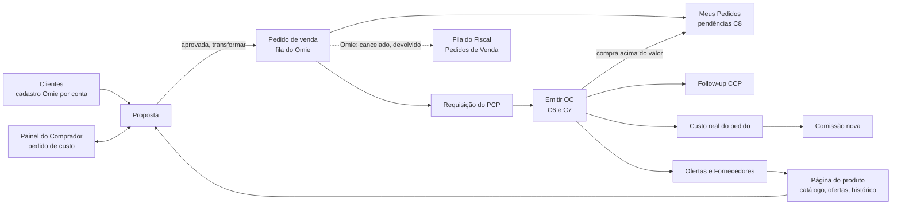

# Telas de Vendas, Orçamento e Compras no modelo novo: auditoria, conexões, redundâncias e a página de proposta

Esta nota substitui a primeira versão de 23/10. Agora **todas as páginas foram lidas** (telas e componentes: títulos, colunas, filtros, ações e serviços que chamam). O que não foi lido por dentro está marcado ❓: o comportamento exato de cada botão no servidor, as telas de Cadastros e as de PCP e Meus Pedidos (só vistas de fora).

Selos: ✅ existe e foi lido · 🔴 não existe · 🟡 proposta · ❓ não conferido.

## 1. Auditoria: o que cada tela faz hoje

### 1.1 Vendas

| Tela | O que mostra e faz (lido no código) | Modelo novo |
|---|---|---|
| **Propostas, lista** | resumo (Total cotado, Em aberto, Fechadas, Perdidas, Conversão); filtros Empresa, Status, Período, Unidade (**Mogi, Uberaba, Arujá**), Responsável; busca por nº e cliente; "Nova proposta" | ✅ muda: estados e rótulos (seção 4) |
| **Proposta, formulário** | blocos Emissão, Cliente, Itens, Condições de fornecimento, Análise de margem, e lateral com Totais e ações (Salvar, Fechar itens, Reabrir, Perder, "Pedido no Omie", Duplicar, Revisões, Linha do tempo, PDF, E-mail) | 🔴 reescrever (seção 5) |
| **Proposta, "Pedido no Omie"** (`PedidoOmieModal`) | monta o cabeçalho e os itens para **copiar e digitar no Omie à mão**, escolhe a conta (Mogi ou Uberaba) e pede de volta o nº do pedido digitado | 🔴 **sai**: o pedido vai por API (fila e pipeline) |
| **Clientes, lista** | cards Clientes, Com proposta em 90 dias, Próximo contato vencido; filtros Status, Segmento, Próximo contato; exportar contatos | ✅ mantém |
| **Cliente, ficha** | dados, compradores, relacionamento (segmento, potencial, próximo contato) e estatísticas: Propostas, Última proposta, Total cotado, **Total fechado**, **Conversão**, Ticket médio | ✅ mantém; "Total fechado" e "Conversão" passam a contar **propostas aprovadas** |
| **Relatório de Cotações** | totais: Propostas, Valor acumulado, **Fechadas**, Valor fechado, Conversão; tabela Cliente, Responsável, Valor; Excel | ✅ mantém, com os novos estados |
| **Relatório Gerencial** | Resumo (Total cotado, Em aberto, Fechadas, **Perdidas**, Conversão); por responsável, empresa e unidade (**Mogi, Uberaba, Arujá**); **Motivos de perda**; Status da carteira; Excel | ✅ mantém; "Perdidas" vira **Canceladas** e os motivos de perda viram **motivos de cancelamento** |
| **Pedidos de Venda** (inativa no menu, N16-33) | lista de pedidos **sincronizados do Omie**: nº, sequencial, inclusão, etapa, cliente, vendedor, valor, situação; detalhe com **Autorizado, Denegado, Faturado, Cancelado, Devolvido, Devolução Parcial, Encerrado**, datas (inclusão, previsão, faturamento, cancelamento, encerramento), motivo e usuário do encerramento | ✅ mantém inativa, mas **vale ouro**: já mostra os **sinalizadores do Omie** que a comissão precisa (cancelado, devolvido, devolvido parcial). Base da fila do Fiscal (seção 4) |
| **Notas Fiscais de Saída** (inativa) | data, nº NF, cliente, vendedor, filial, categoria, IPI, mercadorias, total, "Averbada?" | ✅ mantém inativa |

### 1.2 Orçamento

| Tela | O que mostra e faz | Modelo novo |
|---|---|---|
| **Painel do Comprador** | cards Fila de hoje, Solicitações abertas, **Vencem hoje, Atrasadas**, Ofertas vencendo em 7 dias; Atribuição (Comigo, Livres na fila); ações Assumir, Liberar, Responder, "Sem fornecedor", Cancelar; avisos de "Sem disputas suficientes" e de certificados vencendo | ✅ mantém, mas **tira "Vencem hoje" e "Atrasadas"**: não há prazo (N16-58). Fica o tempo cronometrado |
| **Responder solicitação** (modal) | o Comprador escolhe a **oferta vigente** que vira o custo do item; "o vendedor é avisado"; lança nova oferta ou responde "Sem fornecedor" | ✅ mantém |
| **Pedido de cotação** | um e-mail por fornecedor da categoria, com itens e "Resposta até"; busca no catálogo; modal de análise do item (última compra, média e mínimo, cotações válidas) | ✅ mantém |
| **Ofertas de fornecedor** | lista (produto, fornecedor, preço, custo líquido, cotação, validade); Lançar oferta, **Importar mapa** (xlsx de Compras, com produtos pendentes), Importações, Invalidar, Exportar | ✅ mantém; as ofertas das OCs entram sozinhas |
| **Fornecedores, lista e ficha** | busca por nome ou CNPJ, categoria; ficha com perfil de compras (e-mail de cotação, origem do ICMS padrão, entrega certificado), categorias, certificados, ofertas | ✅ mantém |
| **Catálogo de produtos, lista e ficha** | busca por código ou trechos; **Produtos pendentes** (modal para ligar ao Omie); ficha com preços, **média geral de 90 dias**, "pendente no Omie" | ✅ vira a **página do produto** (`B2`) |
| **Pesquisa de materiais** | menor custo e fornecedor vencedor por material, prazo e frete, quantos cotaram; comparativo por quantidade; PDF "Cotação de Materiais" | ✅ mantém; **sobrepõe** o catálogo (seção 3) |
| **Parâmetros de custo** | ICMS a recuperar por origem, validade padrão da oferta, janela do histórico; "salvar abre uma nova vigência" | ✅ mantém |
| **Tabela da telha** | custo por classe × espessura, núcleos, pinturas, com vigência; telhas já orçadas mantêm o custo da época | ✅ mantém |
| **Custo por item** (`custo-itens`) | resumo do pedido, itens, **lotes**, custo médio, origem, "Cotação a conferir", "Custo completo/incompleto"; aviso **"Dados de exemplo"** e **"Custo sem impostos"** | ✅ vira "Custo real do pedido". O aviso de exemplo precisa sair quando houver dado real |
| **Simulador de Orçamento** | digita compra e venda sem pedido e vê custo líquido, preço sugerido, margem, letra e status com o motor do Simulador de Comissão; **não grava** | ✅ existe; **sobrepõe** a análise da proposta (seção 3) |
| **Sincronização Omie** | "Sincronizando agora" e "Automática desligada: só pelo botão" | ✅ existe na `develop`; ferramenta de TI, **não** de usuário final ❓ |
| **Guia do fluxo do custo** (`FluxoDoCusto`, `GuiaSuprimentos`) | páginas explicativas "Para que serve" | 🔴 descrevem o fluxo **antigo**; precisam ser reescritas |

### 1.3 Compras

| Tela | O que mostra e faz | Modelo novo |
|---|---|---|
| **Dashboard de compras** (`PainelCompras`, `ComprasDashboard`) | Fila de compras (requisições abertas, em cotação, aguardando aprovação, a receber, entregas atrasadas); valor comprado em 12 meses, por comprador, atraso por tempo, a receber por etapa | ✅ mantém |
| **Requisições** (lista e kanban) | requisições vindas do PCP ou manuais; Fechar compra, Ver OC; filtro Unidade, Status, Ação; arrastar no kanban; cancelar com motivo | ✅ mantém; **ganha a tarja de pedido cancelado** |
| **Nova requisição** | "pedido de compra interno": unidade, **nº do pedido de venda**, produto, quantidade, prazo, tipo sugerido (acabado ou não), finalidade | ✅ mantém. Com a proposta, o pedido de venda vem do hub, não do Omie |
| **Emitir OC** (`FecharCompra`, **1.869 linhas**) | unidade, fornecedor, contato, previsão, condição de pagamento e parcelas, moeda, contrato, nº do pedido no fornecedor, itens (produto, qtd, valor, desconto, tipo de material, local de estoque), frete (modalidade, placa), categoria, conta corrente, projeto, observações, resumo; "o Omie só aceita item com produto cadastrado na unidade" | 🔴 **não tem imposto por item e não conhece a proposta**. Precisa de `C6` e `C7` (puxar da proposta, conferir e editar impostos) |
| **Pedidos de venda da OC** (`PedidosVendaOC`) | "Para que é esta compra": o comprador **digita um pedido de venda de cada vez**; vê o que falta comprar por item e marca | ✅ mantém; 🟡 com a proposta, a ligação PV ↔ item de compra deixa de ser digitada |
| **Ordens** (lista, kanban, detalhe) | OC por status e origem ("Pedido feito direto no Omie: só leitura"); detalhe com itens, parcelas, observações, histórico, comprador, PDF, Aprovar, Reprovar, Cancelar OC | ✅ mantém; o detalhe ganha "compra acima do valor" (`C8`) |
| **Aprovações** | OCs **acima do limite da unidade** aguardando o aprovador: Aprovar, Reprovar com motivo | ✅ mantém. ⚠️ **Nome igual a outra coisa**: não é a aprovação do vendedor (`C8`) |
| **Follow-up (CCP)** | OCs aprovadas: confirmação do fornecedor, despacho (data, NF, transportadora), contatos, ocorrências; cards Sem confirmação, Atrasadas, Chegam em 7 dias, Com ocorrência | ✅ mantém. 📝 **CCP é parte do PCP e cuida do follow-up das compras** (N14-24) |
| **Pedido Omie (detalhe)** | pedido de compra **feito direto no Omie**, só leitura, com itens, "Recebido", parcelas | ✅ mantém |
| **Histórico de compras** | filtro Conta (Mogi, Uberaba), período, produto, fornecedor; resumo; gráfico por mês | ✅ mantém; vira aba da página do produto |
| **Compradores** | compradores do Omie por unidade e o funcionário que emite a OC por eles | ✅ mantém (Cadastros/Acessos) |

### 1.4 O que os painéis de fora já têm e a proposta deve respeitar

**Painel PCP** e **Dashboard de Vendas** mostram carteira, desvio de previsão e **"Em avanço"** (pedido marcado pelo diligenciador como faturamento em etapas); **Meus Pedidos** e **Pedidos da Equipe** são a casa do pedido do vendedor. ❓ Lidos só pelo nome dos componentes (`CarteiraPrevisao`, `PainelPcp`, `PainelVendas`).

## 2. Como elas se conectam

**O que já está ligado no código** ✅: Proposta ↔ Painel do Comprador (pedir custo e receber a resposta); Proposta → Simulador de comissão ("simular a comissão deste pedido"); Catálogo, Ofertas, Fornecedores e Pesquisa entre si; Requisição → Emitir OC → Follow-up → Ordens; Pedidos de venda do Omie → Painel PCP.

**O que falta ligar** 🔴:

| Ligação | Efeito hoje |
|---|---|
| Proposta → Pedido por API | o vendedor digita no Omie e volta para anotar o número |
| Proposta → Emitir OC (`C6`) | Compras refaz o que o vendedor informou; a OC **não conhece a proposta** |
| OC → imposto por item | o hub não guarda IPI, ICMS, ST |
| OC → custo real → comissão | não existe |
| Compra acima do valor → Meus Pedidos (`C8`) | o vendedor não sabe que a margem caiu |
| Pedido cancelado → requisição, OC, PCP (tarja) | cada setor descobre sozinho |
| Pedido do Omie (`devolvido parcial`) → fila do Fiscal | a informação existe na tela inativa e ninguém é avisado |
| Cliente → cadastro por conta Omie | o erro só aparece ao transformar em pedido |
| Proposta ↔ Página do produto | o vendedor sai da proposta para consultar preço |

## 3. Redundâncias e confusões (com a decisão proposta)

| # | Onde | Problema | Proposta 🟡 |
|---|---|---|---|
| 1 | Margem em três lugares | "Análise de margem" na proposta, **Simulador de Orçamento** e **Simulador de comissão** usam o mesmo motor e podem divergir | Um cálculo, na API. A proposta é a casa. O Simulador de Orçamento vira "simular sem proposta" usando **a mesma tela de custo**. O Simulador de comissão fica (módulo atual) |
| 2 | Preço do produto em quatro telas | Catálogo, Pesquisa de materiais, Ofertas e Histórico de compras mostram recortes diferentes | **Página do produto** com abas Fornecedores e score, Ofertas, Histórico de compras e Série de preço. Pesquisa e Ofertas ficam como **operação** do Orçamento |
| 3 | Duas condições de pagamento na proposta | texto livre + "Condição (tabela de encargos)" | **Um só campo**, lista da conta Omie ([[Mapa-IncluirPedido-Omie]] §5.1) |
| 4 | Estado de destino × UF do cliente | podem divergir; o ICMS depende disso | O destino vem do cliente/local de entrega; editar exige motivo |
| 5 | ICMS/IPI/ST digitados × cálculo do Omie | o total da proposta pode não ser o da nota | ✅ **Decidido (N16-95): o vendedor digita e o valor segue para o pedido.** Compras confere e pode alterar na OC; o Fiscal também pode alterar. Conferência com o Omie só opcional |
| 6 | Tipo de item "Revenda" × "Fabricação interna" no formulário | o vendedor classifica o que a comissão trata diferente (letra × 2% fixo, N16-78) | Mantém, mas com **texto de ajuda** que mostra o efeito na comissão **estimada dele** |
| 7 | **Dois "Aprovações"** em Compras | OC acima do limite (aprovador) × compra acima do valor da proposta (vendedor, `C8`) | Renomear: **"Aprovar OC"** (Compras) e **"Pendências"** (Meus Pedidos). Em lugar nenhum "Aprovações" sozinho |
| 8 | "Custo" com três sentidos | custo cotado (proposta), custo da oferta (Orçamento), custo real (pedido) | Três rótulos fixos: **Custo cotado**, **Custo da oferta**, **Custo real** |
| 9 | Painel do Comprador com SLA | "Vencem hoje" e "Atrasadas" contrariam N16-58 | Tira os dois; mostra **tempo parado** |
| 10 | Relatórios com "Fechadas/Perdidas" | estados do modelo antigo | **Aprovadas/Canceladas**; "Motivos de perda" → "Motivos de cancelamento" |
| 11 | Guias do fluxo do custo | descrevem o fluxo antigo | Reescrever depois que o fluxo novo estiver no ar |
| 12 | Sincronização Omie no menu de Orçamento | ferramenta de TI parece tarefa do usuário | Fora do menu comum, só para TI ❓ |
| 13 | Unidades: **Mogi (Aços Vital), Uberaba (Aços Uberaba) e Arujá (HRM)** | ✅ **Resolvido (N16-79): são três contas Omie, um só sistema.** O Hub mostra a **logo e a identidade da unidade do usuário** e emite pedidos, OCs e propostas com a identidade da unidade | O catálogo de condições, as categorias e as contas correntes são **por unidade**; a proposta e o relatório escolhem a unidade pela emissora (AV, AU, HRM) |

## 4. Telas que faltam (com dono do dado)

| Tela | Onde | Quem | Nó |
|---|---|---|---|
| Aprovar proposta (revisão e total à vista) | dentro da proposta | vendedor | `V0.5` |
| Transformar em pedido (Qualidade, cliente no Omie, produtos cadastrados) | dentro da proposta | vendedor | `V0.6` |
| Estado do pedido no Omie (fila, enviado, erro com motivo e "Tentar novamente") | proposta e Meus Pedidos | vendedor | `V0.7` |
| Página do produto | Orçamento e dentro da proposta | vendedor, Orçamento, Compras | `B2` |
| Emitir OC com dados da proposta e imposto por item | Compras | comprador | `C6`, `C7` |
| Pendências (aprovar ou reprovar compra acima do valor) | Meus Pedidos | vendedor | `C8` |
| Reprovados sem solução | Compras | comprador | `C8` |
| Tarja de pedido cancelado | requisição, OC, PCP | todos | `V0C` |
| **Fila do Fiscal**: devoluções parciais a informar e pedidos cancelados no Omie; reaproveita a lista "Pedidos de Venda" | Cadastros ou Fiscal | Fiscal, Controladoria | `K6` |
| Comissão estimada na proposta, Minhas Comissões, Decisão, Drill-down, Devoluções pendentes, Visão Geral, Parâmetros | Comissões (novas) | vendedor, Controladoria, Gerência, Coordenação, Fiscal | `K1` a `K6` |
| Configuração por conta Omie (categoria, conta corrente, cenário, etapa, condições de pagamento) | administração | TI | `V0.7` |
| **Calendário**: feriados e dias úteis de exceção por unidade (N16-104) | Cadastros | marketing | datas |
| **Histórico de datas do pedido**: inicial, entregas de Compras, novas datas do CCP, atraso e a vigente (N16-104) | Meus Pedidos (vendedor) e Carteira do PCP | vendedor, PCP | datas |
| **Pedido do Omie na tela do pedido** (N16-106): a parte de vendas vem do Omie, só leitura ("altere no Omie"); o vendedor preenche a parte de compras (é a simulação da comissão) e responde Qualidade e faturamento em partes. Mesma tela e mesmas pendências do pedido da proposta | Meus Pedidos | vendedor | `V1`, `K1` |

## 5. A página de proposta

### 5.1 O que está pesado ou errado hoje (lido em `PropostaForm.tsx`, `ItemProposta.tsx`)

- **Ordem confusa:** Emissão → Cliente → Itens → Condições → *Análise de margem* (só para quem vê custo) → lateral com Totais e botões. O vendedor só descobre o que falta depois de rolar.
- **O item é uma linha de ~25 campos:** descrição, qtd, UM, preço, desconto, ICMS %, IPI %, ST %, prazo, norma, material, certificados, ensaios, tipo, qtd comprada, UM compra, preço compra, origem da compra, IPI compra, ST compra, frete compra, fornecedor, custo, kg/m, metragem, margem. **Venda e compra misturadas.**
- **Botões do modelo antigo:** Fechar itens, Reabrir, Perder, e o modal de digitar no Omie.
- **Não mostra o que falta:** "incompleta" só aparece como erro depois.
- **Duas condições de pagamento, destino repetido, imposto digitado** (seção 3).
- **Sem o estado do pedido:** só aparece "Pedido no Omie: nº" depois de digitado à mão.

### 5.2 Como deve ficar 🟡

**Princípio:** uma ação principal por estado, sempre visível, e a tela diz o que falta para a próxima.

**Cinco blocos nesta ordem, mais um resumo fixo:**

1. **Quem e para quem.** Nº, revisão, estado, **unidade emissora** (a unidade do usuário; logo e identidade vêm dela, N16-79/N16-80), responsável. Cliente com selo "cadastrado no Omie de Mogi/Uberaba" ou aviso "não vira pedido"; comprador; nº da requisição do cliente; finalidade.
2. **O que se vende.** Por item **só o que o cliente vê**: produto (do cadastro do Omie; pendente em destaque), quantidade, UM, preço, desconto, prazo. **Impostos digitados pelo vendedor** (ICMS %, IPI %, ST %), que seguem para o pedido (N16-95); o total é calculado pelo Hub. Especificação técnica recolhida ("Detalhes técnicos").
3. **Condições.** Frete e valor, **condição de pagamento escolhida da lista da conta**, validade, moeda e câmbio (PTAX do dia da aprovação, visível).
4. **Custo de compra** (só para quem vê custo). Por item: de onde veio (digitado, pedido de custo respondido, histórico de OC), fornecedor, link para a página do produto. O pedido de custo mora aqui.
5. **Resultado** (vendedor e gerência): margem, letra e **a comissão estimada que ele colocou**. Nunca a comissão real.

**Resumo fixo (lateral):**
- Totais (subtotal, desconto, impostos do Omie, frete, total).
- **Pendências clicáveis:** "Item 3 sem custo e sem fornecedor", "Cliente sem cadastro no Omie de Mogi", "Produto PEND-0042 sem cadastro", "Condição de pagamento não existe na conta". Cada uma leva ao campo.
- **Um botão principal**: `Salvar` (aberta) → `Marcar como aprovada` (habilita sem pendência; mostra revisão e total) → `Transformar em pedido` (pede **três coisas obrigatórias**: a **data de previsão de faturamento**, se **a Qualidade acompanha todo o processo desde o zero** (sim ou não) e se o pedido **pode faturar em partes ou somente inteiro**; N16-88 e N16-89) → depois só o estado do pedido, com a **previsão de faturamento vigente** e o histórico das datas (inicial, entrega de Compras, entrega do CCP, atraso do fornecedor).
- Em menu: Duplicar, Cancelar (com motivo), Revisões, Linha do tempo, PDF, E-mail.
- **Identidade visual da unidade (logo e cores):** só no **PDF** por enquanto (N16-99). Os **textos padrão** ficam para mais para frente.

**Aprovada:** leitura, com faixa "Aprovada em dd/mm por Fulano (revisão R). Para mudar, cancele e duplique."
**Transformada:** faixa com o pedido: nº do hub, nº do Omie, estado (na fila, enviado, erro com **motivo**), a Qualidade marcada e o aviso de compra acima do valor, se existir.
**Cancelada:** leitura com motivo, quem e quando; só **Duplicar**.

### 5.3 Regras de clareza (valem para todas as telas novas)

1. **Um número, um nome, uma origem visível.** "Custo cotado", "Custo da oferta", "Custo real", "Preço de venda", "Preço sugerido".
2. **Calculado é só leitura e diz quem calculou** ("Omie", "motor", "média das OCs").
3. **O que o perfil não pode ver some**; não vira "—". Comissão real e custo real nunca aparecem vazios para o vendedor.
4. **O imposto é digitado pelo vendedor** e segue para o pedido (N16-95); o Omie não o substitui.
5. **Erro diz o que fazer.** "O Omie recusou: falta a conta corrente da unidade. Fale com a TI."
6. **Sem dado, sem inventar.** Sem OC no histórico, a página do produto diz "sem compras registradas", e não mostra média zero.
7. **Uma pergunta por decisão** (aprovar ou reprovar; informar a devolução; decidir a comissão).
8. **Nenhum nome repetido para coisas diferentes** (ver "Aprovações", seção 3, item 7).

## 5.4 O pedido em partes (sequenciais) 🟡

Quando o vendedor marcou "pode faturar em partes" (N16-89), a tela do **pedido** (dentro de Meus Pedidos) ganha o bloco **Sequenciais**: uma linha por sequencial (número, valor, estado: aberto, faturado ou cancelado, nota fiscal) e o **saldo do original**. Ações (normalmente do **Fiscal**): **Quebrar** (escolhe **itens e quantidades**; o valor sai delas), **Cancelar** (o valor volta ao saldo, o número não se reusa) e **Excluir** (só aberto). Pedido "somente inteiro" não mostra o bloco. O nome na tela é **"Faturamento em partes"**, para não confundir com a **divisão da triagem do PCP** (fabricação, revenda…), que é outra coisa (N16-93). Tela e API dependem de descobrir como o Omie cria o sequencial (R83 do LOG-56).

## 6. Organização do menu 🟡

> [!info] Menu de Vendas e Orçamento revisto em 27/10/2026
> A tabela abaixo foi **enxugada** em [[LOG-62-Reescopo-Menu-Enxuto-e-Limpeza-do-Modulo-do-Pablo]] (N16-107, N16-108): Vendas fica com 4 entradas, Orçamento com 4 (Pedidos de custo com abas Fila e Cotação; Produtos com abas Preços, Comparar e Ofertas; Fornecedores; Parâmetros com abas Custo e Telha) e o **Histórico de compras sai** (a tela Ordens de compra já mostra o histórico). As linhas de Vendas, Orçamento e Compras abaixo já refletem isso.

| Menu | Entradas | Observação |
|---|---|---|
| **Vendas** | Propostas · Clientes · **Meus Pedidos** · Relatórios (Gerencial, com a aba Cotações) | Meus Pedidos entra no grupo: é onde o vendedor responde `C8` |
| **Orçamento** | **Pedidos de custo** (Painel do Comprador + Pedido de cotação) · **Produtos** (Catálogo + Pesquisa de materiais + Ofertas, com a página do produto) · Fornecedores · **Parâmetros** (custo e telha) | de 9 entradas para 4 |
| **Compras** | Requisições · Ordens · **Aprovar OC** · Follow-up (CCP) · **Reprovados** · Dashboard | "Aprovações" vira "Aprovar OC"; **sem Histórico** (vira filtro por produto em Ordens) |
| **Comissões** | atual (não muda) + Comissões da proposta (novas) | nada do módulo atual é tocado |
| **Cadastros ou Fiscal** | Compradores · **Fila do Fiscal** · Sincronização Omie (TI) | |
| **Ocultas** | `propostas-delegacao`, `propostas-valores`, `custo-item`, `solicitacoes-custo` | liberam capacidade, não aparecem |

## 7. Ordem de construção

1. **Proposta nova** (seção 5): a tela de uso diário e a que mais muda. Depende de uma decisão: a condição de pagamento vira lista da conta (o imposto continua digitado pelo vendedor, N16-95).
2. **Meus Pedidos com pendência `C8`** (combinar com a frente "encerrar pedido zerado", que mexe na mesma tela).
3. **Página do produto** (reaproveita Catálogo e Histórico).
4. **Emitir OC com dados da proposta e imposto por item.**
5. **Fila do Fiscal** (reaproveita Pedidos de Venda).
6. Comissões novas.

## Ver também

[[11-Proposta-e-Pedido-de-Venda]] · [[12-Orcamento-Base-de-Preco]] · [[13-Custo-Real-e-Comissao-no-Fluxo]] · [[Mapa-IncluirPedido-Omie]] · [[LOG-57-Menu-Vendas-Orcamento-Compras]] · [[LOG-59-Telas-da-Comissao-Nova]] · [[LOG-60-Matriz-de-Precos-e-Consulta-do-Vendedor]] · [[LOG-61-Custo-Real-do-Pedido-Telas]]
