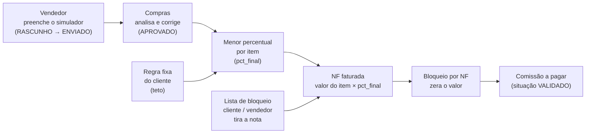

# Como o motor de comissão atual calcula

Esta nota explica, em linguagem simples, **o que o módulo Comissões de hoje faz**. Serve para a Michele (Controladoria) conferir antes de o motor ir para a proposta ([[Registro-de-Decisoes]], N16-11: o motor novo é o mesmo). Nada do módulo atual é alterado. A lista de perguntas está no fim, em "O que a Michele precisa confirmar".

Como ler: **✅** está no código ou no banco (com arquivo e linha) · **📝** decisão do Nathan · **🟡** proposta minha · **🔴** aberto · **❓** não conferido em produção. Nos números, `dump` é `06-Pesquisa\fontes\core_comissionamento-dump-convertido.sql`.

## Resumo em dez linhas

1. O **vendedor** preenche um "simulador" por pedido, item a item: custo de compra, impostos, preço de venda. O simulador calcula a **margem líquida de cada item** e dá uma **letra** (A, B, C ou D) e um **percentual** de comissão.
2. **Compras** abre a mesma simulação, corrige os custos para o valor real e gera uma segunda versão, com o **percentual de Compras**.
3. A comissão de cada item usa o **menor** entre o percentual do vendedor e o de Compras (`pct_final`).
4. Alguns clientes têm **regra fixa**: um teto de percentual, que muda conforme o markup do pedido.
5. Item de **fabricação interna** paga um percentual fixo (hoje 2%) e não entra na margem. Item em **prejuízo** não paga nada.
6. A comissão só vira dinheiro **depois de faturar**: valor faturado do item na NF × `pct_final`.
7. **Bloqueio por NF** zera a comissão daquela nota. **Lista de bloqueio** (cliente ou vendedor) tira a nota do cálculo.
8. O vendedor **não vê o valor** antes de Compras aprovar.
9. Os **coordenadores** têm conta à parte: ajuda de custo mais um percentual do faturamento total do mês.
10. Quem valida hoje é **Compras**; não existe etapa de Controladoria. Isso muda no módulo novo (N16-10).

## Visão do fluxo atual

## 1. Quem faz o quê hoje

| Quem | O que faz | Onde |
|---|---|---|
| Vendedor | Preenche, salva rascunho e envia o simulador do pedido | `comissoes/simulador/page.tsx` (envio em `:1148-1190`) |
| Compras | Aprova a simulação como está, ou cria uma versão com os custos corrigidos e aprova | `comissoes/simulador/page.tsx:1192-1234`, fila em `comissoes/analise-simuladores/page.tsx` |
| Analista/Gerência | Acompanha o mês na Visão Geral e bloqueia NF | `comissoes/visao-geral`, `comissoes/bloqueio-comissoes` |
| Coordenador | Recebe ajuda de custo e percentual sobre o faturamento do mês | `comissao_coordenadores`, `fn_dashboard_comissoes` |

✅ O simulador é **calculado no navegador** (`calcularSimulacao(form, parametros)`, `simulador/page.tsx:1053`) por uma função do front, `lib/simulador/motor.ts`. O banco guarda o resultado e só faz a conta do **menor percentual** (view `vw_simulacao_resolvida`). Isso importa para o módulo novo: o motor precisa sair do navegador (ver nota 03).

## 2. Regra a regra

### R1. Custo líquido do item (o que a empresa gasta para ter o item)

**O que faz.** Soma o que se paga ao fornecedor, tira o ICMS que a empresa recupera e soma IPI, ST e frete de compra.

- Compra bruta = quantidade comprada × preço unitário de compra.
- ICMS recuperável = compra bruta × alíquota da **origem da compra** (zero se o item tem ST).
- IPI = compra bruta × % de IPI.
- Frete: ou **rateio** (`pct_rateio_logistica`, hoje 1,438975% sobre compra + IPI + ST) ou **valor** informado por linha.
- **Custo líquido** = compra bruta − ICMS recuperável + IPI + ST + frete.

**Exemplo.** 50 flanges a R$ 100 de custo, origem "Demais estados" (12%), sem IPI nem ST, frete por rateio:

| Passo | Conta | Valor |
|---|---|---|
| Compra bruta | 50 × 100 | R$ 5.000,00 |
| ICMS recuperável | 5.000 × 12% | R$ 600,00 |
| Frete (rateio) | 5.000 × 1,438975% | R$ 71,95 |
| **Custo líquido** | 5.000 − 600 + 0 + 0 + 71,95 | **R$ 4.471,95** |

**De onde vem.** ✅ `lib/simulador/motor.ts:277-283` (compra, IPI, crédito de ICMS), `:307-312` (frete e custo líquido). Alíquotas: `simulador_parametros.icms_entrada` e `pct_rateio_logistica` (`dump:909-952`). A quantidade da compra é separada da quantidade da venda (`qtd_compra`, `dump:697-699`); o motor não converte unidade, cada lado usa o seu total.

### R2. Margem líquida do item

**O que faz.** Pega o preço de venda do item e desconta custo líquido, despesas operacionais, impostos sobre a venda e a provisão de comissão. O que sobra, dividido pela venda, é a **margem líquida do item**. É ela que decide a letra.

- Despesas operacionais: `pct_despesas_operacionais` (hoje 11,451734%).
- Impostos sobre a venda: ICMS efetivo do destino + PIS + COFINS + IRPJ + CSLL + adicional de IR. Com ICMS 12% a soma é **18,252%**.
- Provisão de comissão: `pct_comissao_provisao` (hoje 2%).
- Item "isento de imposto" zera o bloco de impostos inteiro.

**Exemplo** (mesmo item, venda a R$ 230 a unidade, destino Minas Gerais):

| Passo | Conta | Valor |
|---|---|---|
| Venda do item | 50 × 230 | R$ 11.500,00 |
| Despesas operacionais | 11.500 × 11,451734% | R$ 1.316,95 |
| Impostos | 11.500 × 18,252% | R$ 2.098,98 |
| Provisão de comissão | 11.500 × 2% | R$ 230,00 |
| Lucro do item | 11.500 − 4.471,95 − 1.316,95 − 2.098,98 − 230 | R$ 3.382,12 |
| **Margem líquida** | 3.382,12 ÷ 11.500 | **29,41%** |

**De onde vem.** ✅ `lib/simulador/motor.ts:336-348` (lucro e margem), `:104-110` (impostos), `:144-167` (ICMS efetivo na venda: importação, base reduzida e ST têm regras próprias). Gravado em `simulacao_itens.margem_item` (`dump:745-747`).

### R3. Letra e percentual do vendedor

**O que faz.** A margem líquida do item cai numa faixa. Cada faixa tem uma letra e um percentual de comissão. Os intervalos são "de X até antes da próxima faixa".

| Letra | Margem líquida do item | Percentual |
|---|---|---|
| A | 15% ou mais | 2,0% |
| B | 12% até menos de 15% | 1,3% |
| C | 9% até menos de 12% | 0,7% |
| D | 0% até menos de 9% | 0,5% |

**Exemplo.** Margem 29,41% → letra A → 2%. Comissão estimada do item: 11.500 × 2% = **R$ 230,00**.

**De onde vem.** ✅ `lib/simulador/motor.ts:176-179` (`faixaDaMargem`) e `:389-401`. Faixas em `simulador_parametros.faixas_comissao` (`dump:998-1000`, valores em `dump:1660`). A letra é decidida **por item**; a letra do pedido (`simulacoes.letra_equivalente`) é só informativa (`dump:901-902`).

### R4. Prejuízo e fabricação interna

**O que faz.**
- **Prejuízo:** item de revenda com lucro menor ou igual a zero (ou sem preço de venda) paga **0%**, qualquer que seja a letra.
- **Fabricação interna:** item fabricado pela empresa paga um **percentual fixo** (`pct_fabricacao_interna`, hoje 2%). Não tem custo de compra informado, então **não entra na margem do pedido** e **não tem teto de regra fixa**.

**Exemplo.** Flange sobre desenho (fabricação interna) vendida a R$ 1.800: 1.800 × 2% = **R$ 36,00**. Item de revenda com venda de R$ 4.000 e custo líquido de R$ 4.471,95: prejuízo, comissão **R$ 0,00**.

**De onde vem.** ✅ `motor.ts:363-388`. Fabricação vem **antes** do teste de prejuízo de propósito (`:364-371`). Regra gravada em `simulacao_itens.regra_aplicada` (`PREJUIZO`, `FABRICACAO_INTERNA`, `LETRA`, `TETO_PADRAO`, `TETO_CONDICIONAL`; `dump:704, 754-756`).

### R5. Percentual de Compras

**O que faz.** Compras abre a simulação do vendedor e, se o custo estiver errado, grava uma **segunda versão** (origem `COMPRAS`) com o custo correto. O motor roda de novo e dá um novo percentual por item. A versão do vendedor passa a `CONTESTADO`; a de Compras fica `APROVADO`. Se Compras concorda, só aprova a versão do vendedor.

**Estados da simulação:** `RASCUNHO` → `ENVIADO` → `APROVADO`, `CONTESTADO` ou `DEVOLVIDO`. Os três últimos são finais; versão enviada não muda, correção é versão nova.

**De onde vem.** ✅ `simulacoes.route.js:30-36` (transições), `:233-259` (Compras contesta a do vendedor no mesmo POST), `:311-345` (transição; `DEVOLVIDO` exige motivo), `:348-351` (só rascunho edita). Tela: `simulador/page.tsx:1192-1234`.

### R6. `pct_final`: o menor dos dois

**O que faz.** Para cada item: `pct_final` = o **menor** entre o percentual do vendedor e o de Compras. Se Compras não analisou, vale o do vendedor. Consequência: **custo real melhor que o cotado não aumenta a comissão**; só o pior caso conta.

**Exemplo.** Pedido 27917, conferido no `dump` (vendedor: letra A nos 2 itens; Compras refez o custo do item 1 e ele caiu para letra C):

| Item | % vendedor | % Compras | `pct_final` |
|---|---|---|---|
| 1 | 2,0% (A) | 0,7% (C) | **0,7%** |
| 2 | 2,0% (A) | 2,0% (A) | **2,0%** |

**De onde vem.** ✅ `vw_simulacao_resolvida`: `LEAST(...)` em `dump:1186-1190`. Dados em `dump:1648-1649`. A comissão do vendedor para esse pedido era R$ 216,69 e a de Compras R$ 142,48 (`dump:1648-1649`).

### R7. Regras fixas por cliente (teto)

**O que faz.** Alguns clientes têm um **teto** de percentual combinado. Cada cliente (por unidade) tem três números: comissão **padrão**, comissão **condicional** e a **margem** de gatilho. O teto vale assim: se o **markup bruto** do pedido for **maior ou igual** à margem de gatilho, o teto é a condicional; senão, a padrão. O teto só limita item de **revenda** que pagou pela letra.

Atenção: o gatilho usa o **markup bruto** do pedido, `(total da NF − compra bruta) ÷ compra bruta`, e **não** a margem líquida da letra. No pedido 26616 as duas dão 115,24% e 16,37% (`dump:891-894`). No novo modelo o campo `margem` passa a se chamar `gatilho_markup_pct` para não confundir.

**Exemplo.** Cliente com padrão 0,5%, condicional 1,3% e gatilho 100%. Pedido com markup bruto de 127,87%: usa a condicional (1,3%). Item de letra A (2%) fica em **1,3%**. Se Compras refez o custo e o markup do pedido dela caiu para 60,19% (abaixo de 100%), o teto da versão de Compras é 0,5%; o `pct_final` é o menor dos dois tetos, **0,5%**. Esse é o caso do pedido 27917: 5.709,01 × 0,5% + 5.125,68 × 0,5% = **R$ 54,18** (e não os R$ 142,48 de Compras sem o teto). Conta feita sobre o valor do pedido; o real usa o faturado.

**De onde vem.** ✅ A view aplica o teto: `dump:1151-1198` (cada versão usa o markup da própria versão; `regra_fixa_aplicada` em `:1136-1142`). Regra em `regras_comissoes_fixas` (`dump:589-603`). ⚠️ O motor do front **tem** um trecho que aplica o teto (`motor.ts:467-484`), mas a tela chama `calcularSimulacao(form, parametros)` **sem** a regra fixa (`simulador/page.tsx:1053`): na prática o teto só é aplicado pela view.

### R8. Comissão em reais: sobre o faturado, por item

**O que faz.** O dinheiro só existe depois de faturar. Para cada item que saiu em uma NF: `valor da comissão = valor faturado do item × pct_final ÷ 100`, arredondado a 2 casas. Item **ainda não faturado fica sem valor (nulo, pendente), nunca zero**.

**Exemplo.** Item faturado em R$ 5.709,01 com `pct_final` 0,5% → 28,545 → **R$ 28,55**.

**De onde vem.** ✅ `dump:1128` (`valor_comissao`), `:1129` (`economia_compras`, comparada com a **primeira** versão do vendedor), `:1105-1113` (faturado por `codigo_empresa` + `codigo_item_omie`, não por código do pedido Omie, que muda quando o Omie recria o pedido; `dump:863-865`).

### R9. Comissão por NF e situação

**O que faz.** Soma os itens da NF. O percentual efetivo da NF é **ponderado** pelo valor dos itens. A **situação** da NF é a mais grave entre seus itens, nesta ordem: `BLOQUEADA`, `SEM_SIMULADOR`, `RASCUNHO`, `AGUARDANDO_COMPRAS`, `ITENS_FORA_DO_SIMULADOR`, `VALIDADO`. Só `VALIDADO` entra em "a pagar". A validação é **do pedido**: aprovado uma vez, vale para todas as NFs, inclusive de meses depois.

Também conta os itens da NF **sem vínculo** com a simulação (`qtd_itens_sem_vinculo`): é o aviso do caso "simulou 8, faturou 10".

**De onde vem.** ✅ `vw_comissao_master` situação em `dump:1348-1360`; `vw_comissao_nf` em `dump:1426-1465` (ponderação em `:1444`); resumo do mês em `dump:1520`. A lista só considera NF faturada, de venda líquida, com pedido e vendedor (`dump:1305`).

### R10. O vendedor só vê o valor depois da aprovação

**O que faz.** Enquanto Compras não aprova, o vendedor vê a **letra** e a margem do item, mas **não o valor em reais**. O corte é feito no servidor da tela (BFF), não no CSS, para o número não ir no JSON.

**De onde vem.** ✅ `app/api/comissoes/minhas-comissoes/route.ts:27-31` (corte), `:229` (validado = alguma versão `APROVADO`), `:233-243` (situação), `:249-264` (percentual, valor e teto só se validado). ✅ No simulador a coluna de comissão em reais só aparece na visão de Compras (`simulador/page.tsx:536`). 🟡 No módulo novo o corte passa para o banco e a API (nota 03), porque o BFF não é barreira de segurança.

### R11. Bloqueio por NF

**O que faz.** Uma NF pode ser **bloqueada**: o valor da comissão daquela nota vira zero, com um motivo em texto livre. Desbloquear é marcar "não bloqueada" (a linha fica, com quem mexeu). Não existe chave para a NF: o número é digitado com zeros à esquerda (`00051698`) e, se vier sem os zeros, **o bloqueio nunca casa e nada avisa**.

**Dados hoje:** 2 linhas, **ambas desbloqueadas**, sem motivo (`dump:1570-1571`).

**De onde vem.** ✅ `bloqueio_comissoes` (`dump:410-420`), uso em `vw_comissao_master` (`dump:1338-1347, 1368`). O motivo é opcional (`dump:465-468`).

### R12. Listas de bloqueio: cliente e vendedor

**O que faz.** Cliente na lista de bloqueio, ou vendedor na lista, **faz a NF sair do cálculo**: a nota não aparece na lista de comissões. Não confundir com `blacklist_vendedor_g5` do faturamento, que é outra coisa (cascata de deduções da venda líquida).

**Dados hoje:** 1 cliente e 8 vendedores, sem observação (`dump:1549, 1556-1563`).

**De onde vem.** ✅ `blacklist_comissoes_destinatario` e `blacklist_comissoes_vendedores` (`dump:333-342, 372-381`), usadas nos `NOT EXISTS` da `vw_comissao_master` (`dump:1305-1309`). Não têm data: valem para sempre, sobre qualquer NF, inclusive de meses já pagos.

### R13. Valor máximo (pior caso)

**O que faz.** Para planejar o mês antes de existir simulador, a Visão Geral mostra o **valor máximo possível**: valor do item × o menor entre a maior faixa vigente (2%) e o maior dos dois percentuais da regra fixa do cliente. Se a nota já está validada, mostra o valor real.

**De onde vem.** ✅ `dump:1361-1365` e comentário `:1410-1419`.

### R14. Resumo mensal e cartões

**O que faz.** Mostra por mês e por vendedor: notas por situação, faturado, comissão a pagar (só `VALIDADO`), valor máximo, bloqueado e economia de Compras. A linha de total e as linhas por vendedor vêm juntas (`is_total`); somar sem filtrar duplica.

⚠️ **A coluna "bloqueado" do resumo é sempre zero.** A conta é `valor_faturado_nf × 0` (`dump:1522`). Quem lê "comissões bloqueadas" nessa view vê R$ 0, mesmo com NF bloqueada. No módulo novo o valor retido é a soma do valor calculado das NFs bloqueadas.

### R15. Coordenadores

**O que faz.** Coordenadores não dependem de proposta. Cada um tem **ajuda de custo** (valor fixo) e um **percentual**, com data de vigência. Duas famílias:
- **Gerência:** ranking próprio; comissão = percentual ÷ 100 × **faturamento total do mês** (todas as vendas líquidas).
- **Exceção:** entra no ranking dos vendedores, com a mesma conta.

`total = ajuda de custo + comissão − bloqueado`. O **bloqueio por NF não vale para coordenador** (decisão do Nathan de 06/10/2026, contrato 38): a função é sempre chamada com bloqueio desligado. O ranking ordena por total e, em empate, por `ordem_desempate`, depois por nome.

**Exemplo (valores inventados; os reais ficam no banco):** faturamento do mês R$ 10.000.000; percentual 0,30%; ajuda de custo R$ 4.000. Comissão = 0,30 ÷ 100 × 10.000.000 = R$ 30.000; total = R$ 34.000.

**Mudar valor** = fechar a vigência e abrir outra, para meses passados não mudarem. Se a pessoa tem duas vigências no mês (troca no meio), vale a que começou por último. Toda alteração fica num histórico que **não pode ser editado nem apagado**.

**Dados hoje:** 5 de gerência e 1 de exceção, todos com vigência desde 01/01/2000 (carga do `coordenadores.json`, `dump:1578-1583`). Os valores nominais não são copiados aqui.

**De onde vem.** ✅ `fn_dashboard_comissoes` (`dump:111-287`; conta do coordenador em `:179-194`), `fn_comissao_coordenadores_mes` (`dump:85-95`), tabela e travas (`dump:475-498, 1693`), histórico e imutabilidade (`dump:35-54, 70-76, 1883-1890`). ✅ Bloqueio desligado: `fn_dashboard_comissoes.route.js:20-22, 50`. ✅ A tela `dash-comissoes` ainda lê `lib/comissoes/coordenadores.json` do repositório e calcula no navegador (`LOG-42`, [[Comissoes]]). A tabela `comissao_coordenadores` **não tem rota na API**; só a função de leitura.

### R16. Vendedores do dashboard

**O que faz.** A lista de vendedores do dashboard (`dash-comissoes`) vem do **relatório provisório do mês** (`comissoes_provisoria`, um JSON que um gerador externo grava), e não das views novas. A comissão e o bloqueio ali "como o gerador mandou".

**De onde vem.** ✅ `fn_dashboard_comissoes` (`dump:158-161, 197-214`), `comissoes_provisoria.route.js` (PUT grava o JSON). ❓ Quem é o gerador (o "sistema Python" que o código cita) não está nos repositórios lidos.

### R17. Parâmetros e versão

**O que faz.** Os percentuais (faixas, impostos, despesas, ICMS, encargos de pagamento, margem desejada, fabricação interna) ficam numa tabela com **vigência** por unidade. A simulação grava qual versão usou (`id_parametros`) e fica amarrada a ela. **Não se edita parâmetro vigente**: fecha-se a vigência e abre-se outra.

**Dados hoje:** 3 linhas (uma por unidade), todas "Maio/23", vigência aberta, valores iguais (`dump:1660-1662`).

**De onde vem.** ✅ `simulador_parametros` (`dump:909-952`), regra no comentário `dump:961-965`, exclusão de sobreposição `dump:1701`.

### R18. Mark-up e preço sugerido (informativo)

**O que faz.** O simulador sugere um preço de venda: `mark-up = 1 ÷ (1 − (margem desejada + despesas + impostos + provisão))`, arredondado **para cima** em 2 casas, aplicado ao custo líquido por unidade, mais o encargo da condição de pagamento. Não decide comissão.

**Exemplo.** Soma = 10 + 11,451734 + 18,252 + 2 = 41,703734%. Mark-up = 1 ÷ 0,58296266 = 1,7153 → **1,72**.

**De onde vem.** ✅ `motor.ts:119-133, 324-326`. O arredondamento para cima copia o `ROUNDUP` da planilha (`:40-55`).

## 3. Onde o custo líquido é calculado e a fórmula exata (N16-20)

**Onde.** O custo líquido é calculado **só no navegador**, por uma função pura do front: `calcularSimulacao(entrada, parametros, regraFixa)` em `av-hub\lib\simulador\motor.ts:187-548` (custo líquido em `:277-312`). A tela a chama a cada edição (`simulador/page.tsx:1053`) e manda o resultado pronto à API. ✅ **Não existe função no banco nem rota na API que calcule**: a API só grava e valida (`api-acos-vital\...\simulacoes.route.js` guarda os campos como vieram; o BFF diz "A API ARMAZENA, NÃO CALCULA", `av-hub\app\api\comissoes\simulacoes\route.ts:11`). Do banco, só o `LEAST` e o teto em `vw_simulacao_resolvida` (`dump:1151-1198`). Consequência: o módulo novo precisa portar o motor para o servidor (nota 03, "Onde o cálculo roda").

**A fórmula, por item de revenda** (cada símbolo é uma entrada da tela; unidades e arredondamento como no código):

| Passo | Fórmula | Entrada da tela | Código |
|---|---|---|---|
| Compra bruta | `qtd_compra × preco_unit_compra` | Compra: QTD, PREÇO | `motor.ts:277` |
| IPI | `compra_bruta × pct_ipi ÷ 100` | % IPI | `:278` |
| ICMS de entrada | `0` se `valor_st > 0`; senão a alíquota de `icms_entrada` da **origem da compra** | ORIGEM, ST | `:280-283` |
| ICMS a recuperar | `compra_bruta × icms_entrada ÷ 100` | | `:289` |
| Frete, tipo RATEIO | `(compra_bruta + IPI + valor_st) × pct_rateio_logistica ÷ 100` (hoje 1,438975%) | Frete na compra: rateio | `:310` |
| Frete, tipo VALOR | o frete **da linha** (fabricação interna: zero) | FRETE | `:207-210`, `:309` |
| **Custo líquido** | `compra_bruta − ICMS a recuperar + IPI + valor_st + frete` | CUSTO LÍQ. | `:312` |

- Em **fabricação interna** não há compra: `compra_bruta = IPI = ICMS = 0` (`:259-261`) e o custo líquido é zero; a comissão é o percentual fixo (R4).
- O **encargo da condição de pagamento não entra no custo líquido.** Entra só no preço sugerido: `arredondarParaCima(custo_liquido ÷ qtd × mark-up, 2) × (1 + encargo ÷ 100)` (`:324-325`).
- **DIFAL, ST e frete da venda** são valores do cabeçalho: entram no **total da NF** (`:437-438`), não no custo. O DIFAL **da compra** não existe no motor.
- O **custo do pedido** é a soma dos itens (`:434`). A margem e a letra usam o custo líquido do item (R2, R3).

**Como isso vira "por evento" (N16-20).** Cada evento de custo (uma OC, um lote, uma parcial 5.01…) carrega as **suas** condições: fornecedor, condição de pagamento, encargo, frete, origem do ICMS, IPI, ST, DIFAL. O custo líquido do **evento** usa a mesma tabela de passos acima, com as entradas do evento (`compra_bruta` = valor do evento sem imposto; origem, IPI e ST do evento; frete do evento por VALOR quando a OC traz frete, senão RATEIO). O custo líquido do **item** é a soma dos eventos, mais a parte da quantidade ainda sem evento, calculada com as condições cotadas. Propriedade usada como teste: se todos os eventos de um item têm as mesmas condições, a soma é igual ao custo líquido calculado de uma vez (a fórmula é linear, exceto o zero de ICMS quando há ST, que é por evento). A venda continua com **um** conjunto de condições por pedido (destino, condição de pagamento, impostos sobre a venda, frete e ST da venda).

**O que a OC do hub guarda hoje** (fato do dump, N14-23): no cabeçalho, fornecedor, condição de pagamento, moeda e cotação, tipo e valor do frete, seguro e desconto; no item, quantidade, valor unitário e desconto. **Não guarda IPI, ICMS, ST nem DIFAL por item.** O `custos_eventos` do SQL-016 grava `valor_total` já com desconto e cotação (`SQL-016 fn_custo_evento_sincronizar_oc`) e tem colunas `icms_recuperar_total`, `ipi_total`, `st_total`, `frete_total` **sem preenchimento hoje**. Enquanto o imposto real não existe (OQ-11), o módulo novo faz assim 🟡: o evento herda origem, IPI e ST da proposta, proporcionais à quantidade coberta, e o cálculo fica marcado **"custo parcial por imposto"** (`imposto_completo = false`). A comissão calcula normalmente; só a Controladoria vê a marca. Quando o imposto real chegar, o evento passa a usá-lo e a marca some no recálculo seguinte.

## 4. O passo "Comissão: após a aprovação de Compras" e onde ele entra no fluxo novo

**O que é hoje.** Na tela do vendedor a coluna de comissão em reais **não existe** e no lugar aparece o chip "Comissão: após a aprovação de Compras" (`simulador/page.tsx:1800-1803`; a coluna só aparece no modo Compras, `mostrarComissao = modoCompras`, `:536`). O texto da dica diz que o valor pago é o menor entre a versão do vendedor e a de Compras, calculado sobre o faturado. O passo existe de ponta a ponta no código:

| Etapa | O que acontece | Onde |
|---|---|---|
| 1. Vendedor envia | A simulação passa de `RASCUNHO` a `ENVIADO` | `simulador/page.tsx:1148-1190` |
| 2. Fila de Compras | A tela `Análise de Simuladores` lista as versões `ENVIADO` do vendedor (e as de Compras que ficaram sem aprovar). Botão "Analisar" abre o simulador em `?modo=compras&id_simulacao=…` | `analise-simuladores/page.tsx:20, 85-89`; `services/comissoes/simulador.ts:260-270` |
| 3. Compras revisa | A mesma tela do simulador, com "Compra — Compras revisa", editável; a simulação carrega **os parâmetros congelados** da versão (`id_parametros`), não os vigentes de hoje | `simulador/page.tsx:767-843`, `:1788` |
| 4a. Aprova como está | `PUT /simulacoes/:id {status: APROVADO}` | `simulador/page.tsx:1192-1234` |
| 4b. Ajusta e aprova | `POST /simulacoes` com `origem = COMPRAS` e `id_simulacao_contestada`; no mesmo POST a versão do vendedor vira `CONTESTADO`; depois a versão de Compras vai a `APROVADO` (retomável se a segunda chamada falhar) | `simulacoes.route.js:233-259`; `simulador/page.tsx:1192-1234` |
| 5. Menor percentual | Por item, `pct_final = LEAST(percentual do vendedor, percentual de Compras)`; sem Compras, vale o do vendedor | `vw_simulacao_resolvida`, `dump:1186-1190` |
| 6. Vendedor vê | Só depois de alguma versão `APROVADO` o BFF libera percentual e valor em reais | `minhas-comissoes/route.ts:27-31, 229, 249-264` |

Estados e transições: `RASCUNHO → ENVIADO → APROVADO | CONTESTADO | DEVOLVIDO`, os três últimos terminais (`simulacoes.route.js:30-36`). `DEVOLVIDO` exige motivo (`:328-335`).

**Permissões de hoje.** A tela `Análise de Simuladores` e o `Simulador` são duas telas do cadastro (`slug` `analise-simuladores` e `simulador`). O BFF aceita qualquer uma das duas para ler, criar e editar (`api/comissoes/simulacoes/route.ts:30, 59`; `[id]/route.ts:50, 60`); **a ação de aprovar é um `PUT` de status com a permissão `pode_editar` de qualquer das duas**, ou seja, quem tem `pode_editar` no `Simulador` do vendedor consegue chamar a rota de aprovação. A tela esconde o botão, o BFF não barra 🔴 (ponto de atenção 13).

**Onde ele se encaixa no fluxo novo (proposta 🟡, OQ-28).**

| Hoje | No módulo novo |
|---|---|
| Vendedor "envia" o simulador do pedido a Compras | Não há envio: a proposta salva já grava o cálculo **cotado** (comissão estimada, `K1`). O vendedor só vê esse |
| Compras redigita o custo (versão `COMPRAS`) | Ninguém redigita: o cálculo **real** nasce sozinho dos eventos de custo (OC, lote, matéria-prima), cada evento com as suas condições (`K2`, N16-20). Compras **não altera a proposta** (N16-08) e usa o valor correto na OC (`C7`) |
| `pct_final` = menor entre vendedor e Compras | Igual, por item e por NF: `comissao_final_pct = LEAST(cotada, real)` (R6) |
| Compras aprova (`APROVADO`) e só então o vendedor vê | **Conferência de Compras** por NF (🟡): `CONFIRMAR` ou `CONTESTAR`, sem alterar valor. Padrão **desligado** (`exige_conferencia_compras = false`): a decisão da Controladoria não espera Compras. Se a Michele e o Nathan mantiverem o passo, liga-se o parâmetro e a Controladoria só aprova, corta ou altera depois da confirmação |
| Quem valida o pedido é Compras; **não existe etapa de Controladoria** | A **Controladoria decide uma vez**, no final, com justificativa (`K4`); o vendedor só vê a comissão real depois dessa decisão |
| `Análise de Simuladores` (fila de Compras) | Visão **Compras** da mesma tela de comissão da NF (nota 04, "três visões"): lista as NFs com `compras_estado = PENDENTE`, mostra o cálculo real por evento e permite confirmar ou contestar |

Em uma frase: **a aprovação de Compras sobre o percentual vira a conferência do cálculo real, e a decisão final sai de Compras e vai para a Controladoria.**

## 5. Pontos de atenção que achei

| # | O que | Onde | Selo |
|---|---|---|---|
| 1 | O resumo mensal mostra "bloqueado" sempre zero | `dump:1522` | ✅ |
| 2 | O teto da regra fixa só é aplicado pela view; o motor do front não recebe a regra | `simulador/page.tsx:1053`, `motor.ts:467-484` | ✅ |
| 3 | O bloqueio por NF casa pelo número com zeros; sem os zeros não casa e não avisa | `dump:447-450` | ✅ |
| 4 | As listas de bloqueio e a regra fixa não têm data nem motivo obrigatório; bloqueio vale retroativo | `dump:333-381` | ✅ |
| 5 | A simulação guarda `sequencial` sempre nulo, e a `vw_comissao_master` casa `COALESCE(sequencial, -1)` com o da NF (que é 0 ou maior em pedido de família). Pode não casar em NF de pedido com sequencial | `dump:1367`, `simulador/page.tsx:1117-1122` | ❓ conferir em produção |
| 6 | O protótipo `experimental/simulador-comissao` calcula a letra pelo **pedido inteiro** e a documentação `av-hub/docs/comissao/processo-comissionamento.md` descreve esse protótipo. O motor de verdade é por **item** (`lib/simulador/motor.ts`) | `_lib/calculo.ts:268`, `motor.ts:391-401` | ✅ |
| 7 | O dashboard de vendedores depende de um JSON gerado fora do repositório | `dump:158-214` | ✅ / ❓ gerador |
| 8 | O coordenador não tem API de cadastro; valores mudam só por SQL | `core_comissionamento/index.js` (sem rota) | ✅ |
| 9 | O comentário da `vw_comissao_master` no dump está truncado ("(texto atual)") | `dump:1386` | ✅ |
| 10 | O flag `vendedores.comissao` (cadastro) não é lido pelo motor nem pelas views | `dump:1227-1377` | ✅ / ❓ uso |
| 11 | O briefing diz 6 funções; o dump tem 5 (`fn_dashboard_comissoes`, `fn_comissao_coordenadores_mes`, `fn_jsonb_numero` e as 2 do histórico) | `dump:35-322` | ✅ |
| 12 | Refaturamento e devolução não aparecem na lógica da view (a nota diz zero casos em 6 meses) | `dump:1388-1392` | ✅ / ❓ |
| 13 | O BFF não separa quem aprova de quem digita: o `PUT` de status aceita `pode_editar` do `Simulador` do vendedor | `app/api/comissoes/simulacoes/[id]/route.ts:60` | ✅ |
| 14 | O custo líquido só existe no navegador; nenhuma rota nem função de banco o recalcula, então nada reconfere o valor gravado | `motor.ts:277-312`, `simulacoes.route.js` | ✅ |

## O que a Michele precisa confirmar

Cada pergunta traz o que o módulo novo vai fazer se ela não responder (🟡). **A Michele respondeu em 19/10/2026 ([[Registro-de-Decisoes|respostas da Controladoria de 19/10 (N16-42 a N16-51)]]); onde a resposta diverge do padrão abaixo, vale a resposta (N16-42 a N16-51).**

| # | Pergunta | Padrão proposto 🟡 |
|---|---|---|
| M01 | As **faixas A/B/C/D** (15/12/9/0 e 2/1,3/0,7/0,5) e o **2% de fabricação interna** continuam valendo? | Sim, vira parâmetro com vigência |
| M02 | Os **percentuais de despesa, impostos e provisão de 2%** de "Maio/23" ainda são os vigentes? A margem desejada é 10%? | ✅ Provisoriamente sim (N16-39): "Maio/23" continua até haver nova vigência com novos dados |
| M03 | Custo real **melhor** que o cotado: o vendedor fica com o percentual cotado (menor dos dois). É o desejado? | Sim, igual ao atual |
| M04 | **Regras fixas por cliente**: continuam? O gatilho é o markup bruto do pedido? Podem ter data de fim? (OQ-06) | Continuam, com vigência; campo renomeado |
| M05 | **Lista de bloqueio** de cliente e de vendedor: continua? Quem está nela hoje (1 cliente, 8 vendedores) migra? A comissão excluída deve **aparecer com valor zero e motivo** para a Controladoria, em vez de sumir? (OQ-06) | Migra com vigência a partir de 2000-01-01; aparece zerada com motivo |
| M06 | **Bloqueio por NF** vira a decisão "bloquear" da Controladoria (com justificativa)? As 2 linhas antigas (desbloqueadas) podem ficar só no módulo antigo? (OQ-06) | Sim; não migra |
| M07 | **Coordenadores**: continuam no módulo novo, com a mesma conta e sem bloqueio por NF? Quem aprova a apuração do mês? (OQ-06) | Sim, mesma conta; apuração mensal fechada pela Controladoria |
| M08 | **Item de fabricação interna**: com o custo real da matéria-prima agora disponível (N16-09), continua 2% fixo sem olhar a margem, ou passa a ter letra? | Continua 2% fixo; custo só informativo |
| M09 | **Mão de obra** (serviço comprado por OC): comissiona como revenda (letra pela margem)? Que origem de compra usar para o ICMS (hoje exigida na revenda)? | Revenda, sem crédito de ICMS (origem "Optante Simples" = 0%) |
| M10 | **"Desaprovar"** zera e encerra? **"Bloquear"** retém e pode ser liberado depois? **"Alterar"** pode aumentar acima do calculado? Há teto? | ✅ Respondida (N16-44, N16-45): aprovar, desaprovar, bloquear (e desbloquear), cortar ou alterar, por valor ou percentual, **sem teto**, sempre com justificativa e rastro; decidem a Controladoria, a Gerência e a Coordenação; ninguém decide sobre a própria comissão |
| M11 | O vendedor pode ler a **justificativa** da Controladoria? | ✅ Respondida (N16-46): **sim**; o vendedor vê a justificativa depois da decisão (`K5`); desaprovada aparece com R$ 0 e o motivo |
| M12 | A comissão da NF entra na fila **mesmo com o custo real incompleto**, ou só quando o custo estiver completo? | ✅ Respondida (N16-48): paga-se **só sobre as peças com custo real**; quando o custo completa, a diferença vai para a apuração seguinte, para nova decisão. O restante **não** usa o cotado |
| M17 | **Passo de Compras** (seção 4): Compras continua conferindo o percentual de Compras antes da Controladoria? (OQ-28) | Não; o cálculo real por evento o substitui; a conferência fica pronta no banco, desligada (`exige_conferencia_compras = false`) |
| M18 | **Encargo da condição de pagamento**: entra no custo líquido do evento? Hoje só entra no preço sugerido (seção 3). (OQ-12) | ✅ Respondida (N16-22): não entra no custo; segue só no preço sugerido |
| M19 | **Imposto real do evento** (IPI, ICMS, ST, DIFAL): ✅ respondida (N16-38, OQ-11): vem dos campos novos da OC, pré-preenchidos com os dados da proposta e editados por Compras. O evento herda da proposta só se Compras não tiver editado | Respondida |
| M13 | NF **cancelada** depois da decisão, e **devolução**: como fica a comissão paga? | ✅ Respondida (N16-47, N16-74): **abate na mesma proporção, desde a primeira versão**; se já paga, desconta na próxima apuração. Devolução total vem do Omie; a parcial o Fiscal ou a Controladoria informam (item, quantidade, valor), com pendência até lá (`K6`) |
| M14 | **Pedido que chega do Omie sem proposta** (V1, segunda origem): continua no módulo atual? | ✅ Respondida (N16-103 a N16-106): o módulo atual não muda; o pedido do Omie entra no módulo **novo** pelo mesmo fluxo do Hub, e a estimativa é a parte de compras que o vendedor preenche no pedido; a nota que sair antes dela espera |
| M15 | O flag **`vendedores.comissao`** e a **ajuda de custo do vendedor** (`vendedores.ajuda_custo`) valem para quê? O motor atual não os lê | Fora do motor; ficam no cadastro |
| M16 | O **valor retido** (comissões bloqueadas) deve aparecer no resumo mensal da Controladoria, o que hoje mostra zero por defeito? (OQ-05) | Sim |

Relacionados: [[02-Tabelas-Atuais-core_comissionamento]], [[03-Modelo-Novo-core_comissao]], [[04-Regras-e-Estados-da-Comissao-Nova]], [[Comissoes]], [[LOG-47-Custo-Real-por-Item-no-Hub]], [[Regras-do-Vault]].
