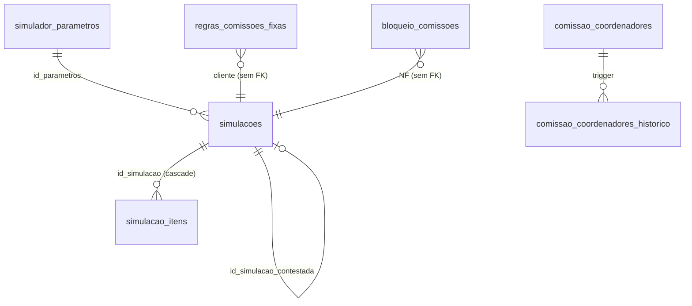

# Tabelas, views e funções atuais do `core_comissionamento`

Inventário do que existe hoje, com o que está bom e o que deve ser **melhorado no módulo novo** ([[03-Modelo-Novo-core_comissao]]). O schema atual **não é alterado** (N16-11). Citações: `dump` = `09-Diagramas/fontes/core_comissionamento-dump-convertido.sql`; "API" = `api-acos-vital\src\schemas\core_comissionamento`. Selos em [[Regras-do-Vault]].

**Contagem conferida no dump:** 9 tabelas, 4 views, **5 funções** (o briefing diz 6; ver [[01-Motor-Atual-Como-Calcula]], ponto 11). Linhas hoje: `blacklist_comissoes_destinatario` 1, `blacklist_comissoes_vendedores` 8, `bloqueio_comissoes` 2, `comissao_coordenadores` 6, `comissao_coordenadores_historico` 6, `regras_comissoes_fixas` 5 (1 apagada), `simulacoes` 14, `simulacao_itens` 21, `simulador_parametros` 3 (`dump:1549-1662`).

## Mapa do schema

Convenção do schema atual: `codigo_empresa uuid` = unidade (`core.unidades`); percentuais em **pontos percentuais** (2 = 2%).

## Tabelas

### 1. `simulador_parametros` (`dump:909-952`)

Parâmetros do motor por unidade e vigência. ✅ Uma simulação grava `id_parametros` e fica amarrada a ela.

| Coluna | Tipo | Nulo | Para que serve |
|---|---|---|---|
| `id` | uuid (uuidv7) | não | PK |
| `codigo_empresa` | uuid | não | Unidade (FK `core.unidades`) |
| `vigencia_inicio`, `vigencia_fim` | date | não / sim | Vigência; `fim` nulo = aberta |
| `descricao` | varchar(60) | não | Rótulo ("Maio/23") |
| `margem_desejada` | numeric(10,4) | não | Margem alvo do preço sugerido |
| `pct_despesas_operacionais` | numeric(10,6) | não | Soma das 9 despesas |
| `detalhe_despesas` | **jsonb** | não | Detalhe por categoria (só auditoria) |
| `pct_rateio_logistica` | numeric(10,6) | não | Rateio de frete de compra |
| `pct_comissao_provisao` | numeric(10,4) | não | Provisão de comissão dentro do mark-up |
| `pct_pis`, `pct_cofins`, `pct_irpj_base`, `pct_irpj`, `pct_csll_base`, `pct_csll`, `pct_adicional_ir` | numeric(10,4) | não | Impostos sobre a venda |
| `icms_saida` | **jsonb** (objeto) | não | Destino → alíquota |
| `icms_entrada` | **jsonb** (objeto) | não | Origem da compra → alíquota |
| `encargos_pagamento` | **jsonb** (objeto) | não | Condição de pagamento → encargo |
| `faixas_comissao` | **jsonb** (array) | não | `[{letra, margem_min, pct}]` |
| `pct_fabricacao_interna` | numeric(10,4) | não | % fixo da fabricação |
| `created_*`, `updated_*`, `deleted_*` | timestamptz/uuid | | Auditoria e soft delete |

**Chaves e regras:** PK `id`; UNIQUE parcial uma vigência aberta por unidade (`uq_simulador_parametros_vigente`, `dump:1855`); EXCLUDE sem sobreposição por unidade (`dump:1701`); CHECKs 0..100 em todos os percentuais e `jsonb_typeof` dos 4 JSON (`dump:938-951`).

**Problemas e melhorias**
- **JSON com regra de negócio** (`icms_saida`, `icms_entrada`, `encargos_pagamento`, `faixas_comissao`): sem chave estrangeira, sem unicidade, sem tipo por valor. As chaves são **texto livre** ("SÃO PAULO - Base de ICMS Reduzida") e o motor casa ignorando caixa mas **não** acento (`motor.ts:79-94`). → tabelas filhas com código (`parametros_icms_saida`, `parametros_icms_entrada`, `parametros_encargos_pagamento`, `parametros_faixas`).
- `detalhe_despesas` soma 11,451733 e o agregado guarda 11,451734 (`dump:1660`): duas verdades. → `parametros_despesas` filha; agregado explícito e tolerância documentada.
- Nomes: prefixo `pct_` no início, mistura de `margem_desejada` (sem `pct`). → sufixo `_pct` em todos.
- Sem trava no banco para "parâmetro já usado não muda"; só um comentário (`dump:961-965`). → trigger.
- Sem auditoria de quem mudou (só `updated_by`). → tabela `auditoria`.
- Uma linha por unidade com valores iguais (3 cópias). Mantido por unidade (cada unidade pode divergir), mas a Controladoria deve confirmar (M02 em [[01-Motor-Atual-Como-Calcula]]).

### 2. `simulacoes` (`dump:780-835`)

Uma linha por **versão** de simulação de um pedido (substitui planilhas .xlsx). ✅ Versão enviada é imutável.

| Grupo | Colunas | Observação |
|---|---|---|
| Identidade | `id`, `codigo_empresa`, `numero_pedido` varchar(15), `sequencial` numeric(4,0), `codigo_pedido_omie` bigint, `origem` (`VENDEDOR`/`COMPRAS`), `versao`, `id_simulacao_contestada`, `status` | `sequencial` sempre nulo na prática; `codigo_pedido_omie` só informativo |
| Contexto | `codigo_vendedor_omie`, `codigo_cliente`, `data_pedido`, `estado_destino`, `condicao_pagamento`, `isento_imposto` | Texto livre em `estado_destino` e `condicao_pagamento` |
| Frete e venda | `frete_compra_tipo` (`RATEIO`/`VALOR`), `frete_compra_valor`, `valor_st_venda`, `imposto_retido_difal`, `frete_venda` | |
| Parâmetros | `id_parametros` (FK, obrigatório) | |
| Resultado | `custo_total`, `venda_sugerida`, `total_nf`, `valor_liquido`, `markup_projetado`, `markup_real`, `markup_bruto`, `pct_opex`, `lucro`, `margem_liquida`, `letra_equivalente`, `pct_comissao_efetivo`, `valor_comissao_total`, `qtd_itens`, `qtd_itens_prejuizo` | Todos **nulos permitidos**: o resultado do motor chega depois do cabeçalho |
| Texto | `observacao`, `motivo_devolucao`, `submitted_at` | |
| Auditoria | `created_*`, `updated_*`, `deleted_*` | |

**Chaves e regras:** PK `id`; UNIQUE parcial `uq_simulacoes_versao` (empresa, pedido, `COALESCE(sequencial,-1)`, origem, versão) e `uq_simulacoes_rascunho` (um rascunho por pedido e origem) (`dump:1841, 1848`); CHECKs de status, origem, `COMPRAS` exige `id_simulacao_contestada`, `DEVOLVIDO` exige motivo, enviado exige `submitted_at` (`dump:826-834`); FKs para unidade, parâmetros e a própria tabela. Índices `ix_simulacoes_fila`, `_pedido`, `_vendedor` (`dump:1792-1806`).

**Problemas e melhorias**
- **Dois conceitos numa tabela:** a simulação do vendedor (preço e custo digitados) e a de Compras (custo corrigido). No módulo novo são **dois cálculos** do mesmo dossiê (`COTADO` e `REAL`), e o de custo real vem do evento, não de digitação.
- Amarrada ao **número do pedido do Omie**; o módulo novo amarra ao **id da proposta** (N16-02, N16-04) e ao id do pedido do hub.
- `sequencial` nulo + `COALESCE(-1)` em dois UNIQUE e em joins: frágil (ponto 5 de [[01-Motor-Atual-Como-Calcula]]). → sem sequencial; uma proposta = um pedido.
- `status` varchar com 5 valores; `DEVOLVIDO` é terminal e "legado" na tela (`simulador/page.tsx:98`). → máquina de estados explícita ([[04-Regras-e-Estados-da-Comissao-Nova]]).
- Resultado todo anulável e sem unidade de medida explícita (`qtd` double). → colunas `NOT NULL` no cálculo gravado; só entra linha de cálculo completa.
- Sem histórico de recálculo: cada mudança de custo exige digitar nova versão. → cada recálculo automático é uma linha nova e imutável.
- Sem coluna da versão do motor: não se sabe com que código o número saiu. → `versao_motor`.

### 3. `simulacao_itens` (`dump:672-706`)

Itens de uma simulação. A comissão é decidida **aqui, item a item**.

| Grupo | Colunas |
|---|---|
| Identidade | `id`, `id_simulacao` (FK, cascade), `ordem`, `codigo_item_omie` bigint, `codigo_produto_omie`, `codigo_produto`, `descricao` |
| Venda | `qtd` **double precision**, `unidade`, `tipo_item` (`REVENDA`/`FABRICACAO_INTERNA`), `preco_unit_venda` |
| Compra | `qtd_compra` **double**, `unidade_compra`, `preco_unit_compra`, `fornecedor` varchar(120), `origem_compra` varchar(50), `pct_ipi`, `valor_st`, `frete_compra_valor` |
| Resultado | `custo_liquido`, `preco_unit_sugerido`, `icms_efetivo`, `pct_impostos`, `margem_item`, `letra_item`, `pct_comissao`, `regra_aplicada` |

**Chaves:** PK `id`; UNIQUE `(id_simulacao, ordem)` e parcial `(id_simulacao, codigo_item_omie)` (`dump:1827-1834`).

**Problemas e melhorias**
- `qtd` e `qtd_compra` em **double precision**: erro de ponto flutuante em quantidade. → `numeric(15,4)`.
- `origem_compra` em **texto livre** (casa com o JSON de parâmetros). → código controlado (`SP`, `SP_REDUZIDA`, `OUTRA_UF`, `IMPORTACAO_SP`, `IMPORTACAO_OUTRA_UF`, `SIMPLES`), igual ao `OrigemIcmsCompra` do Comercial.
- Não guarda as **contas intermediárias** (compra bruta, ICMS recuperável, IPI em valor, frete, lucro): quem audita precisa refazer (`dump:715-718`). → todas gravadas.
- Não guarda o **teto** da regra fixa nem o percentual da letra antes do teto (a view recalcula). → `comissao_letra_pct`, `teto_regra_pct`, `comissao_pct`.
- Não guarda **de onde veio o custo** ("a fonte some ao recarregar", `simulador/page.tsx:117-124`). → novo modelo guarda custo cotado, custo real e cobertura.
- Sem `id_item_proposta`/`id_item_pedido`: amarra pelo `codigo_item_omie`, que só existe depois de o pedido estar no Omie.

### 4. `regras_comissoes_fixas` (`dump:589-603`)

Teto por cliente e unidade.

| Coluna | Tipo | Obs. |
|---|---|---|
| `id` | uuid | PK |
| `codigo_empresa`, `codigo_cliente` | uuid, varchar(60) | Chave de negócio (UNIQUE parcial, `dump:1820`) |
| `comissao_padrao`, `comissao_condicional`, `margem` | numeric(10,2) | 0..100 |
| `created_at`, `updated_at`, `deleted_at` | timestamptz | Sem `created_by`/`updated_by`/`deleted_by` |

**Problemas e melhorias**
- `margem` é, na verdade, **gatilho de markup bruto** (`motor.ts:469`), e o nome convida a confundir com margem líquida. → `gatilho_markup_pct`.
- CHECK limita `margem` a 0..100, mas markup bruto passa de 100 (ex.: 115,24). → faixa 0..1000.
- **Sem vigência**: mudar a regra reescreve o passado. → `vigencia_inicio/fim` com EXCLUDE.
- **Sem autoria** (nenhum `*_by`) e sem histórico. → auditoria.
- Nada impede padrão maior que condicional (`dump:1417-1419`). → CHECK `condicional >= padrão` 🟡.
- Soft delete só pelo `deleted_at`; a API usa `paranoid` (`dump:640-643`).
- Dados: 5 linhas, uma apagada; `margem` = 100,00 em todas (`dump:1602-1606`).

### 5. `bloqueio_comissoes` (`dump:410-420`)

Bloqueio por NF.

| Coluna | Tipo | Obs. |
|---|---|---|
| `codigo_empresa` | uuid | PK composta |
| `numero_nf` | varchar(10) | PK composta; **com zeros à esquerda**; `CHECK` só dígitos |
| `is_blocked` | boolean | default false |
| `motivo` | varchar(255) | **opcional** |
| `created_*`, `updated_*` | | `created_by`/`updated_by` sem FK |

**Problemas e melhorias**
- Chave é o **número da NF com zeros**; sem os zeros nunca casa e nada avisa (`dump:447-450`). Sem FK para `notas_fiscais`. → o módulo novo usa `codigo_nf_omie` (PK real da NF, `Dump Avhub (Esqueleto).sql:22695`) e o bloqueio vira **decisão** da NF.
- **Motivo opcional**; quem bloqueou e quando só em `created_by`/`updated_at`, e a linha é reescrita ao desbloquear (histórico perdido). → decisão imutável, com justificativa obrigatória, valor antes e depois.
- A API tem `DELETE` físico ("só para lançamento por engano", `bloqueio_comissoes.route.js:144-158`): apaga a auditoria. → sem delete.
- Dados: 2 linhas, ambas `is_blocked = false` (`dump:1570-1571`).

### 6 e 7. `blacklist_comissoes_destinatario` e `blacklist_comissoes_vendedores` (`dump:333-342, 372-381`)

| Tabela | Chave | Colunas |
|---|---|---|
| `…_destinatario` | `(codigo_empresa, codigo_cliente varchar(60))` | `observacao`, `created_*`, `updated_*` |
| `…_vendedores` | `(codigo_empresa, codigo_vendedor_omie varchar(11))` | idem |

A presença da linha é o bloqueio. ✅

**Problemas e melhorias**
- **Duas tabelas iguais** com domínios de chave diferentes. → uma tabela `exclusoes` com `tipo` (`CLIENTE`/`VENDEDOR`).
- **Sem vigência**: vale sobre qualquer NF, inclusive de meses fechados. → vigência com EXCLUDE.
- **Sem motivo obrigatório** (`observacao` nula em todas as 9 linhas, `dump:1549-1563`). → `motivo NOT NULL`.
- A exclusão **some com a nota** da lista (`NOT EXISTS`, `dump:1305-1309`) em vez de aparecer marcada. → comissão excluída fica visível com valor zero e `motivo_zerado`.
- Sem `deleted_at`: remoção física. → `deleted_at/by` + auditoria.
- Domínio do `codigo_cliente` (varchar 60) difere de `core.parceiros.codigo_parceiro_omie` (varchar 15); exige `::text` (`dump:361-365`). Mantido, documentado.

### 8. `comissao_coordenadores` (`dump:475-498`)

| Coluna | Tipo | Obs. |
|---|---|---|
| `id` | uuid | PK |
| `nome` | varchar(100) | **É a chave da vigência** (`lower(btrim(nome))`, `dump:1693`) |
| `id_funcionario` | uuid | opcional (FK `core.funcionarios`); nulo nas 6 linhas |
| `tipo` | varchar(10) | `gerencia` / `excecao` |
| `ajuda_custo` | numeric(14,2) | ≥ 0 |
| `percentual_comissao` | numeric(7,4) | pontos percentuais |
| `ordem_desempate` | smallint | substitui "casas decimais" do JSON |
| `vigencia_inicio`, `vigencia_fim` | date | EXCLUDE sem sobreposição por nome |
| `observacao`, `origem` | text, varchar(30) | `origem` = `manual`/`carga_json_2026_10` |
| `created_*`, `updated_*`, `deleted_*` | | soft delete |

**Problemas e melhorias**
- **Nome como chave**: dois cadastros com grafia diferente viram duas pessoas. → tabela `coordenadores` (pessoa, FK opcional a `core.funcionarios`) + `coordenadores_regras` (valores por vigência).
- Mistura pessoa e regra numa linha. → separadas.
- **Sem API** (nenhum model nem rota), só a função de leitura; mudança é SQL (`core_comissionamento/index.js`). → rota no módulo novo, pela tela de parâmetros.
- Valores nominais (remuneração) numa tabela legível; a LOG-42 já alertou para o dado pessoal no repositório. Aqui não são copiados.
- Dados: 6 linhas, vigência desde 2000-01-01 (carga sem data real), `id_funcionario` nulo (`dump:1578-1583`).

### 9. `comissao_coordenadores_historico` (`dump:549-559`)

| Coluna | Tipo |
|---|---|
| `id` | bigint identity |
| `id_coordenador` | uuid (sem FK, de propósito: sobrevive a delete) |
| `operacao` | varchar(10) (`INSERT`/`UPDATE`/`DELETE`) |
| `dados_antes`, `dados_depois` | **jsonb** |
| `feito_por` | uuid |
| `feito_em` | timestamptz |
| `usuario_banco` | text (default `CURRENT_USER`) |

Gravada por trigger (`fn_comissao_coordenadores_historico`, `dump:35-54`) e **imutável** (`fn_…_imutavel`, `dump:70-76`; triggers `dump:1883, 1890`). ✅ Bom desenho; é o padrão a generalizar.

**Melhorias:** o histórico existe só para esta tabela (parâmetros, regras e blacklists não têm). → `core_comissao.auditoria` genérica, alimentada por **uma** função de trigger, nas 10 tabelas de configuração.

## Views

| View | Grão | O que faz | Linhas |
|---|---|---|---|
| `vw_simulacao_resolvida` | item da versão corrente do vendedor | `LEAST` entre vendedor e Compras, teto da regra fixa, valor por item faturado, economia de Compras | `dump:1007-1199` |
| `vw_comissao_master` | item faturado | Junta NF faturada + simulação resolvida + bloqueio + regra fixa; aplica listas de bloqueio; `situacao`; valor máximo | `dump:1227-1377` |
| `vw_comissao_nf` | NF | Soma a master por NF; % efetivo ponderado; situação mais grave; itens sem vínculo | `dump:1426-1465` |
| `vw_comissao_resumo_mensal` | mês (e vendedor) | `GROUPING SETS`; contagens por situação; a pagar; máximo; bloqueado; economia | `dump:1502-1525` |

**Problemas e melhorias**
- `vw_simulacao_resolvida` repete 40+ colunas em dois CTE (`corrente`, `primeira_vendedor`) e tem 3 `CROSS JOIN LATERAL` encadeados: difícil de ler e de testar. A lógica de "menor percentual" e teto fica **dentro de uma view**, sem teste. → o menor percentual por item é gravado em `comissoes_nf_itens` por função com testes; o teto é gravado em cada cálculo.
- A comissão é **recalculada em toda leitura** (sem foto): mês fechado muda se alguém mexer em simulação ou regra (`visao-geral/route.ts:113-116` admite). → decisão imutável da Controladoria e valores gravados por NF.
- `vw_comissao_master` filtra por `is_track_record`; a view soma as duas pernas (viva e histórica) e **dobra mês fechado** sem o filtro (API exige o parâmetro, `vw_comissao_nf.route.js:20-30`). → o módulo novo não usa perna histórica; a NF fica gravada.
- `valor_comissao_bloqueado` = `valor_faturado_nf × 0` (`dump:1522`): sempre zero.
- Comentário da master truncado (`dump:1386`).
- A leitura de `situacao` exige conhecer a precedência de 6 estados escrita em texto (`dump:1399-1403`). → duas máquinas de estados com tabela de visibilidade.

## Funções

| Função | O que faz | Linhas | Problema / melhoria |
|---|---|---|---|
| `fn_dashboard_comissoes(p_ano_mes, p_is_track_record, p_aplicar_bloqueio, p_incluir_pedidos)` → jsonb | Dashboard do mês: vendedores (do relatório provisório) + coordenadores; ranking; cartões | `dump:111-287` | Monta JSON de 5 estruturas dentro de uma função; depende de `comissoes_provisoria` (JSON externo) e de `fn_dashboard_mensal_faturamento`; `p_aplicar_bloqueio` sempre `false` pela rota (`route.js:50`). → apuração mensal em tabela (`coordenadores_apuracoes`), vendedores vêm das NFs decididas |
| `fn_comissao_coordenadores_mes(p_ini, p_fim)` | Parâmetro de coordenador vigente no período (mais recente se houver duas) | `dump:85-95` | Chave por nome. → `fn_coordenadores_vigentes` por id |
| `fn_jsonb_numero(jsonb)` | Converte campo do JSON do relatório provisório em número (ausente = 0) | `dump:303-313` | Existe só por causa do JSON. Não migra |
| `fn_comissao_coordenadores_historico()` | Trigger: grava INSERT/UPDATE/DELETE no histórico | `dump:35-54` | → `fn_auditar()` genérica |
| `fn_comissao_coordenadores_historico_imutavel()` | Trigger: barra UPDATE/DELETE do histórico | `dump:70-76` | → `fn_log_imutavel()` em todo log |

Também usadas: `public.set_updated_at()` em 8 tabelas (`dump:1862-1918`).

## Rotas da API que existem hoje

Montadas em `core_comissionamento/index.js:44-58`.

| Caminho | Fonte | Observação |
|---|---|---|
| `/simulador_parametros` | tabela | CRUD genérico (`crudFactory`) |
| `/simulacoes` | tabela + itens | Máquina de estados na rota (`simulacoes.route.js:30-36`); lista `pick` descarta campo ausente **sem erro** (`:59-63`); versão calculada na rota (`:222-231`) |
| `/simulacao_resolvida`, `/comissoes_master`, `/comissoes_nf`, `/comissoes_resumo_mensal` | views | Leitura; `is_track_record` obrigatório nas de NF |
| `/blacklist_comissoes_destinatario`, `/blacklist_comissoes_vendedores` | tabelas | CRUD; presença bloqueia |
| `/bloqueio_comissoes/:numero_nf` | tabela | PUT é upsert; DELETE físico |
| `/regras_comissoes_fixas` | tabela | CRUD genérico, `paranoid` |
| `/dashboard/comissoes` | função | permissão `dash-comissoes` |

Sem rota: `comissao_coordenadores` e o histórico.

## Resumo dos problemas de estrutura (o que o módulo novo corrige)

1. **JSON com regra** em parâmetros (4 colunas), em `comissoes_provisoria` e no histórico → tabelas tipadas; JSON só em log (`avisos`, `dados` de evento, auditoria).
2. **Texto livre como chave** (origem da compra, destino, condição de pagamento, nome do coordenador, número da NF) → códigos controlados, ids e `codigo_nf_omie`.
3. **Sem vigência** em regra fixa e listas → vigência com EXCLUDE.
4. **Sem autoria e sem histórico** em regra fixa, listas, bloqueio → `created_by/updated_by` + `auditoria` genérica.
5. **Motivo opcional** em bloqueio e listas → justificativa obrigatória.
6. **Double** em quantidade → `numeric(15,4)`.
7. **Nada gravado do cálculo** (contas intermediárias, fonte do custo, versão do motor) → cálculo e itens completos e imutáveis.
8. **Leitura recalcula tudo** → foto por NF e decisão imutável.
9. **Motor no navegador**, banco só faz o `LEAST` → motor em função pura no servidor, gravação atômica por função do banco.
10. **Barreira de visibilidade no BFF** → views por perfil e API por tela.
11. **Delete físico** em bloqueio → sem delete; reverter é nova decisão.

Relacionados: [[01-Motor-Atual-Como-Calcula]], [[03-Modelo-Novo-core_comissao]], [[Comissoes]], [[Banco-AvHub]].
