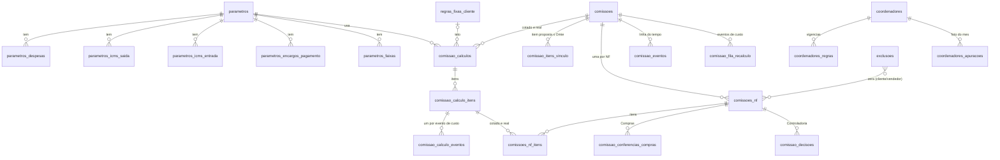

# Modelo novo: schema `core_comissao`

**Em uma frase:** o módulo novo de comissão (`core_comissao`) usa o mesmo motor de hoje, mas guarda cada cálculo, deixa a Controladoria decidir a comissão por nota fiscal e mostra ao vendedor só o que ele pode ver.

**Quando consultar esta nota:** quando precisar entender o desenho do banco da comissão nova, quem escreve em cada tabela e o que muda em relação ao módulo atual. Vendedor e Controladoria leem só o resumo. O time de TI segue para o detalhe técnico.

Tudo aqui é 🟡 proposta, salvo onde há decisão (📝) ou código (✅). O módulo novo fica em **Operações**, em schema novo, e **não toca em `core_comissionamento`** (N16-11). Os contratos do DDL, das rotas e das telas foram removidos em 29/10/2026. O Robert cria os novos. Motor atual: [[01-Motor-Atual-Como-Calcula]]. Tabelas atuais: [[02-Tabelas-Atuais-core_comissionamento]]. Estados: [[04-Regras-e-Estados-da-Comissao-Nova]]. Selos: [[Regras-do-Vault]].

## O que o módulo faz, etapa por etapa

1. **Proposta salva (V0.3):** o motor calcula a comissão **estimada**, por item e no total, com o custo que o vendedor pôs. 📝 N16-10
2. **Proposta aprovada:** a estimativa **congela**. 📝 N16-03, N16-17
3. **Custo real chega** (requisição, ordem de compra ou lote): o motor **recalcula sozinho**. O preço do cliente não muda. 📝 N16-09, N16-10
4. **Nota fiscal (NF) faturada:** a comissão **fecha por NF** e chega à Controladoria já calculada. 📝 N16-10
5. **Decisão:** Controladoria, Gerência ou Coordenação aprovam, desaprovam, bloqueiam, desbloqueiam, cortam ou alteram, sem teto e sempre com justificativa. Ninguém decide a própria comissão. 📝 N16-10, N16-44, N16-45
6. **Vendedor:** vê a comissão que ele colocou até a decisão. Depois vê a real, com a justificativa. 📝 N16-10, N16-46
7. **Compra acima do valor da proposta:** o vendedor aprova ou reprova a compra de cada produto (`C8`). Se aprova, a comissão real cai. 📝 N16-60 a N16-67, que superam N16-18
8. **Proposta cancelada:** a estimativa vira histórico. 📝 N16-02
9. **NF cancelada, devolvida ou recusada (`K6`):** a comissão é abatida na mesma proporção. Na devolução parcial, o Fiscal ou a Controladoria informam item, quantidade e valor, com pendência até lá. 📝 N16-47, N16-74
10. **Pedido cancelado:** o comprado vai ao Estoque e deixa de ser custo do pedido. No faturado em parte, o faturado fica. 📝 N16-68 a N16-71

## Exemplo

No pedido de 5 itens usado como teste, a comissão **cotada** é R$ 513,10. Calculada com o custo real, ela cai para R$ 307,50. Esse número foi conferido contra `lib/simulador/motor.ts` e validado em banco descartável.

Se um item sai em várias NFs, o banco guarda a quantidade já comissionada e nunca paga duas vezes a mesma peça (N16-49). Exemplo da Michele: venda de R$ 1.000 a 2%, com seis notas. Cada nota paga 2% sobre o seu valor.

## Princípios, em poucas palavras

- **Nada é sobrescrito.** Cada cálculo é uma linha nova e imutável. Proposta cancelada vira histórico sem esforço.
- **O que o vendedor vê é decidido no banco e na API**, não na tela.
- **Regra em tabela com tipo, não em JSON.** JSON só para log.
- **Vigência em todo parâmetro.** Mudar valor é fechar a vigência e abrir outra.
- **Justificativa obrigatória** em decisão, exclusão e cancelamento.
- **Custo real só reduz o percentual.** Vale o menor entre cotado e real, como hoje (N16-11).
- **Preço da proposta não muda** com o custo real. Só mudam margem e comissão (N16-17).
- **Depois da decisão nada recalcula.** A NF decidida é uma foto.
- **Cada evento de custo tem as suas condições** (fornecedor, pagamento, impostos, frete). O item soma os eventos. O encargo da condição de pagamento não entra no custo, só no preço sugerido (N16-22). 📝 N16-20
- **Mesmas entradas do simulador** (N16-19): toda caixa e toda coluna da tela existe como coluna no modelo.

## As camadas do schema

| Camada | O que guarda | Quem escreve |
|---|---|---|
| Parâmetros | Percentuais, regra fixa por cliente, exclusões, coordenadores | Tela de parâmetros (Controladoria) |
| Dossiê | Uma comissão por proposta | API, ao salvar a proposta |
| Cálculo | Cada execução do motor, com itens e eventos de custo | Motor |
| NF | Uma comissão por nota faturada | Job de faturamento |
| Decisão | Conferência de Compras (🟡 OQ-28) e decisão da Controladoria | Compras e Controladoria |
| Rastro | Linha do tempo, fila de recálculo, auditoria | Funções e gatilhos |

## O que muda e o que não muda

O motor (margem, letra, prejuízo, fabricação interna, teto da regra fixa e menor percentual) **não muda**. Muda só isto:

1. O custo de compra do item vem dos eventos de custo, não de digitação. Sem imposto real, o evento herda o da proposta e o cálculo é marcado "custo parcial por imposto" (OQ-11).
2. As chaves passam a ser códigos em vez de texto.
3. O teto da regra fixa passa a ser aplicado dentro do motor, e não só na view.
4. O arredondamento do valor em reais é feito no banco.
5. O passo "Compras aprova o percentual" vira uma conferência por NF, **desligada** por padrão (N16-51, OQ-28).

**Custo parcial (OQ-25, respondida em N16-48):** enquanto o custo não cobre a quantidade, só as peças com custo real entram na comissão. Quando o custo completa, a diferença vai para a apuração seguinte, para nova decisão.

## Onde o cálculo roda

Hoje o motor roda no navegador. Há três opções: tudo no banco, motor na API, ou híbrido. A sugestão 🟡 é o **híbrido**: o mesmo código do motor roda na API, e tudo que fecha dinheiro roda no banco, com restrições contra valor errado. A decisão é do Nathan e do Gustavo.

## O que migra e o que não migra

- **Migra:** os parâmetros (3 linhas), as regras fixas vivas (4), as exclusões (9: 1 cliente e 8 vendedores) e os coordenadores (6 pessoas e 6 regras). 🟡
- **Não migra:** simulações e itens antigos (14 e 21), o bloqueio por NF (2 linhas, ambas desbloqueadas), o histórico dos coordenadores e as 4 views antigas. Ficam no módulo atual, intocados.
- O pedido que chega do Omie **sem proposta** entra no módulo novo (N16-103). O vendedor preenche a simulação como hoje.

## Principais riscos

1. O custo real do Ciclo 1 vem sem impostos. A Controladoria vê "imposto estimado" até existir imposto por item (OQ-11).
2. Muitos eventos por item geram muitas linhas, e o cálculo é imutável. O job agrupa eventos pendentes.
3. O motor em JavaScript usa ponto flutuante e o banco usa `numeric`. Aceita-se até R$ 0,01 por NF, com explicação.
4. A remuneração dos coordenadores é dado pessoal. A tela de parâmetros terá perfil restrito.

## Perguntas em aberto

A Michele respondeu em 19/10/2026 (N16-42 a N16-51). Respondidas: C01, C02, C03, C05, C06, C07, C09, C10 e C12. Seguem abertas: C04 (de onde sai a entrada do motor), C08 (data de vigência da carga), C11 (DIFAL da compra no custo), C13 e C14. A tabela completa está no detalhe técnico.

## Detalhe técnico

Desenho do módulo de comissão da proposta. **Motor igual ao atual, tabelas refeitas** (N16-11). O módulo novo fica em **Operações**, em **schema novo**, e **não toca em `core_comissionamento`**. Os contratos do DDL, das rotas e das telas foram removidos em 29/10/2026; o Robert cria os novos. O motor atual está explicado em [[01-Motor-Atual-Como-Calcula]], as tabelas atuais em [[02-Tabelas-Atuais-core_comissionamento]] e os estados em [[04-Regras-e-Estados-da-Comissao-Nova]]. Selos: [[Regras-do-Vault]]. Tudo aqui é 🟡 proposta, salvo onde há decisão (📝) ou código (✅).

### O que o módulo faz, em uma frase por etapa

1. **Proposta salva (V0.3)**: o motor calcula a comissão **estimada** por item e no total, com o custo que o vendedor pôs. 📝 N16-10
2. **Proposta aprovada**: a estimativa **congela** (a proposta não muda mais). 📝 N16-03, N16-17
3. **Custo real chega** (evento por requisição, OC ou lote): o motor **recalcula sozinho**, sem tocar no preço do cliente. 📝 N16-09, N16-10
4. **NF faturada**: a comissão **fecha por NF** e chega à Controladoria **já calculada**. 📝 N16-10
5. **Controladoria, Gerência ou Coordenação decidem** (aprovar, desaprovar, bloquear e desbloquear, cortar ou alterar, por valor ou percentual, sem teto), **sempre com justificativa**; ninguém decide sobre a própria comissão. 📝 N16-10, N16-44, N16-45
6. **Vendedor**: vê a comissão que **ele colocou** até a decisão; depois vê a comissão **real com a justificativa**. Se Compras compra por mais que o valor da proposta, ele **aprova ou reprova** a compra por produto (`C8`, N16-60 a N16-67, que superam N16-18); a comissão real cai se aprova. 📝 N16-10, N16-46
7. **Proposta cancelada**: a estimativa vira **histórico** que o vendedor consulta. 📝 N16-02
8. **Nota cancelada, devolvida ou recusada** (`K6`): abate a comissão na mesma proporção (se paga, entra na próxima apuração). Devolução total vem do Omie; a **parcial** o Fiscal ou a Controladoria informam (item, quantidade, valor), com **pendência** até lá. 📝 N16-47, N16-74
9. **Pedido cancelado** (N16-68 a N16-71): o comprado vai ao Estoque e deixa de ser custo do pedido; a comissão estimada vira histórico; no faturado em parte, o faturado fica e o saldo segue as regras. 📝

### Princípios

1. **Nada é sobrescrito.** Cada cálculo é uma linha nova e imutável (`comissao_calculos`); recálculo por custo real não apaga o cotado. Cancelada vira histórico sem esforço.
2. **O que o vendedor vê é decidido no banco e na API**, por view e por tela, não na interface.
3. **Regra de negócio em tabela tipada, não em JSON.** JSON só para log (`avisos`, `dados` de evento, `auditoria`).
4. **Vigência em tudo que é parâmetro** (parâmetros, regra fixa, exclusões, coordenadores), com `EXCLUDE` contra sobreposição. Mudar valor = fechar e abrir.
5. **Justificativa obrigatória** onde há decisão humana (decisão da Controladoria, exclusão, cancelamento).
6. **Chave estável**: `codigo_nf_omie` (PK da NF), ids de proposta e de item, códigos controlados. Nunca número com zeros à esquerda nem nome.
7. **O motor é puro**: mesma entrada, mesma saída, com `versao_motor` gravada.
8. **Custo real só reduz o percentual, nunca o aumenta** (menor entre cotado e real), como hoje. 📝 N16-11
9. **Preço da proposta não muda** com o custo real; só margem e comissão. 📝 N16-17
10. **Depois da decisão nada recalcula**: a NF decidida é uma foto.
11. **Cada evento de custo carrega as suas condições** (fornecedor, condição de pagamento, encargo, frete, origem do ICMS, IPI, ST, DIFAL). O custo líquido de cada evento sai da mesma fórmula do motor e o item soma os eventos. O encargo da condição de pagamento **não** entra no custo: entra no preço sugerido, como no motor atual (N16-22). Só a venda tem um conjunto de condições por pedido. 📝 N16-20
12. **Mesmas entradas do simulador** (N16-19): toda entrada e toda saída da tela do simulador é coluna do modelo (tabela "Entradas do motor e a tela" abaixo). 📝 N16-19

### Convenções de nome

| Tema | Convenção | Exemplo |
|---|---|---|
| Schema | `core_comissao` | |
| Tabela | plural, `snake_case`, sem acento (padrão do Hub) | `comissoes`, `comissoes_nf` |
| Tabela filha | prefixo da mãe | `parametros_faixas`, `comissao_calculo_itens` |
| View | `vw_comissao_<assunto>` | `vw_comissao_nf_fila` |
| Função | `fn_<verbo>_<assunto>` | `fn_comissao_decidir` |
| PK | `id uuid DEFAULT uuidv7()` | |
| FK | `id_<singular>` | `id_comissao`, `id_parametros` |
| Unidade | `codigo_empresa uuid` (convenção do Hub, FK `core.unidades`) | |
| Percentual | pontos percentuais (2 = 2%), sufixo `_pct`, `numeric(7,4)` | `comissao_pct` |
| Dinheiro | `numeric(15,2)`; unitário `numeric(15,4)`; quantidade `numeric(15,4)` | |
| Estado e tipo | `varchar` + `CHECK ... IN (...)`, valores em `MAIÚSCULAS_COM_UNDERSCORE` (padrão do Hub, sem `ENUM` do Postgres) | `AGUARDANDO_DECISAO` |
| Vigência | `vigencia_inicio date`, `vigencia_fim date` (nulo = aberta), `EXCLUDE` gist | |
| Auditoria | `created_at/by`, `updated_at/by` (`set_updated_at`); `deleted_at/by` onde há exclusão lógica | |
| Log | tabela só de `INSERT`, com trigger `fn_log_imutavel` | `comissao_decisoes` |
| Unidade de medida | sufixo explica (`_pct`, `_valor`, `_total`, `_unitario_medio`) | `custo_real_unitario_medio` |

Mudança de nome em relação ao módulo atual: `margem` → `gatilho_markup_pct`; `pct_*` → `*_pct`; `blacklist_*` → `exclusoes`; `bloqueio_comissoes` → decisão `BLOQUEAR`; `simulacoes` → `comissao_calculos` (`COTADO`/`REAL`).

### Visão geral

Fora do schema, ligadas por chave: `core_comercial.propostas` e `proposta_item`, `core_comercial.pedidos` e `pedidos_itens`, `core_comercial.custos_eventos` e a view `core_comercial.vw_pedido_item_custo` (nomes **no singular**, conferidos em 16/10), `core_vendas_faturamento.notas_fiscais` e `produto_vendas` (NF e itens faturados), `core.unidades`, `core.funcionarios`, `auth.usuarios`. As chaves de `core_comercial` entram no bloco 9 do DDL, depois do SQL de proposta e pedido.

### Em camadas

| Camada | Tabelas | Quem escreve |
|---|---|---|
| **Parâmetros** (poucos, mudam raro, vigência) | `parametros` + 5 filhas, `regras_fixas_cliente`, `exclusoes`, `coordenadores`, `coordenadores_regras` | Tela de parâmetros (Controladoria) |
| **Dossiê** (uma por proposta) | `comissoes`, `comissao_itens_vinculo` | API ao salvar a proposta; vínculo quando o Omie devolve os itens do pedido |
| **Cálculo** (imutável) | `comissao_calculos`, `comissao_calculo_itens`, `comissao_calculo_eventos` | Motor, por `fn_calculo_gravar` |
| **NF** (uma por nota faturada) | `comissoes_nf`, `comissoes_nf_itens` | Job de faturamento, por `fn_comissao_nf_fechar` |
| **Conferência e decisão** (imutáveis) | `comissao_conferencias_compras` (🟡 OQ-28), `comissao_decisoes` | Compras, por `fn_comissao_conferir_compras`; Controladoria, por `fn_comissao_decidir` |
| **Rastro** | `comissao_eventos`, `comissao_fila_recalculo`, `auditoria`, `coordenadores_apuracoes` | Funções e triggers |

### Entradas do motor e a tela do simulador (N16-19)

A tela da proposta e a tela da Controladoria usam o **mesmo motor e as mesmas regras** do simulador atual, em **tabelas novas e isoladas** (N16-21: nada do `core_comissionamento` é tocado) (`tela-simulador-comissao.png`, `av-hub\app\(protected)\comissoes\simulador\page.tsx`). Toda caixa e toda coluna da tela existe como coluna. A coluna **"FAB."** da imagem é uma caixa de seleção (`simulador/page.tsx:2009-2014`): marca o item de **fabricação interna** (`tipo_item = FABRICACAO_INTERNA`), não é o nome do fabricante.

| Na tela | Entrada ou saída | Onde mora no módulo novo | Origem no simulador atual |
|---|---|---|---|
| Parâmetros: Maio/23 | parâmetros do mês | `parametros.descricao`, `vigencia_inicio` (sempre dia 1, `ck_parametros_mes`), `comissao_calculos.id_parametros` | `simulador_parametros` (`dump:909-952`), `simulador/page.tsx:1648` |
| Unidade | entrada | `comissoes.codigo_empresa` | `simulacoes.codigo_empresa` |
| Número do pedido, Cliente, Vendedor, Itens | contexto | `comissoes.numero_pedido`, `codigo_cliente`, `codigo_vendedor_omie`; `comissao_calculos.qtd_itens` | `simulacoes.numero_pedido` etc. |
| Estado de destino, ICMS 18% | entrada e snapshot | `comissao_calculos.estado_destino` (código de `parametros_icms_saida.destino`), `icms_destino_pct` | `simulacoes.estado_destino` (texto) |
| Condição de pagamento, encargo 1,5% | entrada e snapshot | `comissao_calculos.condicao_pagamento`, `encargo_pagamento_pct` | `simulacoes.condicao_pagamento` |
| Com impostos | entrada | `comissao_calculos.isento_imposto` | `simulacoes.isento_imposto` |
| Frete na compra (rateio ou valor) e total | entrada e derivado | `comissao_calculos.frete_compra_tipo`, `frete_compra_total`; por item `comissao_calculo_itens.frete_compra_valor` | `simulacoes.frete_compra_tipo/valor` |
| Valor ST (venda) | entrada | `comissao_calculos.valor_st_venda` | `simulacoes.valor_st_venda` |
| Imposto retido / DIFAL | entrada | `comissao_calculos.imposto_retido_difal` | `simulacoes.imposto_retido_difal` |
| Frete na venda | entrada | `comissao_calculos.frete_venda` | `simulacoes.frete_venda` |
| Item: descrição e código | entrada | `comissao_calculo_itens.descricao`, `codigo_produto` | `simulacao_itens.descricao`, `codigo_produto` |
| Item: FAB. | entrada | `tipo_item` | `simulacao_itens.tipo_item` |
| Compra: QTD e UM | entrada | `qtd_compra`, `unidade_compra` | `qtd_compra`, `unidade_compra` |
| Compra: PREÇO | entrada | `preco_unit_compra_cotado` | `preco_unit_compra` |
| Compra: ORIGEM | entrada | `origem_compra` (código) | `origem_compra` (texto) |
| Compra: % IPI, ST, FRETE | entrada | `ipi_pct`, `valor_st`, `frete_compra_valor` | `pct_ipi`, `valor_st`, `frete_compra_valor` |
| Compra: FORNECEDOR | entrada | `fornecedor` | `fornecedor` |
| Venda: QTD e PREÇO | entrada | `qtd`, `unidade`, `preco_unit_venda` | `qtd`, `preco_unit_venda` |
| Resultado: CUSTO LÍQ. | saída | `custo_liquido` (cotado) e, no real, soma dos eventos (`comissao_calculo_eventos.custo_liquido`) | `custo_liquido` |
| Resultado: SUGERIDO | saída | `preco_unit_sugerido`, `preco_total_sugerido` | `preco_unit_sugerido` |
| Resultado: MARGEM e LETRA | saída | `margem_item_pct`, `letra_item` | `margem_item`, `letra_item` |
| Chip Comissão | saída | `comissao_pct`, `valor_comissao_estimado` | `pct_comissao` |
| Rodapé: CUSTO | total | `comissao_calculos.custo_total` | `custo_total` |
| Rodapé: VENDA | total | `valor_liquido` | `valor_liquido` |
| Rodapé: TOTAL DA NF | total | `total_nf` | `total_nf` |
| Rodapé: SUGERIDO | total | `venda_sugerida` | `venda_sugerida` |
| Rodapé: MARK-UP REAL | total | `markup_real` (revenda sobre custo, `motor.ts:535`) | `markup_real` |
| Rodapé: MARK-UP S/ COMPRA | total | `markup_bruto_pct` (o "AC8", `motor.ts:464-465`) | `markup_bruto` |
| Rodapé: MARGEM e letra do pedido | total | `margem_liquida_pct`, `letra_equivalente` | `margem_liquida`, `letra_equivalente` |

Colunas que o modelo da rodada anterior **não tinha** e que foram acrescentadas: `comissao_calculos.icms_destino_pct`, `encargo_pagamento_pct`, `frete_compra_total`, `markup_projetado`, `markup_real`; `comissao_calculo_itens.codigo_produto`, `preco_total_sugerido`. A origem dessas entradas no lado da proposta (`core_comercial`) é o anexo `0003-entradas-do-motor-em-core_vendas_faturamento.sql`; o modelo de 16/10 ainda não tinha a origem da compra, a quantidade e a unidade de compra, o IPI, a ST e o frete da compra por item, o destino do ICMS, a condição com encargo e o DIFAL.

### Valores fixos (`CHECK`)

| Coluna | Valores |
|---|---|
| `comissoes.estado` | `ESTIMADA`, `CONGELADA`, `EM_ACOMPANHAMENTO`, `ENCERRADA`, `CANCELADA` |
| `comissoes_nf.estado` | `AGUARDANDO_DECISAO`, `APROVADA`, `DESAPROVADA`, `BLOQUEADA`, `CORTADA`, `ALTERADA`, `NF_CANCELADA` |
| `comissoes_nf.compras_estado` | `PENDENTE`, `CONFIRMADA`, `CONTESTADA` (🟡 OQ-28) |
| `comissao_conferencias_compras.tipo` | `CONFIRMAR`, `CONTESTAR` |
| `comissao_calculo_eventos.origem` | `OC_MATERIAL`, `LOTE_ESTOQUE`, `MATERIA_PRIMA_FABRICACAO`, `MAO_DE_OBRA_OC_SERVICO` (as mesmas de `core_comercial.custos_eventos`) |
| `comissao_calculo_eventos.frete_tipo`, `comissao_calculos.frete_compra_tipo` | `RATEIO`, `VALOR` |
| `comissao_calculos.tipo` | `COTADO` (custo da proposta), `REAL` (custo real do pedido) |
| `comissao_calculos.gatilho` | `PROPOSTA_SALVA`, `CUSTO_REAL`, `REPROCESSAMENTO` |
| `comissao_decisoes.tipo` | `APROVAR`, `DESAPROVAR`, `BLOQUEAR`, `CORTAR`, `ALTERAR` |
| `comissao_calculo_itens.tipo_item` | `REVENDA`, `FABRICACAO_INTERNA` |
| `comissao_calculo_itens.regra_aplicada` | `PREJUIZO`, `FABRICACAO_INTERNA`, `LETRA`, `TETO_PADRAO`, `TETO_CONDICIONAL` |
| `origem_compra` | `SP`, `SP_REDUZIDA`, `OUTRA_UF`, `IMPORTACAO_SP`, `IMPORTACAO_OUTRA_UF`, `SIMPLES` |
| `exclusoes.tipo` | `CLIENTE`, `VENDEDOR` |
| `coordenadores_regras.tipo` | `GERENCIA`, `EXCECAO` |
| `comissoes_nf.motivo_zerado` | `CLIENTE_EXCLUIDO`, `VENDEDOR_EXCLUIDO` |

### Índices e chaves únicas principais

| Tabela | Chave ou índice | Para quê |
|---|---|---|
| `comissoes` | `UNIQUE (id_proposta)`, `UNIQUE (id_pedido_venda)` | Uma comissão por proposta e por pedido |
| `comissoes` | `(codigo_empresa, codigo_vendedor_omie, estado)` | Tela do vendedor |
| `comissao_calculos` | `UNIQUE (id_comissao, sequencia)`; `(id_comissao, tipo, sequencia DESC)` | Último cálculo de cada tipo |
| `comissao_calculo_itens` | `UNIQUE (id_calculo, ordem)`, `UNIQUE (id_calculo, id_item_proposta)`, `(id_calculo, codigo_item_omie)` | Casar item faturado com item calculado |
| `comissao_calculo_eventos` | `UNIQUE (id_calculo_item, ordem)`; `(id_custo_evento)` | Drill-down por evento; achar o cálculo de um evento de custo |
| `comissao_itens_vinculo` | `UNIQUE (id_comissao, id_item_proposta)`, `UNIQUE (id_comissao, codigo_item_omie)` | Casar o `codigo_item_omie` da NF com o item da proposta |
| `comissao_conferencias_compras` | `UNIQUE (id_comissao_nf, sequencia)` | Histórico da conferência de Compras |
| `comissoes_nf` | `UNIQUE (codigo_empresa, codigo_nf_omie)`; `(codigo_empresa, estado, data_emissao)` | Fila da Controladoria |
| `comissao_decisoes` | `UNIQUE (id_comissao_nf, sequencia)`; `(decidido_por, decidido_em DESC)` | Histórico por NF e por quem decidiu |
| `comissao_fila_recalculo` | único parcial `(id_comissao, motivo) WHERE processado_em IS NULL` | Junta eventos repetidos |
| `parametros`, `regras_fixas_cliente`, `exclusoes`, `coordenadores_regras` | `EXCLUDE gist` por vigência | Sem sobreposição |
| `auditoria` | `(tabela, id_registro, feito_em)` | Quem mudou o quê |

### Tabelas e colunas

Gerado do DDL aplicado em banco descartável (PostgreSQL 18, 16/10/2026, teste funcional); a coluna "Observação" vem dos `COMMENT ON` do DDL.

#### Grupo: Parâmetros e regras

##### `core_comissao.parametros`

Parâmetros do motor por unidade e vigência (era simulador_parametros). Linha usada por um cálculo é IMUTÁVEL (só vigencia_fim muda): para mudar percentual, feche a vigência e abra outra. Detalhes em parametros_*.

| Coluna | Tipo | Nulo | Padrão | Observação |
|---|---|---|---|---|
| `id` | uuid | não | uuidv7() |  |
| `codigo_empresa` | uuid | não |  |  |
| `vigencia_inicio` | date | não |  | Parâmetros são por MÊS (N16-19): a vigência começa no dia 1 (a tela mostra "Parâmetros: Maio/23"; hoje: 2023-05-01, descricao Maio/23). |
| `vigencia_fim` | date | sim |  |  |
| `descricao` | varchar(60) | não |  |  |
| `margem_desejada_pct` | numeric(7,4) | não |  |  |
| `despesas_operacionais_pct` | numeric(10,6) | não |  | Soma das despesas operacionais, pontos percentuais. É o valor que o motor usa; parametros_despesas guarda o detalhe (tolerância de 0,00001: na carga atual o detalhe soma 11,451733 e o agregado é 11,451734). |
| `rateio_logistica_pct` | numeric(10,6) | não |  |  |
| `provisao_comissao_pct` | numeric(7,4) | não |  | Comissão máxima provisionada dentro do mark-up e descontada da margem do item (era pct_comissao_provisao). |
| `pis_pct` | numeric(7,4) | não |  |  |
| `cofins_pct` | numeric(7,4) | não |  |  |
| `irpj_base_pct` | numeric(7,4) | não |  |  |
| `irpj_pct` | numeric(7,4) | não |  |  |
| `csll_base_pct` | numeric(7,4) | não |  |  |
| `csll_pct` | numeric(7,4) | não |  |  |
| `adicional_ir_pct` | numeric(7,4) | não |  |  |
| `fabricacao_interna_pct` | numeric(7,4) | não |  | Percentual fixo pago ao item de fabricação interna. |
| `exige_conferencia_compras` | boolean | não | false | 🟡 OQ-28: true = a Controladoria só aprova, corta ou altera a NF depois de Compras confirmar o percentual (o passo "Comissão: após a aprovação de Compras" do simulador atual). Padrão false (o cálculo REAL pelo custo da OC substitui a versão de Compras). |
| `created_at` | timestamptz | não | now() |  |
| `created_by` | uuid | sim |  |  |
| `updated_at` | timestamptz | não | now() |  |
| `updated_by` | uuid | sim |  |  |

##### `core_comissao.parametros_despesas`

Detalhe das despesas operacionais (SEDES, PESSOAL, PRODUCAO, LOGISTICA, MARKETING, TERCEIROS, FINANCEIRAS, CONTRIBUICOES, ADMINISTRATIVAS). Só auditoria: o motor usa o agregado de parametros.

| Coluna | Tipo | Nulo | Padrão | Observação |
|---|---|---|---|---|
| `id` | uuid | não | uuidv7() |  |
| `id_parametros` | uuid | não |  |  |
| `categoria` | varchar(30) | não |  |  |
| `pct` | numeric(10,6) | não |  |  |
| `created_at` | timestamptz | não | now() |  |
| `created_by` | uuid | sim |  |  |
| `updated_at` | timestamptz | não | now() |  |
| `updated_by` | uuid | sim |  |  |

##### `core_comissao.parametros_icms_saida`

ICMS de saída por destino da venda. destino = UF (SP, MG, PR, RJ, SC, RS), DEMAIS (demais estados) ou IMPORTACAO (alíquota usada no mark-up de importação). Substitui o JSON icms_saida.

| Coluna | Tipo | Nulo | Padrão | Observação |
|---|---|---|---|---|
| `id` | uuid | não | uuidv7() |  |
| `id_parametros` | uuid | não |  |  |
| `destino` | varchar(12) | não |  |  |
| `rotulo` | varchar(60) | não |  |  |
| `aliquota_pct` | numeric(7,4) | não |  |  |
| `created_at` | timestamptz | não | now() |  |
| `created_by` | uuid | sim |  |  |
| `updated_at` | timestamptz | não | now() |  |
| `updated_by` | uuid | sim |  |  |

##### `core_comissao.parametros_icms_entrada`

ICMS recuperável na compra por origem. Códigos iguais aos de OrigemIcmsCompra do Comercial. Substitui o JSON icms_entrada (que casava por texto).

| Coluna | Tipo | Nulo | Padrão | Observação |
|---|---|---|---|---|
| `id` | uuid | não | uuidv7() |  |
| `id_parametros` | uuid | não |  |  |
| `origem_compra` | varchar(25) | não |  |  |
| `aliquota_pct` | numeric(7,4) | não |  |  |
| `created_at` | timestamptz | não | now() |  |
| `created_by` | uuid | sim |  |  |
| `updated_at` | timestamptz | não | now() |  |
| `updated_by` | uuid | sim |  |  |

##### `core_comissao.parametros_encargos_pagamento`

Encargo financeiro somado ao preço sugerido por condição de pagamento. Substitui o JSON encargos_pagamento.

| Coluna | Tipo | Nulo | Padrão | Observação |
|---|---|---|---|---|
| `id` | uuid | não | uuidv7() |  |
| `id_parametros` | uuid | não |  |  |
| `condicao_pagamento` | varchar(40) | não |  |  |
| `encargo_pct` | numeric(7,4) | não |  |  |
| `created_at` | timestamptz | não | now() |  |
| `created_by` | uuid | sim |  |  |
| `updated_at` | timestamptz | não | now() |  |
| `updated_by` | uuid | sim |  |  |

##### `core_comissao.parametros_faixas`

Faixas da letra: margem líquida mínima do item (semiaberto [min, próxima)) e percentual. Hoje A 15/2,0; B 12/1,3; C 9/0,7; D 0/0,5. Substitui o JSON faixas_comissao.

| Coluna | Tipo | Nulo | Padrão | Observação |
|---|---|---|---|---|
| `id` | uuid | não | uuidv7() |  |
| `id_parametros` | uuid | não |  |  |
| `letra` | char(1) | não |  |  |
| `margem_min_pct` | numeric(7,4) | não |  |  |
| `comissao_pct` | numeric(7,4) | não |  |  |
| `created_at` | timestamptz | não | now() |  |
| `created_by` | uuid | sim |  |  |
| `updated_at` | timestamptz | não | now() |  |
| `updated_by` | uuid | sim |  |  |

##### `core_comissao.regras_fixas_cliente`

Teto de comissão por cliente e vigência (era regras_comissoes_fixas). Limita só item de REVENDA com regra LETRA. Gatilho: markup bruto do pedido >= gatilho_markup_pct usa a condicional, senão a padrão.

| Coluna | Tipo | Nulo | Padrão | Observação |
|---|---|---|---|---|
| `id` | uuid | não | uuidv7() |  |
| `codigo_empresa` | uuid | não |  |  |
| `codigo_cliente` | varchar(60) | não |  | Código Omie do parceiro (varchar(60), como notas_fiscais.codigo_cliente). Só é único dentro da unidade. |
| `vigencia_inicio` | date | não |  |  |
| `vigencia_fim` | date | sim |  |  |
| `gatilho_markup_pct` | numeric(8,4) | não |  | Era `margem`. Compara com o MARKUP BRUTO do pedido ((total NF - compra bruta) / compra bruta), não com a margem líquida da letra. |
| `comissao_padrao_pct` | numeric(7,4) | não |  |  |
| `comissao_condicional_pct` | numeric(7,4) | não |  | CHECK condicional >= padrão é proposta 🟡 (o módulo atual não impede o contrário). |
| `motivo` | text | sim |  |  |
| `created_at` | timestamptz | não | now() |  |
| `created_by` | uuid | sim |  |  |
| `updated_at` | timestamptz | não | now() |  |
| `updated_by` | uuid | sim |  |  |
| `deleted_at` | timestamptz | sim |  |  |
| `deleted_by` | uuid | sim |  |  |

##### `core_comissao.exclusoes`

Cliente ou vendedor fora do comissionamento, com vigência e motivo obrigatório (era blacklist_comissoes_destinatario e blacklist_comissoes_vendedores). A comissão excluída NÃO some: fica com valor 0 e motivo_zerado visível à Controladoria.

| Coluna | Tipo | Nulo | Padrão | Observação |
|---|---|---|---|---|
| `id` | uuid | não | uuidv7() |  |
| `codigo_empresa` | uuid | não |  |  |
| `tipo` | varchar(10) | não |  |  |
| `codigo_omie` | varchar(60) | não |  |  |
| `vigencia_inicio` | date | não | CURRENT_DATE |  |
| `vigencia_fim` | date | sim |  |  |
| `motivo` | text | não |  |  |
| `created_at` | timestamptz | não | now() |  |
| `created_by` | uuid | sim |  |  |
| `updated_at` | timestamptz | não | now() |  |
| `updated_by` | uuid | sim |  |  |
| `deleted_at` | timestamptz | sim |  |  |
| `deleted_by` | uuid | sim |  |  |

##### `core_comissao.coordenadores`

📝 Vale no módulo novo (N16-34, OQ-06). Pessoa que recebe ajuda de custo e comissão sobre o faturamento total do mês (não depende de proposta). Os valores ficam em coordenadores_regras, por vigência.

| Coluna | Tipo | Nulo | Padrão | Observação |
|---|---|---|---|---|
| `id` | uuid | não | uuidv7() |  |
| `nome` | varchar(100) | não |  |  |
| `id_funcionario` | uuid | sim |  |  |
| `ativo` | boolean | não | true |  |
| `created_at` | timestamptz | não | now() |  |
| `created_by` | uuid | sim |  |  |
| `updated_at` | timestamptz | não | now() |  |
| `updated_by` | uuid | sim |  |  |

##### `core_comissao.coordenadores_regras`

Ajuda de custo e percentual do coordenador por vigência. GERENCIA = ranking da gerência; EXCECAO = entra no ranking de vendedores com o mesmo cálculo. Mudar valor = fechar a vigência e abrir outra.

| Coluna | Tipo | Nulo | Padrão | Observação |
|---|---|---|---|---|
| `id` | uuid | não | uuidv7() |  |
| `id_coordenador` | uuid | não |  |  |
| `tipo` | varchar(10) | não |  |  |
| `ajuda_custo` | numeric(14,2) | não | 0 |  |
| `percentual_pct` | numeric(7,4) | não | 0 | Pontos percentuais: 0,35 = 0,35% do faturamento total do mês. |
| `ordem_desempate` | smallint | não | 0 | Desempate do ranking quando o total empata (menor primeiro). |
| `vigencia_inicio` | date | não |  |  |
| `vigencia_fim` | date | sim |  |  |
| `observacao` | text | sim |  |  |
| `created_at` | timestamptz | não | now() |  |
| `created_by` | uuid | sim |  |  |
| `updated_at` | timestamptz | não | now() |  |
| `updated_by` | uuid | sim |  |  |

##### `core_comissao.coordenadores_apuracoes`

🟡 Foto mensal da comissão dos coordenadores: comissao = round(percentual/100 x faturamento_base, 2); total = ajuda_custo + comissao. O bloqueio/decisão por NF NÃO reduz (decisão do Nathan de 06/10/2026, contrato 38). Depois de fechada não muda.

| Coluna | Tipo | Nulo | Padrão | Observação |
|---|---|---|---|---|
| `id` | uuid | não | uuidv7() |  |
| `competencia` | date | não |  |  |
| `id_coordenador` | uuid | não |  |  |
| `id_regra` | uuid | não |  |  |
| `tipo` | varchar(10) | não |  |  |
| `faturamento_base` | numeric(15,2) | não |  |  |
| `percentual_pct` | numeric(7,4) | não |  |  |
| `ajuda_custo` | numeric(14,2) | não |  |  |
| `comissao` | numeric(15,2) | não |  |  |
| `total` | numeric(15,2) | não |  |  |
| `ordem_desempate` | smallint | não |  |  |
| `gerada_em` | timestamptz | não | now() |  |
| `gerada_por` | uuid | sim |  |  |
| `fechada_em` | timestamptz | sim |  |  |
| `fechada_por` | uuid | sim |  |  |

#### Grupo: Dossiê e cálculo

##### `core_comissao.comissoes`

Dossiê da comissão de UMA proposta (uma proposta = um pedido, N16-02). Nasce estimada na V0.3 e acompanha a proposta até o encerramento ou o cancelamento. Cancelada vira histórico consultável.

| Coluna | Tipo | Nulo | Padrão | Observação |
|---|---|---|---|---|
| `id` | uuid | não | uuidv7() |  |
| `codigo_empresa` | uuid | não |  |  |
| `id_proposta` | uuid | não |  |  |
| `id_pedido_venda` | uuid | sim |  |  |
| `numero_proposta` | varchar(20) | não |  |  |
| `numero_pedido` | varchar(20) | sim |  |  |
| `codigo_vendedor_omie` | varchar(11) | não |  |  |
| `codigo_cliente` | varchar(60) | não |  |  |
| `estado` | varchar(20) | não | 'ESTIMADA' | ESTIMADA (proposta ajustável) > CONGELADA (proposta aprovada, estimativa travada) > EM_ACOMPANHAMENTO (pedido criado, custo real chegando, NFs) > ENCERRADA. CANCELADA = histórico. |
| `id_calculo_cotado` | uuid | sim |  | Cálculo do vendedor que vale (o último antes da aprovação da proposta). |
| `id_calculo_real` | uuid | sim |  | Último cálculo feito com o custo real. |
| `custo_real_acima_cotado` | boolean | não | false | Só para a Controladoria e a Gerência. NUNCA sai nas telas do vendedor (N16-18). |
| `proposta_aprovada_em` | timestamptz | sim |  |  |
| `encerrada_em` | timestamptz | sim |  |  |
| `cancelada_em` | timestamptz | sim |  |  |
| `cancelada_por` | uuid | sim |  |  |
| `motivo_cancelamento` | text | sim |  |  |
| `created_at` | timestamptz | não | now() |  |
| `created_by` | uuid | sim |  |  |
| `updated_at` | timestamptz | não | now() |  |
| `updated_by` | uuid | sim |  |  |

##### `core_comissao.comissao_itens_vinculo`

Liga o item da proposta ao item do pedido e ao codigo_item_omie (chave do item faturado em produto_vendas). Preenchido por fn_comissao_vincular_itens quando o pedido é criado no Omie.

| Coluna | Tipo | Nulo | Padrão | Observação |
|---|---|---|---|---|
| `id` | uuid | não | uuidv7() |  |
| `id_comissao` | uuid | não |  |  |
| `id_item_proposta` | uuid | não |  |  |
| `id_item_pedido` | uuid | não |  |  |
| `codigo_item_omie` | bigint | não |  |  |
| `created_at` | timestamptz | não | now() |  |
| `created_by` | uuid | sim |  |  |

##### `core_comissao.comissao_calculos`

Cada execução do motor sobre uma comissão. COTADO = com o custo que o vendedor pôs na proposta; REAL = com o custo real do pedido. Só INSERT: cada recálculo é uma linha nova, então o histórico (inclusive de proposta cancelada) nunca se perde.

| Coluna | Tipo | Nulo | Padrão | Observação |
|---|---|---|---|---|
| `id` | uuid | não | uuidv7() |  |
| `id_comissao` | uuid | não |  |  |
| `sequencia` | integer | não |  |  |
| `tipo` | varchar(6) | não |  |  |
| `gatilho` | varchar(20) | não |  |  |
| `id_parametros` | uuid | não |  |  |
| `id_regra_fixa` | uuid | sim |  |  |
| `versao_motor` | varchar(20) | não |  | Versão do código do motor que calculou (ex.: motor-1.0.0), para reproduzir e comparar. |
| `estado_destino` | varchar(12) | não |  | Código de parametros_icms_saida.destino (SP, MG, PR, RJ, SC, RS, DEMAIS). A tela mostra rotulo e icms_destino_pct (ex.: São Paulo, ICMS 18%). |
| `icms_destino_pct` | numeric(7,4) | não |  |  |
| `condicao_pagamento` | varchar(40) | não |  |  |
| `encargo_pagamento_pct` | numeric(7,4) | não |  | Encargo da condição de pagamento da VENDA; entra só no preço sugerido (motor.ts:324), não no custo nem na margem. |
| `isento_imposto` | boolean | não | false |  |
| `frete_compra_tipo` | varchar(6) | não | 'RATEIO' |  |
| `frete_compra_total` | numeric(15,2) | não | 0 |  |
| `valor_st_venda` | numeric(15,2) | não | 0 |  |
| `imposto_retido_difal` | numeric(15,2) | não | 0 |  |
| `frete_venda` | numeric(15,2) | não | 0 |  |
| `custo_total` | numeric(15,2) | não |  |  |
| `venda_sugerida` | numeric(15,2) | não |  |  |
| `valor_liquido` | numeric(15,2) | não |  |  |
| `total_nf` | numeric(15,2) | não |  |  |
| `markup_projetado` | numeric(10,4) | sim |  | Preço sugerido total / custo total (motor.ts:532). |
| `markup_real` | numeric(10,4) | sim |  | MARK-UP REAL da tela: arredondarParaCima(venda de revenda / custo total, 2) (motor.ts:535). |
| `markup_bruto_pct` | numeric(10,4) | não |  | O "AC8": (total NF de revenda - compra bruta) / compra bruta. Gatilho da regra fixa. Não é a margem líquida que decide a letra. |
| `margem_liquida_pct` | numeric(10,4) | não |  |  |
| `lucro` | numeric(15,2) | não |  |  |
| `letra_equivalente` | char(1) | sim |  |  |
| `comissao_efetiva_pct` | numeric(7,4) | não |  |  |
| `valor_comissao_total` | numeric(15,2) | não |  |  |
| `qtd_itens` | integer | não |  |  |
| `qtd_itens_prejuizo` | integer | não | 0 |  |
| `custo_completo` | boolean | não | false | REAL: true quando todos os itens de revenda têm a quantidade inteira coberta por custo real. |
| `imposto_completo` | boolean | não | true | REAL: false quando algum evento de custo usou o imposto herdado da proposta por falta de imposto real (OQ-11). Cálculo parcial por imposto. |
| `avisos` | jsonb | não | '[]' |  |
| `calculado_em` | timestamptz | não | now() |  |
| `calculado_por` | uuid | sim |  |  |

##### `core_comissao.comissao_calculo_itens`

Item de um cálculo, com TODAS as entradas e saídas do motor (reprodutível). A comissão é decidida item a item. Só INSERT.

| Coluna | Tipo | Nulo | Padrão | Observação |
|---|---|---|---|---|
| `id` | uuid | não | uuidv7() |  |
| `id_calculo` | uuid | não |  |  |
| `ordem` | integer | não |  |  |
| `id_item_proposta` | uuid | não |  |  |
| `id_item_pedido` | uuid | sim |  |  |
| `codigo_item_omie` | bigint | sim |  |  |
| `codigo_produto` | varchar(60) | sim |  |  |
| `descricao` | text | sim |  |  |
| `tipo_item` | varchar(20) | não | 'REVENDA' |  |
| `qtd` | numeric(15,4) | não |  |  |
| `unidade` | varchar(20) | sim |  |  |
| `qtd_compra` | numeric(15,4) | sim |  |  |
| `unidade_compra` | varchar(20) | sim |  |  |
| `fornecedor` | varchar(120) | sim |  |  |
| `origem_compra` | varchar(25) | sim |  |  |
| `ipi_pct` | numeric(7,4) | não | 0 |  |
| `valor_st` | numeric(15,2) | não | 0 |  |
| `frete_compra_valor` | numeric(15,2) | não | 0 |  |
| `preco_unit_compra_cotado` | numeric(15,4) | não | 0 | Preço unitário de compra que o vendedor pôs na proposta (na unidade de compra). No cálculo REAL o custo líquido do item é a SOMA do custo líquido de cada evento (comissao_calculo_eventos, com as condições do próprio evento, N16-20) mais a parte ainda não coberta, calculada com o preço e as condições cotados. |
| `preco_unit_venda` | numeric(15,4) | não |  |  |
| `quantidade_coberta` | numeric(15,4) | sim |  |  |
| `custo_real_total` | numeric(15,2) | sim |  | custo_total de core_comercial.vw_pedido_item_custo, lido pelo item = empresa + número do pedido + produto do Omie (N16-102; soma das linhas de OC ou lote, sem impostos no Ciclo 1). Nulo no cálculo COTADO. |
| `custo_real_unitario_medio` | numeric(15,6) | sim |  |  |
| `custo_completo` | boolean | não | false |  |
| `qtd_eventos` | integer | não | 0 | REAL: quantidade de eventos de custo (OC, lote) somados no item. |
| `qtd_descoberta` | numeric(15,4) | sim |  |  |
| `custo_liquido_descoberto` | numeric(15,2) | não | 0 | REAL: custo líquido da quantidade ainda não coberta por evento = custo líquido cotado x qtd_descoberta / qtd. Zero quando o item está completo. |
| `imposto_completo` | boolean | não | true |  |
| `custo_real_acima_cotado` | boolean | não | false |  |
| `compra_bruta` | numeric(15,2) | não | 0 |  |
| `icms_entrada_pct` | numeric(7,4) | não | 0 |  |
| `icms_recuperar` | numeric(15,2) | não | 0 |  |
| `valor_ipi` | numeric(15,2) | não | 0 |  |
| `frete_item` | numeric(15,2) | não | 0 |  |
| `custo_liquido` | numeric(15,2) | não | 0 |  |
| `preco_unit_sugerido` | numeric(15,4) | sim |  |  |
| `preco_total_sugerido` | numeric(15,2) | sim |  |  |
| `venda_item` | numeric(15,2) | não |  |  |
| `icms_efetivo_pct` | numeric(7,4) | sim |  |  |
| `impostos_pct` | numeric(7,4) | sim |  |  |
| `lucro_item` | numeric(15,2) | sim |  |  |
| `margem_item_pct` | numeric(10,4) | sim |  |  |
| `letra_item` | char(1) | sim |  |  |
| `comissao_letra_pct` | numeric(7,4) | não |  | Percentual da letra (ou 0 no prejuízo, ou o fixo da fabricação interna) ANTES do teto da regra fixa. |
| `teto_regra_pct` | numeric(7,4) | sim |  |  |
| `comissao_pct` | numeric(7,4) | não |  | Percentual do item neste cálculo, já com o teto da regra fixa. É o "percentual do vendedor" (COTADO) ou "percentual de compras" (REAL) do módulo atual. |
| `regra_aplicada` | varchar(20) | não |  |  |
| `valor_comissao_estimado` | numeric(15,2) | não |  | venda_item x comissao_pct / 100, sobre o valor do pedido. O pagamento real usa o faturado da NF (comissoes_nf_itens). |

##### `core_comissao.comissao_calculo_eventos`

Detalhe por evento do custo líquido de um item REAL (N16-20): condições do próprio evento (condição de pagamento, encargo, origem do ICMS, IPI, ST, DIFAL, frete, fornecedor) e o custo líquido pela fórmula do motor. Só INSERT. A soma de custo_liquido dos eventos mais custo_liquido_descoberto do item é o custo_liquido do item.

| Coluna | Tipo | Nulo | Padrão | Observação |
|---|---|---|---|---|
| `id` | uuid | não | uuidv7() |  |
| `id_calculo_item` | uuid | não |  |  |
| `ordem` | integer | não |  |  |
| `id_custo_evento` | uuid | não |  | core_comercial.custos_eventos.id. FK entra no bloco 9, depois do SQL de proposta e pedido. |
| `codigo_parcial` | varchar(20) | sim |  |  |
| `data_evento` | date | não |  |  |
| `origem` | varchar(26) | não |  |  |
| `numero_documento` | varchar(30) | sim |  |  |
| `fornecedor` | varchar(120) | sim |  |  |
| `quantidade_coberta` | numeric(15,4) | não |  |  |
| `valor_unitario` | numeric(15,6) | não |  |  |
| `valor_total` | numeric(15,2) | não |  |  |
| `moeda` | varchar(3) | não | 'BRL' |  |
| `cotacao_moeda` | numeric(15,6) | sim |  |  |
| `condicao_pagamento` | varchar(40) | sim |  |  |
| `encargo_pagamento_pct` | numeric(7,4) | sim |  | Encargo da condição de pagamento da OC (OQ-12, N16-22). Guardado para auditoria; não entra no custo líquido do evento (o encargo só entra no preço sugerido, como no motor atual). |
| `frete_tipo` | varchar(6) | não | 'RATEIO' | VALOR quando a OC traz o frete do evento; RATEIO usa parametros.rateio_logistica_pct sobre compra + IPI + ST, como motor.ts:307-310. |
| `frete_valor` | numeric(15,2) | não | 0 |  |
| `origem_compra` | varchar(25) | sim |  |  |
| `ipi_pct` | numeric(7,4) | não | 0 |  |
| `valor_st` | numeric(15,2) | não | 0 |  |
| `valor_difal` | numeric(15,2) | não | 0 |  |
| `imposto_real` | boolean | não | false | true quando IPI, ST, ICMS e DIFAL vieram do documento (OQ-11). false = herdados da proposta (cálculo parcial por imposto): hoje a OC do hub não guarda imposto por item (N14-23). |
| `compra_bruta` | numeric(15,2) | não |  |  |
| `icms_entrada_pct` | numeric(7,4) | não | 0 |  |
| `icms_recuperar` | numeric(15,2) | não | 0 |  |
| `valor_ipi` | numeric(15,2) | não | 0 |  |
| `frete_evento` | numeric(15,2) | não | 0 |  |
| `custo_liquido` | numeric(15,2) | não |  | compra_bruta - icms_recuperar + valor_ipi + valor_st + frete_evento (motor.ts:312). icms_recuperar = 0 quando valor_st > 0 (motor.ts:280-283). |

#### Grupo: NF, conferência de Compras e decisão

##### `core_comissao.comissoes_nf`

Comissão fechada sobre UMA NF faturada. É o que chega à Controladoria já calculada. Enquanto AGUARDANDO_DECISAO o custo real que chegar recalcula; depois da decisão não muda mais.

| Coluna | Tipo | Nulo | Padrão | Observação |
|---|---|---|---|---|
| `id` | uuid | não | uuidv7() |  |
| `id_comissao` | uuid | não |  |  |
| `codigo_empresa` | uuid | não |  |  |
| `codigo_nf_omie` | bigint | não |  | Chave estável da NF (PK de notas_fiscais é codigo_empresa + codigo_nf_omie). Corrige o bloqueio atual, que usa o número com zeros à esquerda. |
| `numero_nf` | varchar(10) | não |  |  |
| `data_emissao` | date | não |  |  |
| `id_calculo_cotado` | uuid | não |  |  |
| `id_calculo_real` | uuid | sim |  |  |
| `valor_faturado` | numeric(15,2) | não |  |  |
| `valor_se_cotado` | numeric(15,2) | não |  | O que a NF pagaria só com o percentual do vendedor (custo cotado). |
| `valor_calculado` | numeric(15,2) | não |  | Soma dos itens: round(valor faturado x LEAST(percentual cotado, percentual real) / 100, 2). Zero quando motivo_zerado. |
| `queda_por_custo` | numeric(15,2) | sim | (valor_se_cotado - valor_calculado) |  |
| `comissao_efetiva_pct` | numeric(7,4) | sim |  |  |
| `custo_completo` | boolean | não | false |  |
| `qtd_itens` | integer | não | 0 |  |
| `qtd_itens_sem_vinculo` | integer | não | 0 |  |
| `motivo_zerado` | varchar(20) | sim |  |  |
| `estado` | varchar(20) | não | 'AGUARDANDO_DECISAO' | AGUARDANDO_DECISAO > APROVADA / DESAPROVADA / CORTADA / ALTERADA (finais) ou BLOQUEADA (pode ser liberada por nova decisão). NF_CANCELADA: NF cancelada antes da decisão. |
| `valor_final` | numeric(15,2) | sim |  | Valor decidido pela Controladoria. Nulo até a decisão. BLOQUEADA = 0 (retido; valor_calculado mostra quanto está retido). |
| `id_decisao_atual` | uuid | sim |  |  |
| `compras_estado` | varchar(10) | não | 'PENDENTE' | 🟡 Conferência de Compras sobre o percentual de Compras (o passo Comissão: após a aprovação de Compras do simulador atual). PENDENTE > CONFIRMADA ou CONTESTADA. Qualquer recálculo da NF volta a PENDENTE. Interno: o vendedor nunca vê (N16-18). |
| `compras_por` | uuid | sim |  |  |
| `compras_em` | timestamptz | sim |  |  |
| `decidida_em` | timestamptz | sim |  |  |
| `recalculada_em` | timestamptz | sim |  |  |
| `created_at` | timestamptz | não | now() |  |
| `created_by` | uuid | sim |  |  |
| `updated_at` | timestamptz | não | now() |  |
| `updated_by` | uuid | sim |  |  |

##### `core_comissao.comissoes_nf_itens`

Quebra da comissão da NF por item faturado: valor faturado x menor percentual entre o cotado e o real. Regenerada enquanto a NF aguarda decisão.

| Coluna | Tipo | Nulo | Padrão | Observação |
|---|---|---|---|---|
| `id` | uuid | não | uuidv7() |  |
| `id_comissao_nf` | uuid | não |  |  |
| `id_item_cotado` | uuid | não |  |  |
| `id_item_real` | uuid | sim |  |  |
| `id_item_pedido` | uuid | sim |  |  |
| `codigo_item_omie` | bigint | não |  |  |
| `quantidade_faturada` | numeric(15,4) | sim |  |  |
| `valor_faturado_item` | numeric(15,2) | não |  |  |
| `comissao_cotada_pct` | numeric(7,4) | não |  |  |
| `comissao_real_pct` | numeric(7,4) | sim |  |  |
| `comissao_final_pct` | numeric(7,4) | não |  | LEAST(comissao_cotada_pct, comissao_real_pct); sem cálculo real, vale o cotado. Mesma regra de pct_final do módulo atual. |
| `regra_aplicada` | varchar(20) | não |  |  |
| `valor_se_cotado` | numeric(15,2) | não |  |  |
| `valor_calculado` | numeric(15,2) | não |  |  |

##### `core_comissao.comissao_conferencias_compras`

🟡 Conferência de Compras sobre o cálculo REAL da NF. CONFIRMAR = Compras concorda com o percentual de Compras; CONTESTAR (justificativa obrigatória) = custo, imposto ou classificação do item errado: Compras corrige na OC ou no lote e o motor recalcula. Compras NÃO altera a proposta (N16-08). Só INSERT.

| Coluna | Tipo | Nulo | Padrão | Observação |
|---|---|---|---|---|
| `id` | uuid | não | uuidv7() |  |
| `id_comissao_nf` | uuid | não |  |  |
| `sequencia` | integer | não |  |  |
| `tipo` | varchar(10) | não |  |  |
| `id_calculo_real` | uuid | sim |  |  |
| `justificativa` | text | sim |  |  |
| `feito_por` | uuid | não |  |  |
| `feito_em` | timestamptz | não | now() |  |

##### `core_comissao.comissao_decisoes`

Decisão da Controladoria sobre a comissão de uma NF: quem, quando, justificativa obrigatória (10+ caracteres), valor antes e depois. Só INSERT. A comissão da NF recebe uma decisão final; BLOQUEAR admite decisão posterior.

| Coluna | Tipo | Nulo | Padrão | Observação |
|---|---|---|---|---|
| `id` | uuid | não | uuidv7() |  |
| `id_comissao_nf` | uuid | não |  |  |
| `sequencia` | integer | não |  |  |
| `tipo` | varchar(10) | não |  |  |
| `justificativa` | text | não |  |  |
| `justificativa_visivel_vendedor` | boolean | não | false | 🟡 M11: a Controladoria escolhe se o vendedor lê a justificativa. Padrão: não. |
| `corte_pct` | numeric(7,4) | sim |  | Só em CORTAR: percentual cortado (50 = pela metade). |
| `valor_antes` | numeric(15,2) | não |  |  |
| `valor_depois` | numeric(15,2) | não |  |  |
| `estado_antes` | varchar(20) | não |  |  |
| `estado_depois` | varchar(20) | não |  |  |
| `decidido_por` | uuid | não |  |  |
| `decidido_em` | timestamptz | não | now() |  |

#### Grupo: Rastro

##### `core_comissao.comissao_eventos`

Linha do tempo de cada comissão (para a tela de detalhe). Só INSERT. visivel_vendedor marca o que a tela do vendedor pode listar (nunca valor real nem custo antes da decisão).

| Coluna | Tipo | Nulo | Padrão | Observação |
|---|---|---|---|---|
| `id` | uuid | não | uuidv7() |  |
| `id_comissao` | uuid | não |  |  |
| `id_comissao_nf` | uuid | sim |  |  |
| `tipo` | varchar(30) | não |  |  |
| `descricao` | text | não |  |  |
| `dados` | jsonb | não | '{}' |  |
| `visivel_vendedor` | boolean | não | false |  |
| `feito_por` | uuid | sim |  |  |
| `feito_em` | timestamptz | não | now() |  |

##### `core_comissao.comissao_fila_recalculo`

Caixa de saída de eventos: um custo real novo (ou NF nova) marca a comissão e o job do motor recalcula. Eventos repetidos enquanto pendentes viram um só.

| Coluna | Tipo | Nulo | Padrão | Observação |
|---|---|---|---|---|
| `id` | uuid | não | uuidv7() |  |
| `id_comissao` | uuid | não |  |  |
| `motivo` | varchar(12) | não |  |  |
| `criado_em` | timestamptz | não | now() |  |
| `processado_em` | timestamptz | sim |  |  |
| `id_calculo_gerado` | uuid | sim |  |  |
| `tentativas` | integer | não | 0 |  |
| `erro` | text | sim |  |  |

##### `core_comissao.auditoria`

Quem mudou parâmetro, regra, exclusão ou coordenador, quando, antes e depois. Só INSERT. Alimentada por core_comissao.fn_auditar().

| Coluna | Tipo | Nulo | Padrão | Observação |
|---|---|---|---|---|
| `id` | bigint | não |  |  |
| `tabela` | varchar(40) | não |  |  |
| `id_registro` | uuid | não |  |  |
| `operacao` | varchar(6) | não |  |  |
| `dados_antes` | jsonb | sim |  |  |
| `dados_depois` | jsonb | sim |  |  |
| `feito_por` | uuid | sim |  |  |
| `feito_em` | timestamptz | não | now() |  |
| `usuario_banco` | text | não | CURRENT_USER |  |

### Como as tabelas respondem ao que o Nathan pediu

| Requisito (decisão) | Onde está |
|---|---|
| Comissão estimada da proposta, por item e total (N16-10) | `comissao_calculos` (`tipo = COTADO`, total em `valor_comissao_total`) e `comissao_calculo_itens` (`valor_comissao_estimado`) |
| Histórico quando a proposta é cancelada (N16-02) | `comissoes.estado = CANCELADA` + `cancelada_em/por`, `motivo_cancelamento`; cálculos e eventos **permanecem** (imutáveis); vendedor lê por `vw_comissao_vendedor` |
| Recálculo automático por evento de custo real (N16-09, N16-10, N16-20) | `comissao_fila_recalculo` (alimentada por trigger em `core_comercial.custos_eventos`, bloco 9) + job do motor lendo `core_comercial.vw_pedido_item_custo` e `custos_eventos`; resultado em `comissao_calculos` (`tipo = REAL`, `gatilho = CUSTO_REAL`) com um `comissao_calculo_eventos` por evento |
| Condições próprias de cada evento (N16-20) | `comissao_calculo_eventos` (condição de pagamento, encargo, frete, origem do ICMS, IPI, ST, DIFAL, fornecedor); `vw_comissao_eventos_custo` |
| Passo "Comissão: após a aprovação de Compras" (N16-19, OQ-28) | `comissoes_nf.compras_estado`, `comissao_conferencias_compras`, `parametros.exige_conferencia_compras` (padrão `false`) |
| Fechamento por NF (N16-10) | `comissoes_nf` + `comissoes_nf_itens`, por `fn_comissao_nf_fechar` |
| Fila da Controladoria (N16-10) | `vw_comissao_nf_fila` (filtro `estado = AGUARDANDO_DECISAO`) |
| Decisão com justificativa, quem, quando, antes e depois (N16-10) | `comissao_decisoes` (justificativa `CHECK >= 10`, `valor_antes`, `valor_depois`, `decidido_por`, `decidido_em`) |
| Vendedor vê a estimada até a decisão e a real depois (N16-10) | `vw_comissao_vendedor`, `vw_comissao_nf_vendedor` |
| Visão geral da Controladoria (N16-10) | `vw_comissao_visao_geral`, `vw_comissao_resumo_mensal` |
| Parâmetros, regras fixas, bloqueios, blacklists, coordenadores (N16-11) | `parametros*`, `regras_fixas_cliente`, `exclusoes`, `coordenadores*` |
| Auditoria | `auditoria` (configuração), `comissao_eventos` (linha do tempo), `comissao_decisoes` (decisão) |

### Views

| View | Quem usa | O que devolve |
|---|---|---|
| `vw_comissao_vendedor` | Vendedor (escopo do token) | Por proposta: **estimada** (do cálculo cotado) sempre; `valor_decidido` só das NFs já decididas. **Não traz** custo real, margem, queda nem comparação |
| `vw_comissao_nf_vendedor` | Vendedor | Por NF: `EM_ANALISE` **sem valor** até a decisão; depois `valor_final` e tipo da decisão; justificativa só se a Controladoria marcou |
| `vw_comissao_nf_fila` | Controladoria, Compras (leitura) | Por NF: faturado, valor se cotado, valor calculado, **queda por custo**, margem e letra cotadas e reais, custo completo, imposto real completo, conferência de Compras, estado |
| `vw_comissao_eventos_custo` | Controladoria, Gerência, Compras (leitura) | Um evento de custo por linha, com as condições do próprio evento (N16-20) |
| `vw_comissao_itens_custo` | Controladoria e Gerência | Por item: custo cotado × custo real, cobertura, margem, letra, % cotado, % real e % final |
| `vw_comissao_visao_geral` | Controladoria e Gerência | Toda comissão em qualquer estado, com estimado, com custo real, calculado, final e bloqueado |
| `vw_comissao_resumo_mensal` | Controladoria | Por mês e vendedor (`GROUPING SETS`; filtrar `is_total`); `valor_bloqueado` real (no módulo atual é sempre zero) |

A API escolhe a view pelo perfil. O vendedor **nunca** recebe permissão nas views da Controladoria.

### Funções do banco

| Função | Papel |
|---|---|
| `fn_parametros_json(codigo_empresa, data)` | Parâmetros vigentes na forma que o motor consome |
| `fn_regra_fixa_vigente(codigo_empresa, codigo_cliente, data)` | Id da regra fixa do cliente na data |
| `fn_excluido(codigo_empresa, tipo, codigo, data)` | Cliente ou vendedor excluído na data |
| `fn_calculo_gravar(payload jsonb)` | Grava cálculo (cabeçalho e itens) numa transação e aponta o dossiê |
| `fn_comissao_mudar_estado(...)` | Única porta de mudança de estado do dossiê (aprovar proposta, criar pedido, encerrar, cancelar) |
| `fn_comissao_nf_fechar(id_comissao, codigo_nf_omie)` | Fecha ou refaz a comissão da NF (menor percentual por item, valor faturado × percentual, exclusão) |
| `fn_comissao_decidir(...)` | Decisão da Controladoria, com todas as travas (e a conferência de Compras quando o parâmetro a exige) |
| `fn_comissao_conferir_compras(id_comissao_nf, tipo, justificativa, usuario)` | 🟡 Compras confirma ou contesta o cálculo real da NF |
| `fn_comissao_vincular_itens(id_comissao, itens, usuario)` | Liga item da proposta, item do pedido e `codigo_item_omie` |
| `fn_comissao_nf_cancelar(id_comissao_nf, usuario)` | NF cancelada antes da decisão sai da fila (`NF_CANCELADA`) |
| `fn_coordenadores_vigentes(ini, fim)`, `fn_coordenadores_apurar(competencia, faturamento, usuario)` | Coordenadores (📝 N16-34) |
| `fn_log_imutavel()`, `fn_auditar()`, `fn_parametros_travar()`, `fn_regra_fixa_travar()`, `fn_apuracao_travar()`, `fn_parametros_completo()` | Triggers |

### O motor é o mesmo: a fórmula preservada

O cálculo de **margem, letra, prejuízo, fabricação interna, teto da regra fixa e menor percentual** é o de `lib/simulador/motor.ts` e `vw_simulacao_resolvida`, sem mudar fórmula. A tabela mostra cada regra e onde ela passa a morar.

| Regra (nota 01) | Módulo atual | Módulo novo |
|---|---|---|
| R1 Custo líquido | `motor.ts:277-312` | Mesma função no motor da API; contas intermediárias gravadas em `comissao_calculo_itens` (`compra_bruta`, `icms_recuperar`, `valor_ipi`, `frete_item`, `custo_liquido`) |
| R2 Margem líquida do item | `motor.ts:336-348` | Idêntica; `margem_item_pct` |
| R3 Letra e % | `motor.ts:176-179, 389-401` | Idêntica; faixas em `parametros_faixas` |
| R4 Prejuízo e fabricação | `motor.ts:363-388` | Idêntica; `parametros.fabricacao_interna_pct` |
| R5 Percentual de Compras | Segunda simulação digitada por Compras | **Cálculo `REAL`**, automático, por evento de custo (N16-20); a conferência de Compras (🟡 OQ-28) vira `compras_estado` |
| R6 `pct_final` = menor | `dump:1186-1190` | `comissoes_nf_itens.comissao_final_pct = LEAST(cotada, real)` (CHECK `final <= cotada`) |
| R7 Teto da regra fixa | View (`dump:1151-1198`) | Aplicado **no motor, por cálculo** (cada versão com o markup bruto dela) e gravado (`teto_regra_pct`, `regra_aplicada`). O resultado é o mesmo da view |
| R8 Valor sobre o faturado | `dump:1128` | `fn_comissao_nf_fechar`: `round(valor_faturado_item × pct / 100, 2)` |
| R9–R10 NF, situação, visibilidade | Views e BFF | `comissoes_nf` + estados; visibilidade em views e API |
| R11–R12 Bloqueio e listas | `bloqueio_comissoes`, `blacklist_*` | Decisão `BLOQUEAR`; `exclusoes` |
| R15 Coordenadores | `fn_dashboard_comissoes` | `coordenadores*` + `fn_coordenadores_apurar` (mesma conta, sem bloqueio por NF) |

**O que muda (e só isso)**

1. **A entrada de custo, por evento (N16-20).** No cálculo `REAL`, o custo de compra do item vem de `core_comercial.custos_eventos` (as linhas de OC, lote, matéria-prima e mão de obra), **não de digitação**. Cada evento é calculado **com as condições dele** pela fórmula de `motor.ts:277-312` (nota 01, seção 3) e o item soma os eventos. A parte do item ainda sem evento usa o preço e as condições cotados. IPI, ST, DIFAL e origem do ICMS **reais** não existem na OC do hub (N14-23): enquanto não vierem (OQ-11), o evento herda os da proposta e o cálculo fica marcado `imposto_completo = false` (🟡, "custo parcial por imposto"). O encargo da condição de pagamento do evento (OQ-12) fica guardado, mas a fórmula atual do custo líquido não o usa: no motor atual o encargo só entra no preço sugerido (`motor.ts:324`).
2. **Chaves por código** em vez de texto (origem da compra, destino da venda).
3. **O teto da regra fixa** passa a ser aplicado dentro do motor (já existe o trecho, `motor.ts:467-484`, não usado hoje) e não só na view. Equivalência a provar nos testes.
4. **Arredondamento** do valor em reais no banco (`round(numeric, 2)`), como a view atual.
5. **Onde roda** (abaixo).

**Provas de que é o mesmo (testes de ouro, critério de aceite)**

- As **14 simulações e 21 itens** do dump (`dump:1613-1653`) viram fixtures: o motor novo reproduz letra, percentual e valor.
- O exemplo da nota [[04-Regras-e-Estados-da-Comissao-Nova]] (pedido de 5 itens: comissão cotada R$ 513,10, calculada com o custo real R$ 307,50; conferido contra `lib/simulador/motor.ts` e validado em banco descartável).
- Casos de borda: isento, importação com e sem SP, base reduzida, ST (destino SP e outro), frete `VALOR`, fabricação, prejuízo, teto padrão e condicional, margem exatamente 0, 9, 12 e 15.
- Aceita-se diferença de até R$ 0,01 por NF, e cada diferença é explicada (ponto flutuante do motor atual contra o arredondamento do banco).

### Onde o cálculo roda

| Opção | Como é | Prós | Contras |
|---|---|---|---|
| **A. Tudo no banco** (função plpgsql) | Port do motor para SQL; trigger no evento de custo | Atômico; sem job; DBA dono de tudo; sem divergência entre API e banco | Reescrever 250 linhas de motor em SQL (`ROUNDUP`, tolerância 1e-9, mapas de parâmetros); teste de ouro mais difícil; regra de negócio escondida no banco; dois motores durante a transição |
| **B. Motor na API** (função pura TypeScript) + gravação no banco | Porta `lib/simulador/motor.ts` para a `api-acos-vital` quase sem mudar; `fn_calculo_gravar` grava; job recalcula | **Mesmo código que hoje** (garante "motor igual"); testável com fixtures; versão gravada; Pablo migra o Comercial para a mesma API (N16-15) | Precisa de job e de evento; duas camadas (API calcula, banco grava e fecha) |
| **C. Híbrido** | Motor na API para margem e letra; **fechamento por NF, menor percentual, arredondamento e decisão no banco** | Divide como hoje (motor no código, `LEAST` no banco); o dinheiro é sempre fechado por função com `CHECK` | Igual à B |

**Sugestão 🟡 (Claude): opção C.** O motor continua sendo o **mesmo código** (porta de `motor.ts`, testes de ouro), rodando na API; tudo que fecha dinheiro (`fn_comissao_nf_fechar`, `fn_comissao_decidir`) roda no banco, com restrições que impedem valor errado. Motivos: (1) a regra do projeto é lógica no backend, e hoje o motor está no navegador (`simulador/page.tsx:1053`); (2) mantém a fórmula idêntica por reaproveitar o código; (3) as funções do banco são pequenas e testáveis (validadas em banco descartável); (4) o DBA (Gustavo) revisa o que grava dinheiro. Decisão do Nathan e do Gustavo; estimativa de esforço é do Claude, por complexidade.

#### Custo parcial (regra do cálculo `REAL`) 🟡

O custo real chega aos poucos (N16-09, exemplo do Nathan). Para o recálculo não ficar "melhor do que é" enquanto a compra não terminou, o custo líquido do item é:

`custo líquido do item = Σ custo líquido de cada evento + custo líquido cotado do item × quantidade ainda não coberta ÷ quantidade do item`

- A parte já comprada usa **as condições de cada evento**; a parte que falta usa o preço e as condições da proposta.
- Quando `quantidade_coberta = quantidade do item`, a segunda parcela some e o item fica `custo_completo = true`.
- Evento sem imposto real: herda IPI, ST e origem da proposta, proporcionais à quantidade coberta; `imposto_real = false` no evento e `imposto_completo = false` no item e no cálculo.
- Os números por dia estão na nota [[04-Regras-e-Estados-da-Comissao-Nova]]. Alternativa: esperar a cobertura completa (a comissão ficaria só com o cotado até lá). Pergunta OQ-25.

### Mapa de-para: tabela atual → tabela nova

| Tabela atual | Tabela(s) nova(s) | O que acontece com as colunas | Dados |
|---|---|---|---|
| `simulador_parametros` | `parametros` + `parametros_despesas`, `_icms_saida`, `_icms_entrada`, `_encargos_pagamento`, `_faixas` | `margem_desejada`→`margem_desejada_pct`; `pct_despesas_operacionais`→`despesas_operacionais_pct`; `pct_rateio_logistica`→`rateio_logistica_pct`; `pct_comissao_provisao`→`provisao_comissao_pct`; `pct_pis`→`pis_pct` (idem COFINS, IRPJ, CSLL, bases, adicional); `pct_fabricacao_interna`→`fabricacao_interna_pct`; `exige_conferencia_compras` é novo (`false`); `detalhe_despesas`→9 linhas; `icms_saida`, `icms_entrada`, `encargos_pagamento`, `faixas_comissao` (JSON)→linhas | **Migra**: 3 linhas (uma por unidade) |
| `regras_comissoes_fixas` | `regras_fixas_cliente` | `margem`→`gatilho_markup_pct`; `comissao_padrao`→`comissao_padrao_pct`; `comissao_condicional`→`comissao_condicional_pct`; ganha `vigencia_*`, `motivo`, `created_by` | **Migra** as 4 vivas, com `vigencia_inicio = 2000-01-01` 🟡; a apagada fica |
| `blacklist_comissoes_destinatario` | `exclusoes` (`tipo = CLIENTE`) | `codigo_cliente`→`codigo_omie`; `observacao`→`motivo` (obrigatório) | **Migra** 1 linha, motivo "Migrado do módulo Comissões" 🟡 |
| `blacklist_comissoes_vendedores` | `exclusoes` (`tipo = VENDEDOR`) | `codigo_vendedor_omie`→`codigo_omie` | **Migra** 8 linhas 🟡 |
| `comissao_coordenadores` | `coordenadores` + `coordenadores_regras` | `nome`→pessoa; `tipo` em minúsculas→`GERENCIA`/`EXCECAO`; `ajuda_custo`, `percentual_comissao`→`percentual_pct`, `ordem_desempate`, vigência→`coordenadores_regras` | **Migra** 6 pessoas e 6 regras, 🟡 sujeito a OQ-06 |
| `bloqueio_comissoes` | decisão `BLOQUEAR` em `comissao_decisoes` | Sem tabela própria | **Não migra** (2 linhas, ambas desbloqueadas) |
| `comissao_coordenadores_historico` | `auditoria` | Trigger genérica | **Não migra**; a auditoria nova começa na carga |
| `simulacoes` | `comissao_calculos` (+ `comissoes`) | Vendedor→`COTADO`; Compras→`REAL`; `markup_bruto`→`markup_bruto_pct`; `margem_liquida`→`margem_liquida_pct`; `pct_comissao_efetivo`→`comissao_efetiva_pct`; `numero_pedido`/`sequencial` saem (chave é a proposta) | **Não migra**: 14 simulações de pedidos antigos ficam no módulo atual (N16-13, sem migração do ERP antigo) |
| `simulacao_itens` | `comissao_calculo_itens` | `pct_ipi`→`ipi_pct`; `preco_unit_compra`→`preco_unit_compra_cotado`; `margem_item`→`margem_item_pct`; `pct_comissao`→`comissao_pct`; `qtd` e `qtd_compra` de `double`→`numeric(15,4)`; `origem_compra` texto→código | **Não migra** (idem) |
| `vw_simulacao_resolvida` | `comissoes_nf_itens` (gravado) | O `LEAST` e o teto passam de view a linha gravada | Substituída |
| `vw_comissao_master` | `comissoes_nf` + `vw_comissao_visao_geral` | Situação por estado explícito | Substituída |
| `vw_comissao_nf` | `vw_comissao_nf_fila` | | Substituída |
| `vw_comissao_resumo_mensal` | `vw_comissao_resumo_mensal` | `valor_comissao_bloqueado` corrigido | Substituída |
| `fn_dashboard_comissoes`, `fn_comissao_coordenadores_mes`, `fn_jsonb_numero` | `fn_coordenadores_vigentes`, `fn_coordenadores_apurar` | A conta do coordenador é a mesma | `fn_jsonb_numero` não migra (existe por causa do JSON do relatório provisório) |
| `core_vendas_faturamento.comissoes_provisoria` | — | Fora do schema; não usada | Não migra |

Conversão de chaves dos JSON de parâmetros (carga, 🟡):

| JSON atual | Código novo |
|---|---|
| `icms_saida`: Paraná, São Paulo, Minas Gerais, Rio de Janeiro, Santa Catarina, Rio Grande do Sul, Demais estados, Importação | `PR`, `SP`, `MG`, `RJ`, `SC`, `RS`, `DEMAIS`, `IMPORTACAO` |
| `icms_entrada`: SÃO PAULO, SÃO PAULO - Base de ICMS Reduzida, DEMAIS ESTADOS, SÃO PAULO - IMPORTAÇÃO, DEMAIS ESTADOS - IMPORTAÇÃO, OPTANTE SIMPLES | `SP`, `SP_REDUZIDA`, `OUTRA_UF`, `IMPORTACAO_SP`, `IMPORTACAO_OUTRA_UF`, `SIMPLES` |
| `encargos_pagamento`: 19 condições ("30 DDL", "À Vista", "30/60"…) | `condicao_pagamento` igual, texto |

### O que NÃO migra

- `simulacoes`, `simulacao_itens` e os dados de pedido do módulo atual: continuam lá, **intocados**. O pedido que chega do Omie **sem proposta** entra no módulo **novo** (N16-103, anexo `0006`): dossiê `PEDIDO_OMIE`; o vendedor preenche a simulação como hoje no Simulador de Comissão (N16-104) e a comissão segue como a da proposta.
- `bloqueio_comissoes`, `comissao_coordenadores_historico`, `comissoes_provisoria`, `fn_jsonb_numero`, as 4 views antigas.
- A regra do protótipo `experimental/simulador-comissao` (letra por pedido inteiro) **não** é referência; o motor de referência é o por item.
- Telas de Comissões atuais: seguem funcionando, sem mudança (N16-11).

### Plano de carga de dados (para o Gustavo)

1. Aplicar `0001-core-comissao.sql` (blocos 0 a 8).
2. Carga de parâmetros: 3 linhas de `simulador_parametros` → `parametros` e filhas, convertendo as chaves (tabela acima). Conferir: o agregado de despesas fica 11,451734 e o detalhe soma 11,451733 (diferença de 0,000001, esperada).
3. Carga de `regras_fixas_cliente` (4), `exclusoes` (9), `coordenadores` e `coordenadores_regras` (6 e 6), com `created_by` nulo e motivo de migração.
4. Conferir contagens e que `fn_parametros_json` devolve, por unidade, o mesmo objeto de `simulador_parametros` (diff por chave).
5. Aplicar o bloco 9 depois do SQL de proposta e pedido e do SQL do Orçamento.
6. Rodar os testes de ouro do motor (API) contra as 14 simulações.

### Riscos

| # | Risco | Mitigação |
|---|---|---|
| 1 | O custo real do Ciclo 1 vem **sem impostos** (API-008, D5; a OC do hub não guarda IPI, ICMS, ST nem DIFAL por item, N14-23); o crédito de ICMS, o IPI e a ST de cada evento são herdados da proposta, o que pode divergir do imposto real da OC | Marcar o evento (`imposto_real = false`) e o cálculo (`imposto_completo = false`); a Controladoria vê "imposto estimado"; revisar quando existir imposto por item (OQ-11, PS-014, [[Modelo-Estoque-e-Custo-do-Lote]]) |
| 7 | Muitos eventos por item (50 OCs de 1 unidade = 50 linhas de evento por item e por recálculo, e cálculo é imutável) | Recálculo só quando muda o conjunto de eventos; o job agrupa eventos pendentes por comissão (`uq_fila_pendente`); estimar volume antes do go-live |
| 8 | A cotação de moeda e o desconto da OC já entram em `valor_total` do evento (`fn_custo_evento_sincronizar_oc`); `cotacao_a_conferir` pode estar marcada | O evento herda a marca; a tela do drill-down mostra "cotação a conferir" |
| 2 | Faturamento parcial de um **item** em duas NFs: a chave de ligação é `codigo_item_omie` (único por item de pedido, `uq_produto_vendas_item_linha`) | Pergunta C03 ao Gustavo; o modelo aceita 1 NF por item hoje |
| 3 | A `vw_pedido_item_custo` não tem `atualizado_em` (tem `eventos` e `ultimo_evento_em`) | Trigger em `custos_eventos` enfileira; a varredura `vw_comissao_custo_divergente` (bloco 9) é a rede de segurança |
| 4 | Motor em ponto flutuante (JS) contra `numeric` no banco | Aceitar até R$ 0,01 por NF com explicação; testes de ouro |
| 5 | A Michele pode discordar do significado de "desaprovar" e "bloquear" | Perguntas M10 e M11; os `CHECK` de `comissao_decisoes` mudam com uma linha |
| 6 | Dado pessoal de remuneração em `coordenadores_regras` | Perfil da tela de parâmetros restrito; a `auditoria` guarda quem viu/mudou apenas escrita |

### Perguntas em aberto

Perguntas para a Michele estão em M01 a M16 na nota [[01-Motor-Atual-Como-Calcula]]; **ela respondeu em 19/10/2026 ([[Registro-de-Decisoes|respostas da Controladoria de 19/10 (N16-42 a N16-51)]]) e onde diverge dos padrões abaixo vale a resposta**: `C05`, `C07` e a `C03` mudaram (N16-44, N16-48, N16-49), e o DDL ainda precisa acompanhar. As demais:

| ID | Pergunta | Quem responde | Padrão proposto 🟡 |
|---|---|---|---|
| C01 | (Respondida) Nomes das tabelas de `core_comercial`: o desenho de 16/10 usa o **singular** (`proposta`, `proposta_item`, `pedidos`, `pedidos_itens`, `custos_eventos`) | Gustavo | O bloco 9 já está com esses nomes |
| C02 | (Respondida) A `vw_pedido_item_custo` não tem `atualizado_em`, mas tem `eventos` e `ultimo_evento_em`, e `custos_eventos` aceita trigger de INSERT | Gustavo | Trigger enfileira; a view de divergência é rede de segurança |
| C03 | ✅ **Respondida (N16-49):** o mesmo item pode sair em várias NFs, **sem pagar duas vezes a mesma quantidade** (`quantidade_comissionavel`). Resta ao Gustavo confirmar como o Omie devolve o `codigo_item_omie` por NF 🟡 | Nathan (feito), Gustavo | Várias NFs por item, controlando a quantidade já paga |
| C04 | A entrada do motor (itens, destino, condição, frete, preço) sai de uma view `core_comercial` ou o serviço da proposta a monta? | Pablo, Gustavo | Serviço interno da API lê as tabelas da proposta |
| C05 | ✅ **Respondida (N16-48, OQ-25):** o custo parcial **não usa o cotado no restante**; a comissão é paga **só sobre as peças com custo real**; quando o custo completa, a diferença vai para a apuração seguinte, para nova decisão (`valor_pendente_custo`) | Michele (feita) | Só peças com custo real |
| C06 | ✅ **Respondida (N16-68 a N16-71):** pedido cancelado antes da NF: a comissão estimada vira histórico, com motivo; o comprado vai ao Estoque. **Falta no DDL:** campos do cancelamento do pedido e a pendência de devolução parcial (passo seguinte) | Nathan (feito) | Histórico com motivo |
| C07 | ✅ **Respondida (N16-44, N16-45):** decidem a Controladoria, a Gerência e a Coordenação, com as mesmas permissões e sem teto; ninguém decide sobre a própria comissão (`perfil_decisor` em `comissao_decisoes`) | Nathan (feito) | Três perfis |
| C09 | ✅ **Respondida (N16-38, OQ-11):** a OC e o item da OC ganham campos de IPI, ICMS, ST e DIFAL, pré-preenchidos com os da proposta e editados por Compras antes de comprar. `imposto_real` = true quando vêm da OC aprovada 🟡 | Nathan (feito) | Campos da OC |
| C10 | ✅ **Respondida (N16-22):** o encargo da condição de pagamento **não entra no custo do evento**; entra só no preço sugerido, como no motor atual (`motor.ts:324`). O percentual do evento fica guardado para auditoria | Nathan (feito) | Não entra no custo |
| C11 | DIFAL da **compra** (uso e consumo) entra no custo líquido? O motor atual só conhece o DIFAL da **venda** (cabeçalho, total da NF) | Michele | Não entra; guardado no evento |
| C12 | ✅ **Respondida (N16-51, OQ-28):** o passo em que Compras aprova o percentual de compras **sai do fluxo e fica pronto no sistema, desligado** (`exige_conferencia_compras = false`); o cálculo `REAL` o substitui | Nathan (feito) | Desligado |
| C13 | Onde fica o pedido de aprovação do vendedor (`C8`): em `core_comercial` (`divergencia_compra`), não em `core_comissao`; a comissão só reage ao resultado (aprovada: margem e comissão caem) | Gustavo | `core_comercial` |
| C14 | Abatimento por devolução parcial: tabela de pendência (`comissao_devolucao_pendente`) com NF, quem informou, item, quantidade e valor | Gustavo | Pendência até o Fiscal ou a Controladoria informar |
| C08 | Cargas de `vigencia_inicio` das regras e exclusões migradas: `2000-01-01` (como os coordenadores) ou a data de criação? | Michele | `2000-01-01` |

Relacionados: [[01-Motor-Atual-Como-Calcula]], [[02-Tabelas-Atuais-core_comissionamento]], [[04-Regras-e-Estados-da-Comissao-Nova]], [[LOG-47-Custo-Real-por-Item-no-Hub]], [[Modelo-Estoque-e-Custo-do-Lote]], [[Comissoes]].
