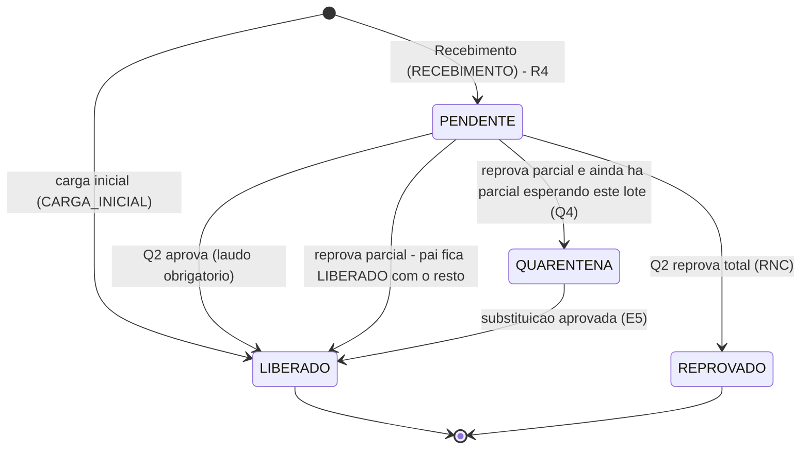

# Modelo de Estoque e custo do lote

Como o Estoque do MES guarda e movimenta o material e como o custo acompanha o lote. Tabelas: [[Banco-MES]]. Telas: [[MES-Front]]. Nós do 0b: E1 a E6, R4, Q1 a Q4 ([[00-Fluxo-Mestre-0b]]). Contratos: [[API-008-Custo-do-Lote-no-MES]], [[API-007-Referencia-OC-Valores-no-MES]], [[LOG-47-Custo-Real-por-Item-no-Hub]]. Selos: [[Regras-do-Vault]].

## Conceitos

| Conceito | Tabela | Regra |
|---|---|---|
| **Material** | `materiais` | snapshot do produto do av-hub, chave `(codigo_empresa, codigo_produto_omie)`; "mesmo produto" entre filiais = `codigo_produto` legível ✅ `estoque-operacao.service.ts:213-220` |
| **Lote** | `lotes` | unidade de rastreio, código `LT-AAAAMMDD-NNNN`, sempre de um material; pode ter lote pai (cisão) |
| **Saldo** | `saldos_estoque` | quantidade do lote por **localização** (único `(id_lote, id_localizacao)`); nunca fica negativo (`aplicarDeltaSaldo` retira só com `quantidade >= retirar`, senão 409 "Saldo insuficiente") ✅ `helpers.ts:70-100` |
| **Movimento** | `movimentos_estoque` | razão só de inserção: `ENTRADA`, `SAIDA`, `TRANSFERENCIA`, `AJUSTE`, sempre com motivo e usuário |
| **Reserva** | `reservas_estoque` | parte do lote prometida a uma parcial; `ATIVA` → `CONSUMIDA` (baixa) ou `LIBERADA` |
| **Custo** | `lote_custo` | 1 para 1 com o lote; opcional |

Filial: o lote pertence à filial **do material** (`materiais.codigo_empresa`); o depósito também tem `codigo_empresa`. O estoque de uma parcial só enxerga lotes da mesma filial do pedido (`pedidos.id_unidade`) ✅ `estoque-operacao.service.ts:112-159`. Estoque em outra filial aparece só como aviso (`outrasFiliais`), sem transferência automática (transferência entre filiais: [[Transferencia-entre-Filiais]]).

## Fórmulas (conferidas)

- **Saldo do lote** = soma de `saldos_estoque.quantidade` de todas as localizações.
- **Reservado** = soma, das reservas `ATIVA` do lote, de `quantidade − quantidade_consumida` ✅ `helpers.ts:41-53`.
- **Disponível** = `max(saldo − reservado, 0)` **só se o lote está `LIBERADO`**; lote em outro status tem disponível 0 ✅ `estoque-operacao.service.ts:374-378`.
- **Saldo disponível da parcial (E1)** = lotes `LIBERADO` do mesmo produto e da mesma filial, com disponível > 0, mais antigos primeiro; os comprados pela própria requisição do item vêm primeiro e marcados `daRequisicao` ✅ `:161-199`.
- A tela de Saldo só mostra depósitos que o perfil visualiza (`perfil_depositos.pode_visualizar`) e até 1 000 linhas ✅ `:61-99`.

## Ciclo de vida do lote

| Evento | O que o código faz | Nó | Código |
|---|---|---|---|
| **Carga inicial** | cria lote `LIBERADO` (`origem = CARGA_INICIAL`), saldo na localização e movimento `ENTRADA`; custo opcional | — | ✅ `estoque-operacao.service.ts:398-475` |
| **Recebimento (conferência bateu)** | por item da requisição: lote `PENDENTE` (`origem = RECEBIMENTO`, `quarentena_desde = agora`, `id_requisicao_item`, NF e fornecedor), saldo na localização e `ENTRADA`; soma `quantidade_recebida`; requisição `RECEBIDA` ou `RECEBIDA_PARCIAL`; a parte da parcial coberta vai para a Qualidade (split se chegou parte; o resto volta a Compras · CCP) | R4 | ✅ `compras.service.ts:472-600` |
| **Qualidade aprova** | lote `PENDENTE` → `LIBERADO` (laudo, `liberado_by`, `liberado_em`); devolve ao Estoque as parciais prontas da requisição (`devolverAoEstoqueParciaisProntas`) | Q2 → E5 | ✅ `qualidade.service.ts:83-99` |
| **Qualidade reprova** | total: lote `REPROVADO` com `motivo_reprovacao` e evidência; **parcial: cisão** (lote filho `REPROVADO` com `id_lote_pai`, saldo movido por `SAIDA` no pai e `ENTRADA` no filho, mesmo custo), pai `LIBERADO` com o resto, **ou `QUARENTENA` se ainda há parcial esperando o lote**; abre `rncs` (`nota_devolucao_pendente = true`); a parte reprovada da parcial volta a Compras; `quantidade_recebida` da requisição é decrementada (recompra) | Q3, Q4 | ✅ `qualidade.service.ts:102-258` |
| **Atender pelo estoque** (E3) | para cada alocação `(lote, quantidade)`: valida mesmo material e filial, lote `LIBERADO`, disponível suficiente; cria `reservas_estoque` `ATIVA`; divide a parcial (parte atendida segue para a Expedição, restante vai à compra ou ao roteiro) | E3, E4 | ✅ `itens-parciais.service.ts:607-720`, `helpers.ts:125-196` |
| **Baixa da reserva** | `consumirReservasDaParcial`: consome as reservas `ATIVA` mais antigas, tira o saldo do lote por localização (maior saldo primeiro), grava `SAIDA` com `id_reserva`, soma `quantidade_consumida`, `CONSUMIDA` quando zera; 409 se o saldo físico não cobre | E6 (hoje) | ✅ `helpers.ts:208-285` |
| **Estorno** | `estornarConsumosDaParcial` devolve o saldo à mesma localização (`ENTRADA`) e volta a reserva a `ATIVA` (Embalagem desfaz o recebimento ou devolve ao Estoque) | — | ✅ `helpers.ts:287-367` |
| **Liberar reserva** | `PATCH /estoque/reservas/:id/liberar` ou ao excluir a ordem: `ATIVA` → `LIBERADA` com motivo | — | ✅ `helpers.ts:369-384` |
| **Transferência e ajuste** | `POST /estoque/movimentos` com `TRANSFERENCIA` (entre localizações e depósitos) ou `AJUSTE` | — | ✅ `estoque-operacao.service.ts:607-700` |

## Onde a baixa acontece hoje e onde deveria

| | Hoje (código) | Decidido em 14/10 |
|---|---|---|
| Quem baixa | a Embalagem/Expedição, ao **receber** a parcial atendida pelo estoque (`atendido_pelo_estoque`), e, por garantia, na entrega | o **Estoque**, no despacho, quando alguém (Expedição ou Produção) gera um **documento de retirada** |
| Código | `itens-parciais.service.ts:279` e `entregas.service.ts:88` (no-op se já consumida) | não existe 🔴 |
| Efeito no saldo | `SAIDA` com `id_reserva` | `SAIDA` com o documento de retirada, a pedido da raia que precisa da mercadoria |

Lacuna para o Robert: criar o documento de retirada (E6) e mover para ele a chamada de `consumirReservasDaParcial` 🔴. Ver [[03-Estoque-Atendimento-e-Despacho]].

## Tudo que é fabricado ou comprado vai para o Estoque

- **Comprado:** já vai. Lote `PENDENTE` → Qualidade → `LIBERADO` → parcial volta ao Estoque ✅.
- **Fabricado:** **não vira lote**. `OrigemLote` só tem `RECEBIMENTO` e `CARGA_INICIAL` (dump `:155-158`); a Inspeção de saída aprovada (Q8) segue para a Expedição, não para o Estoque 🔴. Falta: valor de origem (ex. `PRODUCAO`), criação do lote ao aprovar, ligação `lotes` ↔ parcial de origem e custo do fabricado (hoje o av-hub assume 2% fixo para fabricação) ❓ regra de custo do fabricado.

## Custo do lote

### Modelo ✅ (`lote_custo`, dump `:786`)

| Campo | Significado |
|---|---|
| `origem` | `CARGA_INICIAL`, `OC` ou `MANUAL` (só a primeira tem escritor) |
| `custo_liquido_unitario` `(15,6)` | BRL por unidade **do lote**; é o que se soma |
| `valor_unitario`, `moeda`, `cotacao`, `desconto_pct` | dados da OC de origem |
| `icms_recuperar_unit`, `ipi_unit`, `st_unit`, `frete_unit` | componentes; **vazios no Ciclo 1** (D5: custo sem impostos e sem frete) |
| `id_item_oc` | item da OC que originou o lote |
| `cotacao_a_conferir` | verdadeiro quando a cotação da OC é manual (`cotacao_origem = manual`) |
| `atualizado_por_id`, `atualizado_em` | auditoria |

Fórmula do contrato (D5): `custo_liquido_unitario = valor_unitario × (1 − desconto_pct/100) × (cotacao ?? 1)` no Ciclo 1; com impostos no Ciclo 2 (`− icms_recuperar_unit + ipi_unit + st_unit`) ✅ [[API-008-Custo-do-Lote-no-MES]] §1.

**Imposto por item (PS-014, 🟡 aberta, 📝 N14-23).** O Ciclo 1 segue **sem imposto** (ICMS, IPI, ST e frete). Mas em breve será preciso ter **todos os cenários, também com impostos**, e é preciso pensar desde já em como adequar o modelo. Hoje a OC não tem imposto por item (`ordens_compra_itens` só tem `valor_unitario`, `desconto`, `valor_desconto`, `valor_total_item`: [[Banco-AvHub]]), então a **fonte do imposto** (digitado na OC, vindo do Omie, ou tabela fiscal) é a decisão em aberto. O que precisa ser desenhado (Nathan e Gustavo, BL-053): de onde vem o imposto por item na OC; como `lote_custo` passa a receber `icms_recuperar_unit`, `ipi_unit`, `st_unit` e `frete_unit` (as colunas já existem, vazias); como o custo do item e o `GET /itens/custo` mostram os dois cenários (sem imposto e com imposto) sem quebrar o contrato do Ciclo 1 (`custo_sem_impostos: true`). Os contratos não são editados: se o API-008 precisar mudar, só o [[Painel-de-Contratos]] aponta a pendência.

### O que existe no código e o que não existe

| Item | Estado | Evidência |
|---|---|---|
| Tabela, model e migration `20261009140000_lote_custo` (PR #53) | ✅ | `prisma/models/estoque.prisma:394-423` |
| Custo na **carga inicial** (`custoUnitario` > 0; vazio ou 0 = sem custo), só com `estoque-custo` editar | ✅ | `estoque-operacao.service.ts:403-450` |
| Visibilidade: o custo só sai em `GET /estoque/saldo` e `GET /estoque/lotes/:id` para quem tem `estoque-custo` visualizar | ✅ | `:66`, `:546` |
| **Cisão** copia o custo do pai para o filho | ✅ | `helpers.ts:431-452` |
| **Custo da OC no Recebimento** (`origem = OC`): o lote de recebimento nasce sem `lote_custo`; depende de o MES ler `GET /ordens-compra/referencia` (API-004/007) | 🔴 | `compras.service.ts:520-545` sem `loteCusto`; MES não chama a rota |
| Rota `MANUAL` (`PUT /estoque/lotes/:id/custo`) com `estoque-custo` editar e motivo | 🔴 | ausente do controller |
| Snapshot do custo na `SAIDA` (o movimento não grava custo) | 🔴 | `helpers.ts:208-285` |
| `GET /itens/custo` para o av-hub | 🔴 | grep sem ocorrência; o job do av-hub recebe 404 ([[AV-Hub-API]]) |
| Marca `custo_alterado_em` no item (alimenta `alterado_desde`) | 🔴 | sem coluna em `itens_parciais`/`itens_pedido` |

### Regras decididas em 14/10 (contrato 008, sem código ainda) 📝

- **Uma OC é de um único fornecedor**; o lote é **por produto dentro da OC**: requisições da mesma OC e do mesmo produto formam **um lote**. O mesmo produto em **duas OCs** forma **lotes separados**, cada um com o seu custo (D1).
- A sobra de compra para estoque fica **no mesmo lote** e herda o custo e o `id_item_oc`.
- **OC fechada não muda depois que o lote chega** (D3): o custo gravado na entrada não é atualizado pela OC.
- **Unidade (D2):** unidade da OC diferente da do lote = lote nasce **sem custo**, sinalizado "unidade diferente da OC"; quem tem `estoque-custo` informa pela rota `MANUAL`. Nunca grava custo na unidade errada. Fator de conversão fica para o Ciclo 2 ❓ Compras.
- **Correção de custo depois da baixa (D4):** vale para o saldo e as reservas abertas; as unidades já baixadas mantêm o custo do snapshot.
- **Pedido manual nunca participa do custo** (D6).
- O custo é **opcional e nunca bloqueia** carga inicial, recebimento, reserva, despacho ou faturamento.

### Custo do item do pedido (E3) e o que o av-hub recebe

Definição do contrato (`GET /itens/custo`, uma linha por filial + pedido + **produto**):

- `custo_total = Σ quantidade × custo_liquido_unitario` dos lotes das reservas `ATIVA` e `CONSUMIDA` do item (a `LIBERADA` não conta); parte baixada usa o snapshot da `SAIDA`, a ainda reservada usa o custo atual do lote.
- `custo_medio = custo_total / quantidade_com_custo` (média ponderada pelos lotes).
- `completo = true` só quando `quantidade_com_custo = quantidade` do item.
- Item de fabricação não tem reserva e fica de fora (o av-hub trata como 2% fixos até J2 a J4).

Exemplo ✅ do contrato: 20 flanges = 10 × R$ 10,00 (carga inicial) + 5 × R$ 12,00 (OC-A) + 5 × R$ 15,00 (OC-B) → `custo_total` R$ 235,00, `custo_medio` R$ 11,75, `completo = true`.

No av-hub o dado cai em `core_vendas_faturamento.itens_pedido_custo` (estado atual, uma linha por produto do pedido) e é lido por `GET /itens_pedido_custo` com a permissão `custo-itens` ([[Banco-AvHub]], [[AV-Hub-API]]). O hub **não calcula comissão** com isso ainda (etapas 2 e 3 do LOG-47 são Ciclo 2).

## Lista do que falta para o Robert (estoque e custo)

1. Documento de retirada e baixa no despacho (E6).
2. Lote de fabricado aprovado (Q8 → E5) com `OrigemLote` novo e custo do fabricado.
3. Ler a referência da OC e gravar `lote_custo` com `origem = OC` no Recebimento (R4), com D1, D2, D3.
4. Rota `MANUAL` de custo, snapshot na `SAIDA` e `custo_alterado_em`.
5. `GET /itens/custo` (e o módulo `fluxo` da Torre, [[Rastreabilidade-e-Torre-de-Fluxo]]).
6. Decidir se a tabela `fornecedores` (projeção) entra ou sai ([[Diferencas-Codigo-x-Banco]]).
