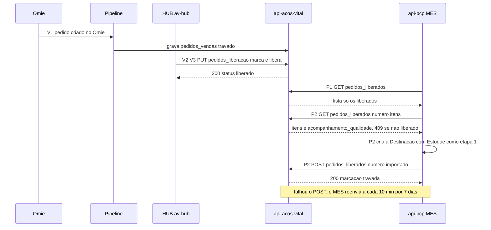
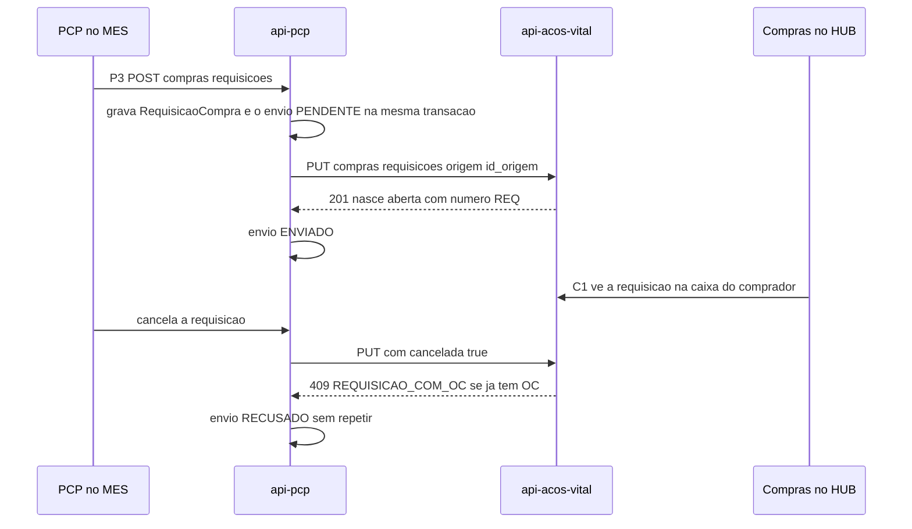
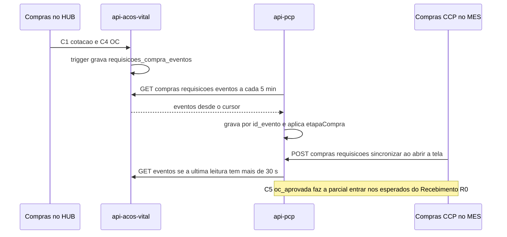
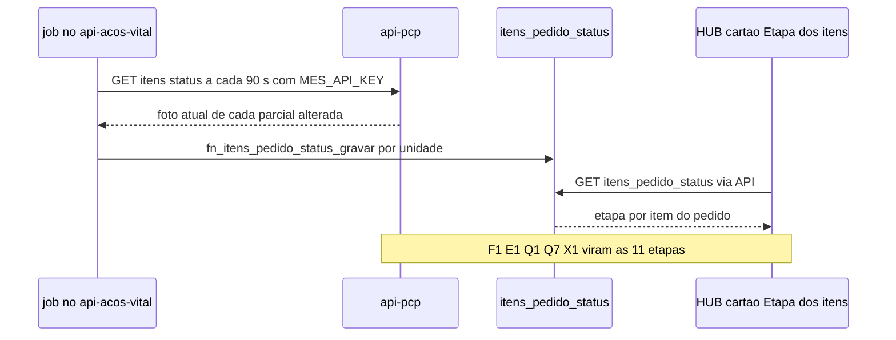
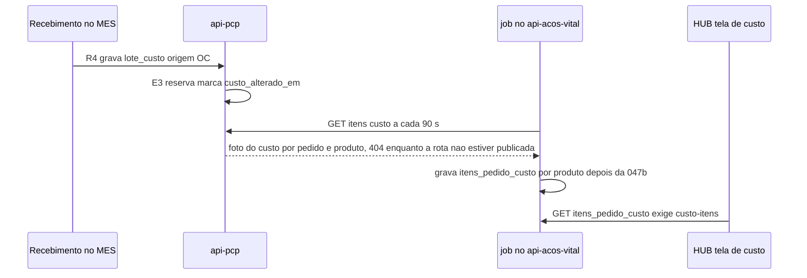
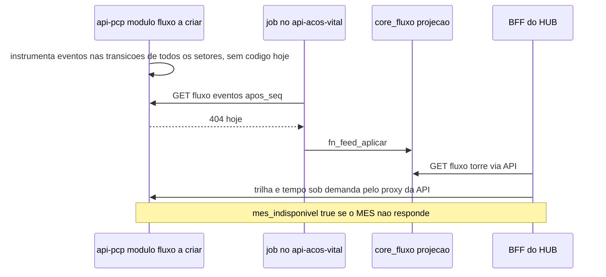

# Integração av-hub ↔ MES

**Em uma frase:** esta nota mostra como o av-hub (o sistema comercial) e o MES (o sistema da fábrica) trocam informação: quem manda o quê, quando e o que acontece se um dos dois cair.

**Quando consultar esta nota:** ao mexer em qualquer troca entre os dois sistemas (liberação de pedido, requisição de compra, etapa do item, custo, Torre de Fluxo) ou ao investigar por que um dado não chegou ao outro lado.

Siglas: **av-hub** = a API `api-acos-vital` mais as telas do HUB. **MES** = a API `api-pcp` mais as telas `app-pcp`. **PCP** = planejamento da produção. **OC** = ordem de compra. Os dois sistemas têm bancos separados e nunca leem o banco um do outro.

## Quem manda dado para quem, quando e por quê

Cada dado tem um dono. O dono oferece o dado numa "rota" (um endereço de consulta protegido por chave). Quem precisa pergunta de tempos em tempos e guarda uma cópia própria. Não há aviso automático: sempre é consulta periódica.

- **Liberação do pedido (INT-01).** O vendedor libera o pedido no HUB. Quando o PCP abre a Triagem no MES, o MES pergunta ao av-hub quais pedidos estão liberados. Depois de criar a Destinação, o MES avisa que "importou". Por quê: o pedido só vai à produção depois de liberado. ✅ funciona ponta a ponta.
- **Requisição de compra, ida (INT-02).** O MES envia ao av-hub cada pedido de material que o PCP faz, assim Compras passa a vê-lo. Se o av-hub estiver fora, a fila do MES espera e reenvia. ✅
- **Marcos da requisição, volta (INT-03).** A cada 5 minutos, o MES pergunta ao av-hub em que ponto da compra está cada requisição dele (cotação, OC aprovada, despachada). Por quê: o MES acompanha a compra sem receber dado comercial. ✅ para requisição criada no MES.
- **Referência da OC (INT-04).** O av-hub oferece as OCs aprovadas. O MES as consulta a cada 5 minutos, para conferir o recebimento e dar custo ao lote. ✅ desde 15/10, só na `develop` do MES (a `main` parou em 08/10).
- **Requisições do Compras com pedido de venda (INT-09).** O av-hub oferece as requisições que o Compras abriu com pedido de venda; o MES as lê a cada 5 minutos para o PCP ver que já há compra em andamento e não pedir de novo. ✅ desde 23/10, só na `develop` do MES.
- **Etapa de cada item (INT-05).** A cada 90 segundos, o av-hub pergunta ao MES em que etapa está cada item. Por quê: o vendedor vê "Etapa dos itens" no pedido. ✅
- **Custo real por item (INT-06).** O av-hub pergunta ao MES o custo de cada item a cada 90 segundos. ✅ A rota do MES foi feita em 27/10, só na `develop`; falta subir para a `main` e ligar a tela no hub.
- **Torre de Fluxo (INT-07).** O av-hub quer ler do MES o histórico de eventos de cada item. 🔴 O MES ainda não tem o módulo.
- **Requisições lidas do MES (INT-08).** Desenho antigo, sem uso: ninguém consome. Candidato a remoção.

O MES nunca fala com o Omie (o ERP, sistema fiscal e financeiro). O que ele precisa do Omie chega pelo av-hub. Requisição criada só no HUB não vai ao MES; o MES enxerga a OC dela (decisão N14-20).

## Se um lado cair

- **av-hub fora:** a Triagem e a Destinação mostram erro, a fila de requisições acumula e nada se perde. O aviso "importado" é reenviado a cada 10 minutos por 7 dias.
- **MES fora:** o vendedor segue liberando pedidos. Os jobs do av-hub repetem a consulta, e o HUB mostra "dado velho" depois de 10 minutos.

## O que falta

- **Robert (MES):** o módulo da Torre (BL-003); usar a leitura da OC no PCP e no Estoque (BL-049, BL-050, BL-051); subir a `develop` para a `main` (BL-035); mensagens novas MES para hub dos avisos de recompra por RNC e de reabertura do recebimento (N16-127, N16-137, ainda sem contrato).
- **Gustavo (banco e API):** cadastrar as listas de rotas das chaves de serviço do MES e do pipeline (BL-018, BL-057) e permissões das telas de custo e Torre (BL-020, BL-021).
- **Nathan (HUB):** telas da Torre (BL-022, consideradas ok em 29/10 sobre dados de teste) e de custo (BL-023, restam o simulador, Compras e Orçamento).

A lista completa, com donos e nós, está em "O que falta desenvolver" no detalhe. Selos: ✅ pronto · 🟡 proposta · 🔴 não existe · ❓ não conferido. Regras do vault: [[Regras-do-Vault]].

## Detalhe técnico

Nota canônica das integrações entre o av-hub (`api-acos-vital` + HUB) e o MES (`api-pcp` + `app-pcp`). Uma seção por fluxo, com rota, direção, chave, cursor, idempotência, falha e estado no código. Os IDs dos nós são os do [[00-Fluxo-Mestre-0b]]. Chaves e escopos: [[Chaves-e-Autenticacao]]. Selos: [[Regras-do-Vault]].

### Regras que valem para todos os fluxos

- **Mecanismo:** REST com `x-api-key`. Dois bancos separados, nenhum acesso cruzado. Quem tem o dado expõe, quem precisa lê e grava projeção própria 📝 ([[Registro-de-Decisoes]], DEC-2). O padrão de leitura é polling com cursor, sem webhook.
- **Exceção da ida:** a requisição de compra é **empurrada** pelo MES (`PUT`, fila de saída), não puxada ✅ (`api-pcp` `envio-avhub.service.ts:129-175`). O contrato 003 (hub puxa do MES) ficou sem consumidor (ver INT-08 abaixo).
- **`codigo_empresa` em todo payload** 📝 (DEC-1): a filial vem do pedido, nunca da fábrica.
- **Idempotência por chave natural, não por token:** upsert por id de origem ou por id do evento. Reler uma janela nunca duplica.
- **Fronteira de dado:** o dado comercial (fornecedor, condição de pagamento) fica no av-hub. Para o MES vai o necessário para conferir e, desde o contrato 007, preço, moeda e cotação por item (para o custo do lote).
- **Nenhuma regra em variável de ambiente** para jobs novos (regra do Nathan): intervalo, página e janela são constantes no código; só endereço e segredo ficam em ambiente ✅ (`item_estado_projetado.job.js:44-49`).

### Tabela-resumo

| ID | Fluxo | Contrato | Direção e rota | Nós 0b | Estado |
|---|---|---|---|---|---|
| INT-01 | Liberação do pedido | [[LOG-26-Vendas-Liberacao-Pedido]] | HUB→av-hub `PUT /pedidos_liberacao/:codigo_empresa/:numero_pedido`; MES←av-hub `GET /pedidos_liberados`, `GET /pedidos_liberados/:numero/itens`; MES→av-hub `POST /pedidos_liberados/:numero/importado` | V2 V3 P1 P2 | ✅ ponta a ponta no código; chave de escopo mínimo 🔴 |
| INT-02 | Requisição de compra, ida | [[LOG-34-Requisicoes-MES-Empurra-para-o-Hub]] | MES→av-hub `PUT /compras/requisicoes/origem/:id_origem` | P3 | ✅ |
| INT-03 | Marcos da requisição, volta | [[LOG-35-Compras-Marcos-Requisicao-para-MES]] | MES←av-hub `GET /compras/requisicoes/eventos` | C1 a C5 R0 | ✅ para requisição do MES; 🔴 para requisição só do av-hub |
| INT-04 | Referência da OC | [[API-004-Referencia-OC-Integracao-MES]], [[API-007-Referencia-OC-Valores-no-MES]], [[SQL-011-Ordens-Compra-Referencia-MES]], [[SQL-012-Ordens-Compra-Referencia-Valores]] | MES←av-hub `GET /ordens-compra/referencia` | C4 R0 R1 R4 | ✅ lado do hub; ✅ job K4 do MES na `develop` (15/10); uso na tela 🔴 |
| INT-05 | Status por item | [[API-005-Status-Item-Integracao-MES]], [[API-006-Status-por-Item-Leitura-no-Hub]], [[SQL-010-Itens-Pedido-Status]] | av-hub←MES `GET /itens/status` | todos | ✅ |
| INT-06 | Custo real por item | [[API-008-Custo-do-Lote-no-MES]], [[LOG-47-Custo-Real-por-Item-no-Hub]] | av-hub←MES `GET /itens/custo` | E3 R4 | ✅ lado do hub; ✅ rota do MES na `develop` (27/10); fora da `main` |
| INT-07 | Torre de Fluxo | [[LOG-46-Torre-de-Fluxo-Feed-Jobs-e-Telas]] | av-hub←MES `GET /fluxo/eventos` e proxy `/fluxo/*` | os 9 setores | ✅ lado do hub; 🔴 MES sem o módulo `fluxo` |
| INT-08 | Requisições lidas do MES | [[API-003-Requisicao-Compra-Integracao-MES]] | MES `GET /requisicoes-compra` | — | legado sem consumidor |
| INT-09 | Requisições do Compras com pedido de venda | [[API-009-Referencia-Requisicao-Hub-Integracao-MES]] | MES←av-hub `GET /compras/requisicoes/referencia` | C0 P1 P2 P3 E1 | ✅ lado do hub e job do MES na `develop` (23/10, `9e75df5`) |

Detalhe da Torre: [[Rastreabilidade-e-Torre-de-Fluxo]].

### INT-01 Liberação do pedido (contrato 26)

**Para quê:** o pedido chega do Omie travado e só vai para o PCP depois que o vendedor marca se a Qualidade acompanha desde o início e libera. Nós V2, V3, P1, P2.

| Passo | Rota | Quem chama | Chave ou auth | Detalhe |
|---|---|---|---|---|
| Libera | `PUT /pedidos_liberacao/:codigo_empresa/:numero_pedido` corpo `{acompanhamento_qualidade, updated_by}` | HUB (BFF) | Bearer do usuário | 404 `PEDIDO_FORA_DA_LIBERACAO`, 409 `PEDIDO_IMPORTADO_MES` ✅ `pedidos_liberacao.route.js:164`, `:194`, `:222` |
| Lista a Triagem | `GET /pedidos_liberados?codigo_empresa=&mes=&ano=&page=&limit=` | MES (Triagem do Pedido, ao abrir) | `API_KEY` do MES | sob demanda, sem job ✅ `omie-integracao.ts:331-338`, `pedidos-carteira.service.ts:65` |
| Itens do pedido | `GET /pedidos_liberados/:numero/itens?codigo_empresa=` | MES (Destinação do Pedido) | `API_KEY` | 409 `PEDIDO_NAO_LIBERADO` barra a criação ✅ `pedidos.service.ts:245-248`, `pedidos_liberados.route.js:53` |
| Confirma | `POST /pedidos_liberados/:numero/importado?codigo_empresa=` corpo `{referencia}` | MES, depois de criar a Destinação | `API_KEY` | idempotente; a partir daí a marcação trava ✅ `omie-integracao.ts:393-425` |

- **Cursor e periodicidade:** não há job. A Triagem e a Destinação leem na hora. `alterado_desde` existe na rota, mas o MES não o usa.
- **Idempotência:** o `importado` vale a primeira `referencia` (número da ordem de produção, campo `Pedidos.ordemProducao`). O MES grava `Pedidos.importadoAvhubEm` ✅ `pedidos.service.ts:133`.
- **Falha e retentativa:** se o `importado` falha, a Destinação já existe e o MES **reenvia a cada 10 min** (`AVHUB_REENVIO_IMPORTADO_MIN`, padrão 10) para pedidos dos últimos 7 dias, 20 por rodada ✅ `pedidos.service.ts:63-81`. Sem o `importado` o vendedor ainda pode mudar a marcação.
- **Se o av-hub cai:** a Triagem responde 422 "Não foi possível carregar a carteira de pedidos" ✅ `omie-integracao.ts:354-360`; a Destinação não cria ordem; nada se perde.
- **Se o MES cai:** o vendedor segue liberando; os pedidos acumulam como `liberado` (status da view `vw_pedidos_liberacao`: `pendente`, `liberado`, `importado`).
- **Pedido anterior à data de corte** 📝 (N16-142, 29/10): fica fora do MES e termina no sistema antigo; falta só uma mensagem clara no lugar do erro 404 nos itens 🔴.
- **Pendências:** data de corte `parametros_vendas.data_inicio_liberacao` em produção (01/09 ou 28/07) ❓ Gustavo; `auth.rotas_telas` para as rotas ❓ Gustavo; chave própria do MES com escopo mínimo: o recurso existe no código, falta cadastrar a lista e ligar o modo `exigir` ❓ Gustavo ([[Chaves-e-Autenticacao]]).



### INT-02 Requisição de compra, ida (contrato 34)

**Para quê:** o PCP pede compra de material de um pedido e o av-hub (Compras) passa a ver a requisição. Nó P3.

- **Rota:** `PUT {API_URL}/compras/requisicoes/origem/{id_origem}` ✅ `envio-avhub.service.ts:130`. `id_origem` = id do `RequisicaoCompraItem`. Uma requisição do MES com N materiais vira N requisições no av-hub.
- **Corpo:** `codigo_empresa`, `material`, `quantidade`, `unidade_medida`, `prazo_necessidade` e opcionais (`numero_requisicao_mes`, `descricao`, `acabado_sugerido`, `solicitante`, `observacao`, `codigo_pedido_omie`, `numero_pedido_venda`, `cancelada`) ✅ `requisicao-avhub.envio.ts:40-62`. O PUT não leva `id_item_parcial`.
- **Chave:** `AVHUB_MES_INTEGRACAO_KEY` no MES = um valor de `MES_INTEGRACAO_KEYS` no hub. Só abre esta rota; qualquer outra dá 403 `CHAVE_MES_ROTA_NAO_PERMITIDA` ✅ `apiKeyAuth.js:94-100`.
- **Respostas do hub** ✅ `requisicoes_compra.route.js:221-260`: 201 criou (nasce `aberta`, número `REQ-…`); 200 atualizou (sem OC); 200 `{aplicado:false, motivo:"com_oc"}` ou `"cancelada"`; 409 `REQUISICAO_COM_OC` ao cancelar requisição com OC; 400 campo inválido; 500 se falta a função de banco `fn_requisicao_mes_aplicar`.
- **Fila de saída (outbox):** a requisição e o envio nascem na mesma transação em `integracao_avhub_envios` (`PENDENTE`, `ENVIADO`, `RECUSADO`, `FALHOU`; `integracao.prisma:290-320`). Dispara logo após criar ou cancelar e a cada `AVHUB_ENVIO_INTERVALO_SEG` (padrão 60 s). Espera crescente 1, 2, 5, 10, 30, 60 min ✅ `envio-avhub.service.ts:21`.
- **Tratamento:** 200/201 vira `ENVIADO` e espelha id, número e status no item; 409 vira `RECUSADO` e não repete (o log avisa Compras) ✅ `:164-169`; 400 vira `FALHOU`; 401, 403, 404 e 5xx reagendam. Sem a chave definida, a fila espera com aviso no log ✅ `:98-102`.
- **Cancelamento** também vai pela fila e só vale sem OC.
- **Se o av-hub cai:** nada se perde; a fila acumula e retoma. **Se o MES cai:** o hub não recebe requisição nova.
- **Precisão:** o MES guarda 4 casas e o hub 3 (10,1234 vira 10,123).
- **Pendência:** o SQL de `fn_requisicao_mes_aplicar` (migration 034) existe em produção, mas não está versionado 🔴 Gustavo.



### INT-03 Marcos da requisição, volta (contrato 35)

**Para quê:** o MES saber em que ponto do circuito de Compras está cada requisição dele, sem receber o dado comercial. Nós C1 a C5 e R0. A tela Compras · CCP do MES é só leitura e espelha esses marcos.

- **Rota:** `GET /compras/requisicoes/eventos?alterado_desde=&apos_id=&codigo_empresa=&limit=` (limite padrão 200, máximo 500). Resposta `{quantidade, tem_mais, proximo:{alterado_desde, apos_id}, data:[…]}` ✅ `requisicoes_compra.route.js:289`.
- **Chave:** `API_KEY` do MES (admin ou de `auth.chaves_servico`). A chave do 34 dá 403 aqui.
- **Cursor:** (`registrado_em`, `id_evento`). O MES guarda o cursor `requisicoes-eventos` em `integracao_avhub_cursores` e relê 2 min para trás a cada rodada ✅ `eventos-avhub.service.ts:25`. Primeira leitura desde `2026-01-01`.
- **Periodicidade:** 5 min (`AVHUB_EVENTOS_INTERVALO_MIN`) e uma rodada 10 s depois de subir; até 50 páginas de 200 por rodada ✅ `:25-27`. **Sob demanda:** `POST /compras/requisicoes/sincronizar` (`compras.controller.ts:57`) — a tela Compras · CCP chama ao abrir e no "Atualizar" (`FilaSetor.tsx:370-396`); pula se a última leitura boa tem menos de 30 s e rodadas simultâneas compartilham a mesma ✅ `eventos-avhub.service.ts:31,80`.
- **Idempotência:** o evento é gravado por `id_evento`; reler não reprocessa.
- **Falha:** evento que não aplica fica gravado com `ERRO:` em `acao`, sem `processadoEm`, e a leitura segue ✅ `eventos-avhub.service.ts:150-181`. Falha de rede reagenda sem mexer no cursor.
- **Só existem eventos de requisição com `id_origem`** (a do MES). Requisição criada só no av-hub não gera evento: `id_origem` é `NOT NULL` em `requisicoes_compra_eventos` (Dump Avhub), e isso fica assim: o MES enxerga a **OC** dessa requisição pela referência (INT-04; ver "Requisito: o MES lê as OCs do hub").

Tratamento de cada `tipo` pelo MES (`requisicao-avhub.eventos.ts:234-318`, `etapaCompra`):

| `tipo` | Efeito no MES |
|---|---|
| `requisicao_recebida` | `AGUARDANDO_COMPRADOR` |
| `requisicao_reaberta` | `AGUARDANDO_COMPRADOR`; se o Compras cancelou e a parcial ainda está em Requisições, a requisição volta a `ABERTA` e a parcial a Compras; senão só anota |
| `em_cotacao` | `EM_COTACAO` |
| `oc_criada`, `oc_enviada_aprovacao` | `EM_APROVACAO`, grava `numeroOc` |
| `oc_removida` | `EM_COTACAO`, zera OC, aprovação e previsão |
| `oc_aprovada` | `COM_FORNECEDOR`, grava `ocAprovadaEm`, OC e previsão; a parcial vira **esperada** do Recebimento (R0) |
| `oc_no_omie` | grava `numeroPedidoOmie` |
| `fornecedor_confirmou` | só marco |
| `previsao_alterada` | atualiza `previsaoChegada` |
| `despachada` | `EM_TRANSITO`, grava `despachadaEm`, `nfFornecedor`, transportadora |
| `ocorrencia` | `ocorrenciaAberta = (dados.status === 'aberta')` |
| `oc_cancelada` | `AGUARDANDO_COMPRADOR`, limpa OC, Omie, previsão, despacho e NF |
| `requisicao_cancelada` | origem `mes` só confirma; origem `compras` com todos os materiais cancelados vira `CANCELADA` (`canceladaPor='compras'`) e a parcial volta a Requisições; só parte, anota |

Autor e comprador do marco (migration 035b do av-hub) vêm dentro de `dados` ✅ `requisicao-avhub.eventos.ts:47-48`.



### INT-04 Referência da OC (contratos 004 e 007)

**Para quê:** (1) o Recebimento conferir contra o que foi comprado e o lote nascer com custo (nós C4, R0, R1, R4); hoje o Recebimento confere contra a **NF** 📝, e o cruzamento com a OC espera o job abaixo; (2) o PCP ver a OC de cada pedido e o Estoque ver o **saldo futuro** das OCs de estoque, inclusive as de requisição criada só no hub (C0, N14-20; ver "Requisito: o MES lê as OCs do hub").

- **Rota no hub:** `GET /ordens-compra/referencia?alterado_desde=&codigo_empresa=&apos_id=&page=&limit=` (`alterado_desde` obrigatório; limite padrão 100, máximo 500) ✅ `vw_ordens_compra_referencia_mes.route.js:44-89`, montada em `core_vendas_faturamento/index.js:199`. Entram OC `aprovada` e as canceladas depois de aprovadas. `alterado_em` é o maior `updated_at` da OC, dos itens e dos vínculos (trigger da migration `api004`). A regra mora no banco.
- **Valores (contrato 007):** a resposta traz `moeda`, `cotacao_moeda`, `cotacao_data`, `cotacao_origem`, `valor_frete`, `valor_seguro` na OC e `valor_unitario`, `desconto_pct`, `valor_desconto`, `valor_total_item` em cada item ✅ `vw_ordens_compra_referencia_mes.route.js:51-53`. A rota tolera banco sem a migration `api007` (200 sem os campos) e responde 500 sem a `api004` ❓ se aplicadas em produção (Gustavo, SQL em [[SQL-012-Ordens-Compra-Referencia-Valores]]). Desde a `api007b` (26/10, `a7fda49`) a OC traz também `codigo_fornecedor`, `nome_fornecedor` e `cnpj_fornecedor` ✅ (pedido do Robert); segue sem condição de pagamento, categoria nem conta corrente.
- **Chave de leitura:** `API_KEY` do MES; a chave do 34 dá 403.
- **Cursor e periodicidade:** `proximo` (`alterado_desde` + `apos_id`) com sobreposição de 5 minutos, a cada 5 min ✅ (`oc-referencia-avhub.service.ts`). Idempotência no MES por `(codigo_empresa, id_ordem_compra)` e itens por `(id_ordem_compra, id_item_oc)`; item que sumiu da OC é marcado `removido_em`; OC cancelada ou item removido desfaz os vínculos de origem do hub.
- **O MES consome ✅ (na `develop`, não na `main`):** `oc-referencia-avhub.service.ts` (K4, `114ba89`, 15/10) lê a referência a cada 5 min (`AVHUB_OC_INTERVALO_MIN`, 0 desliga) e na subida, com cursor `ordens-compra-referencia`, 500 por página, até 40 páginas, e grava a projeção `oc_referencia` e `oc_referencia_itens`; o Recebimento já cria o lote com o custo da OC (BL-005, desde 19/10). O que falta é **usar** a projeção: OC do pedido para o PCP (BL-049) e saldo futuro do Estoque (BL-050). Dono: Robert, backlog [[Backlog-por-Frente]] (BL-001, BL-006).
- **Ajuste pendente do 004:** `id_origem` em cada item (pedido do Robert em 30/09) 🔴 Gustavo conferir.
- **Se o hub cai:** o job reagenda e a página que falhou é relida na rodada seguinte; o Recebimento segue pela NF. **Se o MES cai:** a OC fica no hub.

```mermaid
sequenceDiagram
    participant API as api-acos-vital
    participant JOB as job K4 no MES
    participant MES as api-pcp
    participant REC as Recebimento
    API->>API: C4 OC aprovada e trigger atualiza alterado_em
    JOB->>API: GET ordens-compra referencia com chave de leitura
    API-->>JOB: OC com itens, id_origem e valores
    JOB->>MES: UPSERT projecao oc_referencia
    REC->>MES: R0 R1 confere contra a NF e cruza com a OC
    REC->>MES: R4 cria o lote com custo da OC
    Note over JOB,MES: o job K4 e o custo da OC no lote existem na develop do MES; a conferencia com a OC (R1) segue pela NF
```

### INT-05 Status por item (contratos 005 e 006)

**Para quê:** o vendedor ver a etapa de cada item do pedido. Todos os nós, resumido em 11 etapas.

- **Rota no MES:** `GET /itens/status?alterado_desde=&codigo_empresa=&incluir_deletados=&limit=` (limite padrão 500, máximo 1000) ✅ `integracao-avhub.controller.ts:26`, `integracao-avhub.service.ts:114-156`. Resposta: foto atual por parcial (`id_item_parcial`, `pedido_venda`, `ordem_producao`, `codigo_produto_omie`, `etapa`, `setor`, `status`, `quantidade_na_etapa`, `atendido_pelo_estoque`, `ocorrido_em`).
- **Chave:** `MES_API_KEY` (AvhubApiKeyGuard, fail-closed: sem a variável responde 401) ✅ `avhub-api-key.guard.ts:14-16`.
- **Job no hub:** `itens_pedido_status.job.js`, a cada 90 s (`MES_STATUS_INTERVALO_SEG`), uma unidade por vez, página de 1000, cursor por unidade, `pg_try_advisory_xact_lock`; falha desfaz a transação e o cursor não anda; 401 ou 403 seguidos viram alerta no log; grava por `fn_itens_pedido_status_gravar` (migration `api005`) ✅ `itens_pedido_status.job.js:9-37`, iniciado em `app.js:207`.
- **Rota de leitura no hub:** `GET /itens_pedido_status?codigo_empresa=&pedido_venda=&historico=`; lê só a tabela local; escopo "dono do pedido", 403 se sem dono (contrato 006).
- **Idempotência:** chave `(codigo_empresa, id_item_parcial, etapa, ocorrido_em)`; o vendedor vê a etapa de maior `ocorrido_em`.
- **Vocabulário `etapa` (11 valores)** ✅ `integracao-avhub.service.ts:167-192`: `qualidade.reprovado`, `estoque.atendimento`, `compras.requisicao`, `compras.fechamento`, `recebimento.conferencia`, `qualidade.quarentena`, `qualidade.inspecao`, `expedicao.concluido`, `expedicao.embalagem`, `fabrica.execucao`, `fabrica.espera`. O HUB traduz em `lib/domain/etapas-item.ts:30-41`; etapa desconhecida aparece com o código cru. Ver [[Estados-e-Status]].
- **Front:** cartão "Etapa dos itens" (`EtapaDosItens`, BFF `app/api/pedidos-venda/[fonte]/…/etapas/route.ts`); avisa se o job parou há mais de 10 min.
- **Se o MES cai:** o job falha e tenta de novo; o cartão mostra a última foto e o aviso de dado velho. **Se o hub cai:** o MES não percebe (só responde a leituras).
- **Pendências:** `compras.fechamento` ainda é "Em compra", sem cotação, aprovação e trânsito 🔴 Robert + Nathan (BL-009); migration `api005` no banco ❓ Gustavo; teste ponta a ponta do cartão ❓ Nathan.



### INT-06 Custo real por item (contratos 008 e 47)

**Para quê:** o custo do item do pedido = média dos lotes reservados (nó E3), usado pelo hub no Ciclo 2 para o simulador e a comissão ([[LOG-47-Custo-Real-por-Item-no-Hub]]).

- **Rota no MES** ✅ (`integracao-avhub.controller.ts`, `itens-custo.ts`, `6c11147`, 27/10, só na `develop`): `GET /itens/custo?alterado_desde=&codigo_empresa=&apos_id=&limit=`, array puro, uma linha por filial + pedido + **produto** (`codigo_produto_omie`; linhas repetidas do pedido são somadas), com `quantidade`, `quantidade_com_custo`, `custo_total`, `custo_medio`, `completo`, `cotacao_a_conferir`, `lotes[]`, `alterado_em` ([[API-008-Custo-do-Lote-no-MES]]). Entram só pedidos do Omie e itens que têm ou tiveram reserva no Estoque; fabricado fica de fora até o custo da matéria-prima; só entra o que mudou há mais de 180 s (janela de segurança). BL-004 feito pelo Robert.
- **Job no hub** ✅ `itens_pedido_custo.job.js`: a cada 90 s por unidade, cursor `alterado_em` + `id`; **404 do MES avisa e tenta a cada 10 min** (produção ainda sem a rota: `main` do MES parou em 08/10); sem a migration 047b o job nem chama o MES.
- **Rota de leitura no hub:** `GET /itens_pedido_custo?codigo_empresa=&numero_pedido=` exige sempre `custo-itens:pode_visualizar`; a tela nasce sem perfil, então responde 403 a todos 🔴 Gustavo (BL-020). Devolve `custo_sem_impostos: true` (custo do Ciclo 1 não tem ICMS, IPI nem ST).
- **Chave:** `MES_API_KEY` (a mesma do INT-05).
- **Banco:** a função `fn_itens_pedido_custo_gravar` ainda grava por `item integer` no Dump Avhub; a migration 047b troca para produto. 🔴 Gustavo aplicar (BL-019). A API já exige a 047b.
- **Pedido manual nunca participa do custo** 📝 (D6 do contrato 008); precisa de marca de origem manual 🔴 ([[Backlog-por-Frente]] BL-026).
- **Do lado do MES** (`develop`): o Recebimento já grava `lote_custo` com origem `OC` quando a unidade da OC bate (BL-005, 19/10, `97b9adc`); unidade diferente ou OC fora da projeção gera lote sem custo e sinalizado; o custo também pode ser informado ou corrigido à mão em `PUT /estoque/lotes/:id/custo` (27/10) ([[Modelo-Estoque-e-Custo-do-Lote]]).



### INT-07 Torre de Fluxo (contrato 46)

Resumo; o desenho completo (envelope, projeção, telas) está em [[Rastreabilidade-e-Torre-de-Fluxo]].

- **Feed no MES (a criar):** `GET /fluxo/eventos?apos_seq=&limite=` com cursor `seq` monotônico. O MES não tem módulo `fluxo` nem tabela de eventos 🔴 Robert (BL-003; conferido em 29/10 na `develop`: nenhuma pasta `fluxo` em `api-pcp/src`).
- **Job no hub** ✅ `item_estado_projetado.job.js`: lê o feed a cada 90 s, página de 1000, janela de 200 `seq` relidos, trava por fonte; **404 do MES avisa e repete a cada 10 min**; aplica por `core_fluxo.fn_feed_aplicar`. O cliente HTTP do MES é `utils/mesFluxo.js`.
- **Rotas do hub** ✅ `item_estado_projetado.route.js`: `GET /fluxo/torre`, `/fluxo/sla-etapas`, `/fluxo/itens/:id/tempo`, `/fluxo/itens/:id`. Trilha, tempo e SLA são proxy do MES (a chave fica na API); MES fora do ar devolve 200 com `mes_indisponivel: true`.
- **Chave:** `MES_API_KEY`, `MES_API_URL` (mesma do INT-05).
- **Permissão:** telas `torre-fluxo` e `torre-fluxo-trilha`, concedidas só ao perfil de testes do time de TI pela 046b ❓ aplicada; nenhum perfil de negócio as tem 🔴 Gustavo/Nathan (BL-021).
- **Front:** o HUB tem as telas da Torre (`/torre-fluxo`, ranking, tempo e item) e o BFF `/api/fluxo/*`, **sobre dados de teste** (fixtures); consideradas ok pelo Nathan em 29/10 (BL-022). Dependem do feed do MES e dos perfis (BL-021).



### INT-08 `GET /requisicoes-compra` (003, legado)

`GET /requisicoes-compra` e `GET /itens/status` ficam no mesmo controller do MES, protegidos por `MES_API_KEY` ✅ `integracao-avhub.controller.ts`. A primeira rota era o antigo desenho "o hub puxa a requisição". Foi substituída pelo INT-02 e **nenhum job do hub a consome** ✅ (nenhuma referência em `api-acos-vital/src`). Fica como código morto 🔴 Robert decidir remover (BL-032; conferido em 29/10, a rota ainda está no controller do MES). O comentário "JOB DE POLLING do MES" no `api-acos-vital` está velho (Gustavo, BL-033).

### Requisito: o MES lê as OCs do hub (requisição só do av-hub, C0)

Compras cria requisição de necessidade própria no HUB (nó C0, `POST /compras/requisicoes`, número por trigger, permissão `compras.pode_criar`) ✅ `requisicoes_compra.route.js:384`. A **requisição** não chega ao MES (sem `id_origem` não há evento do contrato 35) e **não precisa chegar**. 📝 Decisão N14-20 (14/10): o MES lê a **OC**, pela referência (INT-04), e com ela:

- **OC vinculada a pedido de venda:** o PCP vê, no MES, que já existe ordem de compra para aquele pedido (Triagem, Destinação e Atendimento). Fonte: `destino[]` do item com `tipo = pedido_venda` e `numero_pedido_venda`.
- **OC de itens de estoque (sem pedido):** o Estoque do MES mostra o **saldo futuro**: as OCs em andamento e a parte que preenche o estoque (`destino` com `tipo = estoque`), somada ao saldo atual.
- **Entrada da mercadoria:** o Recebimento do MES exige requisição do MES; é preciso um caminho para a OC sem requisição ([[05-Recebimento]], "Mercadoria de OC sem requisição do MES").

✅ No hub já existe: `ordens_compra.finalidade` (`estoque`, `pedidos_venda`, `recompra`, `uso_interno`), `ordens_compra_itens_vinculos`, a view `vw_pedido_venda_itens_compra`, `GET /compras/pedidos-venda/:numero` e `/:numero/compras`, e a referência com `destino[]` e `finalidade` (arquivos em [[04-Circuito-de-Compra]]). 🔴 Falta no MES: o job K4 (BL-001), a projeção da OC, as telas e o cálculo do saldo futuro (BL-049, BL-050, BL-051). Falta no hub só conferir se a referência (que traz só OC aprovada) e uma consulta por produto e por pedido bastam (BL-028). Dono: Robert (MES), Gustavo se a API precisar expor por produto ou pedido, Nathan se precisar de tela no HUB (BL-041). Pendência [[Pontas-Soltas]] (PS-003, resolvida em 14/10).

### Outras pontes com o MES

- **MES→Omie:** o MES nunca fala com o Omie. A sinalização de faturamento (nó O1, tela 11.1) não existe 🔴 ([[10-Fiscal-Omie]]). Decidido em 29/10: quem avisa o Fiscal é a Logística, ao fechar a carga (N16-132, depende da consolidação de carga `X3`, que não existe), e o MES só mostra um aviso de "faturado antes da entrega", sem bloquear (N16-133); hoje o MES nem sabe se o pedido foi faturado.
- **Avisos do MES ao hub (novos, sem contrato):** recompra por RNC de lote 100% reprovado (N16-127) e reabertura do recebimento pelo PCP (N16-137). Hoje só o MES sabe e a OC do hub segue "atendida" 🔴.
- **Pipeline→av-hub→Omie:** a única escrita no Omie é o envio da OC pela pipeline (`GET /compras/ordens/fila-omie`, `PATCH /compras/ordens/:id/sincronizacao`); não passa pelo MES. Ver [[Omie-Integracao-Estado]] e [[Pipeline-Omie]].
- **Pedido manual** ([[LOG-45-Pedido-de-Venda-Manual]]) não percorre o fluxo do MES.

### O que acontece quando o outro lado cai

| Cai | Efeito | Recuperação |
|---|---|---|
| av-hub (`api-acos-vital`) | Triagem e Destinação do Pedido falham com mensagem; a fila de requisição acumula; o polling de marcos reagenda; o "importado" é reenviado a cada 10 min por 7 dias | automática ao voltar; depois de 7 dias o "importado" não é mais reenviado, sem alerta 🔴 BL-034 |
| MES (`api-pcp`) | O vendedor segue liberando; os jobs de status, custo e Torre falham e repetem (90 s; 10 min em 404); o HUB mostra "dado velho" após 10 min | automática ao voltar; cursores não andam em falha |
| Banco do MES vazio ou sem migrations | a `main` do MES parou em 08/10 e o banco de produção não tem as migrations da `develop` (job da OC, custo por item, OP e lote do fabricado só na `develop`) | merge `develop`→`main` antes do piloto 📝 ([[Riscos]], RS-002) |

### O que falta desenvolver

| Item | Dono | Nós | Backlog |
|---|---|---|---|
| Subir a `develop` do MES (job da OC, custo no recebimento, `GET /itens/custo`, OP e lote do fabricado) para a `main` | Robert | todos | BL-035 |
| Módulo `fluxo` e feed `GET /fluxo/eventos` | Robert | todos | BL-003 |
| MES ler as OCs do hub: OC do pedido, saldo futuro e entrada da mercadoria sem requisição do MES | Robert (+ Gustavo, + Nathan se precisar de tela) | C0 R0 E1 | BL-006, BL-028, BL-049, BL-050, BL-051 |
| Etapa de compra mais fina no 005 | Robert | C1 a C5 | BL-009 |
| Lista de rotas e modo `exigir` nas chaves do MES e da pipeline | Gustavo | — | BL-018, BL-057 |
| Conceder `torre-fluxo` e `custo-itens` aos perfis | Gustavo | — | BL-020, BL-021 |
| Tela de custo no HUB: simulador, Compras e Orçamento | Nathan | — | BL-023 |
| Avisos MES para hub (RNC, reabertura do recebimento) | Robert + Gustavo | R0 R1 | N16-127, N16-137 |

Lista completa: [[Backlog-por-Frente]].

### Pendências

- Quem marca a requisição como atendida no fluxo do MES: hoje `resumirRequisicao` fecha por OC e recebimento; confirmar regra com o Robert ([[Pontas-Soltas]] PS-011).
- Teste ponta a ponta do cancelamento de requisição (marcos do 35) ❓ Robert (PS-012).
- Retentativa do `importado` depois de 7 dias ❓ (PS-013).
