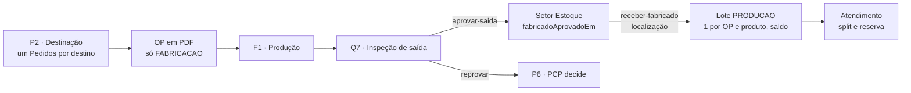

# Contrato 53 — Ordem de Produção e lote do fabricado (MES)

> **Onde atua:** MES: banco, API, front

> [!abstract] Resumo em linguagem natural
> **O que é:** Define a Ordem de Produção (OP) como documento em PDF, numerada `pedidoVenda/N`, só para destinos de fabricação. Define também que o item fabricado vira lote no Estoque depois da inspeção de saída.
> **Quem é afetado:** PCP, Produção, Qualidade e Estoque no MES. Aprovada na inspeção de saída, a peça vai ao Estoque, não mais à Expedição, e o Estoque informa a localização.
> **Situação:** Proposta, dono Robert. Nada existe no código; o SQL foi escrito e validado em banco descartável. Estimativa: 3,0 e 4,0 pd, dentro do Ciclo 1.
> **Exemplo:** Pedido 27605 com dois destinos de fabricação e um de revenda gera duas OPs, 27605/1 e 27605/2.

> [!info] Situação em 15/10/2026
> **Status:** `proposta` · **Pasta:** `Ativos` · **Nós do 0b:** P2, F1, Q7, Q8, E5 · **Dono:** Robert (MES, sem API entre sistemas)
>
> - 📝 **N14-22:** a OP é uma **entidade** e um **documento para impressão**, só para o que será fabricado. **N14-06:** tudo que é fabricado ou comprado vai ao Estoque e vira lote e saldo. **N14-29 (15/10):** proposta do Robert aceita. Estimativas (±30%): **BL-052 3,0 pd** e **BL-008 4,0 pd**, ambas **dentro** da conta do Ciclo 1.
> - 🔴 **Nada existe no código** (`api-pcp`): o "OP" é só o texto `pedidoVenda/N` em `Pedidos.ordemProducao` (`@@unique([ordemProducao])`); `OrigemLote` só tem `RECEBIMENTO` e `CARGA_INICIAL`; o "sim" da inspeção de saída é um `mover` que leva à Expedição.
> - ✅ **SQL escrito e validado** em banco descartável (PostgreSQL 18, tabelas-esqueleto): [[0001-origem-lote-producao.sql]] e [[0002-op-e-lote-do-fabricado.sql]] em `LOG-53-anexos/`. Validado: um lote `PRODUCAO` por OP e produto (o segundo é recusado), lote `PRODUCAO` sempre com OP e os demais nunca, vários lotes de recebimento do mesmo produto continuam possíveis, contagem de impressões. **Não validado:** contra o schema real do MES e nenhum código existe.
>
> Selos em [[Regras-do-Vault]]. Rotas, nomes e o conteúdo do PDF são **propostas** para o Robert ajustar; as regras são as decididas.

## Achados do código que moldam o desenho

1. **A "ordem" que a Destinação cria já é a OP.** `criarCompletoLote` (`pedidos.service.ts:191-424`) cria **um `Pedidos` por destino** (`Fabrica`) em cada envio, com `ordemProducao = ${pedidoVenda}/${numero}`. `Pedidos.idFabrica` aponta a `Fabrica`, e `Fabrica.tipo` é `FABRICACAO` ou `REVENDA`. Logo: **a OP é o `Pedidos` de um destino de `FABRICACAO`**; a de `REVENDA` é só a ordem interna. Não precisa de tabela nova, só do que falta: a emissão, o PDF e a ligação com o lote.
2. **O "OP" de hoje é um anexo.** `TipoAnexo.ORDEM_PRODUCAO` guarda o PDF do PCP legado (campo `anexoOrdemProducaoUrl` na criação), e `GET /pedidos/:id/imprimir?tipos=ORDEM_PRODUCAO,…` apenas **junta anexos** num PDF (`PedidosPdfService.imprimir`, `pdf-lib`). Há também `GET /pedidos/:id/relatorio`. Não existe geração do documento pelo sistema.
3. **Não existe `OrdemProducaoController`.** `ordens-producao` é só o slug de permissão; todas as rotas de ordem são `/pedidos/...` (`PedidosController`).
4. **A "inspeção de saída" não tem código próprio.** É um setor `tipo = QUALIDADE` do roteiro: o "sim" é `PATCH /itens-parciais/:id/mover` e o "não" é `PATCH /itens-parciais/:id/reprovar` (`ensureSetorAtualEhInspecaoQualidade`). O comentário em `pedidos.service.ts:487-488` já diz que o Estoque "entra com a baixa no despacho (passo 3)".
5. **O Estoque é o setor `estoque` (etapa 0 fixa)** de todo roteiro e `ensureSetorPertenceAFabrica` o aceita: a parcela aprovada pode voltar a ele com `idSetorDestino`.

## Parte 1: Ordem de Produção (BL-052)

### Regras

| # | Regra |
|---|---|
| 1 | **Uma ordem por destino em cada envio**, numerada em sequência por pedido de venda: `pedidoVenda/N` (ex.: `27605/1`, `27605/2`) — como hoje |
| 2 | **A OP é a ordem de um destino de FABRICAÇÃO** (`Fabrica.tipo = FABRICACAO`): entidade, documento imprimível (PDF) e numeração. **Revenda não gera OP** |
| 3 | **Não agrupar tudo no `/1`:** cada destino tem roteiro, fila, prazo de fábrica e responsável próprios; agrupar misturaria fábricas e impediria o lote por OP |
| 4 | **Numeração: sequência única `pedidoVenda/N`** (N14-29). A OP pode **pular número** quando a revenda saiu antes |
| 5 | O que o **Estoque atende** não gera OP; só vira OP o que segue para a produção |
| 6 | **O PDF gerado pelo sistema passa a ser o documento `ORDEM_PRODUCAO`**; o anexo `ORDEM_PRODUCAO` carregado (legado) continua valendo e o `imprimir` o usa se existir |
| 7 | O BL-036 (renomear rotas e campos antigos) **não bloqueia** este contrato |

Exemplo (pedido 27605, 10 produtos; primeira leva com 3 produtos, um por destino):

| `Pedidos.ordemProducao` | Destino (`Fabrica`) | Tipo | Documento |
|---|---|---|---|
| 27605/1 | Flanges | FABRICACAO | Ordem + OP impressa |
| 27605/2 | Caldeiraria HRM | FABRICACAO | Ordem + OP impressa |
| 27605/3 | Revenda | REVENDA | Só a ordem interna, sem OP |
| 27605/4… | próximos envios | — | Continuam a sequência |

### Dados ([[0002-op-e-lote-do-fabricado.sql]], seção 1)

```prisma
model Pedidos {
  // ... campos de hoje ...
  opEmitidaEm    DateTime? @map("op_emitida_em")        // gravado na criação, para destino FABRICACAO
  opEmitidaPorId String?   @map("op_emitida_por_id") @db.Uuid
  opImpressoes   Int       @default(0) @map("op_impressoes")
}
```
A `criarCompletoLote` grava `opEmitidaEm` e `opEmitidaPorId` quando `fabrica.tipo = FABRICACAO`.

### Rota (proposta)

**`GET /pedidos/:id/op`** — `ordens-producao:visualizar` (mesma permissão do `imprimir`). Gera o PDF da OP e incrementa `opImpressoes`; a partir da 2ª impressão o PDF sai com a marca "2ª via". Pedido de destino `REVENDA`: `409 "Revenda não gera Ordem de Produção"`.
- `Content-Type: application/pdf`, `Content-Disposition: inline; filename="OP-27605-1.pdf"` (a `/` do número vira `-`).
- O `GET /pedidos/:id/imprimir?tipos=…` passa a usar o PDF gerado para o tipo `ORDEM_PRODUCAO` quando não houver anexo carregado.

### O documento (PDF; 🟡 Robert ajusta, gerado com `pdf-lib` como o `imprimir`)

Cabeçalho: número da OP (`27605/1`), pedido de venda, cliente, vendedor, unidade (`Pedidos.nomeUnidade`), destino/fábrica (`Fabrica.nome`), prioridade, **prazo de entrega** (`Pedidos.prazoEntrega`), data de emissão e emitente. Itens (`ItensPedido`): código, descrição, quantidade, unidade, **quantidade desta ordem** (a das parcelas criadas). **Roteiro:** os setores na ordem (`Roteiros`). Rodapé: observações (`Pedidos.observacoes`) e, se for reimpressão, "2ª via" com a data. Quando houver `acompanhamentoQualidade = true`, uma linha "Qualidade acompanha desde o início".

## Parte 2: o fabricado vira lote (BL-008)

### Regras

| # | Regra |
|---|---|
| 1 | **Um lote por OP e produto.** Uma OP com mais de um produto gera um lote por produto |
| 2 | **`OrigemLote.PRODUCAO`**, com a ligação à OP (`Lote.idPedidoOp` = o `Pedidos` da OP): rastreabilidade do que foi fabricado |
| 3 | **Aprovação em partes:** a segunda aprovação **soma ao mesmo lote** da OP e produto |
| 4 | **O "sim" da inspeção de saída leva ao Estoque** (corrige o fluxo de hoje, que segue à Expedição) |
| 5 | **O Estoque informa a localização ao receber**: só aí o lote ganha saldo |
| 6 | A parcela é **atendida a partir desse lote** (split e reserva do Atendimento) |
| 7 | **Reprovar** continua abrindo divergência e o PCP decide (P6); **não** gera RNC nem nota de devolução e **não** cria lote |
| 8 | O lote nasce **`LIBERADO`** (a inspeção de saída já aprovou), sem quarentena |
| 9 | **Custo:** no Ciclo 1 o lote do fabricado nasce **sem custo** (sem `LoteCusto`), sinalizado; o custo do fabricado é do Ciclo 2 ([[API-008-Custo-do-Lote-no-MES]], K9 a K11 🟡) |

### Dados ([[0001-origem-lote-producao.sql]] e [[0002-op-e-lote-do-fabricado.sql]], seções 2 e 3)

```prisma
enum OrigemLote { RECEBIMENTO CARGA_INICIAL PRODUCAO }

model Lote {
  // ... campos de hoje ...
  idPedidoOp String? @map("id_pedido_op") @db.Uuid
  pedidoOp   Pedidos? @relation("LoteOp", fields: [idPedidoOp], references: [id], onDelete: SetNull)
  // índice parcial único (id_pedido_op, id_material) WHERE origem = 'PRODUCAO'  (só na migration)
  // CHECK: (origem = 'PRODUCAO') = (id_pedido_op IS NOT NULL)
}

model ItemParcial {
  // ... campos de hoje ...
  fabricadoAprovadoEm DateTime? @map("fabricado_aprovado_em")  // a Qualidade de saída aprovou
  idLoteFabricado     String?   @map("id_lote_fabricado") @db.Uuid
  loteFabricado       Lote?     @relation("ParcialLoteFabricado", fields: [idLoteFabricado], references: [id], onDelete: SetNull)
}
```
A migration do valor novo do enum fica **sozinha** (arquivo 0001): no PostgreSQL o valor recém-criado não pode ser usado na mesma transação, e o índice parcial da migration seguinte filtra por `'PRODUCAO'`.

### Rotas (propostas)

**R1. `PATCH /itens-parciais/:id/aprovar-saida`** — `movimentacoes:editar`, corpo `{ "observacao"?: string }` (máx. 500).
- Valida: `ensurePodeAtuar`; o setor atual é `tipo QUALIDADE`; `status EM_ANDAMENTO`; a ordem (`Pedidos`) é de `FABRICACAO`.
- Efeito: grava `fabricadoAprovadoEm`, move a parcela ao setor `estoque` (`status EM_TRANSITO`, `idSetorOrigem` o atual) e cria `HistoricoItemParcial` ("Inspeção de saída aprovada"). **Ainda não cria lote.**
- `PATCH /itens-parciais/:id/mover` num setor de Qualidade de uma ordem de `FABRICACAO` passa a responder `409 "Use Aprovar na inspeção de saída"`.

**R2. `PATCH /itens-parciais/:id/receber-fabricado`** — `movimentacao:criar` (permissão de movimentação do Estoque — ❓ confirmar o slug exato da tela de movimentação no `auth.rotas_telas`, Robert, 19/10), corpo:
```json
{ "idLocalizacao": "uuid", "observacao": "Prateleira B-3" }
```
- Valida: a parcela está no setor `estoque`, `fabricadoAprovadoEm` preenchido e `idLoteFabricado` nulo (senão `409`).
- Efeito, **numa transação**: localiza o `Material` do item (por `codigoEmpresa = pedido.idUnidade` e `codigoProduto = itemPedido.codigo`; 🔴 Q2); **acha ou cria** o `Lote` (`origem PRODUCAO`, `idPedidoOp = pedido.id`, `statusQualidade LIBERADO`, `quantidade += parcela.quantidade`); grava o `MovimentoEstoque` `ENTRADA` (motivo "Fabricado, OP 27605/1") e o `SaldoEstoque` (`aplicarDeltaSaldo`) na localização; grava `ItemParcial.idLoteFabricado`.
- Resposta `200`: `{ "idItemParcial": "uuid", "lote": { "id": "uuid", "codigo": "LT-20261022-0007", "quantidade": 30, "origem": "PRODUCAO" } }`.
- A **segunda aprovação** da mesma OP e produto passa por R1 e R2 de novo e **soma** ao lote existente.

**R3. Guarda no Atendimento.** `PATCH /itens-parciais/:id/atender-estoque` recusa (`409 "Receba o fabricado no Estoque antes de atender"`) a parcela com `fabricadoAprovadoEm` e sem `idLoteFabricado`. Depois de R2 o Atendimento segue como hoje (reserva do lote, parcela à Expedição).

### Fluxo



## O que não muda

A Triagem e a Destinação, o roteiro dos setores produtivos, a inspeção de **entrada** do comprado (`qualidade.service.ts`, lote por lote) e a divergência de produção. O consumo de matéria-prima (BL-010) e o documento de retirada ([[LOG-54-Documento-de-Retirada-e-Baixa-na-Retirada]]) são contratos à parte.

## Critérios de aceite

1. Destinação com 3 destinos (2 `FABRICACAO`, 1 `REVENDA`) cria 3 `Pedidos` e **2 OPs** (`opEmitidaEm` preenchido só nas 2); `GET /pedidos/:id/op` devolve o PDF das 2 e `409` na revenda.
2. A numeração segue `pedidoVenda/N`; a OP pode sair `/2` e `/3`.
3. `aprovar-saida` leva a parcela ao Estoque (não à Expedição) e `mover` na Qualidade de saída é recusado. ✅ tela do `app-pcp` atualizada (Robert, 19/10).
4. `receber-fabricado` cria o lote `PRODUCAO` ligado à OP, com `ENTRADA` e saldo na localização informada, e grava `idLoteFabricado` (✅ a unicidade por OP e produto está validada no banco de teste).
5. Aprovar em duas partes **soma** ao mesmo lote da OP e produto; OP com dois produtos gera dois lotes.
6. `atender-estoque` recusa a parcela do fabricado que ainda não foi recebida no Estoque.
7. Reprovar não cria lote e abre a divergência.
8. O lote do fabricado nasce `LIBERADO`, sem `LoteCusto`, e aparece em Saldo.
9. A OP pode ser reimpressa: 2ª via, `opImpressoes` incrementa.
10. A migration aplica sem erro e os `CHECK` e o índice parcial recusam lote `PRODUCAO` sem OP, lote de recebimento com OP e dois lotes `PRODUCAO` da mesma OP e produto (✅ validado no banco de teste).

## Ordem

1. Robert: migrations 0001 e 0002; emissão da OP e `GET /pedidos/:id/op` (BL-052). 2. Robert: R1, R2 e R3 (BL-008). 3. Tela do Estoque para informar a localização do fabricado. A saída do Estoque até a Expedição depende do [[LOG-54-Documento-de-Retirada-e-Baixa-na-Retirada]].

## Perguntas em aberto

| # | Pergunta | Dono | Selo |
|---|---|---|---|
| Q1 | Conteúdo exato do PDF (campos, assinatura, código de barras, logotipo da unidade)? | Robert, Nathan | 🟡 |
| Q2 | Como achar o `Material` do item do pedido: `ItensPedido.codigo` é o `codigo_produto`? Se o `Material` não existir, `upsertMaterialDoAvhub` como na `requisitar`? | Robert | ❓ |
| Q3 | Reprovação total depois de aprovações parciais: o lote já criado fica como está? | Robert | 🟡 |
| Q4 | A Caldeiraria HRM (outra unidade) emite OP no mesmo molde? | Nathan | ❓ |
| Q5 | A OP precisa de status próprio (emitida, em produção, concluída, cancelada) ou segue a parcela? Proposta: segue a parcela, sem status próprio | Robert | 🟡 |

Relacionados: [[02-PCP-Triagem-e-Destinacao]], [[07-Producao-e-Roteiro]], [[08-Qualidade-Saida]], [[03-Estoque-Atendimento-e-Despacho]], [[API-008-Custo-do-Lote-no-MES]], [[LOG-54-Documento-de-Retirada-e-Baixa-na-Retirada]], [[Backlog-por-Frente]] (BL-036, BL-052, BL-008), [[Registro-de-Decisoes]] (N14-06, N14-22, N14-29).
