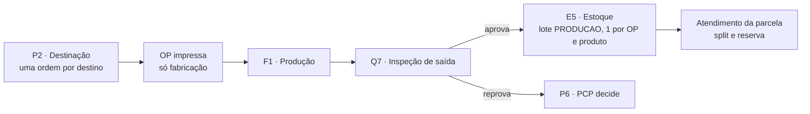

# Contrato 53 — Ordem de Produção e lote do fabricado (MES)

> [!info] Situação em 15/10/2026
> **Status:** `proposta` · **Pasta:** `Ativos` · **Nós do 0b:** P2, F1, Q7, Q8, E5 · **Dono:** Robert (MES, sem API entre sistemas)
>
> - 📝 **N14-22:** a Ordem de Produção (OP) é uma **entidade** e também um **documento para impressão**, emitido **só para o que será fabricado**. **N14-06:** tudo que é fabricado ou comprado vai para o Estoque e vira lote e saldo. **N14-29 (15/10):** proposta do Robert aceita.
> - 🔴 **Nada existe no código** (`api-pcp` `develop` `6914fe9`): `ordemProducao` é só o texto `pedidoVenda/N` no `Pedidos` (`producao.prisma:97`); `OrigemLote` só tem `RECEBIMENTO` e `CARGA_INICIAL`; o "sim" da inspeção de saída leva à Expedição, não ao Estoque.
> - Estimativas do Robert (±30%): **BL-052 (OP) 3,0 pd** e **BL-008 (lote do fabricado) 4,0 pd**, ambos **dentro** da conta do Ciclo 1 (déficit de 29,6 pd, N14-32).

**Destinatários:** MES (`api-pcp` e `app-pcp`, Robert). Não há contrato de API com o av-hub: a OP e o lote são do MES. Selos em [[Regras-do-Vault]].

## Por quê

Hoje o código grava uma "ordem" por destino, numerada em sequência por pedido de venda, sem documento e sem distinção entre o que se fabrica e o que se revende. E o fabricado aprovado **nunca vira lote**: vai direto à Expedição, sem saldo, sem reserva e sem rastreabilidade. Isso contradiz a decisão de que tudo entra pelo Estoque. Este contrato cria a OP e o lote do fabricado.

## Parte 1: Ordem de Produção (BL-052)

### Regras

| # | Regra |
|---|---|
| 1 | **Uma ordem por destino em cada envio**, como hoje, numerada em sequência por pedido de venda: `pedidoVenda/N` (ex.: `27605/1`, `27605/2`) |
| 2 | **A OP é a ordem de um destino de FABRICAÇÃO**: entidade, documento imprimível (PDF) e numeração. **Revenda não gera OP**: fica só a ordem interna |
| 3 | **Não agrupar tudo no `/1`:** cada destino tem roteiro, fila, prazo de fábrica e responsável próprios; agrupar misturaria fábricas num documento e impediria o lote por OP |
| 4 | **Numeração: sequência única `pedidoVenda/N`** (decisão do Nathan, N14-29). A OP pode **pular número** quando a revenda saiu antes (as OPs seriam `/2` e `/3`) |
| 5 | O que o **Estoque atende** não gera OP; só vira OP o que segue para a produção (o restante do Atendimento "enviar à produção") |
| 6 | Libera o **nome "Ordem de Produção"** para a entidade nova: renomear os nomes técnicos antigos (`/ordens-producao/novo`, campo `ordemProducao`, prefixo `OP-`) é o BL-036, que **não bloqueia** este contrato |

Exemplo (pedido 27605, 10 produtos, primeira leva com 3 produtos, um por destino):

| Ordem | Destino | Tipo | Documento |
|---|---|---|---|
| 27605/1 | Flanges | Fabricação | Ordem + OP impressa |
| 27605/2 | Caldeiraria HRM | Fabricação | Ordem + OP impressa |
| 27605/3 | Revenda | Revenda | Só a ordem interna, sem OP |
| 27605/4… | próximos envios | — | Continuam a sequência |

### O documento da OP (PDF)

Proposta de conteúdo (🟡 Robert ajusta): número (`27605/1`), pedido de venda e unidade, cliente, data de emissão e emitente, destino/fábrica, **prazo**, observações, e por item: código do produto, descrição, quantidade, unidade de medida e o **roteiro** (setores na ordem). O documento é gerado a partir da OP e pode ser impresso de novo (mesmo conteúdo, marca de "segunda via").

### Dados e rotas (desenho do Robert)

- **Entidade `OrdemProducao`**: id, número `pedidoVenda/N` (único), pedido, destino, tipo (`FABRICACAO`), status, emitida em/por, itens. As ordens de revenda continuam na tabela atual de ordem por destino, sem OP.
- **Rotas (proposta):** listar e detalhar a OP; `GET .../documento` devolvendo o PDF. Tela de OP: lista, detalhe e botão "Imprimir". 🟡 Nomes de rota e de slug do Robert, com o BL-036 em mente.

## Parte 2: o fabricado vira lote (BL-008)

### Regras

| # | Regra |
|---|---|
| 1 | **Um lote por OP e produto.** Uma OP pode ter mais de um produto; cada produto aprovado gera o seu lote |
| 2 | **Origem nova `OrigemLote.PRODUCAO`**, com a **ligação com a OP** (`idOrdemProducao` no lote): rastreabilidade do que foi fabricado |
| 3 | **Aprovação em partes na Qualidade de saída:** a segunda aprovação **soma ao mesmo lote** da OP (continua um lote por OP e produto) |
| 4 | **O aprovado volta ao Estoque** (corrige o fluxo de hoje, que segue para a Expedição): o "sim" do Q8 leva ao Estoque, setor de retorno no roteiro fixo, como o circuito de compra |
| 5 | **O Estoque informa a localização** ao receber o lote do fabricado |
| 6 | A parcela do pedido é **atendida a partir desse lote**, como qualquer outro saldo (split e reserva do Atendimento) |
| 7 | **Qualidade de saída:** reprovação continua abrindo divergência e o PCP decide (P6, novo norte); **não** gera RNC nem nota de devolução e **não** cria lote |
| 8 | O lote do fabricado nasce **liberado** (a inspeção de saída já aprovou), sem quarentena; entra no saldo disponível da filial |
| 9 | **Custo:** no Ciclo 1 o lote do fabricado nasce **sem custo** e sinalizado; o custo do fabricado é do Ciclo 2 ([[API-008-Custo-do-Lote-no-MES]], K9 a K11 🟡) |

### Fluxo

### Dados (desenho do Robert)

`OrigemLote.PRODUCAO`; `Lote.idOrdemProducao`; movimento de `ENTRADA` na aprovação; setor de retorno ao Estoque no roteiro fixo; ação "aprovar" na inspeção de saída (hoje o inspetor usa `mover`, `qualidade.service.ts:97`); tela do Estoque para informar a localização.

## O que não muda

A Triagem e a Destinação, o roteiro dos setores produtivos (F1) e a divergência de produção. O consumo de matéria-prima (BL-010) e o documento de retirada ([[LOG-54-Documento-de-Retirada-e-Baixa-na-Retirada]]) são contratos à parte.

## Critérios de aceite

1. Destinação com 3 destinos (2 fabricação, 1 revenda) cria 3 ordens e **2 OPs** com PDF; a revenda não gera OP.
2. A numeração segue `pedidoVenda/N`, e a OP pode sair `/2` e `/3`.
3. Aprovar o item na Qualidade de saída cria o lote `PRODUCAO` ligado à OP, com `ENTRADA` no saldo, e a parcela vai ao Estoque (não à Expedição).
4. Aprovar em duas partes soma ao mesmo lote da OP e produto.
5. OP com dois produtos gera dois lotes.
6. Reprovar não cria lote e abre a divergência.
7. O Estoque informa a localização ao receber; o lote aparece em Saldo.
8. A parcela é atendida a partir do lote e segue para a Expedição com reserva (a baixa fica para a retirada, LOG-54).
9. A OP pode ser reimpressa com o mesmo conteúdo.

## Ordem

1. Robert: entidade e documento da OP (BL-052). 2. Robert: `PRODUCAO`, ação "aprovar" e retorno ao Estoque (BL-008). 3. Estoque: localização na entrada do fabricado. Depende do [[LOG-54-Documento-de-Retirada-e-Baixa-na-Retirada]] para a saída do Estoque até a Expedição.

## Perguntas em aberto

| # | Pergunta | Dono | Selo |
|---|---|---|---|
| Q1 | Conteúdo exato do PDF da OP (campos, assinatura, código de barras)? | Robert, Nathan | 🟡 |
| Q2 | A OP tem status próprio (emitida, em produção, concluída, cancelada) ou segue o da parcela? | Robert | 🟡 |
| Q3 | Reprovação total da OP: o lote já criado por aprovação parcial anterior fica como está? | Robert | 🟡 |
| Q4 | A Caldeiraria HRM (outra unidade) emite OP no mesmo molde? | Nathan | ❓ |

Relacionados: [[02-PCP-Triagem-e-Destinacao]], [[07-Producao-e-Roteiro]], [[08-Qualidade-Saida]], [[03-Estoque-Atendimento-e-Despacho]], [[API-008-Custo-do-Lote-no-MES]], [[LOG-54-Documento-de-Retirada-e-Baixa-na-Retirada]], [[Backlog-por-Frente]] (BL-036, BL-052, BL-008), [[Registro-de-Decisoes]] (N14-06, N14-22, N14-29).
