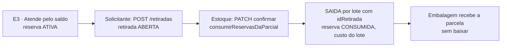

# Contrato 54 — Documento de retirada e baixa do saldo na retirada (MES)

> **Onde atua:** MES: banco, API, front

> [!info] Situação em 15/10/2026
> **Status:** `proposta` · **Pasta:** `Ativos` · **Nós do 0b:** E6, X1, F1 · **Dono:** Robert (MES, sem API entre sistemas)
>
> - 📝 **N14-05 (14/10):** o despacho é no Estoque; **quem precisa da mercadoria** (Expedição ou Produção) gera um **documento de retirada**; **a baixa do saldo acontece na retirada**.
> - 🔴 **Não existe no código** (`api-pcp`): hoje a baixa roda quando a Embalagem **recebe** a parcela (`consumirReservasDaParcial` em `receber()`, `itens-parciais.service.ts:275-285`) e há uma segunda chamada "de garantia" na entrega (`entregas.service.ts:84-94`). Nenhuma ocorrência de "retirada" em `api-pcp/src` nem em `app-pcp`.
> - ✅ **SQL escrito e validado** em banco descartável (PostgreSQL 18, tabelas-esqueleto): [[0001-documento-de-retirada.sql]] em `LOG-54-anexos/`. Validado: a mesma parcela não entra duas vezes na retirada; não se retira mais que o solicitado; confirmar exige quem confirmou; cancelar exige quem cancelou e o motivo; o movimento de saída carrega a retirada. **Não validado:** contra o schema real do MES; nenhum código existe.
> - 🔴 **Perguntas do Nathan abertas** (seção "Perguntas"): quem gera o documento e o que ele imprime, e se a reserva continua depois da retirada. O desenho abaixo adota a proposta mais simples para cada uma, marcada.
> - **BL-007: 3,5 pd (±30%) do Robert, fora da conta do Ciclo 1** até o Nathan decidir (se entrar, o déficit vai a 36,1 pd e a W0 a 03/03/2027 a 75% de foco).

Selos em [[Regras-do-Vault]]. Rotas, nomes e telas são **propostas**; as regras são as decididas ou marcadas 🟡.

## Por quê

A mercadoria do Estoque sai sem um registro de **quem retirou, quando e o que**: o saldo baixa como efeito colateral de a Embalagem receber a parcela e, de novo, na entrega. Isso mistura estoque e expedição, não serve à matéria-prima enviada à produção e não deixa trilha de retirada.

## Estado do código (o que muda)

| Onde | Hoje | Depois |
|---|---|---|
| `ItensParciaisService.receber` (`:275-285`) | Se `atendidoPeloEstoque`, chama `consumirReservasDaParcial` ("Recebido na Expedição") | **Não baixa.** Exige a retirada confirmada (regra 6) |
| `ItensParciaisService.desfazerRecebimento` (`:1587`) | Chama `estornarConsumosDaParcial` | Não estorna a baixa (o recebimento não baixou); estorno da baixa vira ação sobre a retirada (Q4) |
| `EntregasService.create` (`:84-94`) | Chama `consumirReservasDaParcial` de novo, "de garantia" | **Sai.** Exige que a reserva esteja consumida (retirada confirmada), senão `409` |
| `consumirReservasDaParcial` (helpers `:208-277`) | Consome as reservas `ATIVA` da parcela (mais antigas primeiro), tira o saldo das localizações do lote (maior saldo primeiro) com `aplicarDeltaSaldo` e grava `MovimentoEstoque SAIDA` com `idReserva` | **Reaproveitada** na confirmação da retirada; passa a gravar também `idRetirada` no movimento |

## Regras

| # | Regra | Selo |
|---|---|---|
| 1 | **Quem precisa da mercadoria gera o documento:** a Expedição (produto pronto) ou a Produção (matéria-prima ou beneficiamento) | 📝 N14-05 |
| 2 | O documento traz **parcelas, quantidades e solicitante**; os lotes saem das **reservas** da parcela (a parcela atendida pelo Estoque já tem reserva `ATIVA`) | 📝 / 🟡 |
| 3 | **A baixa do saldo é do Estoque, na confirmação da retirada**, reaproveitando `consumirReservasDaParcial`; nunca no recebimento da Embalagem nem na entrega | 📝 N14-05 |
| 4 | A baixa grava `SAIDA` por lote (com `idReserva` e, agora, `idRetirada`), consome a reserva e guarda o **custo do lote no momento** ([[API-008-Custo-do-Lote-no-MES]], K6) | 📝 |
| 5 | **Retirada parcial** é válida: baixa só o que foi retirado e mantém o restante reservado; a retirada fica `PARCIAL` até completar | 🟡 |
| 6 | A Embalagem só **recebe** (`receber()`) a parcela atendida pelo Estoque depois da retirada **confirmada** (é a retirada que traz a mercadoria até ela). Parcela que não vem do Estoque recebe como hoje | 🟡 Q3 |
| 7 | Cancelar a retirada **`ABERTA`** não altera saldo nem reserva. Retirada `PARCIAL` ou `CONFIRMADA` não cancela: o estorno é outra ação (Q4) | 🟡 |
| 8 | A retirada não altera lote nem quarentena: só movimenta o que está **liberado e reservado** | 🟡 |
| 9 | O fabricado aprovado entra no Estoque como lote ([[LOG-53-Ordem-de-Producao-e-Lote-do-Fabricado]]) e **sai pelo mesmo documento** até a Expedição | 📝 N14-06 |
| 10 | A matéria-prima enviada à produção sai pelo mesmo documento (tipo `PRODUCAO`); o consumo e a genealogia são o BL-010, contrato à parte | 📝 |

## Dados ([[0001-documento-de-retirada.sql]])

```prisma
enum TipoRetirada   { EXPEDICAO PRODUCAO }
enum StatusRetirada { ABERTA PARCIAL CONFIRMADA CANCELADA }

model Retirada {
  id                 String          @id @default(uuid()) @db.Uuid
  codigo             String          @unique @db.VarChar(30)       // RT-AAAAMMDD-NNNN (gerarCodigo(tx, 'RT', 'retirada'))
  tipo               TipoRetirada
  status             StatusRetirada  @default(ABERTA)
  idSetorSolicitante String          @map("id_setor_solicitante") @db.Uuid
  setorSolicitante   Setor           @relation(fields: [idSetorSolicitante], references: [id])
  observacao         String?         @db.VarChar(500)
  motivoCancelamento String?         @map("motivo_cancelamento") @db.VarChar(500)
  solicitadaPorId    String          @map("solicitada_por_id") @db.Uuid
  solicitadaEm       DateTime        @default(now()) @map("solicitada_em")
  confirmadaPorId    String?         @map("confirmada_por_id") @db.Uuid
  confirmadaEm       DateTime?       @map("confirmada_em")
  canceladaPorId     String?         @map("cancelada_por_id") @db.Uuid
  canceladaEm        DateTime?       @map("cancelada_em")
  updatedAt          DateTime        @updatedAt @map("updated_at")
  itens              RetiradaItem[]
  movimentos         MovimentoEstoque[]
  @@index([status])
  @@index([tipo, status])
  @@map("retiradas")
}

model RetiradaItem {
  id                   String       @id @default(uuid()) @db.Uuid
  idRetirada           String       @map("id_retirada") @db.Uuid
  retirada             Retirada     @relation(fields: [idRetirada], references: [id], onDelete: Cascade)
  idItemParcial        String       @map("id_item_parcial") @db.Uuid
  itemParcial          ItemParcial  @relation(fields: [idItemParcial], references: [id])
  quantidadeSolicitada Decimal      @map("quantidade_solicitada") @db.Decimal(14, 4)
  quantidadeRetirada   Decimal      @default(0) @map("quantidade_retirada") @db.Decimal(14, 4)
  @@unique([idRetirada, idItemParcial])
  @@index([idItemParcial])
  @@map("retiradas_itens")
}

model MovimentoEstoque {
  // ... campos de hoje ...
  idRetirada String?   @map("id_retirada") @db.Uuid
  retirada   Retirada? @relation(fields: [idRetirada], references: [id], onDelete: SetNull)
}
```

## Rotas (propostas; permissão nova `retiradas`)

Tela nova no cadastro de permissões do MES (`retiradas`, com `visualizar`, `criar`, `editar`). ❓ Robert confirma onde as telas são cadastradas e quais perfis recebem. O padrão de erro é o do Nest (`{ statusCode, message, error }`).

### `POST /retiradas` — `retiradas:criar`

```json
{ "tipo": "EXPEDICAO", "idSetorSolicitante": "uuid-do-setor-embalagem",
  "observacao": "Cliente retira hoje às 15h",
  "itens": [ { "idItemParcial": "uuid", "quantidade": 10 } ] }
```
- Valida: `ensurePodeAtuar` no setor solicitante; cada parcela é `atendidoPeloEstoque` e tem reserva `ATIVA` que cubra a quantidade (senão `409 "A parcela … não tem reserva ativa suficiente"`); a parcela não está em outra retirada `ABERTA` ou `PARCIAL`.
- Resposta `201`: `{ "id": "uuid", "codigo": "RT-20261022-0003", "status": "ABERTA", "tipo": "EXPEDICAO", "itens": [ { "id": "uuid", "idItemParcial": "uuid", "quantidadeSolicitada": 10, "quantidadeRetirada": 0 } ] }`.

### `GET /retiradas` e `GET /retiradas/:id` — `retiradas:visualizar`

Filtros: `status`, `tipo`, `de`, `ate`, `idSetorSolicitante`. O detalhe traz, por item, a parcela (pedido, produto, ordem), as **reservas** e os **lotes** com localização (de onde separar) e, depois de confirmada, os movimentos de saída.

### `PATCH /retiradas/:id/confirmar` — `retiradas:editar` (Estoque)

```json
{ "itens": [ { "idItem": "uuid", "quantidadeRetirada": 10 } ], "observacao": "Separado do lote LT-20260930-0012" }
```
- **Numa transação:** para cada item, chama `consumirReservasDaParcial(tx, { idItemParcial, quantidade: quantidadeRetirada, userId, motivo: "Retirada RT-… — item …" })` e grava `RetiradaItem.quantidadeRetirada`; os `MovimentoEstoque SAIDA` criados recebem `idRetirada`. `quantidadeRetirada <= quantidadeSolicitada`.
- Estado: tudo retirado → `CONFIRMADA`; parte → `PARCIAL` (a retirada segue aberta para o restante); `confirmadaPorId` e `confirmadaEm` gravados.
- Saldo físico menor que a reserva: o `consumirReservasDaParcial` já responde `409 "Saldo físico do lote da reserva não cobre a saída… registre um ajuste de estoque"` e nada é gravado.
- Resposta `200`: a retirada com os itens e os movimentos.

### `PATCH /retiradas/:id/cancelar` — `retiradas:editar`

`{ "motivo": "Parcela cancelada" }` (3 a 500). Só retirada `ABERTA`. Grava `canceladaPorId`, `canceladaEm`, `motivoCancelamento`. Não toca saldo nem reserva.

## Mudanças em rotas que já existem

- `PATCH /itens-parciais/:id/receber`: se a parcela é `atendidoPeloEstoque` e a reserva ainda está `ATIVA` (sem retirada confirmada), `409 "Aguardando a retirada no Estoque"`; **remove** a chamada de `consumirReservasDaParcial`.
- `POST /entregas`: **remove** a chamada de `consumirReservasDaParcial` (`entregas.service.ts:84-94`); se `atendidoPeloEstoque` e a reserva não está `CONSUMIDA`, `409 "Retirada não confirmada"`.
- `PATCH /itens-parciais/:id/desfazer-recebimento`: deixa de chamar `estornarConsumosDaParcial` (linha `:1587`), porque o recebimento não baixou.
- `GET /estoque/reservas` ganha a retirada do movimento (opcional).

## Telas (Robert, `app-pcp`)

| Quem | Onde | O quê |
|---|---|---|
| Embalagem (Expedição) ou Produção | Fila do setor | Botão **Pedir retirada** na parcela atendida pelo Estoque (chama `POST /retiradas`); a parcela só pode ser recebida depois da confirmação |
| Estoque | Nova tela **Retiradas** | Lista `ABERTA` e `PARCIAL`, mostra lotes e localizações a separar, **Confirmar** (baixa) |
| Estoque | Saldo e Movimentos | A `SAIDA` mostra a retirada de origem |

## Como o fluxo muda

| Hoje | Depois |
|---|---|
| Atende → reserva → parcela vai à Embalagem → **`receber()` baixa** → entrega baixa de novo se faltou | Atende → reserva → parcela vai à Embalagem → o solicitante **pede a retirada** → o Estoque **confirma e baixa** → a Embalagem **recebe** |



## Critérios de aceite

1. `PATCH /itens-parciais/:id/receber` de parcela atendida pelo Estoque, sem retirada confirmada, devolve `409`; depois da confirmação, recebe **sem** baixar de novo.
2. `POST /retiradas` com parcela sem reserva suficiente devolve `409`; com reserva cria a retirada `ABERTA` com código `RT-…`.
3. `PATCH /retiradas/:id/confirmar` baixa por lote, consome a reserva, grava `SAIDA` com `idReserva` **e** `idRetirada`, e registra o custo do lote no momento.
4. Retirada parcial baixa só a parte; fica `PARCIAL`; a reserva do restante continua `ATIVA`.
5. `POST /entregas` **não baixa** mais; recusa se a retirada não foi confirmada.
6. Retirada de matéria-prima pela Produção funciona pelo mesmo documento (tipo `PRODUCAO`).
7. O fabricado aprovado ([[LOG-53-Ordem-de-Producao-e-Lote-do-Fabricado]]) sai do Estoque até a Expedição por retirada.
8. `PATCH /retiradas/:id/cancelar` só em retirada `ABERTA`, exige motivo e não altera saldo nem reserva.
9. Histórico: cada retirada guarda quem pediu, quem confirmou, quando e os movimentos.
10. A migration aplica sem erro e as constraints recusam a mesma parcela duas vezes, retirar mais que o solicitado, confirmar sem autor e cancelar sem motivo (✅ validado no banco de teste).

## Ordem

1. Nathan decide as perguntas Q1 a Q3. 2. Robert: migration, modelos, rotas e a baixa na confirmação; tirar `consumirReservasDaParcial` de `receber()` e da entrega (BL-007). 3. Telas de pedir e de confirmar. Depende do [[LOG-53-Ordem-de-Producao-e-Lote-do-Fabricado]] para o fabricado e do [[API-008-Custo-do-Lote-no-MES]] (K6) para o custo na saída.

## Perguntas em aberto

| # | Pergunta | Dono | Selo |
|---|---|---|---|
| Q1 | O documento nasce de **quem**: a Expedição pede ao Estoque (como desenhado acima), ou o Estoque gera quando a parcela chega à Expedição? O que o documento imprime (lote, localização, quantidade, assinatura) e **quem confirma** (só o Estoque)? | Nathan | 🔴 |
| Q2 | A **reserva** continua depois da retirada (para rastrear custo) ou é consumida junto com a baixa? O desenho consome junto, com o custo gravado na `SAIDA` | Nathan | 🔴 |
| Q3 | A Embalagem só **recebe** a parcela depois da retirada confirmada (regra 6, é o que traz a mercadoria até ela)? Ou recebe antes e a retirada confirma depois? | Nathan | 🔴 |
| Q4 | **Estornar** uma retirada confirmada (mercadoria devolvida ao Estoque) é ação própria? Hoje `estornarConsumosDaParcial` faz isso para o desfazer-recebimento | Robert | 🟡 |
| Q5 | O BL-007 (3,5 pd) entra no Ciclo 1? Aguardando decisão | Nathan | 🟡 |
| Q6 | Uma retirada pode juntar parcelas de **pedidos diferentes** (uma ida ao estoque) ou é por pedido? O desenho aceita várias parcelas | Robert | ❓ |

Relacionados: [[03-Estoque-Atendimento-e-Despacho]], [[09-Expedicao]], [[07-Producao-e-Roteiro]], [[LOG-53-Ordem-de-Producao-e-Lote-do-Fabricado]], [[API-008-Custo-do-Lote-no-MES]], [[Pontas-Soltas]] (PS-024), [[Riscos]] (RS-004), [[Backlog-por-Frente]] (BL-007), [[Registro-de-Decisoes]] (N14-05).
