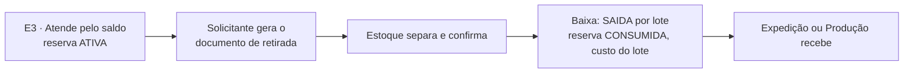

# Contrato 54 — Documento de retirada e baixa do saldo na retirada (MES)

> [!info] Situação em 15/10/2026
> **Status:** `proposta` · **Pasta:** `Ativos` · **Nós do 0b:** E6, X1, F1 · **Dono:** Robert (MES, sem API entre sistemas)
>
> - 📝 **N14-05 (14/10):** o despacho é no Estoque; **quem precisa da mercadoria** (Expedição ou Produção) gera um **documento de retirada**; **a baixa do saldo acontece na retirada**.
> - 🔴 **Não existe no código** (`api-pcp` `develop` `6914fe9`): hoje a baixa roda quando a Embalagem **recebe** a parcela (`consumirReservasDaParcial` em `receber()`, `itens-parciais.service.ts:279`) e há uma segunda chamada como garantia na entrega (`entregas.service.ts:88`). Nenhuma ocorrência de "retirada" em `api-pcp/src` nem em `app-pcp`.
> - 🔴 **Pergunta do Nathan ainda aberta:** quem gera o documento e o que ele imprime (seção "Perguntas"). As regras abaixo seguem a decisão e as propostas do vault; o que depende do Nathan está marcado.
> - Estimativa do Robert (±30%): **BL-007 3,5 pd**, **fora da conta** do Ciclo 1 até o Nathan decidir (se entrar, o déficit vai a 36,1 pd e a W0 a 03/03/2027 a 75% de foco).

**Destinatários:** MES (`api-pcp` e `app-pcp`, Robert). Selos em [[Regras-do-Vault]].

## Por quê

A mercadoria do Estoque sai sem um registro de **quem retirou, quando e o que**: o saldo baixa como efeito colateral de a Embalagem receber a parcela, e de novo na entrega. Isso mistura estoque e expedição, não serve para a matéria-prima enviada à produção e não deixa trilha de retirada. A decisão é um **documento de retirada**, e a baixa passa a ser do Estoque, na retirada.

## Regras

| # | Regra | Selo |
|---|---|---|
| 1 | **Quem precisa da mercadoria gera o documento de retirada**: a Expedição (produto pronto para entregar) ou a Produção (matéria-prima ou beneficiamento) | 📝 N14-05 |
| 2 | O documento traz **itens, lotes, quantidades e solicitante** | 📝 vault |
| 3 | **A baixa do saldo é feita pelo Estoque, na confirmação da retirada**, e não no recebimento da Embalagem nem na entrega | 📝 N14-05 |
| 4 | `consumirReservasDaParcial` **sai** de `receber()` da Embalagem e da entrega (hoje a segunda chamada é "garantia"); passa a rodar na confirmação da retirada | 🔴 |
| 5 | A baixa grava `SAIDA` por lote e consome a **reserva** do item, com o **custo do lote no momento** (snapshot, [[API-008-Custo-do-Lote-no-MES]] K6) | 📝 API-008 |
| 6 | A matéria-prima enviada à produção também sai **por documento de retirada** (o consumo e a genealogia são o BL-010, contrato à parte) | 📝 vault |
| 7 | O que vem da produção: o fabricado entra no Estoque como lote ([[LOG-53-Ordem-de-Producao-e-Lote-do-Fabricado]]) e **sai pelo mesmo documento** até a Expedição | 📝 N14-06 |
| 8 | Retirada **parcial** é válida: baixa só o que foi retirado e mantém o restante reservado | 🟡 |
| 9 | Cancelar o documento **antes da confirmação** libera a reserva só se a parcela também for cancelada; senão a reserva continua | 🟡 |
| 10 | O documento não altera lote nem quarentena: só movimenta o que já está liberado e reservado | 🟡 |

## O documento (desenho do Robert)

Estados (proposta): `ABERTA` (gerada, aguardando o Estoque), `CONFIRMADA` (o Estoque separou e confirmou: baixa feita), `CANCELADA`. Campos: número, tipo (`EXPEDICAO` ou `PRODUCAO`), solicitante (setor e usuário), parcela(s) e pedido, e por item: lote, localização de origem, quantidade solicitada e retirada. Impressão (🟡): o que imprime depende da pergunta 1.

### Rotas e telas (proposta)

| Quem | Onde | O quê |
|---|---|---|
| Expedição ou Produção | Fila do setor | **Pedir a retirada** da parcela pronta ou da matéria-prima |
| Estoque | Nova tela "Retiradas" | Lista de documentos `ABERTA`, **separar e confirmar** (baixa o saldo) |
| MES | Rotas `POST` criar, `GET` listar e detalhar, `PATCH` confirmar e cancelar | 🟡 nomes e permissão do Robert (`movimentacoes` ou permissão própria) |

## Como o fluxo muda

| Hoje | Depois |
|---|---|
| Atende pelo Estoque → reserva → a parcela vai à Embalagem → **`receber()` baixa** → entrega baixa de novo se faltou | Atende pelo Estoque → reserva → a parcela vai à Embalagem **sem baixar** → o solicitante gera o documento → o Estoque **confirma a retirada e baixa** |

## Critérios de aceite

1. Receber a parcela na Embalagem **não** baixa mais o saldo.
2. Gerar o documento a partir da Expedição cria a retirada `ABERTA` com itens, lotes e quantidades.
3. Confirmar no Estoque baixa por lote, consome a reserva e grava o custo do lote no momento.
4. Retirada parcial baixa só a parte retirada; o restante segue reservado.
5. A entrega **não** baixa de novo (a segunda chamada de garantia sai).
6. Retirada de matéria-prima pela Produção funciona pelo mesmo documento.
7. O fabricado aprovado (LOG-53) sai do Estoque até a Expedição por documento.
8. Cancelar o documento `ABERTA` não altera saldo.
9. Histórico: cada retirada guarda quem pediu, quem confirmou e quando.

## Ordem

1. Nathan decide as perguntas 1 e 2 (abaixo). 2. Robert: modelo, rotas e baixa na confirmação; tirar `consumirReservasDaParcial` de `receber()` e da entrega (BL-007). 3. Telas de pedir e de confirmar. Depende do [[LOG-53-Ordem-de-Producao-e-Lote-do-Fabricado]] para o fabricado e do [[API-008-Custo-do-Lote-no-MES]] (K6) para o custo na saída.

## Perguntas em aberto

| # | Pergunta | Dono | Selo |
|---|---|---|---|
| Q1 | O documento nasce de **quem**: a Expedição pede ao Estoque, ou o Estoque gera quando a parcela chega à Expedição? O que o documento imprime e **quem confirma**? | Nathan | 🔴 |
| Q2 | A **reserva** continua existindo depois da retirada (para rastrear custo) ou é consumida junto com a baixa? A proposta acima consome junto, com o custo gravado na `SAIDA` | Nathan | 🔴 |
| Q3 | O BL-007 (3,5 pd) entra no Ciclo 1? Aguardando decisão | Nathan | 🟡 |
| Q4 | Retirada por mais de um solicitante para a mesma parcela (Produção e Expedição)? | Robert | ❓ |

Relacionados: [[03-Estoque-Atendimento-e-Despacho]], [[09-Expedicao]], [[07-Producao-e-Roteiro]], [[LOG-53-Ordem-de-Producao-e-Lote-do-Fabricado]], [[API-008-Custo-do-Lote-no-MES]], [[Pontas-Soltas]] (PS-024), [[Riscos]] (RS-004), [[Backlog-por-Frente]] (BL-007), [[Registro-de-Decisoes]] (N14-05).
