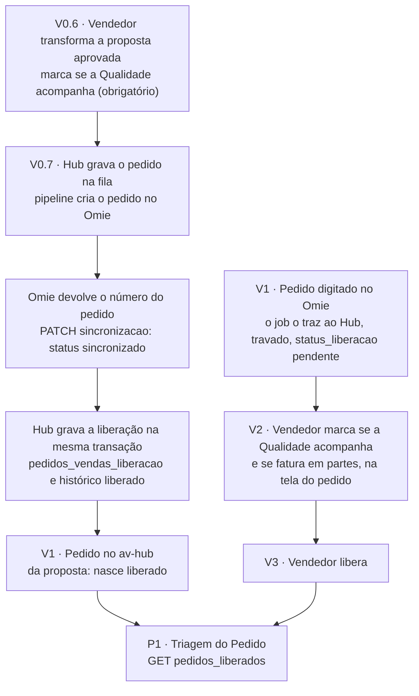

# Contrato 57 — Liberação do pedido de venda com origem na proposta (V1 com duas origens)

> **Onde atua:** av-hub: banco, API · pipeline Omie

> [!info] Situação em 21/10/2026
> **Status:** `proposta` · **Pasta:** `Ativos` · **Nós do 0b:** `V0.6`, `V0.7`, `V1`, `V2`, `V3`, `P1` · **Donos:** Gustavo (banco e API) e Nathan (regra e pipeline)
>
> - 📝 **Decidido (N16-05):** o "A Qualidade acompanha?" é obrigatório na proposta (`V0.6`); o pedido criado a partir dela **nasce liberado, sem `V3`**; o `V1` tem **duas origens** (a proposta, ou o pedido digitado direto no Omie). O do Omie continua chegando travado, mas o vendedor responde a Qualidade e o faturamento em partes **na tela do pedido** (N16-106), o que grava a mesma liberação do LOG-26.
> - ✅ **O que existe:** a liberação do pedido que vem do Omie ([[LOG-26-Vendas-Liberacao-Pedido]], `Entregues`): tabela `pedidos_vendas_liberacao` com chave `(codigo_empresa, numero_pedido)` e histórico em `pedidos_vendas_liberacao_historico`, gravado por trigger.
> - 🔴 **Não existe em código:** o pedido criado pelo hub, a fila para o Omie e a gravação da liberação na criação. O desenho de `core_comercial.pedidos` já guarda a marcação e quem liberou (SQL-016, outro agente).
> - 🟡 **Resposta à OQ-15 (a chave é o número do Omie, que só existe depois da resposta da API):** a liberação é gravada **na mesma transação em que o hub recebe o número do Omie**, com a data e o autor da escolha feita na proposta. Detalhes na seção 4.
> - ✅ **OQ-15 respondida pelo [[Estudo-Omie-API]] (21/10):** o `IncluirPedido` devolve o número do pedido na própria resposta, e o pedido vai com o `codigo_pedido_integracao` (N16-26). A liberação é gravada **na resposta do `IncluirPedido`**, sem esperar a pipeline `ListarPedidos`; o código de integração serve de chave de idempotência.
> - 🟡 O pedido criado por API pode nascer **bloqueado** no Omie (OQ-16, teste pendente); o **vendedor cancela, edita e exclui** o pedido (N16-84; o Omie tem `CancelarPedidoVenda`), e o cancelamento é guardado no hub (N16-68 a N16-71, [[LOG-56-Fluxo-da-Proposta-ao-Pedido]] R58 a R62).
> - 🔴 Perguntas abertas na seção 10 (OQ-16, OQ-17, OQ-30).

Selos em [[Regras-do-Vault]]. Regras da proposta em [[LOG-56-Fluxo-da-Proposta-ao-Pedido]]; nota de raia em [[01-Vendas-Liberacao]] e [[11-Proposta-e-Pedido-de-Venda]].

> [!info] Nova marcação obrigatória (N16-89)
> No "Transformar em pedido" o vendedor passa a responder também se o pedido **pode faturar em partes ou somente inteiro** (`faturamento_parcial`), além da Qualidade e da previsão de faturamento. Para o pedido **digitado no Omie** (`V2`/`V3`), **sim** (N16-91, N16-106): o vendedor responde a Qualidade **e** o faturamento em partes na tela do pedido; a data de previsão inicial vem do Omie.

## 1. Por quê

Hoje o pedido nasce **no Omie**, chega ao hub **travado** e o vendedor marca a Qualidade e libera (`V1` a `V3`, LOG-26). Com a proposta, a marcação e a decisão de seguir já foram feitas antes (`V0.4` aprovação da Gerência, `V0.6` botão "Transformar em pedido"). Repetir a marcação e a liberação no pedido seria pedir a mesma coisa duas vezes e abriria uma janela em que o pedido existe sem liberação. Este contrato define **como o pedido da proposta chega liberado** e onde o vendedor libera o pedido digitado no Omie, sem mexer na liberação que o MES já lê.

## 2. As duas origens do `V1`

| | **Origem proposta** (novo) | **Origem Omie** |
|---|---|---|
| Quem cria o pedido | O hub, por API no Omie (fila e pipeline, padrão da OC), `V0.7` | O vendedor, direto no Omie |
| Como chega ao hub | O hub já o tem em `core_comercial.pedidos` ; o Omie devolve o número | A pipeline `ListarPedidos` grava em `pedidos_vendas` |
| Marcação da Qualidade | Obrigatória na proposta (`V0.6`) | Marcada pelo vendedor em `V2`, na tela do pedido (N16-106) |
| Liberação | **Gravada na criação**, a partir da escolha da proposta | Gravada por `V3` (marcação e liberação numa ação só) |
| Estado inicial em `status_liberacao` | `liberado` (depois `importado`, como sempre) | `pendente` |
| Passa por `V2` e `V3`? | **Não** | **Sim** |
| Regras 1 a 11 do [[01-Vendas-Liberacao]] | 2, 3, 6, 8, 9, 10 e 11 valem; 1, 4, 5 e 7 mudam (seção 5) | Todas, sem mudança |

## 3. O que o fluxo faz



## 4. Como a liberação é gravada na criação (🟡 resposta à OQ-15)

### 4.1 O problema

`pedidos_vendas_liberacao` tem chave `(codigo_empresa, numero_pedido)`, e `numero_pedido` é o número que o **Omie** atribui (`character varying(15)`). A liberação não tem chave estrangeira para `pedidos_vendas` ("o pipeline recria linhas", Dump Avhub 18285-18298). O pedido do hub só tem esse número **depois** que o Omie responde à criação.

### 4.2 A regra

1. Em `V0.6`, o hub grava em `core_comercial.pedidos`: `acompanhamento_qualidade` (a escolha), `liberado_em` (o instante do clique) e `liberado_por` (o usuário que clicou). É a **escolha da proposta**, e nada mais é pedido ao vendedor.
2. A pipeline cria o pedido no Omie. Quando o Omie responde com sucesso, a pipeline chama `PATCH /comercial/pedidos_venda/:id/sincronizacao` com o número do Omie (rota de [[LOG-56-Fluxo-da-Proposta-ao-Pedido]], seção 8).
3. **Na mesma transação** em que grava `status_sincronizacao_omie = 'sincronizado'` e `numero_pedido_omie`, a API chama a função `fn_pedido_liberar_da_proposta` (abaixo). Ela insere a linha em `pedidos_vendas_liberacao`, com a marcação, `liberado_por` e `liberado_em` **iguais aos da escolha da proposta**.
4. O trigger que já existe (`fn_pedidos_vendas_liberacao_historico`, AFTER INSERT) grava sozinho a linha `liberado` em `pedidos_vendas_liberacao_historico`. A função informa o texto de `referencia` (`PROPOSTA <número da proposta>`), para a trilha dizer de onde veio.
5. Se a transação falhar, o pedido **continua `pendente`** na fila e a pipeline tenta de novo (reenvio da OC como padrão). Nunca existe pedido sincronizado sem liberação.

### 4.3 A função 🟡

```sql
-- Proposta, não aplicada. Dono: Gustavo. Idempotente: a segunda chamada não faz nada.
CREATE OR REPLACE FUNCTION core_vendas_faturamento.fn_pedido_liberar_da_proposta(
  p_codigo_empresa uuid, p_numero_pedido_omie varchar, p_acompanha boolean,
  p_liberado_por uuid, p_liberado_em timestamptz, p_numero_proposta bigint)
RETURNS void LANGUAGE plpgsql AS $$
BEGIN
  IF p_acompanha IS NULL THEN
    RAISE EXCEPTION 'QUALIDADE_NAO_INFORMADA: o pedido da proposta nasce com a marcação.' USING ERRCODE = '23514';
  END IF;
  INSERT INTO core_vendas_faturamento.pedidos_vendas_liberacao
    (codigo_empresa, numero_pedido, acompanhamento_qualidade, liberado_por, liberado_em, updated_by)
  VALUES (p_codigo_empresa, p_numero_pedido_omie, p_acompanha, p_liberado_por, p_liberado_em, p_liberado_por)
  ON CONFLICT (codigo_empresa, numero_pedido) DO NOTHING;
END $$;
```

- A coluna `referencia` do histórico (`varchar(60)`) é preenchida pelo trigger; para gravar `PROPOSTA <número>` o Gustavo ajusta o trigger para ler uma variável de sessão (`SET LOCAL app.liberacao_referencia`) ou passa a função a gravar a linha do histórico ela mesma 🟡. **A escolha é do Gustavo** (OQ-15).
- A hora do histórico (`created_at`) é a da gravação, não a do clique; o clique está em `liberado_em` da liberação e em `core_comercial.pedidos.liberado_em`.

### 4.4 Por que não as outras opções da OQ-15

| Opção | Por que não |
|---|---|
| (a) esperar a pipeline trazer o pedido (`ListarPedidos`) e casar por código de integração | Abre uma janela em que o pedido existe em `pedidos_vendas` sem liberação (aparece em `V2`, `V3`) e depende do ciclo da pipeline |
| (c) trigger no banco sobre `pedidos` | O número do Omie só chega pela rota de sincronização; a regra fica escondida em trigger e difícil de testar |

## 5. O que muda para o pedido da proposta (regras do [[01-Vendas-Liberacao]])

| # | Regra de hoje | Pedido da proposta |
|---|---|---|
| 1 | O pedido chega travado; o vendedor marca e libera numa ação | Nasce **liberado**; a marcação veio da proposta (N16-05) |
| 2 | Só pedido liberado vai ao MES | Igual: a Triagem (`GET /pedidos_liberados`) o lista assim que ele existir em `pedidos_vendas` e a liberação estiver gravada |
| 3 | Grão por pedido | Igual |
| 4 | Data de corte (`parametros_vendas.data_inicio_liberacao`) | **Não se aplica** ao pedido da proposta: a regra nasce liberado. A view `vw_pedidos_liberacao` ainda filtra por `data_inclusao`; como o pedido é novo, ele é sempre posterior à data de corte |
| 5 | O vendedor corrige a marcação até o MES importar | 🟡 **Pergunta (OQ-30):** o default é manter a correção até a importação, pelo mesmo `PUT /pedidos_liberacao/:empresa/:numero`, com o histórico `alterado` (a proposta aprovada **não** muda, N16-03); a alternativa é bloquear a correção do pedido de origem proposta |
| 6 a 9 | MES faz polling; gerente só vê; escopo pelo token | Igual |
| 7 | Quem libera: o vendedor e o auxiliar | Quem transforma é o responsável da proposta ou quem edita por ele (delegação); `liberado_por` registra **quem clicou** |
| 10 | Filtros da view (sequencial 0, etapa ≠ 0 …) | Igual. A etapa inicial do pedido criado no Omie precisa ser `<> 0` (OQ-16), senão a view não o mostra |
| 11 | A marcação alimenta a inspeção de processo | Igual |

**Telas:** `Liberar Pedidos` (`/liberar-pedidos`) e `Liberação da Equipe` (`/liberacao-equipe`) mostram o pedido da proposta já na aba "Liberados" (e depois "No PCP"), e **nunca** em "Aguardando você" 🟡. A coluna de origem ("Proposta" ou "Omie") é proposta para o vendedor entender por que não precisou liberar.

## 6. O pedido digitado no Omie

- O pedido criado direto no Omie chega travado (`status_liberacao = pendente`); o vendedor marca em `V2` e libera em `V3`, numa ação só (regra 1 do LOG-26), agora **na tela do pedido** (Meus Pedidos), junto com a resposta de faturamento em partes e a parte de compras (N16-106). `Liberar Pedidos` continua listando os que esperam a resposta 🟡.
- A data de corte, a correção da marcação até a importação, o trigger `fn_pedidos_vendas_liberacao_regras`, o histórico `liberado`, `alterado` e `importado_mes`, a rota `PUT /pedidos_liberacao/:empresa/:numero` e a rota `POST /pedidos_liberados/:numero/importado` **não mudam**.
- A parte de vendas desse pedido só se altera no Omie; o cancelamento também (N16-106).
- Pedido manual (`MAN-`, [[LOG-45-Pedido-de-Venda-Manual]]) segue fora do fluxo.

## 7. Estados

`status_liberacao` (valor da view `vw_pedidos_liberacao`) **não ganha valor novo**: `pendente`, `liberado`, `importado`. O que muda é o caminho: o pedido da proposta pula `pendente`.

| Estado do pedido do hub (`status_sincronizacao_omie`) | `status_liberacao` | O que o vendedor vê |
|---|---|---|
| `pendente` (na fila do Omie) | sem linha de liberação | "Pedido na fila do Omie", em Vendas; não aparece em Liberar Pedidos |
| `sincronizado` | `liberado` (depois `importado`) | em "Liberados" |
| `erro` | sem linha | "Pedido não criado no Omie: motivo" e "Tentar de novo" (OQ-09); a proposta segue aprovada e a marcação **não se perde** |

## 8. Validações

| # | Validação | Quando |
|---|---|---|
| 1 | `acompanhamento_qualidade` não é nulo | transformar (`V0.6`) e `fn_pedido_liberar_da_proposta` |
| 2 | A proposta está `APROVADA` e sem pedido | transformar |
| 3 | O número do Omie é único por `codigo_empresa` | sincronização |
| 4 | A liberação é idempotente (`ON CONFLICT DO NOTHING`) | reenvio da sincronização |
| 5 | A gravação da liberação e a do `sincronizado` são **uma transação** | sincronização |
| 6 | Pedido de origem proposta não aparece em "Aguardando você" | leitura |

## 9. Casos de borda

| # | Caso | O que faz 🟡 |
|---|---|---|
| 1 | O Omie responde com sucesso e a transação do hub falha | O pedido volta a `pendente` no hub, mas **já existe no Omie**: a pipeline consulta pelo código de integração antes de criar de novo (idempotência pelo `codigo_pedido_integracao`, N16-26) |
| 2 | A pipeline `ListarPedidos` traz o pedido antes da sincronização | Ele aparece uma vez em `pendente` até a liberação ser gravada. Proposta: o hub marca o pedido da proposta como "origem proposta" e a tela o oculta até a liberação existir |
| 3 | O MES já importou e alguém tenta mudar a marcação | `409 PEDIDO_IMPORTADO_MES`, como hoje |
| 4 | O pedido é cancelado ou alterado no Omie depois | A liberação não é desfeita. O cancelamento é guardado no hub (`cancelado_em`, motivo), porque o `ExcluirPedido` e o `exclusionSync` apagariam o pedido do hub; a requisição do PCP e a OC não emitida são canceladas com tarja ([[LOG-56-Fluxo-da-Proposta-ao-Pedido]] R59 a R62). OQ-17 e OQ-48 |
| 5 | Vendedor delegado transforma a proposta | `liberado_por` é quem clicou; o dono do pedido continua o responsável |
| 6 | Pedido do Omie sem linha de liberação | Segue travado até o vendedor responder `V2`/`V3` na tela do pedido |

## 10. Perguntas em aberto

- **OQ-15** (como gravar a liberação na criação): ✅ respondida; grava-se na resposta do `IncluirPedido` (seção 4). Falta só o Gustavo decidir como preencher `referencia`.
- **OQ-16** (campos obrigatórios do `IncluirPedido`, etapa `"10"`, `numero_pedido` próprio e pedido bloqueado): a etapa precisa ser diferente de 0 para a view mostrar o pedido; **testes no Omie** pendentes.
- **OQ-48** respondida (N16-84): o Omie tem `CancelarPedidoVenda`; o vendedor cancela o pedido da proposta pelo Hub, e o do Omie se cancela no Omie (N16-106).
- **OQ-17** (pedido mexido no Omie depois).
- **OQ-30** (o vendedor pode corrigir a marcação do pedido da proposta até a importação?). Default 🟡: sim, com o histórico `alterado`. Quem responde: Nathan.

Texto em [[Perguntas-Proposta-Pedido-Comissao]].

## 11. Testes de aceite

1. Transformar uma proposta com "Qualidade acompanha = Sim": após a resposta do Omie, existe uma linha em `pedidos_vendas_liberacao` com `acompanhamento_qualidade = true`, `liberado_por` = quem clicou e `liberado_em` = a hora do clique.
2. A tabela `pedidos_vendas_liberacao_historico` ganha **uma** linha `liberado` para o pedido, sem passar por `V2` nem por `V3`.
3. `GET /pedidos_liberados` lista o pedido (assim que ele estiver em `pedidos_vendas`) e `vw_pedidos_liberacao` mostra `status_liberacao = liberado`.
4. Repetir a sincronização (segundo `PATCH`): nenhuma linha nova na liberação nem no histórico.
5. Simular falha da transação: o pedido segue `pendente` na fila e nenhuma linha de liberação fica para trás.
6. O pedido da proposta não aparece em "Aguardando você" de Liberar Pedidos.
7. Um pedido criado direto no Omie continua chegando `pendente`; marcar e liberar em `V3` grava `liberado` como antes (teste de regressão do LOG-26).
8. Depois de `POST /pedidos_liberados/:numero/importado`, mudar a marcação responde `409 PEDIDO_IMPORTADO_MES` nos dois tipos de pedido.
9. A proposta cancelada ou sem pedido não gera linha de liberação.

## Ver também

[[LOG-26-Vendas-Liberacao-Pedido]] · [[01-Vendas-Liberacao]] · [[LOG-56-Fluxo-da-Proposta-ao-Pedido]] · [[11-Proposta-e-Pedido-de-Venda]] · [[Registro-de-Decisoes]] · [[Perguntas-Proposta-Pedido-Comissao]] · [[LOG-45-Pedido-de-Venda-Manual]]
