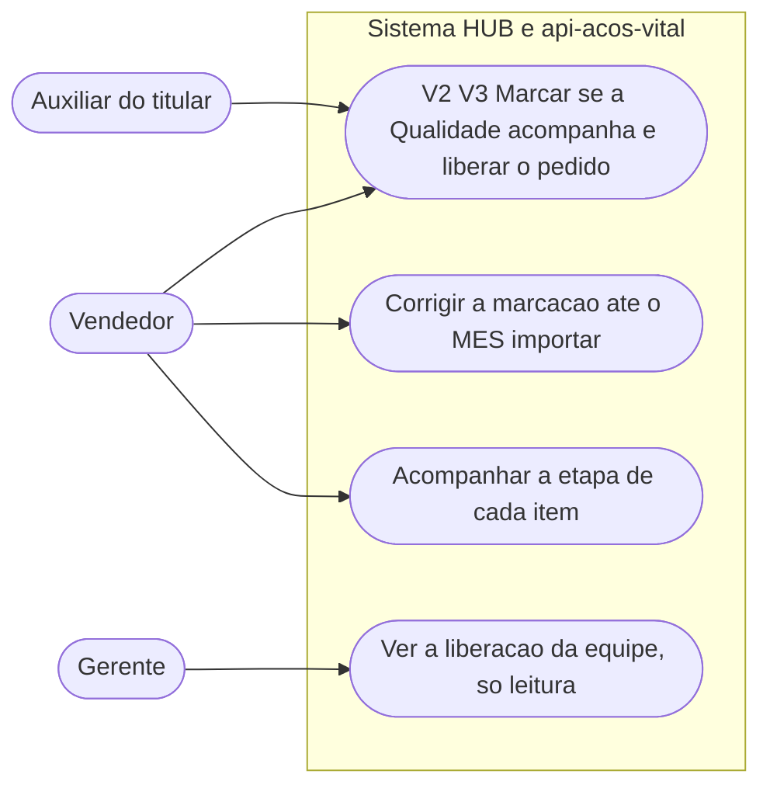
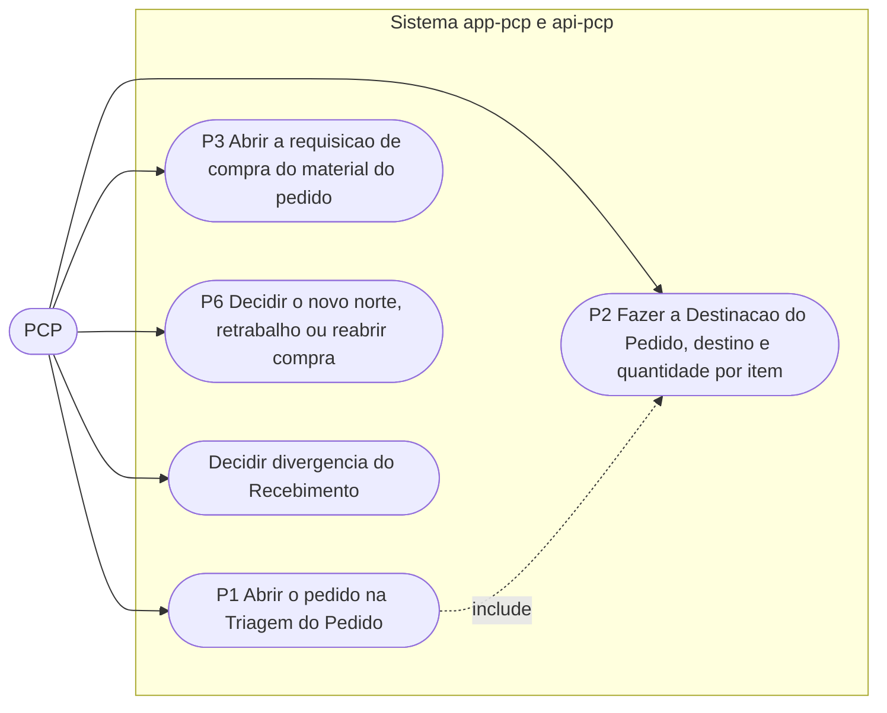
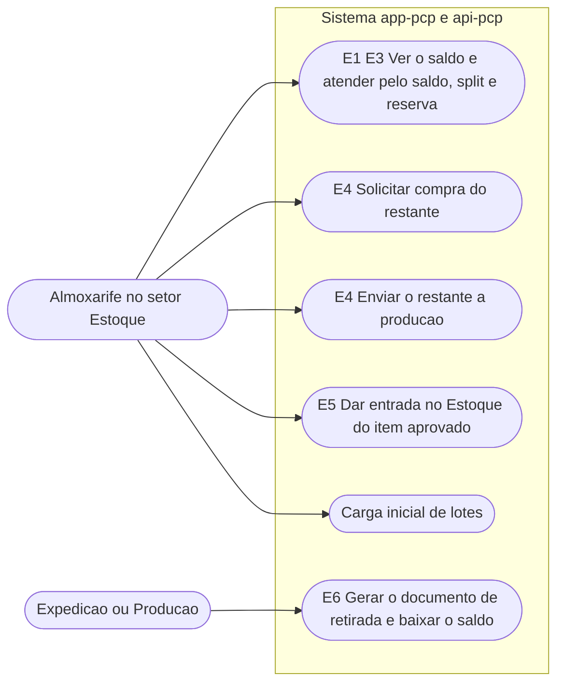
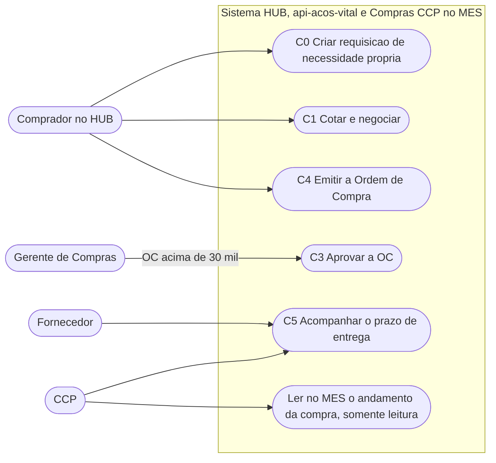
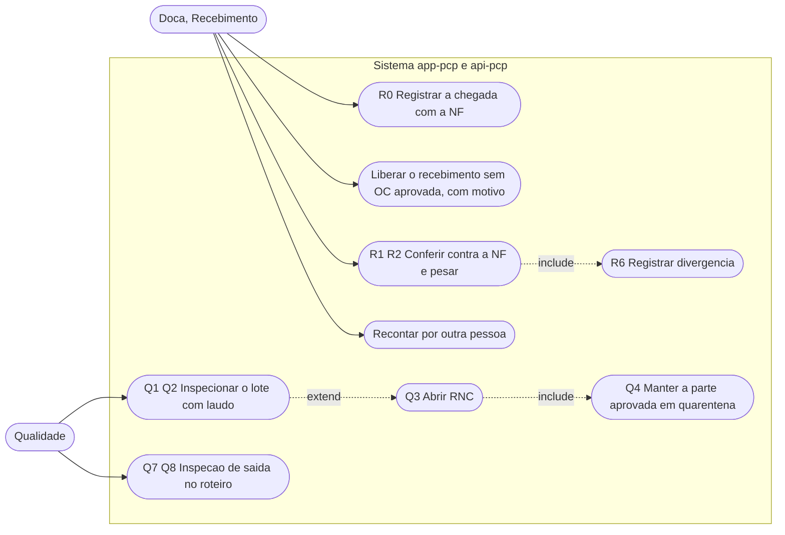
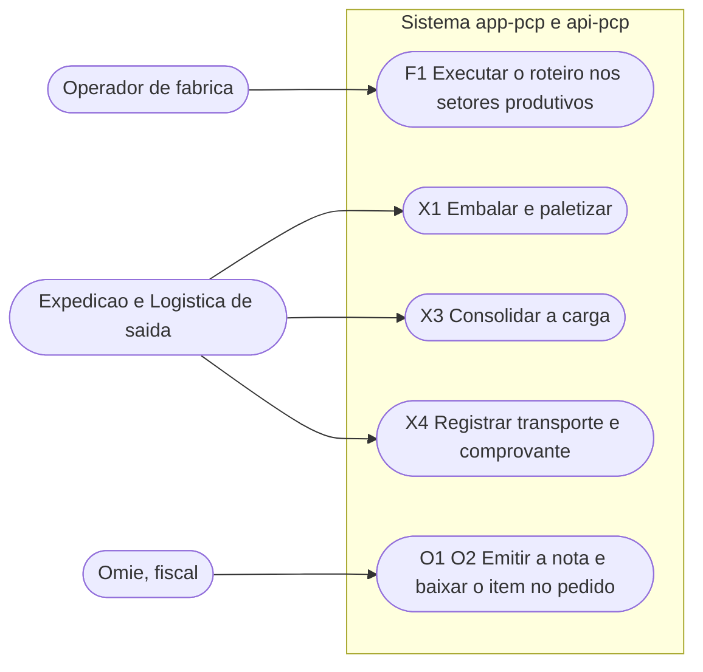

# Diagramas de casos de uso

**Em uma frase:** seis desenhos mostram quem usa o sistema em cada área da Aços Vital e o que cada pessoa consegue fazer nele.

**Como ler estes diagramas**

- O boneco arredondado (`Vendedor`, `PCP`…) é **quem usa**. Cada elipse dentro da caixa "Sistema" é **o que a pessoa faz**.
- Uma seta cheia diz "esta pessoa faz isto". `include` quer dizer "sempre vem junto"; `extend`, "só acontece às vezes".
- Cada elipse começa com o código do passo no [[00-Fluxo-Mestre-0b]] (`V2`, `E3`…). Procure primeiro o código para achar o passo no fluxo.
- Abaixo de cada desenho há um resumo. A tabela com tela, rota e selos de cada caso está em "Detalhe técnico", no fim.

## 1. Vendas (V1 a V3)

Quem vende marca se a Qualidade acompanha o pedido e o libera. O vendedor pode corrigir a marcação até o MES importar o pedido. O gerente só acompanha.

**Em resumo:** ✅ tudo existe. Só o teste ponta a ponta do acompanhamento da etapa ainda não foi feito ❓.

## 2. PCP (P1, P2, P6)

O PCP abre o pedido, decide destino e quantidade de cada item, abre a compra do material e decide as divergências do Recebimento. `P2` sempre vem junto de `P1`.

**Em resumo:** ✅ P1, P2, P3 e a decisão de divergência funcionam. O novo rumo depois de uma reprovação (`P6`) está decidido, mas ainda sem tela 🔴.

## 3. Estoque (E1 a E6)

O almoxarife vê o saldo, atende o item pelo estoque e decide o que fazer com o restante: comprar ou produzir. Os dois caminhos de `E4` são alternativas. Quem retira o material (Expedição ou Produção) gera o documento de retirada.

**Em resumo:** ✅ saldo, atendimento, compra do restante, produção do restante e carga inicial funcionam. 🔴 Falta o custo do item, a baixa de matéria-prima e a entrada do fabricado aprovado. O documento de retirada (`E6`) está decidido 📝, sem código 🔴.

## 4. Compras e fornecedor (C0 a C5, FN1)

O comprador cria requisição própria, cota e emite a Ordem de Compra (OC). OC acima de R$ 30 mil precisa do Gerente de Compras. O CCP (acompanhamento de compras no MES) e o fornecedor acompanham o prazo de entrega.

**Em resumo:** ✅ requisição, cotação, OC, aprovação e leitura no MES funcionam. 🔴 O MES ainda não lê a OC das requisições criadas no Compras, e o perfil CCP no HUB falta.

## 5. Recebimento e Qualidade de entrada (R0 a R6, Q1 a Q4)

A doca registra a chegada com a nota fiscal (NF), confere e pesa. Se a contagem diverge, outra pessoa reconta. A Qualidade inspeciona o lote com laudo; se reprova, abre a RNC (registro de não conformidade) e a parte aprovada fica em quarentena.

**Em resumo:** ✅ chegada, conferência, divergência, recontagem e inspeção de entrada funcionam. A inspeção de saída (`Q7`, `Q8`) existe, mas ninguém a conferiu ❓.

## 6. Produção, Expedição e Fiscal (F1, X1 a X4, O1, O2)

O operador executa o roteiro nos setores. A Expedição embala, consolida a carga e registra o transporte. O Omie emite a nota e baixa o item no pedido.

**Em resumo:** ✅ filas de produção, paletes e nota pelo Omie funcionam. 🔴 Faltam o consumo de matéria-prima, a consolidação da carga (`X3`), o transporte e o aviso do MES ao Omie. O registro da entrega com comprovante está 🟡.

## O que mudou em relação ao v1

- Saiu **Registrar a compra no MES manualmente** (UC13 do v1). O MES só espelha a compra.
- Saíram como casos soltos **Pesar material**, **Etiquetar lote**, **Separar item para Expedição** e **Contagem cíclica**. O peso entra no `R2`; a etiqueta é gerada na hora; separação e contagem não existem no banco (ficam fora do fluxo 0b).
- Entraram **Criar requisição de necessidade própria** (`C0`), **Liberar o recebimento sem OC**, **Gerar documento de retirada** (`E6`) e **Carga inicial**.
- A aprovação de OC acima de R$ 30 mil é do Gerente de Compras. Até esse valor os compradores ficam livres. A Diretoria não é ator (N14-21).

Destino de cada diagrama do v1: [[Indice-de-Diagramas]].

## Detalhe técnico

O mermaid não tem notação nativa de caso de uso: atores são nós arredondados e casos de uso são elipses dentro de um subgrafo "Sistema". Cada caso leva o ID do nó do Mestre.

### 1. Vendas (V1 a V3)

| Caso | Estado | Selo |
|---|---|---|
| V2 V3 liberar | Tela `/liberar-pedidos` | ✅ ver [[01-Vendas-Liberacao]] |
| Corrigir a marcação | Trava com 409 `PEDIDO_IMPORTADO_MES` | ✅ |
| Acompanhar a etapa | Cartão "Etapa dos itens" | ✅ ❓ teste ponta a ponta |
| Ver a equipe | `/liberacao-equipe` | ✅ |

### 2. PCP (P1, P2, P6)

| Caso | Estado | Selo |
|---|---|---|
| P1, P2 | `/carteira` e `/ordens-producao/novo` | ✅ ([[02-PCP-Triagem-e-Destinacao]]) |
| P3 | Setor Requisições, `POST /compras/requisicoes` | ✅ |
| P6 | Decidido, sem tela | 🔴 |
| Decidir divergência | `/decisoes-pcp`, `POST /compras/recebimentos/:id/decidir` | ✅ |

### 3. Estoque (E1 a E6)

As duas opções do nó `E4` (compra ou produção) são alternativas para o restante.

| Caso | Estado | Selo |
|---|---|---|
| E1 a E3 | `/estoque-operacao/atendimento` | ✅ custo do item 🔴 |
| E4 compra | `destinoRestante` igual a `COMPRA` | ✅ |
| E4 produção | `destinoRestante` igual a `ROTEIRO` | ✅ sem baixa de matéria-prima 🔴 |
| E5 compra aprovada | `devolverAoEstoqueParciaisProntas` | ✅ |
| E5 fabricado aprovado | não vira lote | 🔴 |
| E6 retirada | decidido 14/10, sem código | 📝 🔴 |
| Carga inicial | `POST /estoque/lotes/carga-inicial` | ✅ |

### 4. Compras e fornecedor (C0 a C5, FN1)

| Caso | Estado | Selo |
|---|---|---|
| C0 | `POST /compras/requisicoes` no HUB; a requisição não chega ao MES, a OC dela deve chegar pela referência (N14-20) | ✅ 🔴 MES não lê a OC |
| C1, C4 | Requisições e Ordens no HUB; OC até R$ 30 mil sai livre | ✅ |
| C3 | Aprovações: Gerente de Compras aprova a OC acima de R$ 30 mil | ✅ (N14-21) |
| C5 | Follow-up no HUB | ✅ perfil CCP 🔴 |
| Ler no MES | Compras · CCP, só leitura | ✅ |

### 5. Recebimento e Qualidade de entrada (R0 a R6, Q1 a Q4)

| Caso | Estado | Selo |
|---|---|---|
| R0 chegada | `POST /compras/requisicoes/:id/chegada` exige NF | ✅ |
| Liberar sem OC | `POST …/liberar-recebimento`, permissão `compras-liberar` | ✅ |
| R1, R2, R6 | `POST /compras/recebimentos`, `/recontar` | ✅ |
| Q1 a Q4 | `/qualidade/inspecao-entrada` | ✅ ([[06-Qualidade-Entrada]]) |
| Q7, Q8 | `/qualidade/inspecao-saida` | ✅ ❓ ninguém conferiu |

### 6. Produção, Expedição e Fiscal (F1, X1 a X4, O1, O2)

| Caso | Estado | Selo |
|---|---|---|
| F1 | Filas de Produção `/movimentacoes` | ✅ consumo de matéria-prima 🔴 |
| X1 | Paletes (10.1) | ✅ |
| X3 | Consolidar a carga (10.2) | 🔴 |
| X4 | `POST /entregas` com comprovante | 🟡 transporte 🔴 |
| O1 O2 | Lado Omie; sinalização do MES ao Omie (11.1) | ✅ 🔴 |
