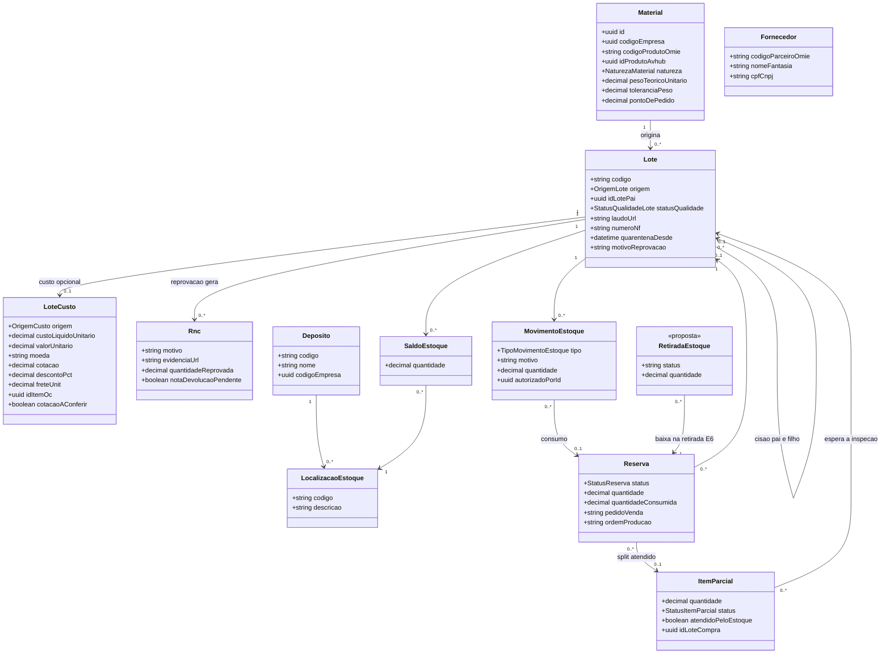
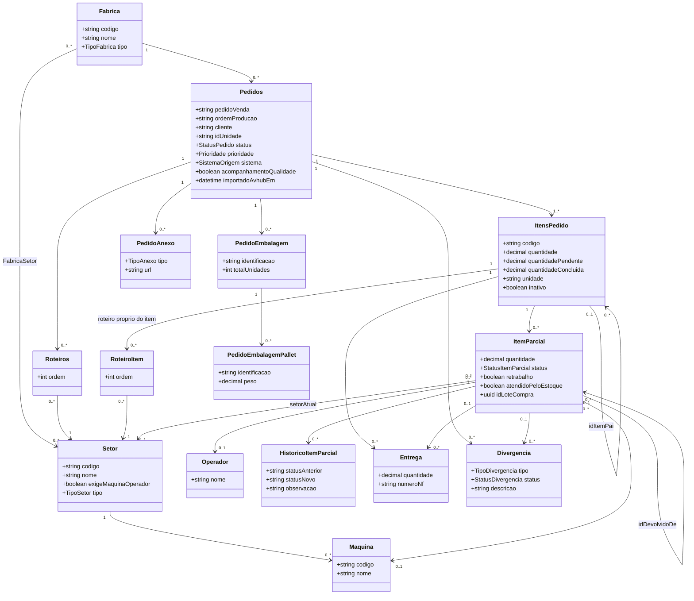
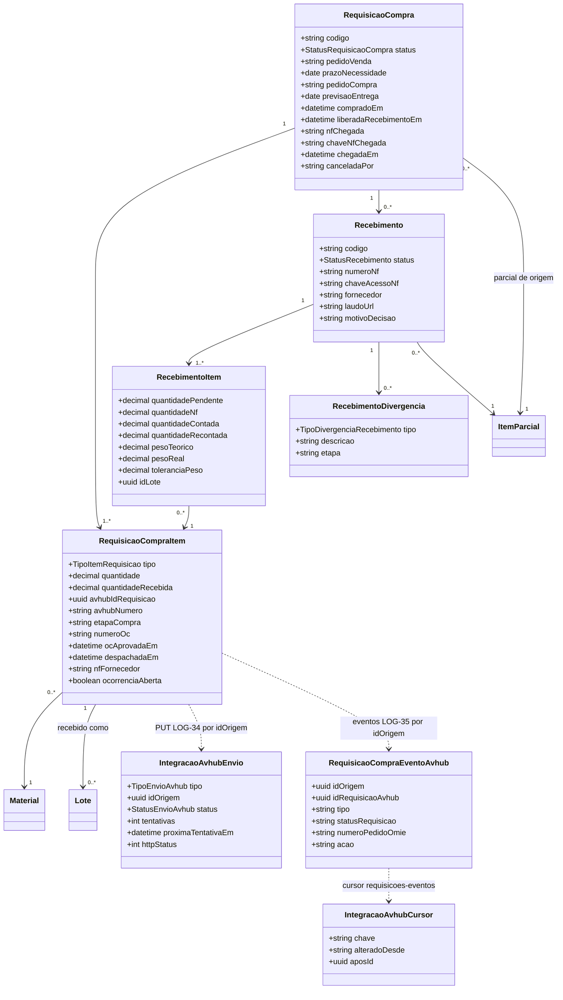
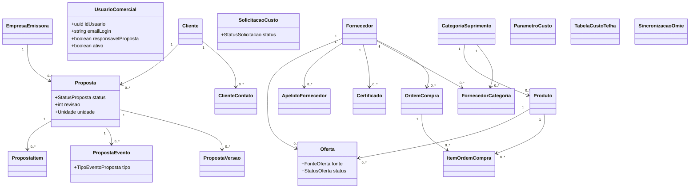

# Diagramas de classes

Redesenhados a partir do Prisma do `api-pcp` (`prisma/models/`) e do Prisma do `api-comercial` (HUB `b55ac55`), ambos de 14/10/2026. Mostram o que importa para o fluxo [[00-Fluxo-Mestre-0b]]: nem todos os campos aparecem. Colunas e tipos exatos: [[Modelo-de-Dados]] e [[Banco-MES]]. Destino de cada diagrama do v1: [[Indice-de-Diagramas]].

## 1. Estoque e compras no MES (E1 a E5, R0 a R4, Q1 a Q4)

Selo ✅ para todas as classes exceto `RetiradaEstoque` (📝 decidida em 14/10, 🔴 sem código). Fontes: `estoque.prisma:61-423`. Mudanças em relação ao v1:

- `Deposito` ganhou `codigoEmpresa` e `nomeUnidade` (filial do depósito) ✅ `estoque.prisma:69-70`; o v1 dizia que não tinha.
- `LoteCusto` existe e tem `OrigemCusto` (`CARGA_INICIAL`, `OC`, `MANUAL`); só a carga inicial grava 🔴 (o Recebimento não grava custo).
- `Pesagem` não é classe: peso teórico, real e recontado ficam em `RecebimentoItem` (diagrama 3). Etiqueta é geração sob demanda (`src/estoque/etiquetas`), sem tabela. `OrdemSeparacao`, `ItemSeparacao`, `DevolucaoCliente` e `ContagemCiclica` não existem no schema e saíram deste vault (fora do fluxo 0b).
- `Fornecedor` é projeção local (`fornecedores`) sem ligação com o lote; o lote guarda `numeroNf` e o recebimento guarda o nome do fornecedor.
- `RetiradaEstoque` entra como proposta do nó E6: a baixa sai do recebimento da parcial na Embalagem e passa para a retirada. Nome e campos 🟡 a definir com o Robert.

## 2. Produção no MES (P1, P2, F1, Q7, X1 a X4)

Selo ✅ `producao.prisma:88-620`, `fabricas.prisma:36-170`. Observações conferidas:

- O roteiro existe em dois níveis: `Roteiros` (por pedido) e `RoteiroItem` (por item) ✅ `producao.prisma:262-292`.
- O setor Estoque é inserido pelo backend como etapa 1 de todo roteiro (`GET /pedidos/setor-estoque-fixo` ✅ `pedidos.controller.ts:92`).
- `Pedidos.importadoAvhubEm` é a marca do `POST /pedidos_liberados/:n/importado` ✅ `pedidos.service.ts:133`.
- Também existem `PedidoExcluido` (snapshot de exclusão), `ItemParcialAnexo`, `ItemParcialObservacao` e `PerfilSetor`; não aparecem para não poluir.
- Tipo de pedido no av-hub: pedido manual (`LOG-45`) não participa deste modelo ([[Pedido-Manual]]).

## 3. Compras, recebimento e integração com o av-hub (P3, R0 a R6)

Selo ✅ `compras.prisma:51-262`, `integracao.prisma:33-120`. Enums: `StatusRequisicaoCompra` (`ABERTA`, `EM_COMPRA`, `RECEBIDA_PARCIAL`, `RECEBIDA`, `CANCELADA`), `TipoItemRequisicao` (`PRODUTO_FINAL`, `MATERIA_PRIMA`), `TipoDivergenciaRecebimento` (`QUANTIDADE`, `DESCRICAO`, `PESO`, `AVARIA`), `StatusEnvioAvhub` (`PENDENTE`, `ENVIADO`, `RECUSADO`, `FALHOU`), `TipoEnvioAvhub` (`REQUISICAO_COMPRA`). Mudanças em relação ao v1 (08/10):

- Entraram os campos de **Compras · CCP** (14/10): `etapaCompra`, `numeroOc`, `numeroPedidoOmie`, `previsaoChegada`, `ocAprovadaEm`, `despachadaEm`, `nfFornecedor`, `transportadora`, `ocorrenciaAberta` no item; `pedidoCompra`, `previsaoEntrega`, `compradoEm`, `liberadaRecebimento*`, `nfChegada`, `chaveNfChegada`, `chegadaEm`, `canceladaPor` na requisição.
- O registro manual da compra (`PATCH :id/compra`) saiu; `pedidoCompra`, `fornecedor` e `previsaoEntrega` agora são espelho do av-hub, nunca digitados ✅ `compras.prisma` (comentário do bloco CCP).
- `idLocalizacao` e `idLote` de `RecebimentoItem` não têm FK no schema; o lote só nasce em `CONCLUIDO` ou `ACEITO`.

## 4. api-comercial (schema `core_comercial`, Comercial e Suprimentos)

Fora do fluxo 0b; ver [[Comercial-Suprimentos]].

Selo ✅ `api-comercial/prisma/models/*.prisma` (HUB `b55ac55`). Mudança: `PerfilComercial` (v1) virou `UsuarioComercial`, mapeada para a tabela `perfis_comerciais`, sem coluna de cargo (migration `20261013140000_usuarios_comerciais_diretorio`) ✅ `empresas.prisma:61-78`. `StatusProposta` (`ABERTA`, `PARCIAL`, `FECHADA`, `PERDIDA`), `StatusSolicitacao` (`ABERTA`, `RESPONDIDA`, `SEM_FORNECEDOR`, `CANCELADA`), `StatusOferta` (`VIGENTE`, `VENCIDA`, `INVALIDADA`, `HISTORICA`), `FonteOferta` (`MANUAL`, `MAPA_COTACAO`, `PEDIDO_OMIE`, `MIGRACAO`). O enum `CargoComercial` do v1 não existe mais.

## O que não foi redesenhado

O diagrama 3 do v1 (RBAC e comercial do av-hub: `Usuario`, `Perfil`, `Tela`, `Funcionario`, `Unidade`, `PedidoVenda`…) não foi refeito aqui: pertence ao banco do av-hub e vive em [[Banco-AvHub]] e [[RBAC-e-Permissoes]]. Ver [[Indice-de-Diagramas]].
