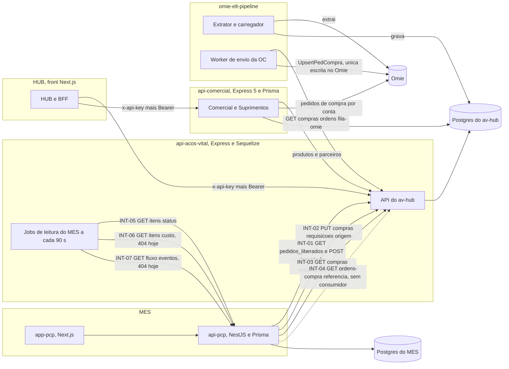
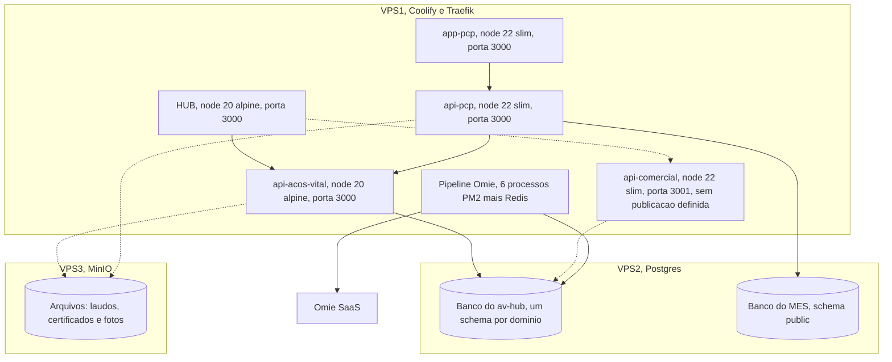
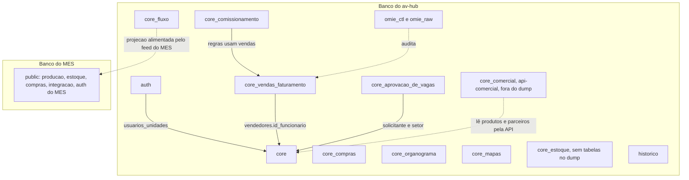
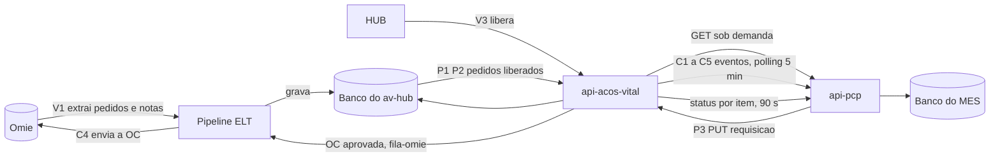

# Componentes, implantação e dados entre sistemas

Redesenhado em 14/10/2026. Topologia: [[Infraestrutura]]. Integrações com rota, chave e cursor: [[Integracao-AvHub-MES]]. Responsáveis: [[Sistemas-e-Responsabilidades]]. Destino de cada diagrama do v1: [[Indice-de-Diagramas]].

## 1. Componentes e integrações

Selo ✅ para as setas cheias (rotas conferidas em [[Integracao-AvHub-MES]] e nos routers da `api-acos-vital`); as setas `INT-06` e `INT-07` têm o job no hub e o MES responde 404 🔴; `INT-04` existe só no hub, o MES não consome 🔴. Mudanças em relação ao v1:

- Os jobs `itens_pedido_status.job.js`, `itens_pedido_custo.job.js` e `item_estado_projetado.job.js` (Torre) agora existem no hub; no v1 o hub "ainda não consumia" o status por item.
- O MES lê **todos** os eventos do contrato 35, não só cancelada e reaberta.
- A pipeline só escreve no Omie para enviar a OC (`omie-envio-oc-worker`); o `api-comercial` lê pedidos de compra do Omie, sem escrita ✅ [[Pipeline-Omie]].
- `api-comercial` aponta para o banco do av-hub no schema `core_comercial`; cluster ❓ não confirmado.
- A chave do MES para o PUT do contrato 34 só abre essa rota (`apiKeyAuth.js:94-100`); as leituras usam a `API_KEY` do MES ✅ [[Chaves-e-Autenticacao]].

## 2. Implantação

Topologia decidida pelo Nathan (📝, 07/10); estado real dos containers ❓ não conferido.

Selo ✅ para imagens e portas (`Dockerfile` de cada repositório, linhas citadas em [[Infraestrutura]]); 📝 para VPS e Postgres; MinIO ❓: nenhuma referência a MinIO foi encontrada no código de `api-pcp` e `api-acos-vital` em 14/10, por isso as setas são tracejadas. `api-comercial` 🔴 sem ambiente de produção decidido (nada dele em `main` no vault v1; no HUB `b55ac55` a pasta existe em `api-comercial/`).

## 3. Pacotes: schemas por banco

Não há dependência de schema entre os bancos do av-hub e do MES: a ligação é só por REST. O MES usa só `public`; o av-hub divide por domínio ([[Schemas-Postgres]]).

Selo ✅ para a lista de schemas (`CREATE SCHEMA` no Dump Avhub de 14/10: `auth`, `core`, `core_aprovacao_de_vagas`, `core_comissionamento`, `core_compras`, `core_estoque`, `core_fluxo`, `core_mapas`, `core_organograma`, `core_vendas_faturamento`, `historico`, `omie_ctl`, `omie_raw`). `core_comercial` não aparece no dump (o `api-comercial` cria o schema por Prisma) ❓. `core_estoque` não tem tabela no dump (o Estoque é do MES, decisão #21); 🟡 as dependências de FK entre schemas foram mantidas do v1 e não relidas no dump nesta rodada ❓ (`vendedores.id_funcionario`, `usuarios_unidades`). `core_compras` guarda o orçamento (`orc_*`) e as views de compras; ordens e requisições de compra vivem em `core_vendas_faturamento` ✅ (dump).

## 4. Fluxo de dados de ponta a ponta

Substitui o DFD do v1 (diagrama 22), que ainda dizia "o av-hub não consome o status por item".

Velocidade hoje: polling em camadas, sem webhook. Triagem e Destinação leem na hora; marcos da requisição a cada 5 min (ou sob demanda); status por item, custo e Torre a cada 90 s; extração do Omie conforme o agendador da pipeline. Tempo real continua fora do desenho 📝 (DEC-2). Ver [[Pipeline-Omie]].
