# Diagramas de estados

Os enums vêm do Prisma do `api-pcp` (`prisma/models/*.prisma`) e das rotas do `api-acos-vital` em 14/10/2026. Vocabulário completo de status e etapas: [[Estados-e-Status]]. Destino de cada diagrama do v1: [[Indice-de-Diagramas]].

## 1. Parcial do item (`ItemParcial`, enum `StatusItemParcial`)

Motor de estado do chão de fábrica. 9 valores no enum ✅ (`producao.prisma:29-55`): `CRIADO`, `RECEBIDO`, `EM_ANDAMENTO`, `EM_TRANSITO`, `PAUSADO`, `REPROVADO`, `CONCLUIDO`, `RETRABALHO`, `CANCELADO`. Não é entrega ao cliente (isso é `Entrega`).

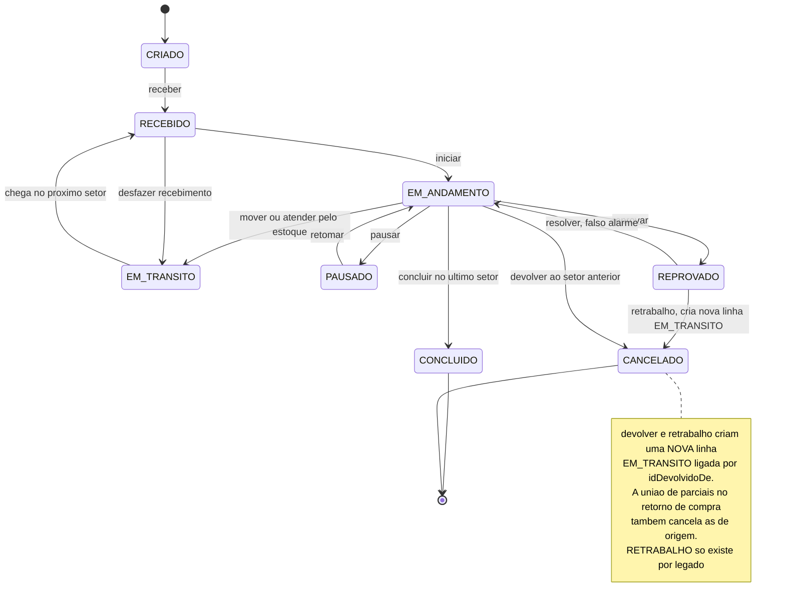

Selo ✅: ações em `itens-parciais.controller.ts:100-297` (receber, iniciar, mover, concluir, atender-estoque, pausar, reprovar, resolver, retrabalho, retomar, split, devolver, cancelar, desfazer-recebimento, consolidar). Nó do Mestre: F1, Q7, X1. `desfazer-recebimento` ✅ `itens-parciais.controller.ts:285` estorna o consumo da reserva; ❓ o status de destino exato não foi relido nesta rodada (desenhado como `EM_TRANSITO`).

## 2. Lote (`StatusQualidadeLote`)

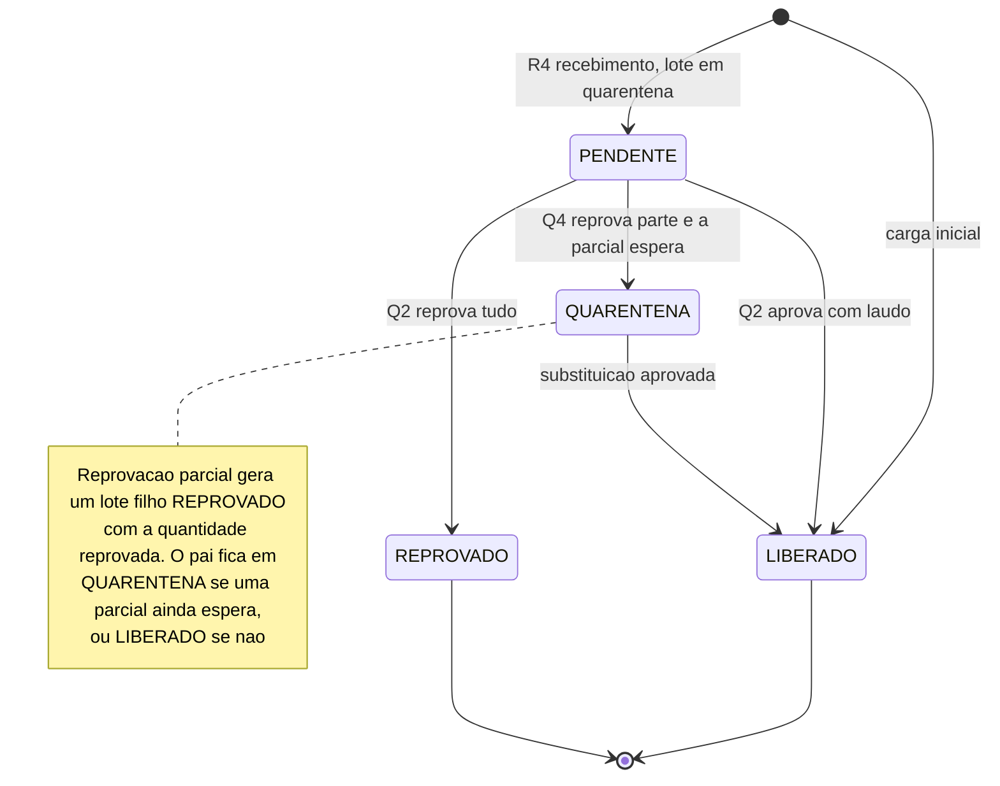

Selo ✅: enum `estoque.prisma:25-32`; `qualidade.service.ts:83-262` (quarentena em `:243`); carga inicial `OrigemLote.CARGA_INICIAL`. 🔴 Não existe origem de lote para fabricado aprovado (`OrigemLote` só tem `RECEBIMENTO` e `CARGA_INICIAL`).

## 3. Reserva de estoque (`StatusReserva`)

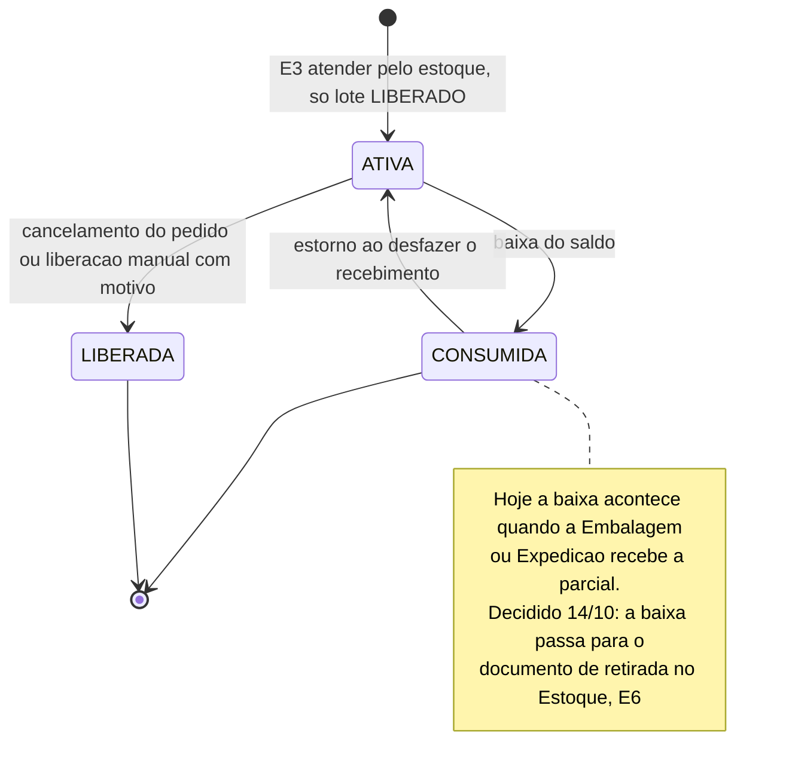

Selo ✅ enum `estoque.prisma:48-52`, `consumirReservasDaParcial` em `estoque-operacao.helpers.ts:208`; 📝 retirada decidida; 🔴 sem código. Liberação manual: `PATCH /estoque/reservas/:id/liberar` ✅ `estoque-operacao.controller.ts:97`.

## 4. Recebimento (`StatusRecebimento`)

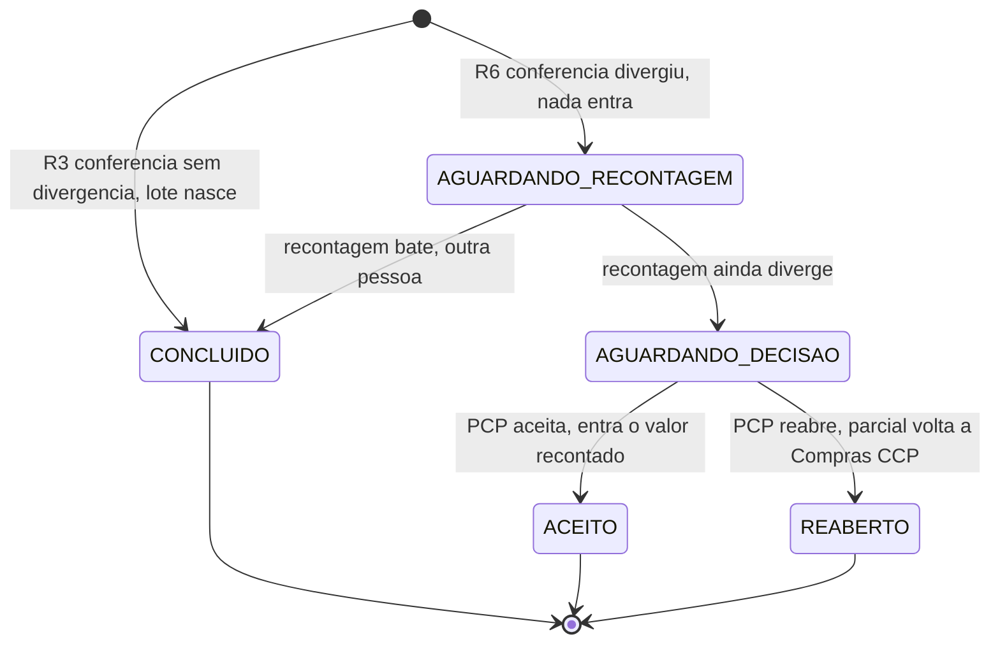

Selo ✅: enum `compras.prisma:31-37`; `recebimento.service.ts:135,249,331`. Motivo obrigatório em `ACEITO` e `REABERTO`. Tipos de divergência do recebimento: `QUANTIDADE`, `DESCRICAO`, `PESO`, `AVARIA` ✅ `compras.prisma:42-47`.

## 5. Divergência de produção (`StatusDivergencia`)

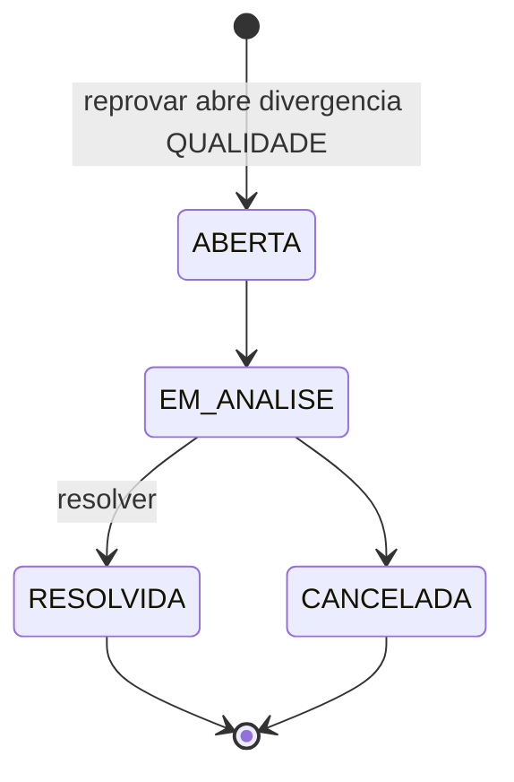

Selo ✅ enum `producao.prisma:77-82`. 🔴 Não há reabertura de divergência resolvida (sem endpoint; risco catalogado e adiado). Tipos: `QUALIDADE`, `QUANTIDADE`, `PRAZO`, `DANO`, `DOCUMENTACAO`, `OUTRO`.

## 6. Requisição de compra no MES (`StatusRequisicaoCompra`)

Resumo da requisição, recalculado por `resumirRequisicao` a cada marco do av-hub e a cada recebimento.

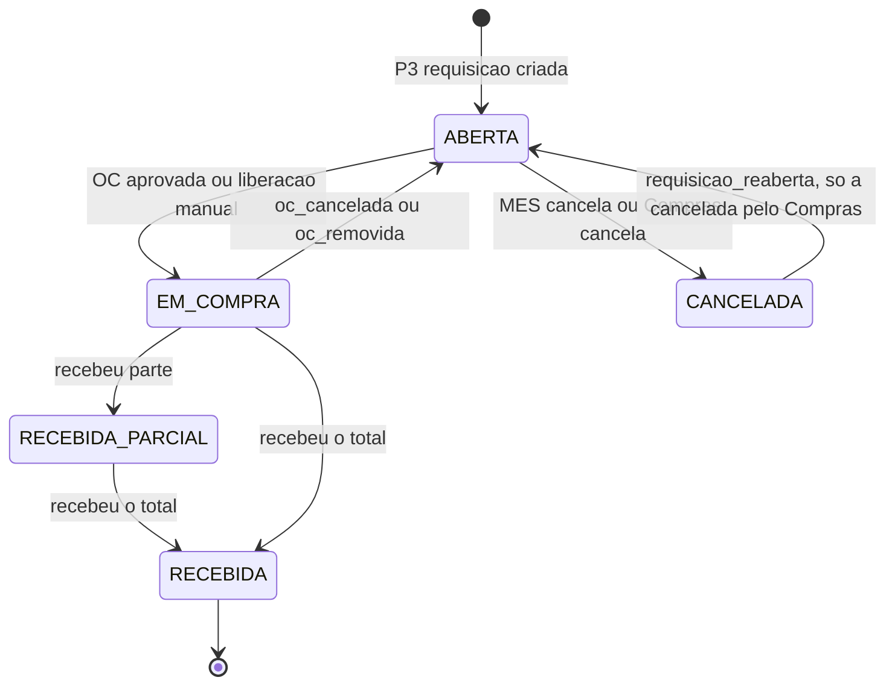

Selo ✅ enum `compras.prisma:9-15`; cancelamento só em `ABERTA` (`canceladaPor` `mes` ou `compras`, `compras.prisma:84-87`); liberação manual muda `ABERTA` para `EM_COMPRA` (`compras.service.ts:430-436`). 🟡 As arestas `RECEBIDA_PARCIAL` e `RECEBIDA` vêm de `resumirRequisicao`, não relido linha a linha nesta rodada; pendência PS-011 em [[Pontas-Soltas]].

## 7. Etapa de compra de cada material (`RequisicaoCompraItem.etapaCompra`)

Espelho dos marcos do contrato 35 ([[Integracao-AvHub-MES]], INT-03).

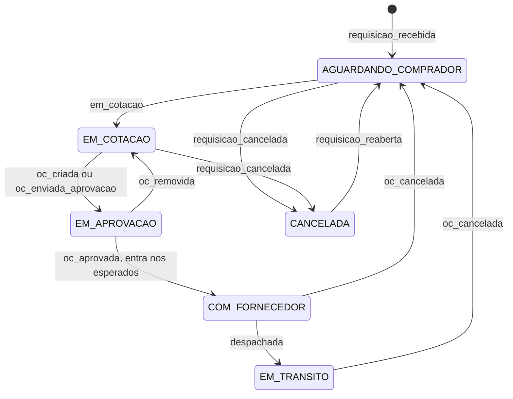

Selo ✅ `requisicao-avhub.eventos.ts:234-318`; valores em `compras.prisma:132-135`. `previsao_alterada`, `fornecedor_confirmou`, `oc_no_omie` e `ocorrencia` não mudam a etapa.

## 8. Requisição no av-hub (`requisicoes_compra.status`)

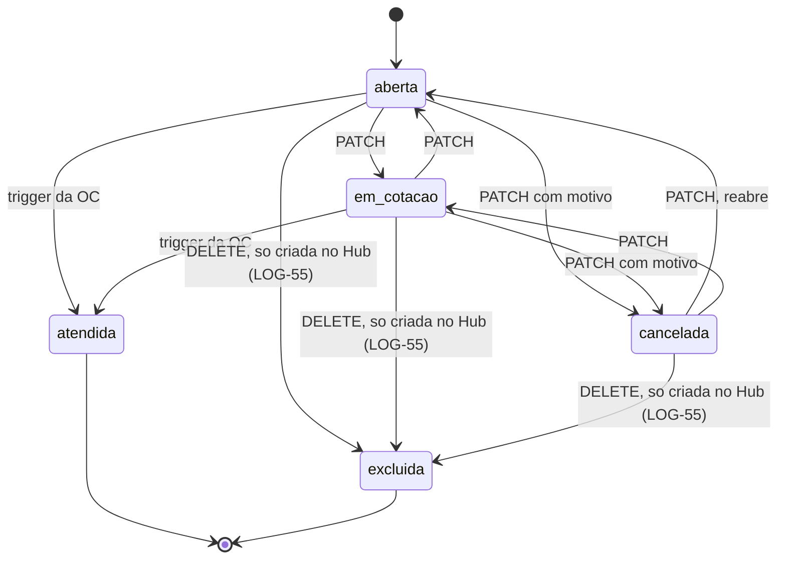

🔴 `excluida` é 📝 proposta ([[LOG-55-Compras-Excluir-Requisicao]]): exclusão lógica (`deleted_at`), sem OC e sem `id_origem`; a requisição do MES continua só cancelável. Banco e API ainda não existem.

Selo ✅ `requisicoes_compra.route.js:13-22` (`atendida` só pela trigger da OC, nunca pelo PATCH); 409 `REQUISICAO_COM_OC` ao cancelar com OC (`:221-265`).

## 9. Ordem de compra no av-hub (`ordens_compra.status`)

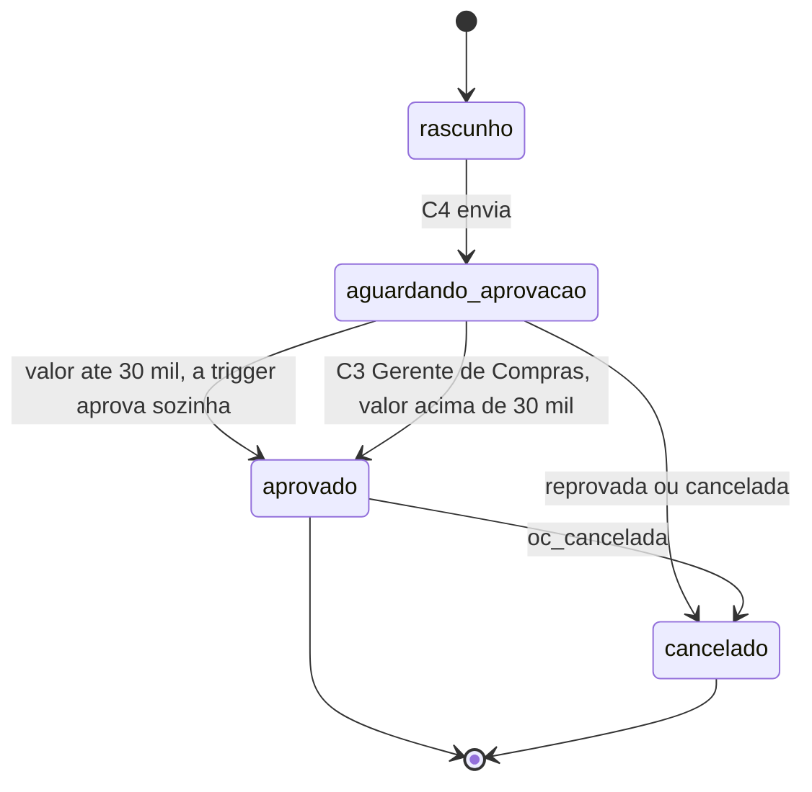

Selo ✅ valores em `ordens_compra.route.js:91` e no `CHECK` do dump (`ck_ordens_compra_status`); 🟡 as transições exatas são feitas por trigger do banco e não foram relidas; ✅ regra de aprovação N14-21: até o limite da unidade (R$ 30 mil por padrão) a trigger `fn_ordens_compra_recalcular` aprova sozinha; acima dele, só o Gerente de Compras (`ordens_compra.route.js:1230-1240`); a Diretoria não aprova (Mestre, nós C2/C3). Envio ao Omie tem estado próprio (`status_sincronizacao_omie`) fora deste diagrama.

## 10. Envio da requisição ao av-hub (`StatusEnvioAvhub`)

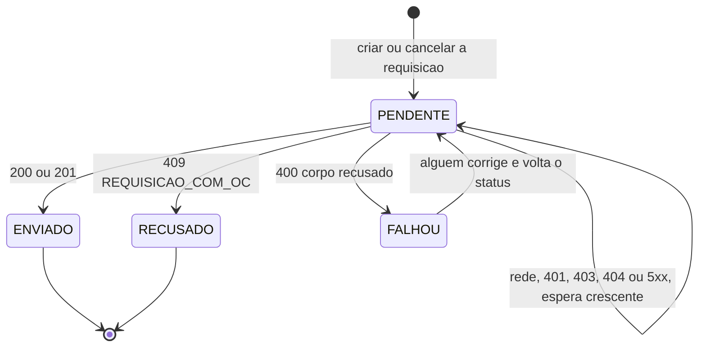

Selo ✅ `integracao.prisma:17-29`, `envio-avhub.service.ts:164-169`.

## 11. Liberação do pedido (`status_liberacao`)

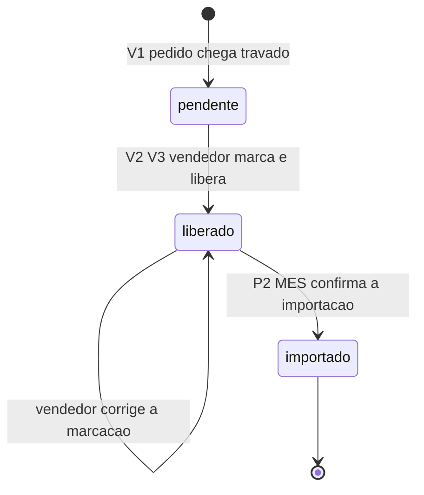

Selo ✅ valores da view `vw_pedidos_liberacao` e travas: [[01-Vendas-Liberacao]]; importado trava a marcação (409 `PEDIDO_IMPORTADO_MES`).

## 12. Do setor e do status para a etapa do item (contrato 005)

Não é um diagrama de transição: o MES calcula a etapa por regra (`etapaDoItem`). As 11 etapas e a tradução no HUB estão em [[Estados-e-Status]].

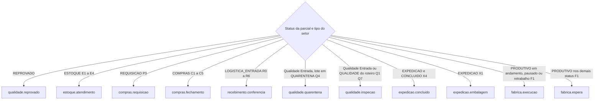

Selo ✅ `integracao-avhub.service.ts:160-192`. 🟡 `compras.fechamento` ainda é "Em compra", sem cotação, aprovação e trânsito (BL-009).

## Outros enums de status do MES

| Enum | Valores | Selo |
|---|---|---|
| `StatusPedido` | `AGUARDANDO`, `EM_PRODUCAO`, `BLOQUEADO`, `ENTREGUE` | ✅ `producao.prisma:11-16` |
| `TipoMovimentoEstoque` | `ENTRADA`, `SAIDA`, `TRANSFERENCIA`, `AJUSTE` | ✅ `estoque.prisma:38-43` |
| `OrigemCusto` (`lote_custo`) | `CARGA_INICIAL`, `OC`, `MANUAL` | ✅ `estoque.prisma:378-382`; só a carga inicial grava 🔴 |
| `TipoSetor` | `PRODUTIVO`, `ESTOQUE`, `COMPRAS`, `EXPEDICAO`, `REQUISICAO`, `LOGISTICA_ENTRADA`, `QUALIDADE` | ✅ `fabricas.prisma:17-30` |
| `TipoFabrica` | `FABRICACAO`, `REVENDA` | ✅ `fabricas.prisma:5-8` |
