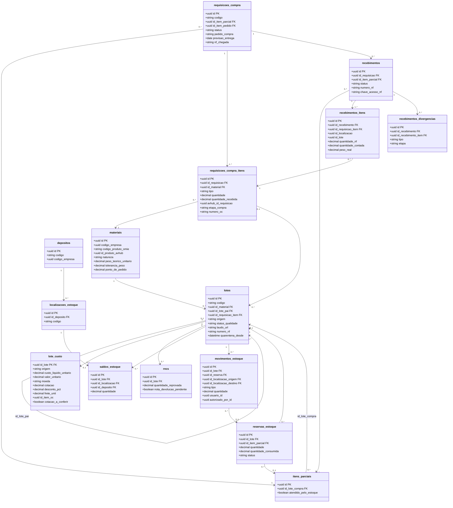
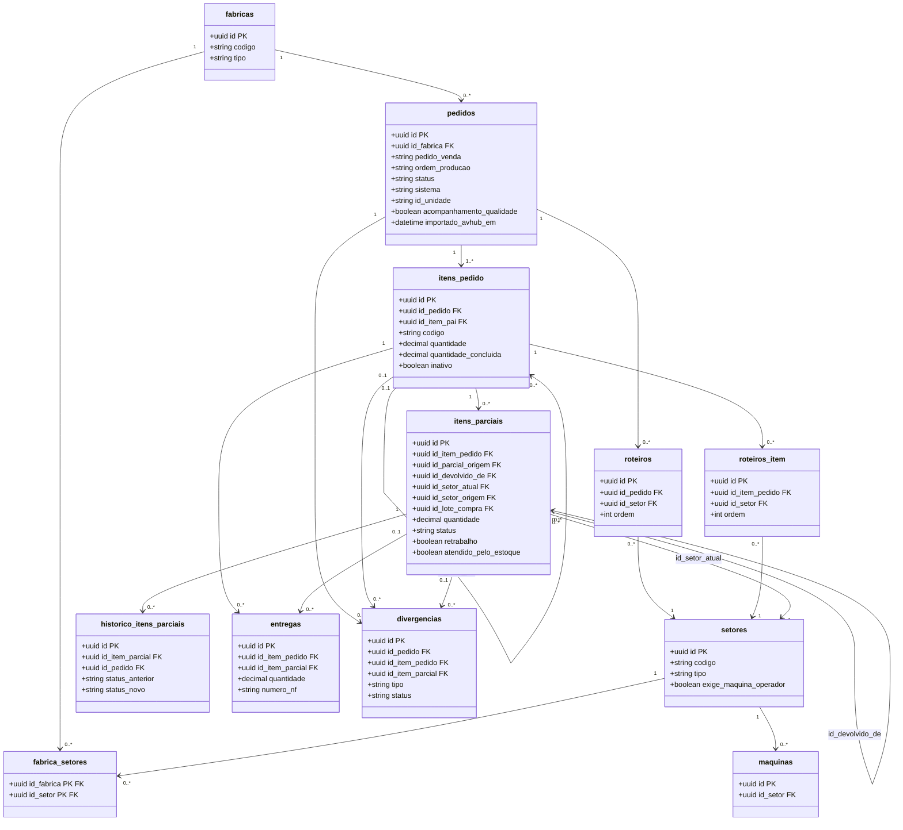
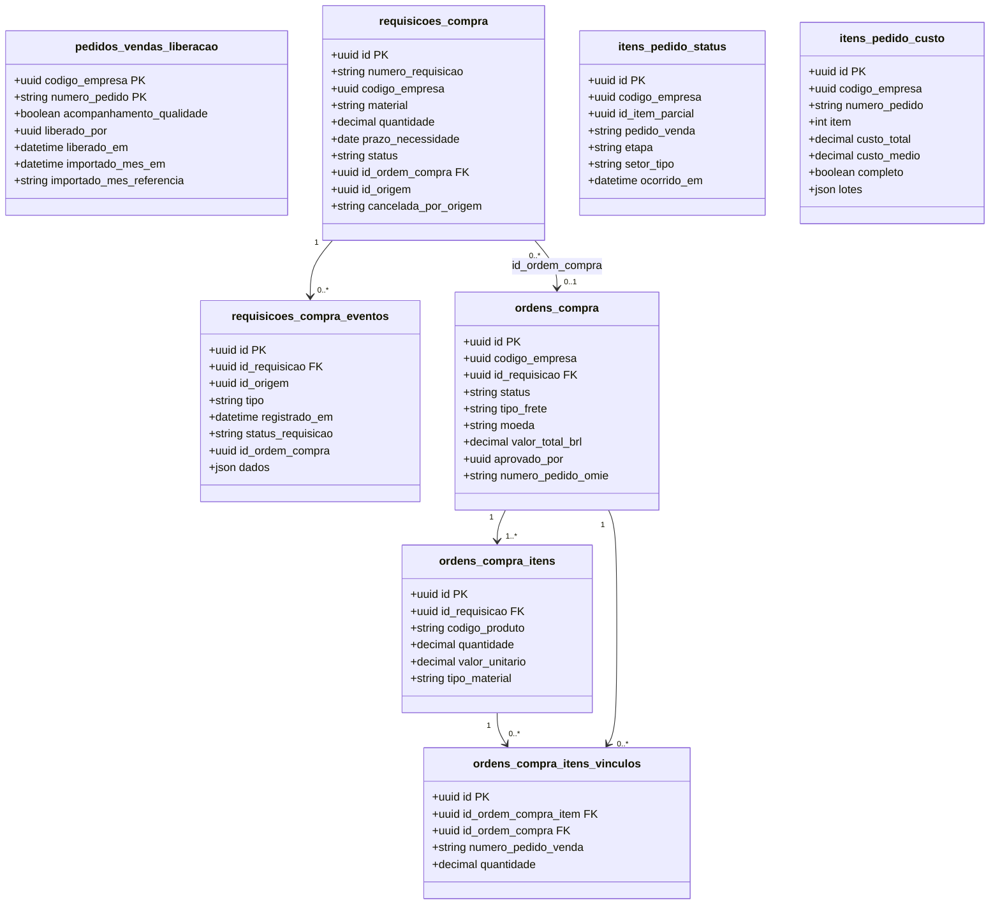
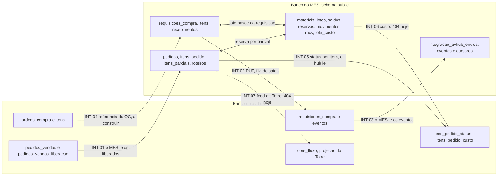

# Modelos de dados (PK e FK)

**Em uma frase:** mostra as tabelas dos dois bancos (MES e av-hub) e como uma aponta para a outra, com os nomes reais do banco.

**Como ler estes diagramas**

- Cada caixa é uma tabela; cada linha dentro dela é uma coluna. `PK` (chave primária) identifica a linha. `FK` (chave estrangeira) aponta para outra tabela.
- Uma seta liga a tabela que "tem" à tabela que "pertence". `1` e `0..*` dizem quantos: um, ou nenhum ou vários.
- Só aparecem as colunas que ligam as tabelas e as que o fluxo 0b usa.
- O último diagrama (o 5) é o mapa simples dos dois bancos. Se você não é técnico, comece por ele.

Dicionário completo: [[Banco-MES]], [[Banco-AvHub]] e [[Modelo-Estoque-e-Custo-do-Lote]]. Destino de cada diagrama do v1: [[Indice-de-Diagramas]].

## 1. MES: Estoque e Compras

Material gera lote; lote tem saldo, movimento, custo e reserva. A requisição de compra gera o recebimento, e o recebimento gera o lote.

✅ Conferido no código. `depositos.codigo_empresa` e `lote_custo` existem agora. Só a carga inicial grava custo no lote 🔴.

## 2. MES: Produção

Pedido tem itens, roteiro e parciais. A parcial é a parte do item que anda de setor em setor. Entregas e divergências ligam ao item e à parcial.

✅ Conferido no código.

## 3. MES: tabelas de integração

Três tabelas guardam a conversa com o av-hub: a fila do que o MES envia, os eventos que ele lê e o ponto onde a leitura parou.

| Tabela | Para quê | Selo |
|---|---|---|
| `integracao_avhub_envios` | Fila de saída da requisição de compra | ✅ |
| `requisicoes_compra_eventos_avhub` | Eventos lidos do av-hub, sem repetição | ✅ |
| `integracao_avhub_cursores` | Ponto onde a leitura parou | ✅ |

## 4. av-hub: tabelas do fluxo 0b

Liberação do pedido, requisições e ordens de compra, e as duas projeções que o hub lê do MES (status e custo por item).

✅ Conferido no Dump Avhub de 14/10 (`core_vendas_faturamento.*`).

- O status da liberação não é uma coluna: é calculado a partir de `importado_mes_em`.
- A requisição criada só no av-hub não gera evento 🔴.
- O custo por item ainda grava por número do item; a troca para produto está pendente 🔴 Gustavo (BL-019).

## 5. Mapa dos dois bancos

Cada seta é uma conversa `INT-xx` entre os dois bancos. A seta mostra quem lê de quem.

✅ Setas cheias existem. 🔴 Setas tracejadas e `INT-06` ainda não funcionam. Rota, chave e cursor de cada seta: [[Integracao-AvHub-MES]].

## Detalhe técnico

Nomes de tabela e coluna como estão no banco: no MES, o `@map` do Prisma de `api-pcp/prisma/models/`; no av-hub, o Dump Avhub de 14/10. Desenhados como `classDiagram` com `PK` e `FK` nos atributos (o `erDiagram` do mermaid não aceita estilo por tabela).

### 1. MES: Estoque e Compras

Selo ✅ `estoque.prisma`, `compras.prisma`. Conferido: `depositos.codigo_empresa` existe agora (`estoque.prisma:69`; o v1 marcava L-09 como pendente); `lote_custo` existe (`estoque.prisma:394-423`); `recebimentos_itens.id_localizacao` e `id_lote` não têm FK no schema (`compras.prisma:218-240`). Em `lote_custo` só a carga inicial grava 🔴.

### 2. MES: Produção

Selo ✅ `producao.prisma`, `fabricas.prisma`. `fabrica_setores` tem PK composta `(id_fabrica, id_setor)` ✅ `fabricas.prisma:158`. Não aparecem `pedido_embalagens`, `pedido_embalagem_pallets`, `pedido_anexos`, `item_parcial_anexos`, `item_parcial_observacoes`, `pedidos_excluidos`, `perfil_setores`, `operadores`.

### 3. MES: tabelas de integração

| Tabela | Colunas-chave | Para quê | Selo |
|---|---|---|---|
| `integracao_avhub_envios` | `id` PK, `tipo`, `id_origem`, `corpo` json, `status`, `tentativas`, `proxima_tentativa_em`, `http_status`, `ultimo_erro` | Fila de saída do PUT do contrato 34; índice `(status, proxima_tentativa_em)` | ✅ `integracao.prisma:33-60` |
| `requisicoes_compra_eventos_avhub` | `id` PK (id do evento do hub), `id_origem`, `id_requisicao_avhub`, `tipo`, `registrado_em`, `status_requisicao`, `dados` json, `processado_em`, `acao` | Eventos lidos do contrato 35, gravados por `id_evento` | ✅ `integracao.prisma:69-110` |
| `integracao_avhub_cursores` | `chave` PK (`requisicoes-eventos`), `alterado_desde`, `apos_id` | Cursor do polling | ✅ `integracao.prisma:112-120` |

### 4. av-hub: tabelas do fluxo 0b

Selo ✅ Dump Avhub de 14/10 (`core_vendas_faturamento.*`). Observações:

- `pedidos_vendas_liberacao` não tem coluna de status: `pendente`, `liberado` e `importado` são calculados pela view `vw_pedidos_liberacao` a partir de `importado_mes_em`.
- `requisicoes_compra.id_origem` é o id do `requisicoes_compra_itens` do MES; vale só para a origem MES. `requisicoes_compra_eventos.id_origem` é `NOT NULL`, por isso a requisição criada só no av-hub não gera evento 🔴 ([[Integracao-AvHub-MES]]).
- `itens_pedido_custo` ainda grava por `item integer` no dump; a migration 047b troca para produto 🔴 Gustavo (BL-019).
- `itens_pedido_status` e `itens_pedido_custo` são projeções lidas do MES pelos jobs de 90 s; `ordens_compra_itens_vinculos` liga o item da OC ao pedido de venda (contrato [[LOG-14b-Compras-Vinculo-Pedido-Venda]]).

### 5. Mapa dos dois bancos

Selo ✅ nas setas cheias; 🔴 nas tracejadas e em `INT-06`. Ver [[Integracao-AvHub-MES]] para rota, chave e cursor de cada seta.
