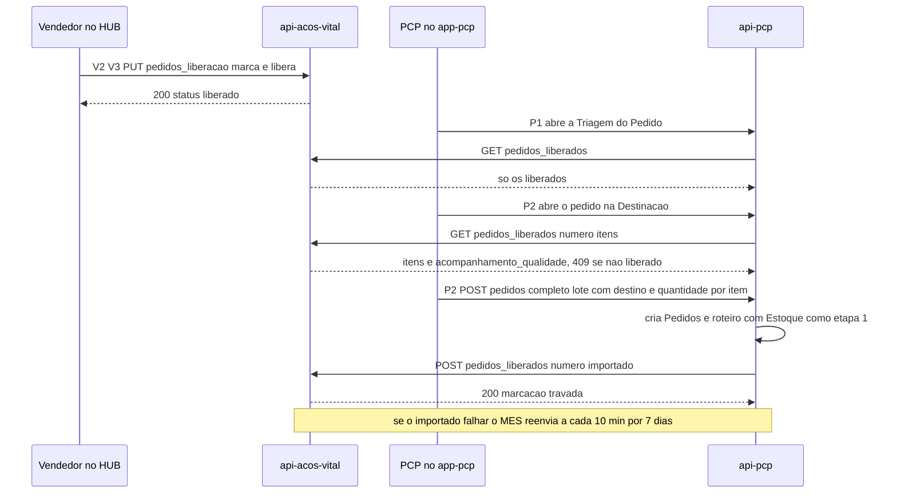
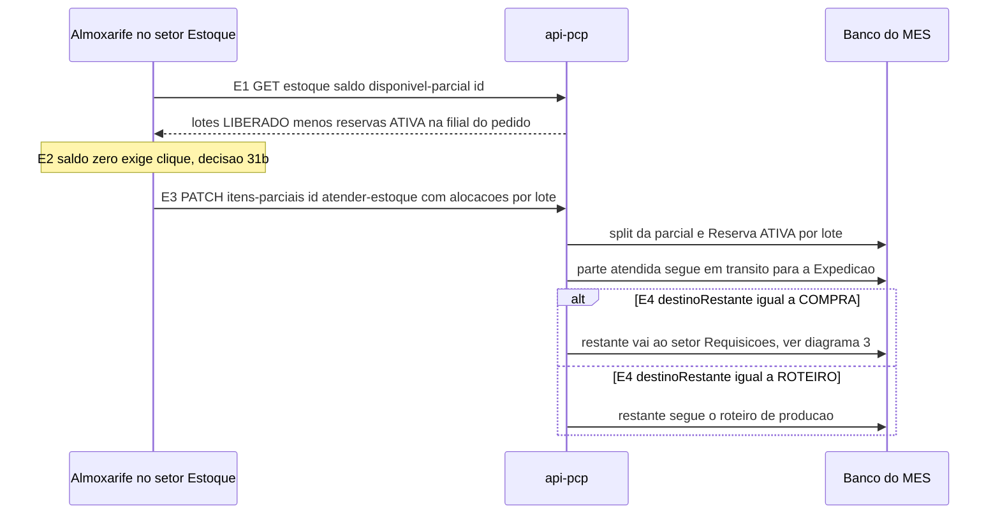
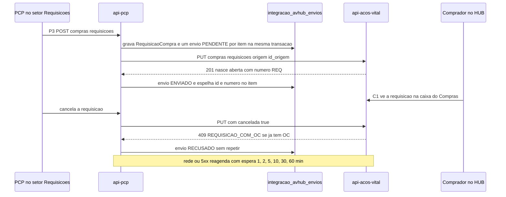
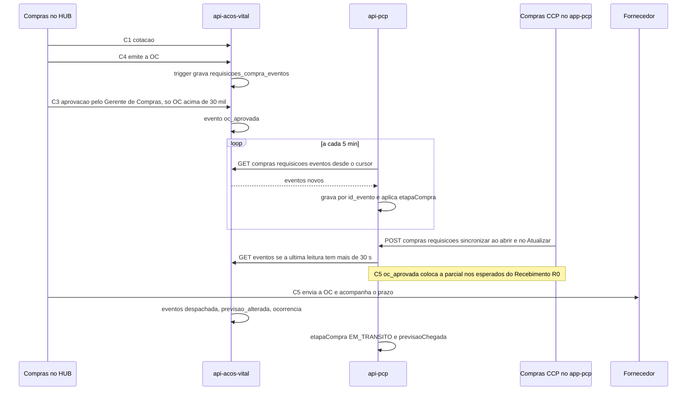
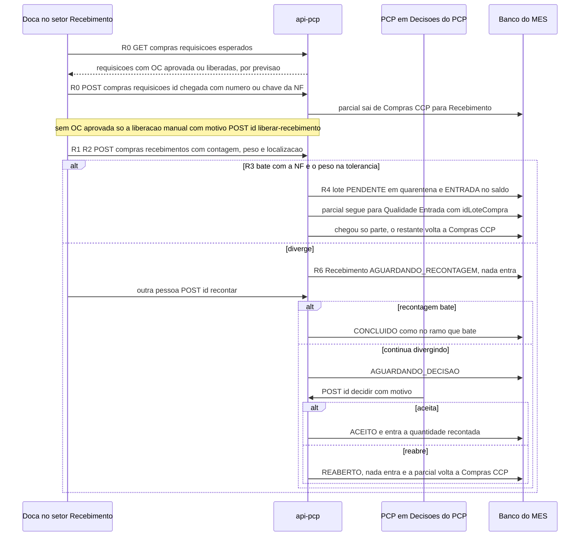
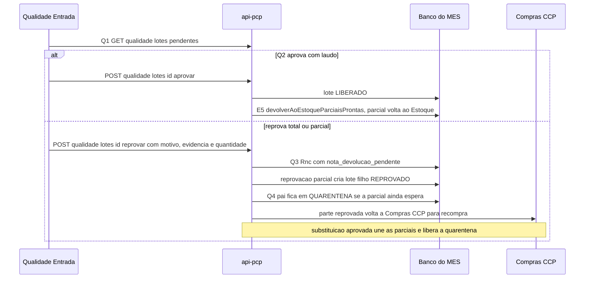
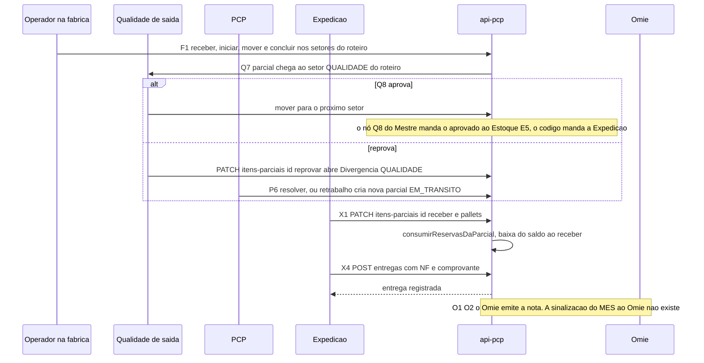
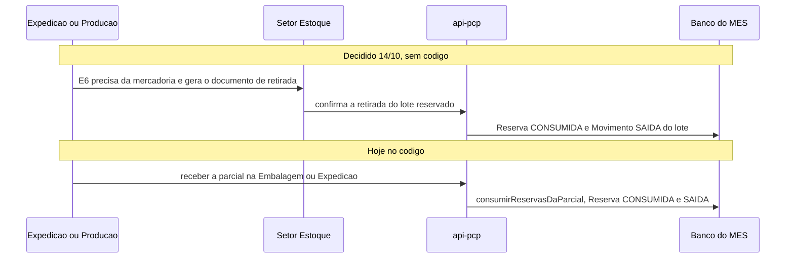

# Diagramas de sequência

Redesenhados a partir do [[00-Fluxo-Mestre-0b]] e conferidos no código de 14/10/2026. Cada mensagem começa com o ID do nó do Mestre quando existe. Visão geral e destino de cada diagrama do v1: [[Indice-de-Diagramas]]. Selos: [[Regras-do-Vault]].

Lista:

1. Do pedido liberado à Destinação (V2 a P2)
2. Atendimento do Estoque (E1 a E4)
3. Requisição de compra, ida (P3) e volta (C1 a C5)
4. Chegada com NF e Recebimento (R0 a R6)
5. Inspeção de entrada e volta ao Estoque (Q1 a Q4, E5)
6. Produção, inspeção de saída e Expedição (F1, Q7, X1 a X4, O1)
7. Despacho do Estoque: hoje e decidido (E6)

## 1. Do pedido liberado à Destinação (V2 a P2)

Fluxo 4 da integração ([[Integracao-AvHub-MES]], INT-01). Só pedido liberado atravessa para o MES.

Selo ✅: rotas em `api-pcp/src/pedidos/pedidos.controller.ts:58,102` e `omie-integracao.ts:331-425` (conferidas na nota de integração).

## 2. Atendimento do Estoque (E1 a E4)

O almoxarife atende a parcial pelo saldo (split e reserva) e decide o destino do restante.

Selo ✅: `itens-parciais.service.ts:607-700` (`atenderEstoque`, `destinoRestante` `'ROTEIRO' | 'COMPRA'`); saldo em `estoque-operacao.controller.ts:46`. 🔴 O custo do item (média dos lotes) não é calculado: não existe `GET /itens/custo` no MES.

## 3. Requisição de compra: ida (P3) e volta (C1 a C5)

Duas origens de requisição ([[00-Fluxo-Mestre-0b]], nós P3 e C0). Este diagrama é a origem PCP; a origem Compras (C0) nasce no av-hub e a requisição não chega ao MES; o MES lê a OC dela pela referência (N14-20, 🔴 ainda não lê; ver [[Integracao-AvHub-MES]]).

### 3.1 Ida (LOG-34)

Selo ✅: `envio-avhub.service.ts:21,98-102,129-175`; resposta do hub `requisicoes_compra.route.js:221-265`.

### 3.2 Volta (LOG-35)

Selo ✅: `eventos-avhub.service.ts:25-27,31,80,150-181`, tratamento por tipo em `requisicao-avhub.eventos.ts:234-318`. 🔴 O MES não recebe fornecedor da OC: falta o job do contrato 004/007.

## 4. Chegada com NF e Recebimento (R0 a R6)

A doca registra a chegada com a NF. A conferência é contra a NF, não contra a OC (decisão do Nathan de 14/10; cruzamento com a OC entra com o job do contrato 004).

Selo ✅: `compras.service.ts:356-402` (chegada exige NF, parcial em `COMPRAS`), `:404-455` (liberar), `recebimento.service.ts:135,249,331`; rotas `recebimento.controller.ts:46,52,62`. 🔴 O custo da OC não é gravado no lote (R4).

## 5. Inspeção de entrada e volta ao Estoque (Q1 a Q4, E5)

Selo ✅: `qualidade.service.ts:83-100` (aprovar), `:102-262` (reprovar, quarentena em `:243`), `circuito-compra.ts:166-` (união e volta ao Estoque). 🟡 A recompra por RNC não tem contrato com o av-hub.

## 6. Produção, inspeção de saída e Expedição (F1, Q7, X1 a X4, O1)

Selo ✅: `itens-parciais.controller.ts:206-229` (reprovar, resolver, retrabalho), `itens-parciais.service.ts:279` e `entregas.service.ts:88` (baixa). 🟡 Q8 (aprovado volta ao Estoque) e X3 (consolidar carga) sem código. 🔴 Sinalização de faturamento (11.1).

## 7. Despacho do Estoque: hoje e decidido (E6)

📝 Decisão do Nathan de 14/10. 🔴 Não existe documento de retirada nem tela; hoje a baixa é na Embalagem/Expedição (`itens-parciais.service.ts:274-282`). Dono: Robert ([[03-Estoque-Atendimento-e-Despacho]]).
