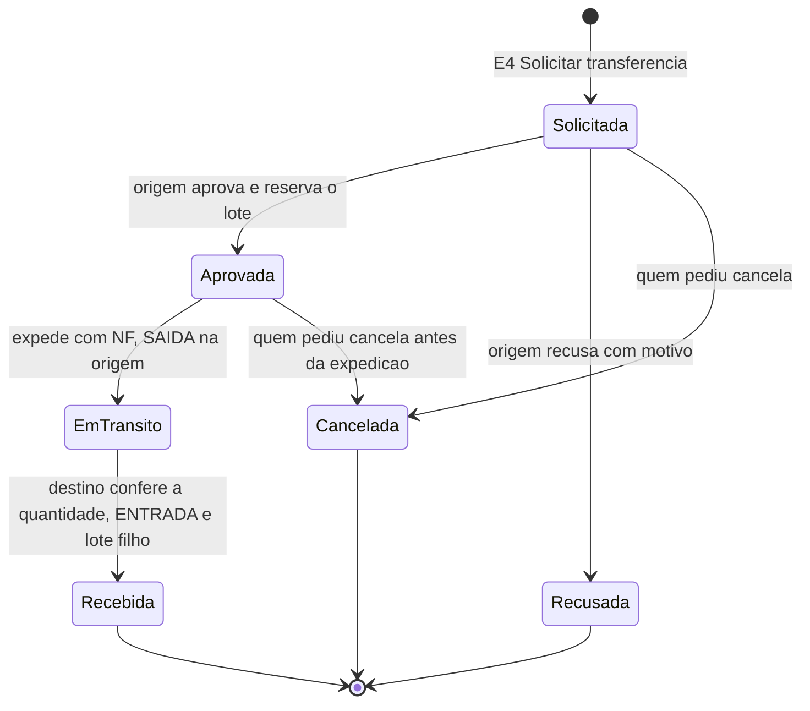

# Transferência de estoque entre filiais (Ciclo 2)

Fora do fluxo 0b. Hoje, quando um pedido de Mogi não tem saldo em Mogi, o único caminho é solicitar compra (nó `E4`), mesmo com o material parado em outra filial. A proposta cria a transferência com aprovação. **A etapa 1 (ver o saldo das outras filiais) está no código; as etapas 2 a 4 entram no Ciclo 2, que começa em 22/01/2027** 📝 ([[Cronograma]]). Dono: Robert.

## Decisões

| # | Decisão | Selo |
|---|---|---|
| 1 | Todo depósito tem filial | 📝 06/10 |
| 2 | O mesmo produto nas filiais é o mesmo `codigo_produto` (não o `codigo_produto_omie`, que muda por conta Omie) | 📝 06/10 |
| 3 | Quem envia aprova na origem e só então gera a NF | 📝 07/10 |
| 4 | Aprova o estoque da filial de origem | 📝 06/10 |
| 5 | O destino confere só a quantidade; o lote filho herda o status do pai | 📝 06/10 |
| 6 | O número da NF chega ao MES pelo av-hub (o gateway do Omie avisa), não é digitado | 📝 07/10 |
| 7 | O atendimento sugere transferir antes de requisitar compra quando há saldo em outra filial | 📝 06/10 |

## O que existe no código (etapa 1)

| Item | Estado | Selo |
|---|---|---|
| `Deposito.codigoEmpresa` e `nomeUnidade` (filial do depósito) | Existem; o cadastro novo exige | ✅ `estoque.prisma:69-70` |
| Saldo das outras filiais no Atendimento | `disponiveisParaParcial` devolve `outrasFiliais`, inclusive quando a filial do pedido não tem o material | ✅ `estoque-operacao.service.ts:107-147` |
| Modal "Atender pelo estoque" mostra o saldo fora | Filtra `quantidadeDisponivel > 0` | ✅ `AtenderEstoqueModal.tsx:216` |
| Movimento `TRANSFERENCIA` | Existe só **entre localizações**, com depósito e localização de origem e destino; exige permissão de atuar nos dois depósitos | ✅ `estoque-operacao.service.ts:624-640` |
| Lote filho com `idLotePai`, reserva, cisão | Existem (usados por Qualidade e Atendimento) | ✅ `estoque.prisma` |
| Botão "Solicitar transferência", solicitação, aprovação, expedição, recebimento, "em trânsito", consulta e métricas | Não existem; não há model de solicitação no Prisma | 🔴 (`grep` de `SolicitacaoTransfer` e `solicitarTransfer` em `api-pcp` e `app-pcp`: nenhum resultado) |

## Fluxo proposto

O saldo só muda de filial em dois pontos: sai da origem na expedição, com a NF; entra no destino na conferência. Até a expedição a solicitação pode ser recusada pela origem ou cancelada por quem pediu; a reserva é liberada e o parcial volta às opções de sempre.

Selo 🟡 proposta, sem código. Regras: nada se cria nem some (o que sai é o que entra, ligado pelo lote); em trânsito o material não conta no saldo de nenhuma filial; lote em quarentena ou reprovado não transfere; diferença no recebimento exige ajuste com motivo na origem; quando nasce de um parcial, o lote recebido já é reservado para ele; sem pedido, o mesmo fluxo serve para reposição entre filiais.

## Etapas

| Etapa | O que entrega | Selo |
|---|---|---|
| 1 | Saldo por filial e saldo das outras filiais no Atendimento | ✅ concluída (`develop`, v1: `861c050`) |
| 2 | Solicitação, aprovação, expedição e recebimento (tabela de solicitações, botão, fila na origem, recebimento no destino, reserva e lote filho) | 🔴 Ciclo 2, depende da NF via av-hub (decisão 6) |
| 3 | Tela de consulta e métricas (tempo por etapa, compras evitadas) | 🔴 Ciclo 2 |

## Pendências

- Como o gateway do Omie avisa o MES da NF de transferência (decisão 6): sem rota nem contrato; o MES nunca fala com o Omie ([[Integracao-AvHub-MES]]) 🔴 Gustavo e Robert.
- Cadastro: um material por filial (`codigo_empresa` mais código Omie), então a busca do mesmo produto na outra filial é por `codigo_produto` ✅ (`disponivelOutrasFiliais` recebe `itemPedido.codigo`).
